# Pharma Safety Intake & Triage Tracker
## Architecture, Workflows & Complete Understanding Guide

> Read this file to understand **what this project is**, **why it exists**, **what problem it solves**, **how every user/admin scenario flows**, and **how to approach building it**.  
> All Mermaid diagrams render in GitHub, VS Code, Cursor preview, and most Markdown viewers.

---

# PART A — Understand the Capstone First

## A1. What is this project?

It is a **local training web application** for a fictional pharmaceutical company.

Operators receive **product quality complaints** and **suspected adverse event** reports (email/phone → human types into the app). The app must:

1. Capture the report with mandatory fields  
2. Give each report a unique ID (`REF-2026-XXXX`)  
3. Let reviewers move status: **New → In Review → Closed**  
4. Keep an **audit log** of who did what  
5. Let users **ask historical questions** over past reports + SOP documents using a **4-stage Hybrid RAG** pipeline  
6. Run those actions through a **safe agent control plane** (validation, routing, HITL, circuit breaker)

It is **NOT** a real hospital system, **NOT** a doctor, and **NOT** a regulatory decision engine.

---

## A2. Why does this project exist? (The real teaching goal)

There are **two goals** at once:

| Goal | Meaning |
|---|---|
| **Product goal** | Build a working Streamlit intake + triage + RAG app |
| **Process goal** | Learn **AI-assisted engineering with governance**: CLAUDE.md, Plan Mode, review skills, hooks, tests |

PwC-style capstones often test whether you can **use AI tools safely and systematically**, not only whether the UI works.

---

## A3. What problem does it solve?

### Business problem (story)
Today, intake staff use **many Excel sheets**. That causes:

- Missing mandatory fields  
- No clear review status  
- Weak audit trail  
- No smart search over past cases / SOPs  

### Your solution
One **local Streamlit app** + **SQLite** + **validation** + **workflow** + **audit** + **hybrid RAG knowledge agent**.

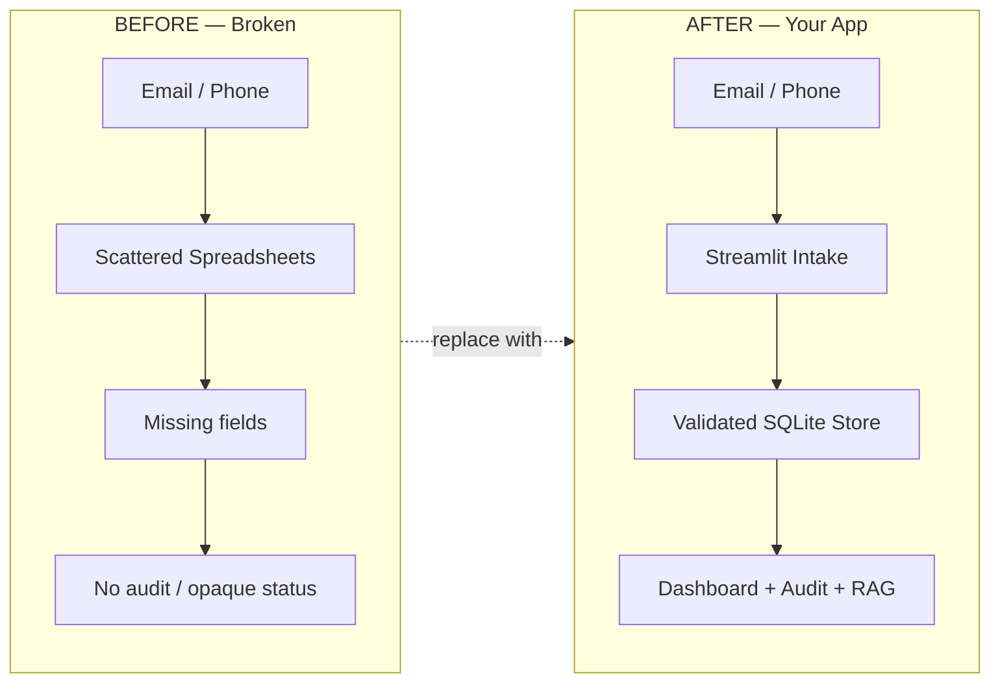

---

## A4. What it must NEVER do (critical)

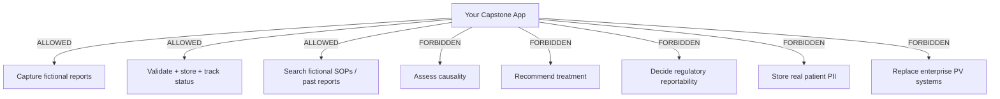

**Data rule:** synthetic / fictional data only.

---

## A5. Roles in the system (who uses what)

| Role | What they do in the UI |
|---|---|
| **Intake Operator** | Fill new report form, see validation errors, save report |
| **Triage Reviewer / Admin** | Filter dashboard, change status, approve Close (HITL) |
| **Knowledge Admin** | Inject / upload fictional SOP documents into the knowledge base (chunk → embed → vector store) |
| **Query User** | Ask historical questions (“past LOT-88392 cases?”, “SOP quarantine steps?”) |
| **Developer (you)** | Build app + governance artifacts + tests |

> “Admin panel” in this capstone = a **Knowledge / Document Admin** page in Streamlit (local), not a cloud console.

---

# PART B — Big Picture Architecture

## B1. System architecture (all layers)

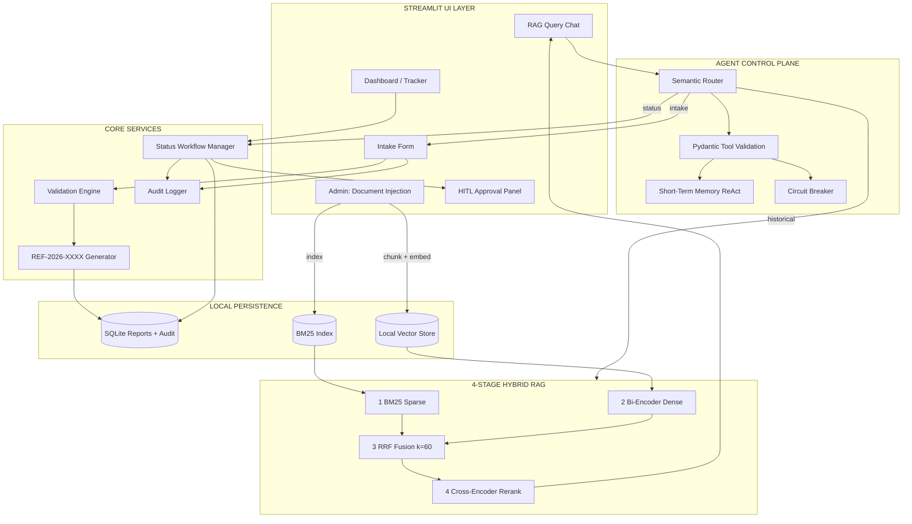

---

## B2. How folders should look (target project shape)

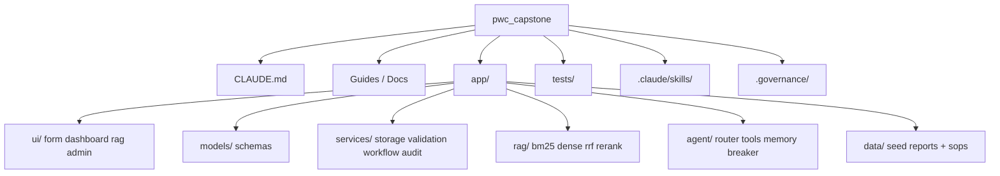

**Concrete tree:**

```
pwc_capstone/
├── CLAUDE.md
├── ARCHITECTURE_AND_WORKFLOWS.md   ← this file
├── CAPSTONE_COMPLETE_GUIDE.md
├── docs/IMPLEMENTATION_PLAN.md
├── app/
│   ├── main.py                     # Streamlit multipage entry
│   ├── ui/
│   │   ├── intake_form.py
│   │   ├── dashboard.py
│   │   ├── rag_chat.py
│   │   └── admin_docs.py           # document injection panel
│   ├── models/schemas.py
│   ├── services/
│   ├── rag/
│   ├── agent/
│   └── data/sops/ + seed_reports/
├── tests/
├── .claude/skills/pharma-intake-review/SKILL.md
└── .governance/edit-audit.jsonl
```

---

## B3. Data model (what is stored where)

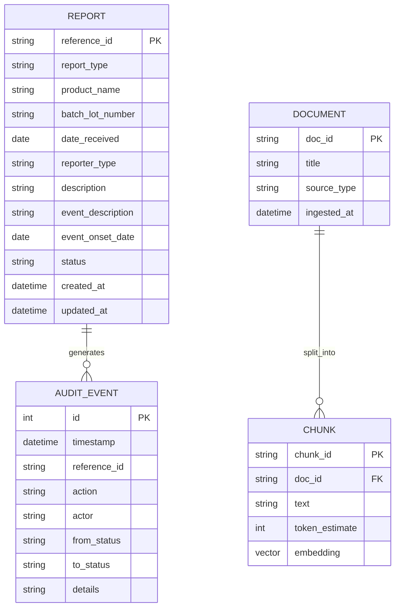

| Store | Holds |
|---|---|
| **SQLite** | Reports, status, audit events, document metadata |
| **BM25 index** | Same chunk texts for keyword search |
| **Vector store** | Chunk embeddings for semantic search (local files / sqlite-vec / chroma local / faiss local) |

---

# PART C — All Scenario Workflows (User → Response)

## C1. Scenario Map (which path for which intent)

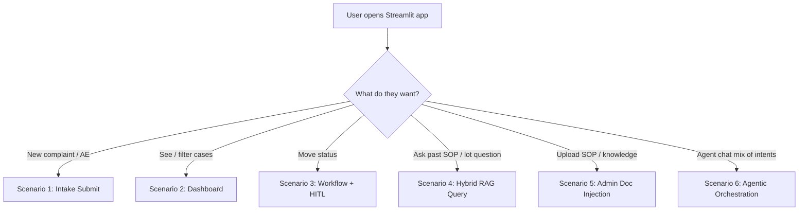

---

## C2. Scenario 1 — Intake Form (User data → Saved report)

**Actors:** Intake Operator  
**Input:** Form fields  
**Output:** `REF-2026-XXXX` saved + audit “created”

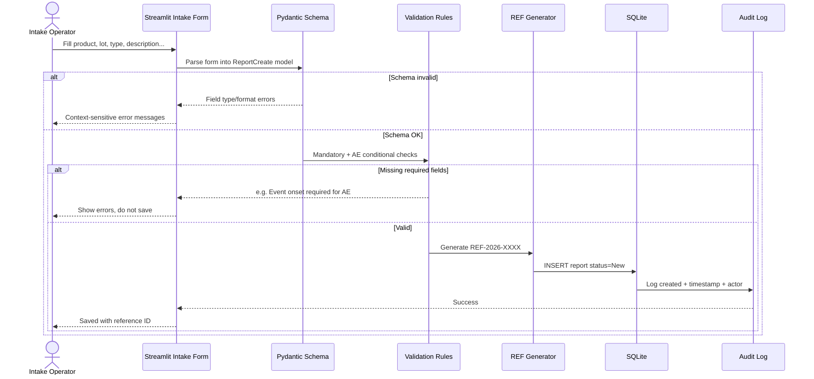

### Validation logic (plain English)

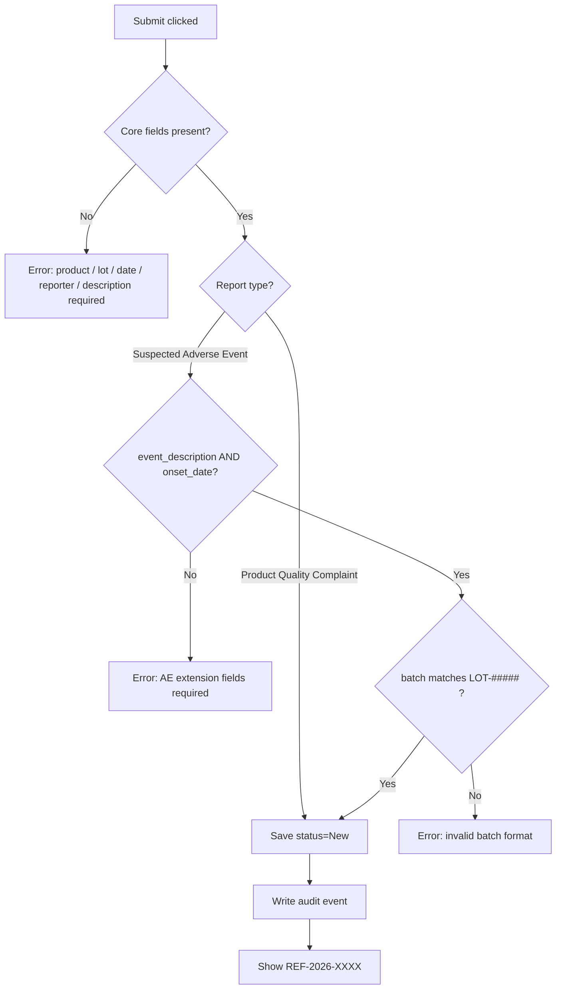

---

## C3. Scenario 2 — Dashboard (List + Filter)

**Actors:** Reviewer  
**Input:** Filters (status, report type)  
**Output:** Filtered table

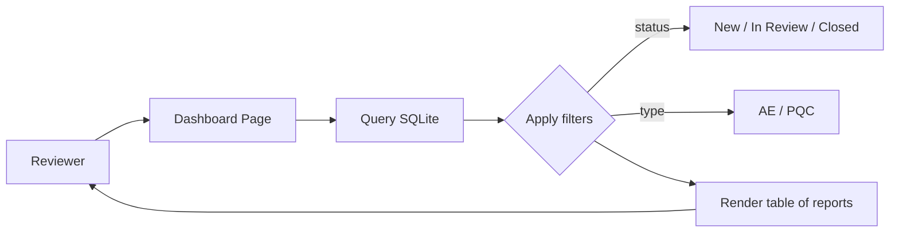

---

## C4. Scenario 3 — Status Lifecycle + HITL Close Gate

**Actors:** Triage Reviewer  
**Rule:** `In Review → Closed` **requires human approval** recorded in audit.

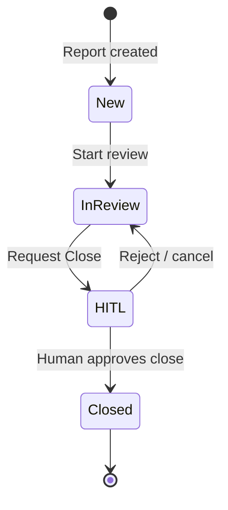

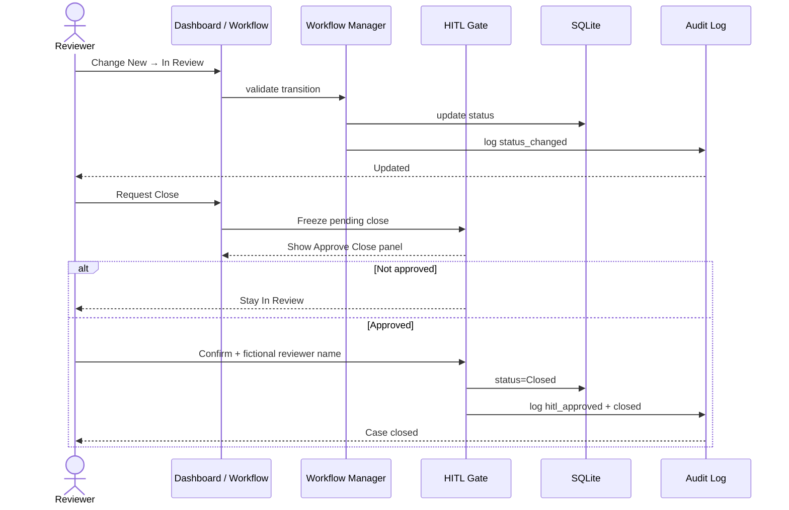

**Illegal transitions (must reject):** New→Closed, Closed→New, Closed→In Review (unless you explicitly design reopen — default = reject).

---

## C5. Scenario 4 — Hybrid RAG Query (Question → Grounded Answer)

**Actors:** Any user asking historical / SOP questions  
**Input:** Natural language query  
**Output:** Answer grounded on Top-3..Top-5 chunks only

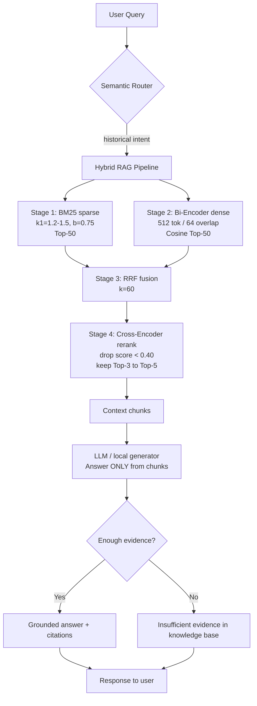

### Why 4 stages? (simple)

| Stage | Catches | Example |
|---|---|---|
| BM25 | Exact codes / lots | `LOT-88392`, `Anaphylaxis` |
| Bi-Encoder | Meaning / synonyms | “hard to breathe” → dyspnea SOP text |
| RRF | Merge both lists fairly | One ranked pool |
| Cross-Encoder | Precision filter | Only strong matches go to the LLM |

---

## C6. Scenario 5 — Admin Panel: Document Injection → Vector DB

This is the part many students miss. **RAG cannot answer about SOPs unless someone puts documents into the knowledge base.**

**Actors:** Knowledge Admin  
**Input:** Upload `.txt` / `.md` fictional SOP (or paste text)  
**Output:** Chunks in BM25 index + embeddings in local vector store

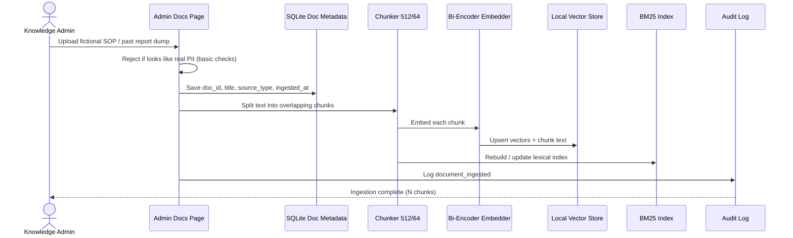

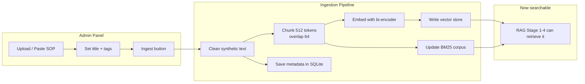

### Admin panel fields (suggested)

| Field | Purpose |
|---|---|
| Document title | e.g. “SOP-QUARANTINE-LOT-v1” |
| Source type | `SOP` / `Past Report Digest` / `Training Note` |
| File upload or text area | Content to index |
| Tags | e.g. `lot`, `complaint`, `packaging` |
| Ingest status | chunks created, timestamp |

---

## C7. Scenario 6 — Full Agentic Orchestration (Chat → Tool → Response)

When the user talks to the **agent**, every message goes through the **5-step control plane**.

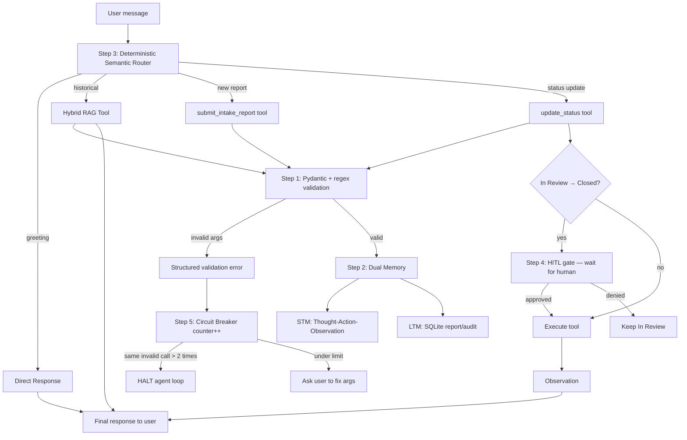

### Circuit breaker detail

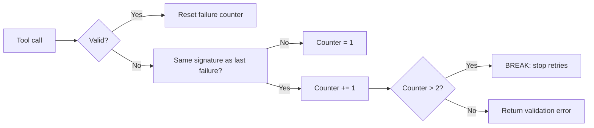

---

# PART D — End-to-End “Day in the Life” Story

Use this story to demo the whole system:

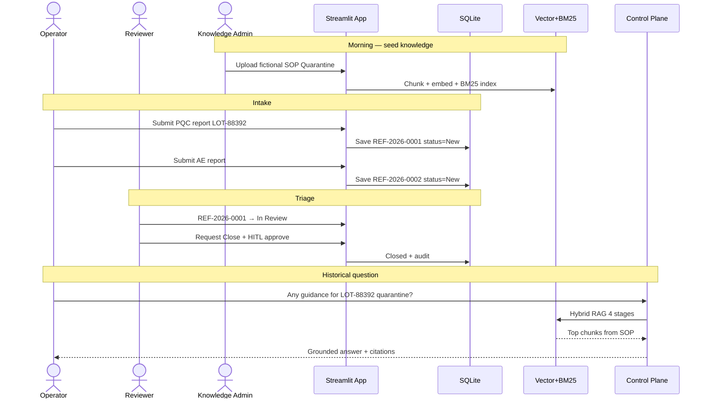

---

# PART E — Requirements Explained Clearly

## E1. Functional requirements (must work)

| ID | Requirement | How you prove it |
|---|---|---|
| F1 | Auto `REF-2026-XXXX` | Create report → ID appears |
| F2 | Two report types | AE and PQC selectable |
| F3 | Core fields captured | Form + DB columns |
| F4 | AE extension fields | Shown/required only for AE |
| F5 | Mandatory validation | Empty submit shows clear errors |
| F6 | Dashboard + filters | Filter by status and type |
| F7 | Status lifecycle | Only allowed transitions |
| F8 | Local audit trail | Create/status/HITL logged |
| F9 | Hybrid RAG 4 stages | Query returns grounded result |
| F10 | Admin doc injection | Upload SOP → searchable |
| F11 | Agent router + tools | Intents routed correctly |
| F12 | HITL on close | Cannot close without approval |
| F13 | Circuit breaker | 3rd identical invalid call stops |

## E2. Non-functional / boundary requirements

| ID | Requirement |
|---|---|
| N1 | Python 3.10+ / Streamlit |
| N2 | SQLite or JSON local storage |
| N3 | No cloud / no remote DB / no external production APIs (local models or offline fixtures) |
| N4 | Synthetic data only; no real PII |
| N5 | Never make clinical/regulatory decisions |

## E3. Governance deliverables (also required)

| ID | Artifact |
|---|---|
| G1 | Root `CLAUDE.md` |
| G2 | Plan Mode implementation plan |
| G3 | `.claude/skills/pharma-intake-review/SKILL.md` |
| G4 | PostToolUse hook + governance edit log |
| G5 | Automated tests |
| G6 | Demo walkthrough evidence |

---

# PART F — How to Approach This Project (Step-by-Step)

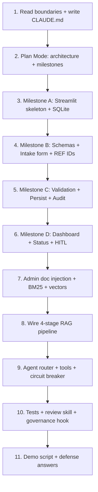

### Practical tips
1. **Build CRUD + workflow first** — RAG/agent are useless without saved reports and audit.  
2. **Seed 5–10 fictional SOPs** early so RAG has something to retrieve.  
3. **Keep router rule-based** at first (keywords) so it is deterministic and testable.  
4. **Log everything important** (create, status, HITL, ingest, breaker trip).  
5. **Write tests alongside** each milestone, not at the end.

---

# PART G — UI Pages You Should Have

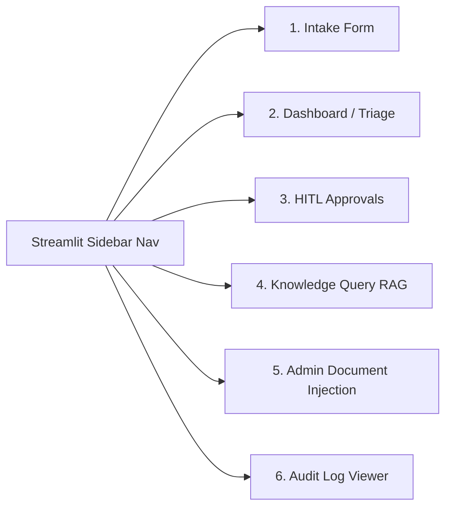

| Page | Primary job |
|---|---|
| Intake Form | Create reports |
| Dashboard | List / filter / start review |
| HITL Approvals | Approve Close requests |
| Knowledge Query | Ask RAG questions |
| Admin Docs | Inject SOPs into vector + BM25 |
| Audit Viewer | Prove immutability / traceability |

---

# PART H — Defense Cheat Sheet (short answers)

1. **CLAUDE.md vs skills?** Always-on constitution vs on-demand review checklist.  
2. **Plan Mode value?** Clarifies data flow + edge cases before code.  
3. **Hooks deterministic?** Fixed event logging, no LLM judgment.  
4. **Why hybrid RAG?** Keywords + meaning + fusion + precision rerank → less hallucination.  
5. **Production gap?** Auth, encryption, real PV integration, GxP/Part 11, PHI controls, HA — not in this prototype.

---

# PART I — One Diagram to Remember Everything

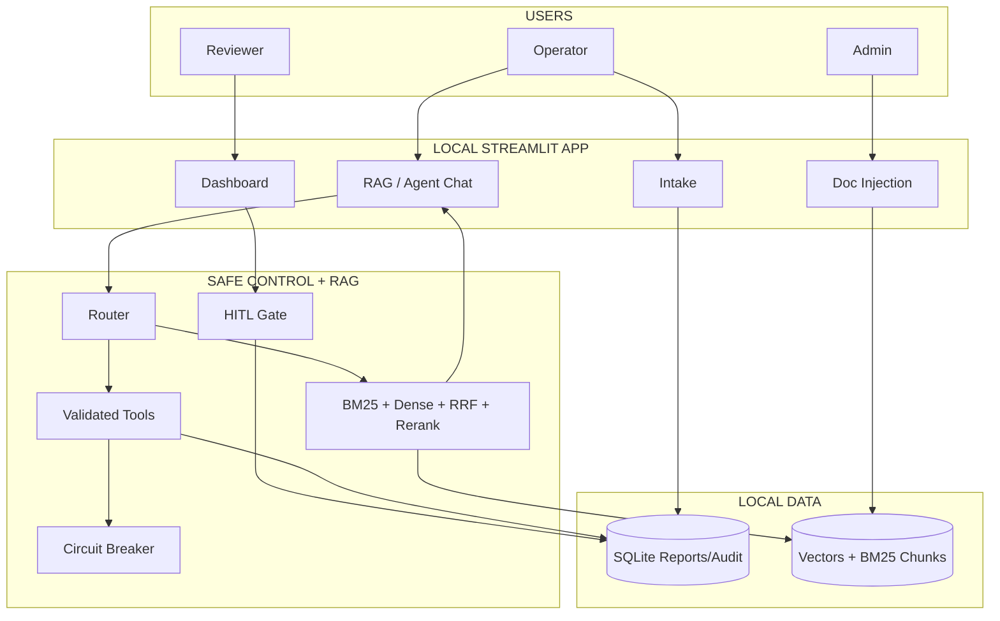

---

## Final takeaway

| Question | Answer |
|---|---|
| **What is it?** | Local pharma intake + triage + RAG training app |
| **Why?** | Fix spreadsheet chaos + teach governed AI engineering |
| **What problem?** | Missing fields, opaque review, weak audit, no knowledge search |
| **How to approach?** | Boundaries → plan → CRUD/workflow → admin ingest → RAG → agent → tests/governance |
| **What must you show?** | Working app + CLAUDE.md + plan + skill + hook log + tests + demo |

---

*Next files to create when you start building: `CLAUDE.md`, then `docs/IMPLEMENTATION_PLAN.md`.*
