# Pharma Safety Intake Tracker
## Every Scenario Explained With Real (Fictional) Examples

> This file uses **story-style examples** so you can see exactly what happens.  
> All names, lots, and events are **FAKE / TRAINING ONLY**.

---

# Before You Read — The App in One Story

Imagine a fictional company: **NovaCure Pharma**.

People call or email about:
- A **broken bottle** → Product Quality Complaint (PQC)
- Someone feeling **dizzy after taking a tablet** → Suspected Adverse Event (AE)

Your app is the place where staff **type that information**, **track review**, and **search old SOPs**.

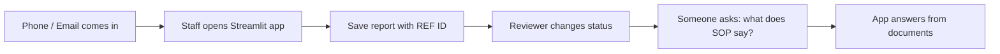

---

# Scenario Index

| # | Scenario | Who | Simple meaning |
|---|---|---|---|
| 1 | New Product Quality Complaint | Operator Maya | Broken packaging report |
| 2 | New Suspected Adverse Event | Operator Maya | Dizziness report (extra fields) |
| 3 | Validation failure | Operator Maya | Form rejected with clear errors |
| 4 | Dashboard filtering | Reviewer Arjun | Find only “In Review” AE cases |
| 5 | Status change New → In Review | Reviewer Arjun | Start triage |
| 6 | Close with HITL approval | Reviewer Arjun + Approver Priya | Cannot close without human OK |
| 7 | Illegal status jump blocked | Reviewer Arjun | New → Closed is rejected |
| 8 | Admin uploads an SOP | Admin Sam | Document enters vector + BM25 |
| 9 | RAG question about a lot | Operator Maya | Hybrid search returns grounded answer |
| 10 | RAG finds nothing useful | Operator Maya | App says “insufficient evidence” |
| 11 | Agent greeting | Anyone | Direct reply, no tools |
| 12 | Agent creates report via tool | Operator Maya | Router → intake tool → validate → save |
| 13 | Circuit breaker trips | Agent loop | Same bad tool call 3 times → STOP |

---

# SCENARIO 1 — New Product Quality Complaint

## Real example story
Customer emails: *“Bottle of NeuroCalm 50mg, lot LOT-88392, seal was broken.”*  
Operator **Maya** enters it as a **Product Quality Complaint**.

## Example form data Maya enters

| Field | Value Maya types |
|---|---|
| Report type | Product Quality Complaint |
| Product name | NeuroCalm 50mg |
| Batch / Lot | LOT-88392 |
| Date received | 2026-11-02 |
| Reporter type | Consumer |
| Description | Bottle seal was broken on arrival. No tablets missing. |
| Event description | *(hidden / not required for PQC)* |
| Event onset date | *(hidden / not required for PQC)* |

## What the system does

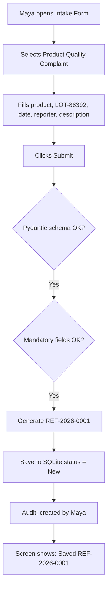

## Example result in database

```text
reference_id : REF-2026-0001
report_type  : Product Quality Complaint
product_name : NeuroCalm 50mg
batch_lot    : LOT-88392
status       : New
```

## Example audit row

```text
2026-11-02 14:05 | REF-2026-0001 | created | actor=Maya | status=New
```

**Takeaway:** PQC needs core fields only. No patient-event fields.

---

# SCENARIO 2 — New Suspected Adverse Event

## Real example story
Doctor calls: *“Patient felt dizzy one day after starting CardioSafe 10mg, lot LOT-12045.”*  
(Still fictional — no real patient name stored.)

## Example form data

| Field | Value |
|---|---|
| Report type | Suspected Adverse Event |
| Product name | CardioSafe 10mg |
| Batch / Lot | LOT-12045 |
| Date received | 2026-11-02 |
| Reporter type | Healthcare Professional |
| Description | Reporter states dizziness after first doses. No real patient identifiers recorded. |
| Event description | Dizziness / lightheadedness |
| Event onset date | 2026-10-28 |

## Flow

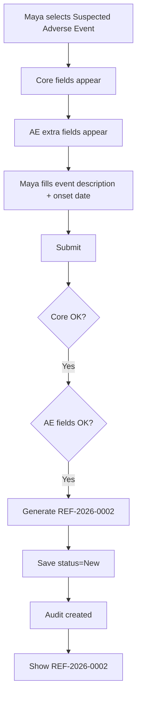

## Why AE is different from Scenario 1

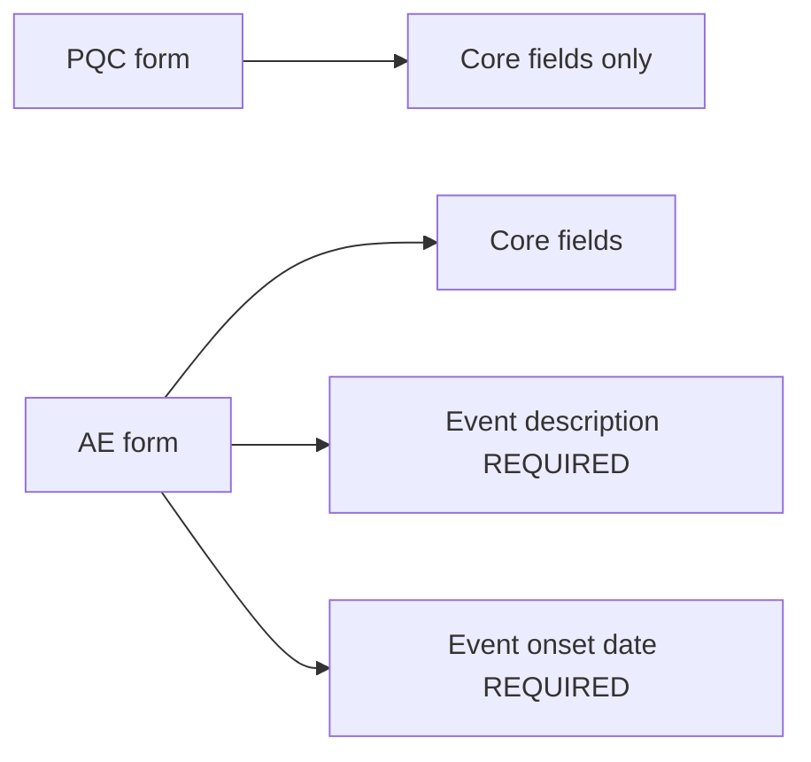

**Takeaway:** Same app, different required fields based on report type.

---

# SCENARIO 3 — Validation Failure (Bad / Incomplete Data)

## Real example story
Maya is rushed and clicks Submit with empty lot and no onset date on an AE.

## What Maya entered (broken)

| Field | Value |
|---|---|
| Report type | Suspected Adverse Event |
| Product name | CardioSafe 10mg |
| Batch / Lot | *(empty)* |
| Date received | 2026-11-02 |
| Reporter type | Consumer |
| Description | Felt sick |
| Event description | Nausea |
| Event onset date | *(empty)* |

## Flow

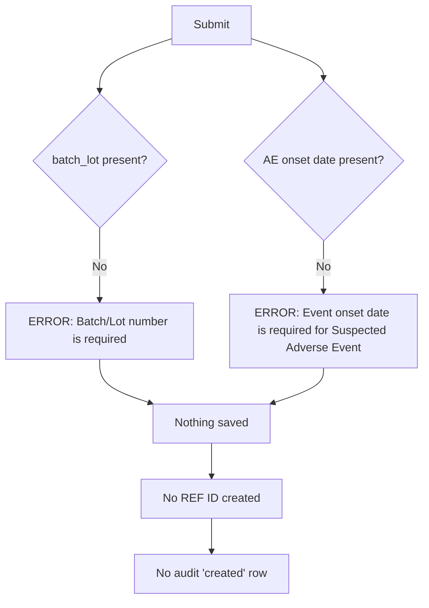

## Example error messages on screen

```text
❌ Batch/Lot number is required.
❌ Event onset date is required for Suspected Adverse Event reports.
```

## Another bad example — wrong lot format

Maya types `88392` instead of `LOT-88392`.

```mermaid
flowchart LR
  IN[batch = 88392] --> V{Matches ^LOT-\d{5}$ ?}
  V -->|No| ERR[ERROR: Batch must look like LOT-12345]
  V -->|Yes| OK[Continue]
```

**Takeaway:** Invalid data never becomes a report. Errors must be specific, not just “invalid”.

---

# SCENARIO 4 — Dashboard Filtering

## Real example story
After lunch, SQLite has these reports:

| REF | Type | Status | Product |
|---|---|---|---|
| REF-2026-0001 | PQC | New | NeuroCalm 50mg |
| REF-2026-0002 | AE | New | CardioSafe 10mg |
| REF-2026-0003 | AE | In Review | PainAway Gel |
| REF-2026-0004 | PQC | Closed | NeuroCalm 50mg |

Reviewer **Arjun** wants only **AE + In Review**.

## Flow

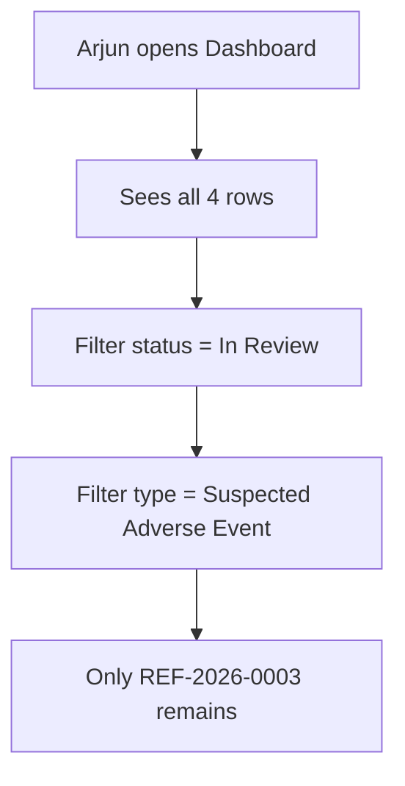

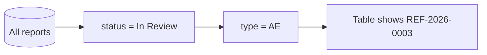

**Takeaway:** Dashboard is a tracker, not a medical decision tool.

---

# SCENARIO 5 — Status Change: New → In Review

## Real example story
Arjun opens `REF-2026-0001` (broken seal PQC) and starts review.

## Before / After

| | Before | After |
|---|---|---|
| Status | New | In Review |
| Audit | created | + status_changed |

## Flow

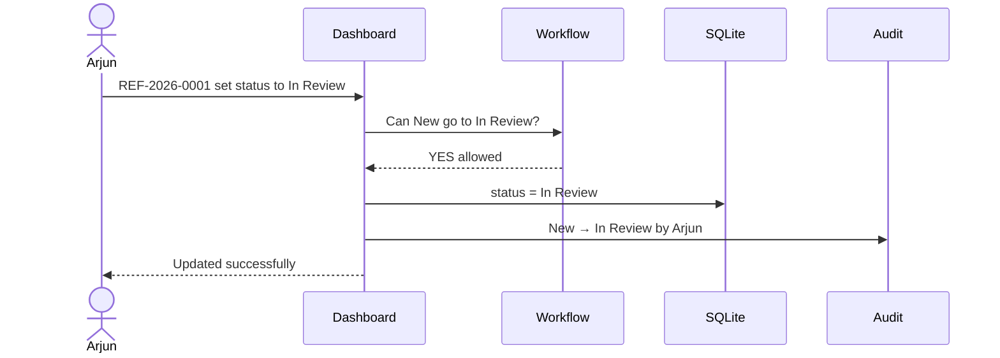

## Example audit

```text
2026-11-02 15:10 | REF-2026-0001 | status_changed | Arjun | New → In Review
```

**Takeaway:** Only allowed transitions succeed.

---

# SCENARIO 6 — Close Case With HITL (Human Approval)

## Real example story
Arjun finishes review of `REF-2026-0001` and wants **Closed**.  
System **freezes** until Approver **Priya** confirms.

## Why HITL exists
Closing means “intake triage finished” in this training app.  
A human must confirm — the AI/agent cannot silently close.

## Flow

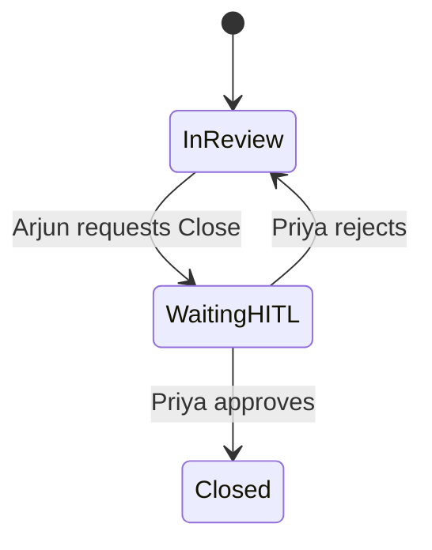

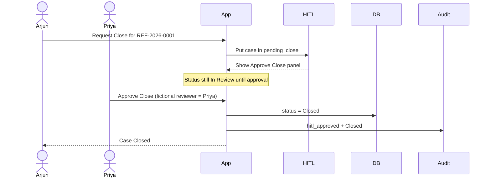

## Example screens

**Arjun sees:**
```text
REF-2026-0001 is waiting for Close approval.
Status: In Review (pending HITL)
```

**Priya clicks:**
```text
[✓] I confirm triage close for training record REF-2026-0001
Approver name: Priya
[Approve Close]
```

## Example audit rows

```text
15:40 | REF-2026-0001 | close_requested | Arjun
15:42 | REF-2026-0001 | hitl_approved   | Priya
15:42 | REF-2026-0001 | status_changed  | In Review → Closed
```

**Takeaway:** `In Review → Closed` always needs a human gate.

---

# SCENARIO 7 — Illegal Transition Blocked

## Real example story
Arjun tries to jump `REF-2026-0002` from **New** straight to **Closed**.

## Flow

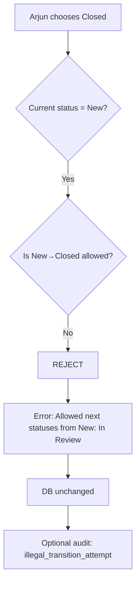

## Example error

```text
❌ Invalid transition: New → Closed is not allowed.
   Allowed from New: In Review
```

**Takeaway:** Workflow rules are hard-coded / enforced, not free-text status.

---

# SCENARIO 8 — Admin Document Injection (SOP → Vector DB)

## Real example story
Knowledge Admin **Sam** uploads a fictional SOP so people can ask questions later.

## Example document Sam uploads

**Title:** `SOP-LOT-QUARANTINE-001`  
**Source type:** SOP  
**Content (fictional):**

```text
NovaCure Pharma — Training SOP (Fictional)
If a packaging integrity complaint is received for a finished pack,
quarantine the implicated lot within 4 business hours.
Example lot format: LOT-XXXXX.
Notify fictional Quality Desk mailbox qc-desk@novacure.example.
Do not provide medical advice in intake notes.
```

## Flow (this is the “admin panel → vector database” path)

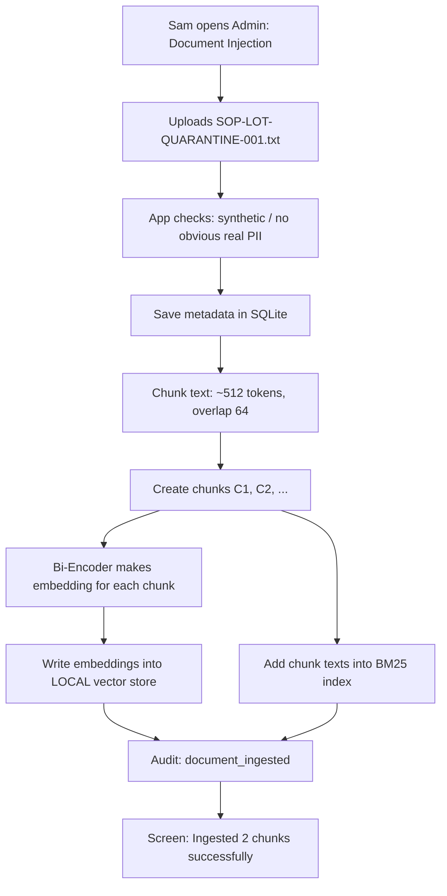

## Example after ingestion

| Store | What was added |
|---|---|
| SQLite docs table | doc_id=`SOP-LOT-QUARANTINE-001`, chunks=2 |
| Vector store | 2 embedding vectors |
| BM25 index | same 2 text chunks searchable by keywords like `LOT`, `quarantine` |

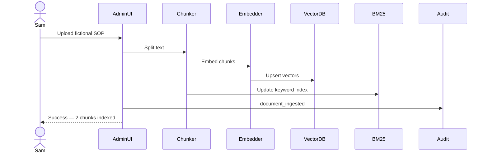

**Takeaway:** If Sam never uploads documents, RAG has almost nothing useful to answer with.

---

# SCENARIO 9 — Hybrid RAG Question (Happy Path)

## Real example story
Maya asks:

> “What should we do if there is a packaging complaint for LOT-88392?”

## Step-by-step inside the 4-stage pipeline

### Stage 1 — BM25 (keyword)
Finds chunks containing exact words like `LOT`, `packaging`, `quarantine`.

### Stage 2 — Bi-Encoder (meaning)
Also finds chunks about “integrity complaint” even if wording differs.

### Stage 3 — RRF
Merges both top-50 lists into one ranked list (`k=60`).

### Stage 4 — Cross-Encoder
Keeps only strong matches (score ≥ 0.40), top 3–5 chunks.

Then the model answers **only using those chunks**.

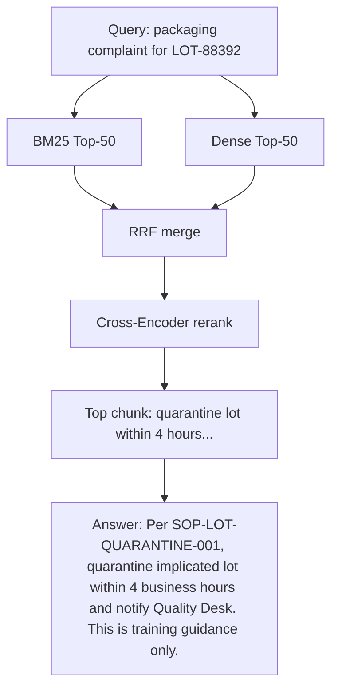

## Example grounded answer (good)

```text
According to fictional SOP-LOT-QUARANTINE-001:
- Quarantine the implicated lot within 4 business hours.
- Notify the fictional Quality Desk.
I cannot assess medical causality or regulatory reportability.
Sources: SOP-LOT-QUARANTINE-001 (chunk 1)
```

**Takeaway:** Answer comes from retrieved text, not from the model inventing policy.

---

# SCENARIO 10 — RAG With No Good Evidence

## Real example story
Maya asks:

> “What is the antidote protocol for NeuroCalm overdose?”

But no SOP about antidotes was uploaded (and the app must not give medical treatment advice anyway).

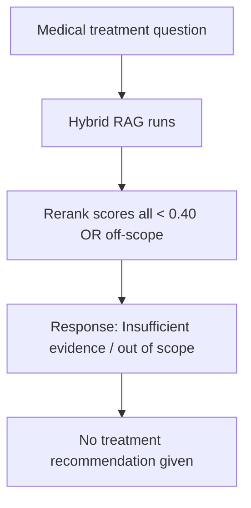

## Example response

```text
I could not find sufficient grounded SOP/report context for that question.
This training app does not provide medical treatment advice.
Please ask about intake process, lot quarantine SOPs, or past fictional reports.
```

**Takeaway:** “I don’t know / out of scope” is a correct success, not a failure.

---

# SCENARIO 11 — Agent Greeting (Direct Response)

## Real example story
User types: `Hi`

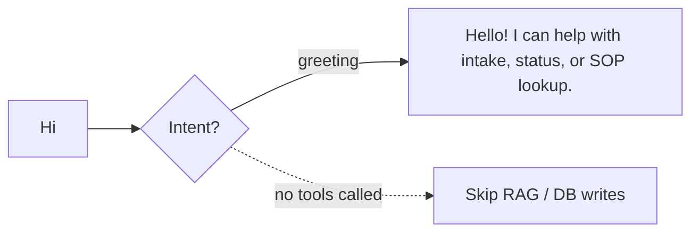

**Takeaway:** Not every message needs RAG or tools.

---

# SCENARIO 12 — Agent Creates a Report via Tool

## Real example story
User tells the agent:

> “Create a product quality complaint for NeuroCalm 50mg lot LOT-88392 received today from a consumer: seal broken.”

## Flow

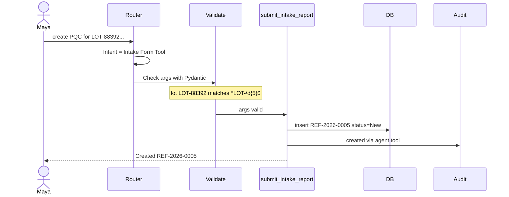

## Example tool arguments (valid)

```json
{
  "report_type": "Product Quality Complaint",
  "product_name": "NeuroCalm 50mg",
  "batch_lot_number": "LOT-88392",
  "date_received": "2026-11-02",
  "reporter_type": "Consumer",
  "description": "Seal broken on arrival"
}
```

**Takeaway:** Agent is a controlled tool caller, not a free medical chatbot.

---

# SCENARIO 13 — Circuit Breaker Stops Infinite Retries

## Real example story
Agent keeps trying to submit with invalid lot `ABC` three times.

| Attempt | Arguments | Result | Counter |
|---|---|---|---|
| 1 | lot=`ABC` | Validation error | 1 |
| 2 | lot=`ABC` (same) | Validation error | 2 |
| 3 | lot=`ABC` (same) | Validation error | 3 → **BREAK** |

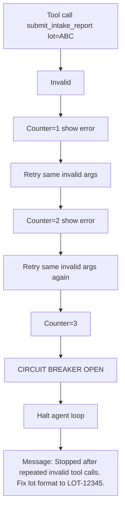

**Takeaway:** Guardrail prevents endless failing loops.

---

# Put All Scenarios on One Timeline (Full Demo Day)

Use this as your demo script.

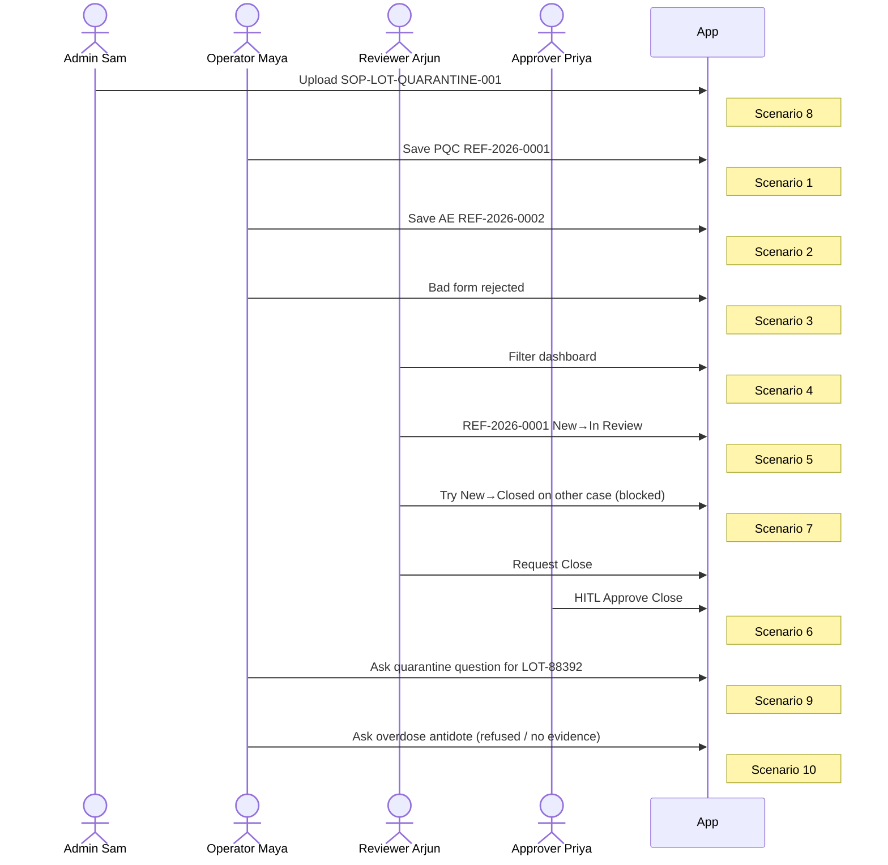

---

# Quick “If This → Then That” Cheat Sheet

| If user does this... | Then system does this... |
|---|---|
| Submits complete PQC | Save + REF + audit |
| Submits AE without onset date | Reject with clear error |
| Filters dashboard | Show matching rows only |
| New → In Review | Allow + audit |
| In Review → Closed | Wait for HITL human approval |
| New → Closed | Reject |
| Admin uploads SOP | Chunk → embed → vector + BM25 |
| Asks lot quarantine question | 4-stage RAG → grounded answer |
| Asks treatment advice | Refuse / insufficient / out of scope |
| Says “Hi” | Direct greeting |
| Agent sends bad lot 3 times | Circuit breaker stops |

---

# What Problem Each Scenario Proves You Solved

| Scenario | Business pain it fixes |
|---|---|
| 1–3 | Spreadsheet missing fields / bad data |
| 4–5 | Opaque review tracking |
| 6–7 | Unsafe / unclear closure process |
| 8–10 | No searchable SOP / history knowledge |
| 11–13 | Uncontrolled AI behavior |

---

# Final Tiny Mental Model

```mermaid
flowchart TB
  subgraph CAPTURE["CAPTURE"]
    S1[Scenario 1-3 Form + Validation]
  end
  subgraph TRACK["TRACK"]
    S2[Scenario 4-7 Dashboard + Status + HITL]
  end
  subgraph KNOW["KNOWLEDGE"]
    S3[Scenario 8 Admin inject docs]
    S4[Scenario 9-10 RAG answers]
  end
  subgraph SAFE_AI["SAFE AI"]
    S5[Scenario 11-13 Router + Tools + Breaker]
  end

  CAPTURE --> TRACK
  S3 --> S4
  TRACK --> SAFE_AI
  S4 --> SAFE_AI
```

1. **Capture** reports correctly  
2. **Track** them through review safely  
3. **Inject documents** so knowledge exists  
4. **Retrieve + answer** without inventing medical decisions  
5. **Control the agent** so it cannot loop or skip rules  

---

*If one scenario is still confusing, tell me the scenario number and we can expand only that one with more sample screens/data.*
