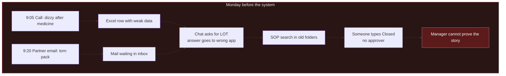
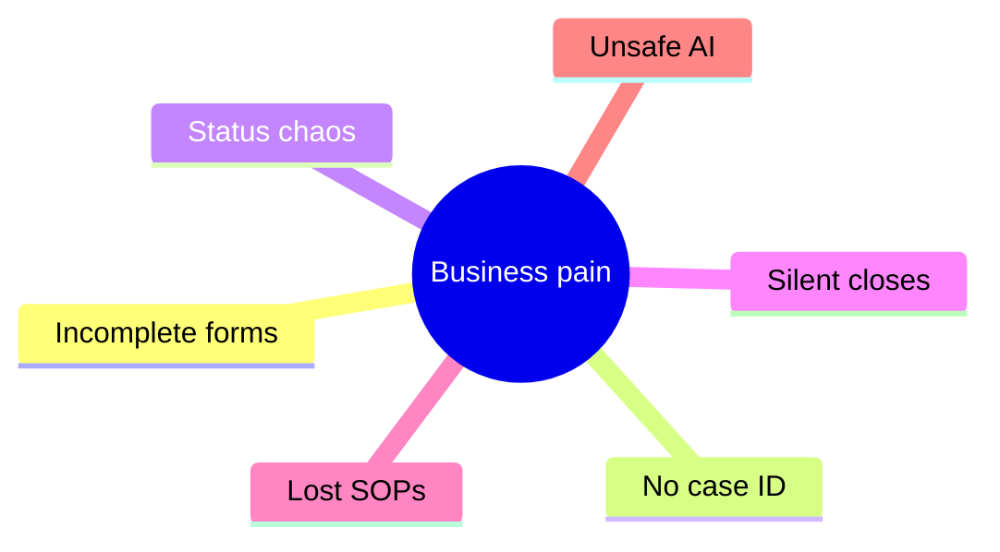
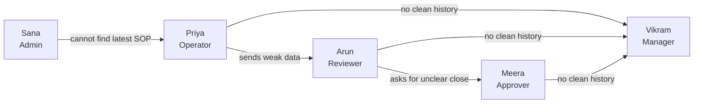
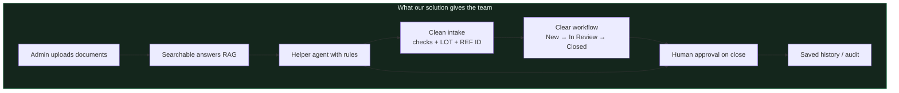
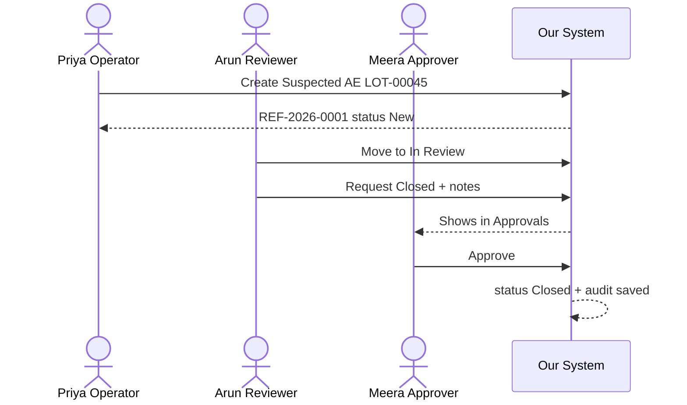
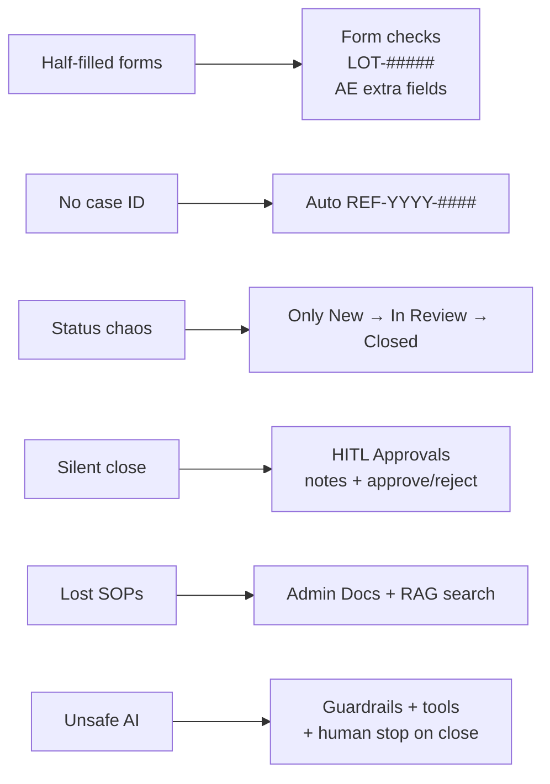
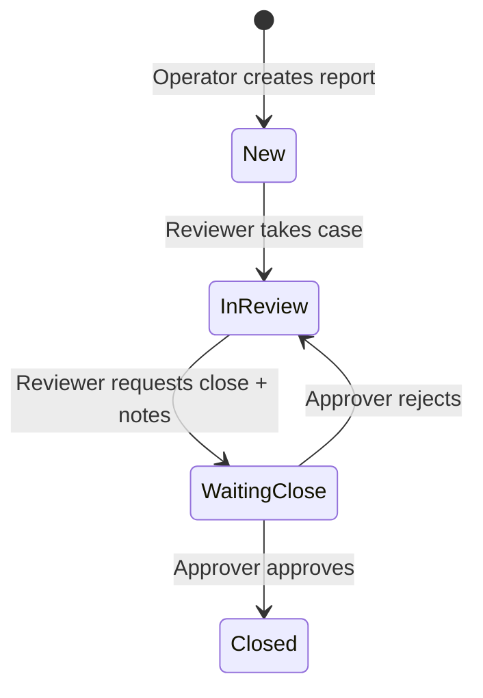
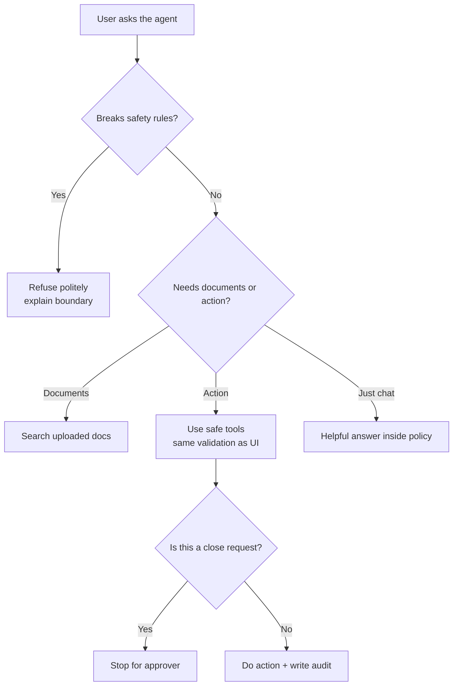
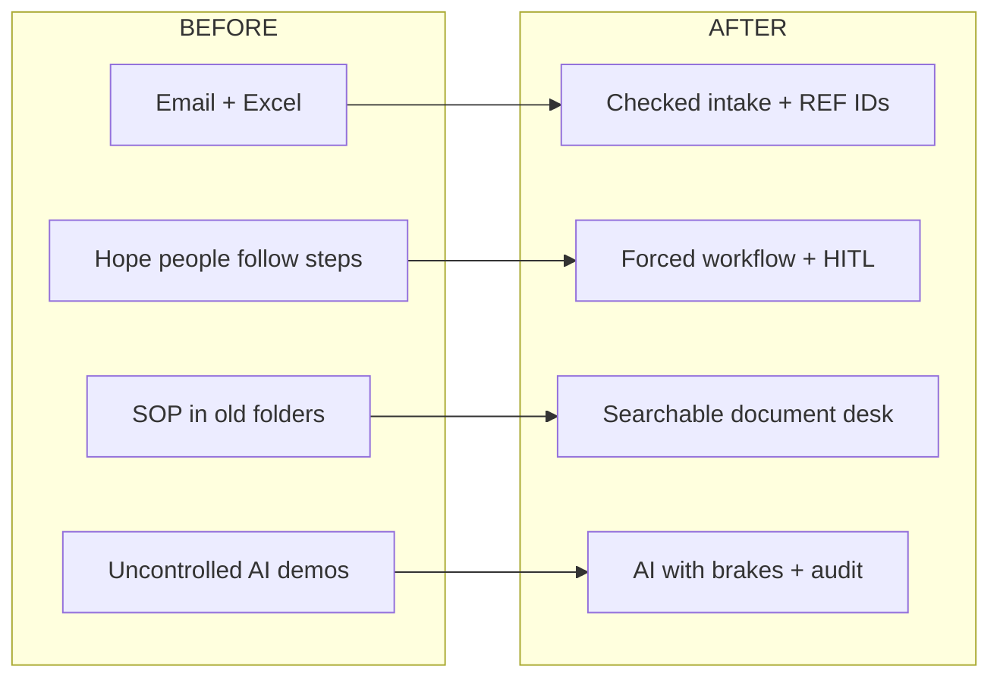
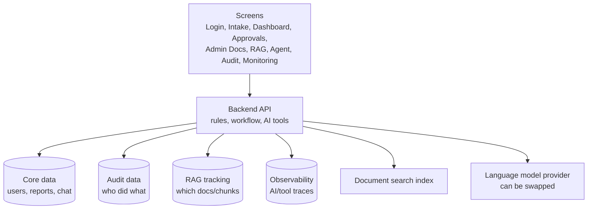

# Business Problem & Solution

### Pharma Safety Intake & Triage Tracker

**Read this like a story.**  
No heavy jargon first. We explain the real workplace mess, then show how **RAG + Agentic AI** fix it — with simple English.

> Training prototype only. All names and cases below are **fictional / synthetic**.  
> The system never decides medical cause, treatment, or “must we report to regulators?”

---

## Start here — explain to anyone in 2 minutes

### What work is this?

Every day, pharma teams receive reports about:

1. **Product Quality Complaint (PQC)** — damaged pack, wrong label, broken tablet…  
2. **Suspected Adverse Event (AE)** — “after taking the medicine, something unexpected happened” *(training uses fake stories only)*

Someone must write the case correctly, find the right company rule document, move it through review, and close it only with permission.

### What is an SOP? (important word)

**SOP = Standard Operating Procedure.**

In plain English: the company’s official **“how we do this work”** document.

Examples:
- “When logging a suspected AE, which fields are mandatory?”
- “What LOT number format is allowed?”
- “Who is allowed to close a case?”

So when we say “find the SOP,” we mean: **find the official company rule / checklist PDF** — not a random internet answer.

### What is the business problem? (simple)

Today that work often lives in **email + Excel + chat**.

That creates four everyday pains:

| Pain | Plain meaning |
|---|---|
| Messy cases | Incomplete fields, no clear case ID, notes scattered |
| Weak process | Nobody sure who owns it; someone can mark “Closed” without approval |
| Hard-to-find knowledge | SOP PDFs sit in folders; new joiners waste 20–40 minutes searching |
| Unsafe AI shortcuts | People paste into open ChatGPT → answers may be **invented** |

**One sentence:**

> The team is **slow and at risk** because cases are messy, process is weak, knowledge is hard to find, and AI has no brakes.

### Why “just use ChatGPT” is not the solution

| They hope | Reality |
|---|---|
| “Find the SOP rule” *(official company how-to)* | Public chat does **not** know *your* company documents |
| “Create the case” | It cannot write into your system of record |
| “Close the case” | It has no Approver step / permissions |
| “Prove what happened” | No durable company audit trail |

### Our AI solution (the main point)

We built a digital intake desk with **three layers**:

| Layer | What it means in plain English | Business impact |
|---|---|---|
| **Clean workflow** | Validated forms + roles + Approver must approve close | Stops silent / messy closes |
| **RAG** | AI answers from **your uploaded SOPs**, with sources | Stops PDF hunting + invented SOP answers |
| **Agentic AI** | AI can use **approved tools** to create / triage cases | Saves handling time without removing human control |

**Memorize this line:**

> **AI finds the right knowledge. Agents do the busywork. Humans keep the final decision.**

### How AI hits the business problem

| Pain | AI / Agent impact |
|---|---|
| Incomplete / slow intake | Agent helps create a validated case from a short request |
| “Where is the rule?” | RAG answers from company SOPs in seconds + shows source |
| Reviewer overload | Agent summarizes case and suggests next *allowed* step |
| Risky close | Agent can only **request** close → Approver decides |
| No proof later | AI calls, tools, and decisions can be traced |

**Bottom line:**  
RAG saves **search time**. Agents save **handling time**. Human-in-the-loop + audit save **risk cost**.

---

## Quick map (deeper sections below)

| Section | What you will learn |
|---|---|
| [1. The problem in plain words](#1-the-problem-in-plain-words) | One clear problem statement |
| [2. A normal Monday (before our system)](#2-a-normal-monday--before-our-system) | Real-time chaos, hour by hour |
| [3. Six pains, explained slowly](#3-six-pains-explained-slowly) | Why each pain hurts the business |
| [4. Who suffers — and how](#4-who-suffers--and-how) | Operator, reviewer, approver, admin, boss |
| [5. What happens if we ignore it](#5-what-happens-if-we-ignore-it) | Cost of “we’ll manage in Excel” |
| [6. What “good” must look like](#6-what-good-must-look-like) | Simple rules any boss would agree with |
| [7. Our solution in plain words](#7-our-solution-in-plain-words) | What we built, without buzzwords |
| [8. Same Monday — after our system](#8-same-monday--after-our-system) | Real-time happy path |
| [9. Problem → fix map](#9-problem--fix-map) | Each pain matched to a feature |
| [10. The close step (HITL) in depth](#10-the-close-step-hitl-in-depth) | Why a second human must say yes |
| [11. Where AI helps — and where it must stop](#11-where-ai-helps--and-where-it-must-stop) | RAG + agent with brakes |
| [12. Before vs after](#12-before-vs-after) | Side-by-side comparison |
| [13. What we refuse to automate](#13-what-we-refuse-to-automate) | Honest boundaries |
| [14. How the pieces fit](#14-how-the-pieces-fit) | Simple architecture picture |
| [15. How you know it worked](#15-how-you-know-it-worked) | Success checklist |

---

## 1. The problem in plain words

Pharma teams receive two common kinds of reports:

1. **Product Quality Complaint (PQC)** — something looks wrong with the product (damaged pack, wrong label, broken tablet, and so on).
2. **Suspected Adverse Event (AE)** — someone reports that after taking a medicine, something bad or unexpected happened (for training we use fake stories only).

These reports must be:

- written down correctly,
- given to the right person,
- reviewed carefully,
- closed only with proper permission,
- and remembered later if someone asks: *“What happened on this case?”*

### The real business problem

**Today, many teams still do this work with email, chat, and Excel.**  
Information gets lost. Forms are half-filled. Nobody is sure who owns the case. Cases get closed quietly. Old SOPs sit in folders nobody searches. And if someone adds “AI chat,” it may invent answers that sound smart but are unsafe.

**In one sentence:**

> The business problem is not “we need a website.”  
> The business problem is: **messy intake + weak process + scattered knowledge + unsafe AI = slow work and high risk.**

### Our answer in one sentence

> We built a simple digital desk where **clean data goes in**, **roles follow a clear path**, **closing needs a human approval**, **documents are searchable with RAG**, and **Agentic AI helps with tools but cannot break the rules**.

---

## 2. A normal Monday — before our system

Meet a fictional team (training story only):

| Person | Job |
|---|---|
| **Priya** | Operator — first person who types the report |
| **Arun** | Reviewer — checks and triages the case |
| **Meera** | Approver — final say before a case can close |
| **Sana** | Admin — keeps SOPs and product documents |
| **Vikram** | Manager — must answer audit / inspection questions |

### 9:05 AM — a call comes in

A call-center note says:

> “Patient felt dizzy after CardioMax. Batch maybe 45 or 54? Please log.”

Priya opens **Excel sheet v3_final_REAL.xlsx**.  
There is also `v3_final_REAL (2).xlsx` in email.

She types:

- Product: CardioMax  
- Batch: `45?`  
- Description: “dizzy”  
- Status: she leaves blank  

No unique case ID. Tomorrow nobody will find this row easily.

### 9:20 AM — a partner email

Subject: *Packaging issue — urgent*

Body:

> “Blister foil torn. Lot around December shipment. Please close if minor.”

Priya forwards to Arun.  
Arun is in another meeting. The mail sits.

### 10:00 AM — chat confusion

Arun on Teams:

> “Need proper LOT number for the dizzy case.”

Priya replies in WhatsApp (different channel):

> “I put 45 in the sheet.”

Arun never sees it. He asks again tomorrow.

### 11:30 AM — tribal knowledge

New joiner asks Sana:

> “For suspected AE, do we need onset date?”

Sana says:

> “Yes — it’s in last year’s PDF… I think on page 12… or was it the 2023 file?”

They spend 20 minutes hunting folders.

### 2:00 PM — silent close

Someone writes in Excel status column: `Closed`.  
No notes. No approver name. No reason.

Meera (approver) was never asked.

### 4:30 PM — manager stress

Vikram gets a message:

> “For yesterday’s CardioMax case — show who created it, who reviewed it, and why it closed.”

Team searches email, chat, and three Excels.  
They cannot rebuild a clean story.

**This Monday is the business problem.**  
Not one dramatic failure — many small leaks that add up to risk.

---

## 3. Six pains, explained slowly

### Pain 1 — Incomplete intake (“half a form”)

**Simple meaning:** If key details are missing, the next person cannot do good work.

**Real-time example:**  
Priya enters batch as `45?`.  
Arun cannot check manufacturing history for the right lot.  
He sends the case back. Time is wasted. The reporter may need a second call.

**Why business cares:** Bad input creates double work and weak decisions later.

---

### Pain 2 — No clear case identity (“which row is this?”)

**Simple meaning:** Without a stable ID, people talk about “the dizzy case” or “the email from morning.”

**Real-time example:**  
Priya, Arun, and Meera each mean a different Excel row when they say “CardioMax issue.”

**Why business cares:** You cannot track, count, or audit what you cannot name.

---

### Pain 3 — Unclear ownership and status (“who has the ball?”)

**Simple meaning:** Work must move in order: create → review → close. Email cannot force that order.

**Real-time example:**  
A case jumps from blank to `Closed` because someone edited the sheet.  
Reviewer never touched it.

**Why business cares:** Important steps get skipped when the tool does not protect the path.

---

### Pain 4 — Unsafe close (“closed because we were busy”)

**Simple meaning:** Closing a case is a serious step. It should need a clear reason and a second human.

**Real-time example:**  
End of day, someone marks 8 rows `Closed` to “clear the queue.”  
Next month, inspection asks why. Nobody remembers.

**Why business cares:** Close is a trust moment. Shortcuts create future panic.

---

### Pain 5 — Knowledge scatter (“the answer is in someone’s head”)

**Simple meaning:** Rules and SOPs live in PDFs, drives, and senior people — not in a fast, shared place.

**Real-time example:**  
Two operators give two different answers about AE onset date because they read two different files.

**Why business cares:** Inconsistent answers = inconsistent quality.

---

### Pain 6 — AI without brakes (“smart-sounding, dangerous”)

**Simple meaning:** A normal chatbot may invent medical cause, suggest treatment, or guess regulatory duty.

**Real-time example:**  
Someone asks a free chatbot:  
“Did CardioMax cause the dizziness? Should we report this?”  
The bot answers with confidence.  
That answer is not allowed for this desk — and may be wrong.

**Why business cares:** In pharma training and operations, **wrong confident AI** is worse than slow human work.

---

## 4. Who suffers — and how

### Priya — Operator

- **Wants:** A clear form, quick save, a case number she can share.
- **Without system:** She guesses fields, copies old rows, loses track.
- **Business impact:** Garbage in → garbage everywhere.

### Arun — Reviewer

- **Wants:** Complete cases, a queue of “New” work, space for triage notes.
- **Without system:** He chases people on chat; notes live in email drafts.
- **Business impact:** Slow triage, uneven quality.

### Meera — Approver

- **Wants:** A short list of “ready to close” cases with reviewer notes.
- **Without system:** People ping her: “please approve in Excel.”
- **Business impact:** She either blocks everything or rubber-stamps blindly.

### Sana — Admin

- **Wants:** One place to upload the latest SOP so everyone uses it.
- **Without system:** Version hell (`SOP_final`, `SOP_final2`, `SOP_use_this`).
- **Business impact:** Team follows different rules.

### Vikram — Manager / QA

- **Wants:** Proof: who did what, when, and why.
- **Without system:** Archaeology in inboxes.
- **Business impact:** Inspection stress, lost trust with leadership.

---

## 5. What happens if we ignore it

If the company says “Excel is fine for now”:

| Quiet risk | What it looks like in real life |
|---|---|
| **Data mess** | LOT written as `lot 12`, `LOT12`, `batch-12` — hard to search or group |
| **Process mess** | Cases close with no notes and no approver |
| **Knowledge mess** | New joiners keep asking the same questions |
| **AI mess** | Demo bots impress leaders, then scare compliance |
| **Audit mess** | “Show the trail” becomes a weekend fire drill |

**Simple truth:**  
Going fast without structure creates hidden risk.  
Structure without help creates backlog.  
The business needs **both structure and help**.

---

## 6. What “good” must look like

Ask any practical manager. They will agree with these plain rules:

| # | Simple rule | Everyday meaning |
|---|---|---|
| 1 | Required fields + fixed LOT format | Do not accept “maybe batch 45” |
| 2 | Different rules for PQC vs Suspected AE | AE needs event text + onset date |
| 3 | Only three statuses, in order | **New → In Review → Closed** |
| 4 | Close needs a second human | Reviewer asks; approver decides |
| 5 | Keep an audit trail | Later we can replay the story |
| 6 | Different logins for different jobs | Operator is not approver |
| 7 | AI can help, not rule | No medical cause, no treatment, no reportability guesses |
| 8 | Fake / training data only in this prototype | Learn safely |

These rules are the **design contract** of our product.

---

## 7. Our solution in plain words

We built a **Pharma Safety Intake & Triage Tracker** — a local training system that behaves like a serious operations desk.

### What it does (no buzzwords)

1. **Login by role** — operator, reviewer, approver, admin.
2. **Intake form with checks** — missing fields are blocked; LOT must look like `LOT-01234`.
3. **Automatic case ID** — example: `REF-2026-0001`.
4. **Dashboard** — filter by status / type; see what is waiting.
5. **Status path locked** — you cannot jump wildly.
6. **Close gate** — requesting Closed sends the case to Approvals; approver says yes or no.
7. **Admin documents** — upload SOPs / guides; system splits and indexes them.
8. **Ask the knowledge base (RAG)** — get answers from *your* uploaded docs, not random internet guesses.
9. **Agent chat** — can help create/update cases using the **same rules** as the screens.
10. **Audit + monitoring** — see actions and AI traces later.

### Solution in one breath

> Priya enters clean data.  
> Arun reviews with visible ownership.  
> Meera approves closes.  
> Sana keeps documents fresh and searchable.  
> AI helps the team move faster — but **cannot quietly close cases** or invent medical conclusions.  
> Vikram can open the audit trail and tell the story.

---

## 8. Same Monday — after our system

Replay the same day with the product.

### 9:05 AM — Priya (Operator)

Call note: dizzy after CardioMax.

Priya opens **Intake**.

She tries batch `45?` → **system says no**.  
She enters `LOT-00045` → accepted.

Because it is **Suspected Adverse Event**, the form also asks for:

- event description  
- event onset date  

She saves.

System gives her: **`REF-2026-0001`**, status **New**.

She can paste that ID in any chat. Everyone means the same case.

### 9:20 AM — packaging complaint

Priya files a **Product Quality Complaint**:

- Product, LOT, date received, reporter type, description  

Gets **`REF-2026-0002`**, status **New**.

### 10:00 AM — Arun (Reviewer)

Arun opens **Dashboard**, filter = `New`.

He opens `REF-2026-0001`, moves it to **In Review**.  
He writes triage notes in the system (not in a random email).

When ready, he requests **Closed** with notes.  
Case does **not** close yet. It waits for Meera.

### 11:30 AM — Sana (Admin) + knowledge

Sana uploads the latest intake SOP in **Admin Docs**.

Priya asks in **RAG**:

> “For suspected AE, is onset date required?”

Answer comes from the uploaded SOP — same answer for everyone.

### 2:00 PM — Meera (Approver)

Meera opens **Approvals**.

She sees `REF-2026-0001` with Arun’s notes.

- If she **approves** → status becomes **Closed**, audit records it.  
- If she **rejects** → stays **In Review**, audit records why.

No silent Excel close.

### 4:30 PM — Vikram (Manager)

Vikram opens **Audit**.

He searches `REF-2026-0001` and sees:

- who created it  
- who moved it to In Review  
- who requested close  
- who approved  

He can answer the inspection-style question without a panic search.

**Same people. Same volume. Different outcome.**  
That is the value of the solution.

---

## 9. Problem → fix map

| Everyday pain | What we built | Easy example |
|---|---|---|
| Half-filled forms | Required fields + LOT pattern `LOT-#####` | `45?` rejected; `LOT-00045` accepted |
| AE details missing | Extra fields for Suspected AE | Must enter event text + onset date |
| “Which case?” | Auto reference ID | Share `REF-2026-0001` in chat |
| Jumping status | Hard workflow rules | Cannot invent random statuses |
| Closed without permission | Human-in-the-loop close | Approver queue |
| SOP hunting | Document upload + hybrid search | Ask the desk knowledge base |
| AI overreach | Prompt rules + tool rules + breaker | Bot refuses cause / treatment / reportability |
| “Prove it” | Audit DB + observability | Manager replays the path |

### Tiny dictionary (simple meanings)

| Word you may hear | Simple meaning in this project |
|---|---|
| **Intake** | First capture of a complaint / suspected event |
| **Triage** | Reviewer checks and decides next handling step |
| **HITL** | Human In The Loop — a person must approve a sensitive step |
| **RAG** | Ask questions; answers come from *your* uploaded documents |
| **Agent** | Chat helper that can call safe tools (create report, update status…) |
| **Audit** | Saved history of who did what |
| **Guardrail** | Hard “do not cross” rule for AI and workflow |

---

## 10. The close step (HITL) in depth

### Why closing is special

Creating a case is important.  
**Closing** a case is more sensitive — it says “we are done.”

If close is too easy, people clear queues under pressure.  
If close is too hard, work piles up.

So we use a fair middle path:

1. Reviewer finishes triage and writes **notes**.  
2. Reviewer requests **Closed**.  
3. Case becomes **waiting for approval** (not fully closed yet).  
4. Approver reads notes and chooses **Approve** or **Reject**.  
5. Everything is saved in audit.

### Real-time example

Arun writes:

> “LOT verified. Description complete. No further intake data needed for this training case. Request close.”

Meera sees that note.  
She approves.  
Later Vikram can show: Arun asked, Meera approved, timestamps included.

### What if AI asks to close?

The helper agent may *request* a close.  
It still stops for the human approver.  
**AI can assist the path. AI cannot be the final stamp.**

That single design choice solves a huge business fear:  
“Will the bot close cases behind our back?”  
**No.**

---

## 11. Where AI helps — and where it must stop

Leaders want AI.  
Compliance wants control.  
We designed for both.

### Helpful AI example (allowed)

Priya asks:

> “What fields are required for Suspected Adverse Event in our intake guide?”

RAG reads the uploaded guide and answers from that content.

### Dangerous AI example (blocked by design)

Someone asks:

> “Did the drug cause this? What medicine should they take? Must we report this to authorities?”

Our system is built to **refuse** those three lanes:

- no causality decision  
- no treatment advice  
- no regulatory reportability decision  

### How the helper agent behaves

| AI feature | Helps the business by… | Hard stop |
|---|---|---|
| Document Q&A (RAG) | Faster, consistent answers | Uses controlled uploads, not random web claims as source of truth |
| Agent tools | Create / update cases from chat | Same validation and roles as screens |
| Chat history | People continue work later | Stored per user in core data |
| Circuit breaker | Stops repeated tool failures from making a bigger mess | Fails safe |
| Observability | Shows what AI/tools did | Managers can inspect traces |

**Business message in plain English:**  
AI is a fast junior assistant with a rulebook.  
Humans remain the managers of sensitive decisions.

---

## 12. Before vs after

| Topic | Before | After (our system) |
|---|---|---|
| Entering a case | Free text in sheet | Guided form with checks |
| Case name | “that morning email” | `REF-2026-0001` |
| Status truth | Last person to edit Excel | Server rules only allow valid moves |
| Closing | Anyone can type Closed | Approver must confirm |
| Finding SOP answers | Ask senior / dig folders | Ask RAG on latest upload |
| AI | Sounds smart, no fence | Tools + refusals + human stop |
| Proof for manager | Screenshots and memory | Audit + monitoring pages |

---

## 13. What we refuse to automate

Being honest makes the story stronger.

| We do **not** decide | Simple reason |
|---|---|
| Did the medicine cause the event? | That is clinical judgment |
| What treatment should someone take? | Patient safety — humans only |
| Must this be reported to regulators? | Legal / PV decision — not this app |
| Real patient private data | This prototype uses synthetic training data |
| Cloud-only setup | Runs locally for training demos |

These are not “missing features.”  
They are **safety fences** that make the solution acceptable to serious stakeholders.

---

## 14. How the pieces fit

You do not need to be an engineer to understand the shape:

### Why separate data stores? (simple reason)

Think of four notebooks:

1. **Core** — the live cases and users  
2. **Audit** — the proof notebook  
3. **RAG tracking** — what documents we indexed  
4. **Observability** — how AI/tools behaved  

If one notebook gets messy, the others still protect the business story.

---

## 15. How you know it worked

Use this checklist in a demo or training walkthrough:

- [ ] A new operator can file a valid case without guessing tribal rules  
- [ ] Bad LOT formats are blocked live  
- [ ] Suspected AE without onset details is blocked  
- [ ] Every case gets a clear `REF-…` ID  
- [ ] Reviewer can move New → In Review, but cannot skip the close gate  
- [ ] Approver sees pending closes with notes  
- [ ] Reject keeps the case alive (back to In Review)  
- [ ] Admin upload changes what RAG can answer  
- [ ] Agent refuses causality / treatment / reportability questions  
- [ ] Agent close still waits for a human  
- [ ] Manager can rebuild the case story from audit  

If these boxes are true, the **business problem is being solved** — not just “a UI exists.”

---

## Closing story

**Before:**  
Priya’s Monday is leaks — weak data, lost chats, silent closes, folder hunting, manager panic.

**After:**  
Priya’s Monday is a path — clean intake, named cases, clear handoffs, human-approved closes, shared knowledge, AI that helps inside a fence, and a trail Vikram can trust.

### Remember the core message

| | |
|---|---|
| **Problem** | Messy intake, weak process, scattered knowledge, unsafe AI |
| **Solution** | Checked intake + role workflow + HITL close + searchable docs + guardrailed AI + audit |
| **Promise** | Faster desk work **without** giving away accountability |

That is the business problem.  
That is how we solve it.

---

### Next documents in this folder

- **Frontend** — how each screen makes this story easy for users  
- **Backend** — how the rules, databases, RAG, and agent are built  

---

*Pharma Safety Intake & Triage Tracker — fictional training prototype. Synthetic data only.*
