# Canva Presentation Guide — End-to-End Project Story

### Pharma Safety Intake & Triage Tracker

Use this file as your **slide-by-slide script** while building the deck in Canva.  
Each slide has: **title · on-slide text · Canva visual idea · what you say · optional diagram**.

> Training prototype · synthetic data only · no causality / treatment / reportability decisions.

---

## How to build this in Canva (5 minutes setup)

| Tip | Do this |
|---|---|
| Template | Pick a clean corporate template (light background, strong accent — avoid purple glow clichés) |
| Fonts | One bold display font + one readable body font |
| Layout rule | 1 idea per slide · max 5 bullets · big visuals |
| Diagrams | Recreate Mermaid flows as Canva flowcharts / Smart Draw / screenshots of Mermaid preview |
| Screenshots | Capture last (Part G) after live demo; leave placeholder boxes now |
| Length options | **15 slides** (executive) · **30 slides** (standard) · **full ~49** (deep technical) |

### Recommended deck lengths

| Audience | Use slides |
|---|---|
| Manager / business | **1–13** (problem + AI solution), then 32–36, 44–49 |
| Technical + manager | Full set |
| AI deep-dive | **6–13** + RAG/agent backend slides + screenshot AI pages |

---

## Deck map (all parts)

| Part | Slides | Topic |
|---|---|---|
| **A** | 1–6 | Business problem in plain English (+ why raw ChatGPT fails) |
| **B** | 7–13 | **AI solution focus:** RAG + Agentic AI + human approval |
| **C** | 14–16 | Tech stack + architecture |
| **D** | 17–31 | Backend logics (auth, workflow, chunking, RAG, agent, tracing, eval, MCP) |
| **E** | 32–36 | Scenarios, with/without agent, time & cost |
| **F** | 37–43 | Live screenshot storyboard (every page + questions) |
| **G** | 44–49 | Governance, demo checklist, Q&A, thank you |

---

# PART A — Business problem (plain English)

> Goal of Part A+B: any outsider should understand in 5 minutes  
> **what is broken**, **why AI matters**, and **how RAG + Agentic AI fix it** — without tech jargon.

---

## Slide 1 — Title

**On slide**
- Pharma Safety Intake & Triage Tracker
- How **AI, RAG, and Agentic AI** fix a real intake operations problem
- Your name · date

**Canva visual:** Product name large. Subtitle about AI impact — not “another web app.”

**Say:**  
“This is not a demo of fancy AI toys. This is a demo of how governed AI removes real daily pain for safety intake teams.”

---

## Slide 2 — Agenda

**On slide**
1. What is the business problem? (simple story)  
2. Why normal tools fail — and why **raw ChatGPT is not enough**  
3. Our AI solution: **RAG + Agentic AI + human approval**  
4. How that impact shows up in daily work  
5. What’s under the hood (tech + flows)  
6. Live screenshots / scenarios / savings  
7. Safety fences & Q&A  

**Say:** “First the human story. Then the AI answer. Then the engine room.”

---

## Slide 3 — What work are we talking about? (30-second setup)

**On slide (big, simple)**

Pharma companies receive two kinds of reports every day:

1. **Product Quality Complaint (PQC)** — pack damaged, wrong label, broken tablet…  
2. **Suspected Adverse Event (AE)** — “after taking the medicine, something unexpected happened” *(training uses fake stories only)*

Someone must:
- write the case down correctly  
- give it to the right person  
- find the right SOP / guidance  
- close it only with permission  
- prove later what happened  

**Say:**  
“Think of it like a hospital reception desk for product problems — if intake is messy, everything after it is messy.”

---

## Slide 4 — The business problem in one page (anyone can understand)

**On slide title:** What is broken today?

**On slide (use these 4 boxes — not jargon)**

| # | Everyday problem | What it feels like |
|---|---|---|
| 1 | Cases live in **email + Excel + chat** | Same case has 3 versions |
| 2 | People don’t know **who owns** the case or **what step** it is on | Work stalls or gets closed by accident |
| 3 | Official rules (**SOPs** = company how-to PDFs) are buried in folders | New joiners waste 20–40 minutes searching |
| 4 | If they paste into **open AI chat**, answers may be invented | Sounds smart — can be wrong / unsafe |

**One-line problem (put this huge on slide):**

> The team is slow and at risk because **cases are messy, process is weak, knowledge is hard to find, and AI has no brakes.**

**Canva visual:** 4 icons in a row → arrow → “Slow + Risky.”

**Say:**  
“Please remember this: the business problem is not ‘we need a website.’  
The business problem is: **messy cases + missing knowledge + unsafe AI shortcuts.**”

---

## Slide 5 — Make it real: Monday without our system

**On slide**

| Time | What happens | Hidden cost |
|---|---|---|
| 9:05 | Call: “dizzy after medicine… batch maybe 45?” | Incomplete case |
| 9:20 | Email: torn packaging — “close if minor” | Wrong channel |
| 10:00 | LOT answer goes to WhatsApp, reviewer is on Teams | Information loss |
| 11:30 | New joiner hunts SOP PDF for “do we need onset date?” | 20–40 min wasted |
| 2:00 | Someone types `Closed` in Excel — no approver | Process failure |
| 4:30 | Manager asks: prove the case trail — team panics | Audit / trust risk |

**Diagram to draw**

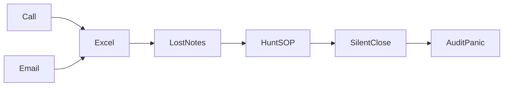

**Say:**  
“Nobody is lazy. The tools force them to hunt, guess, and copy-paste. That is the business problem.”

---

## Slide 6 — Why “just use ChatGPT” does NOT solve this

**On slide (critical slide for outsiders)**

If the team opens public ChatGPT / any free chatbot:

| They hope | What actually happens |
|---|---|
| “Find the SOP answer” *(official company how-to PDF)* | Model may **guess** — it does not know *your* documents |
| “Create the case for me” | It cannot write into your system of record |
| “Close this case” | It has **no permission model**, no approver step |
| “Remember what we did” | No durable audit trail for your company |

**Big takeaway text:**

> Normal AI chat is a **talking assistant**.  
> Business intake needs an AI that can **use company knowledge**, **take controlled actions**, and **stop when humans must decide**.

**Say:**  
“So our solution is not ‘add a chatbot.’ Our solution is **RAG + Agentic AI with guardrails**, inside a real workflow.”

---

# PART B — Our AI solution (RAG + Agentic AI)

## Slide 7 — Solution in one breath (plain English)

**On slide**

We built one digital desk with **three AI layers** on top of a clean process:

| Layer | Simple meaning | Business impact |
|---|---|---|
| **1. Clean workflow** | Validated intake + roles + approval to close | Stops messy / silent closes |
| **2. RAG (Retrieval)** | AI answers **from your uploaded SOPs**, with sources | Stops PDF hunting + invented SOP answers |
| **3. Agentic AI** | AI can **create / update / triage cases using tools**, but cannot illegally close | Saves time without removing human control |

**One-line solution (huge on slide):**

> **AI finds the right knowledge. Agents do the busywork. Humans keep the final decision.**

**Say:**  
“That sentence is the whole product. Everything else is how we engineered it safely.”

---

## Slide 8 — What is RAG here? (no jargon)

**On slide title:** RAG = “Ask your documents, not the internet”

**Explain like this:**

1. Admin uploads company SOPs / training PDFs  
2. System **cuts them into chunks** and indexes them  
3. Reviewer asks: *“For suspected AE intake, is onset date required?”*  
4. System **retrieves the matching passages** from *your* docs  
5. LLM answers **only using those passages** and shows sources  

**Business pain it kills:**
- “Where is the SOP?”  
- “Which version is correct?”  
- “New joiner doesn’t know the rule”  
- “ChatGPT invented a rule that is not in our SOP”

**Diagram**

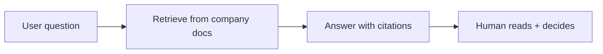

**Say:**  
“RAG is how AI becomes useful for **company knowledge** instead of random guessing.”

---

## Slide 9 — What is Agentic AI here? (no jargon)

**On slide title:** Agentic AI = “AI that can do steps — not only talk”

**Normal chatbot:**  
“Here is text advice. Now you go do the work yourself.”

**Our agent:**  
“I can call approved **tools** inside the product.”

Examples of tools:
- create intake report  
- list / get reports  
- update fields (with validation)  
- move case to review  
- request close *(needs approver later)*  
- ask RAG about SOPs  
- summarize a case for a human  

**But it cannot:**
- skip roles  
- force-close without Approver  
- invent medical causality / treatment / reportability  

**Diagram**

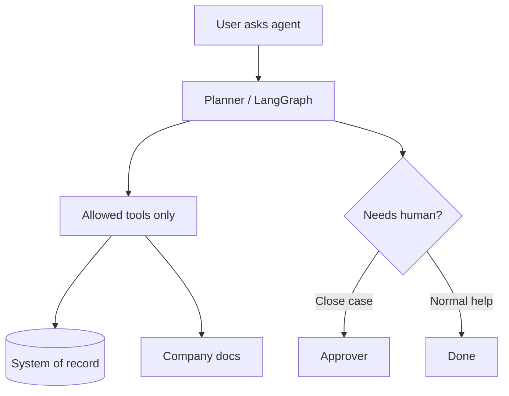

**Say:**  
“This is the business leap: AI stops being a suggestion box and becomes a **controlled junior teammate**.”

---

## Slide 10 — How AI hits the business problem (the money slide)

**On slide title:** From pain → AI impact

| Business pain | Without AI | With our AI |
|---|---|---|
| Incomplete / slow intake | Operator types everything manually, mistakes common | **Agent** drafts / creates validated case from a short request |
| “Where is the rule?” | Search folders / ask senior | **RAG** answers from SOPs with sources in seconds |
| Reviewer overload | Read long notes, rebuild context | **Agent** summarizes case + suggests next allowed step |
| Risky close | Someone marks Closed in Excel | Agent can only **request** close → **Approver** decides |
| No proof | Chat + Excel archaeology | Every AI call / tool / decision can be **traced** |

**Big caption:**

> RAG saves **search time**.  
> Agents save **handling time**.  
> HITL + audit save **risk cost**.

**Say:**  
“If you remember only one slide — remember this table.”

---

## Slide 11 — Before vs After (same Monday)

**On slide**

| Moment | Before | After (with RAG + Agent) |
|---|---|---|
| 9:05 call | Half row in Excel | Operator or **agent** creates `REF-…` with validated LOT |
| 11:30 SOP question | Hunt PDFs 20–40 min | Reviewer asks **RAG** → answer + source in ~seconds |
| Afternoon triage | Rewrites notes by hand | **Agent** summarizes + moves case with tools |
| Close | Silent Excel “Closed” | Request close → **Approver** HITL gate |
| Manager ask | Panic search | Audit trail + traces exist |

**Canva visual:** Red timeline vs green timeline.

---

## Slide 12 — Who uses the AI (roles)

**On slide**

| Role | How they use AI |
|---|---|
| **Operator** | Create clean cases (form or agent-assisted) |
| **Reviewer** | RAG for SOP questions + agent for triage / summary / request close |
| **Approver** | Final human stamp — AI does **not** replace this |
| **Admin** | Uploads docs that power RAG; manages users |

**Say:**  
“Approver stays human on purpose. That is how Agentic AI stays trustworthy.”

---

## Slide 13 — What we refuse to automate (trust slide)

**On slide**

AI / Agent will **never** decide:
- medical **causality**  
- **treatment** advice  
- regulatory **reportability**  

Also:
- synthetic / training data only  
- local-first prototype (SQLite)  

**Say:**  
“These are not missing features. These are the fences that make AI acceptable in a safety-adjacent workflow.”

---

# PART C — Tech stack & design

## Slide 14 — Stack at a glance

**On slide**

| Layer | Technology |
|---|---|
| Frontend | React + Vite + TypeScript |
| Backend | FastAPI + SQLAlchemy + Pydantic |
| Auth | JWT (HS256) + bcrypt + RBAC permissions |
| Data | 4 SQLite DBs (core / audit / rag / observability) |
| RAG | BM25 + dense + RRF + rerank |
| Vectors | FAISS or Chroma |
| Embeddings | sentence-transformers (pluggable) |
| Agent | LangGraph + tools + SQLite checkpointer |
| LLMs | Groq / OpenAI / Google / mock (by role) |
| Observability | Custom SQLite traces ± Langfuse |
| Eval | pytest + classic metrics + RAGAS + Locust |
| MCP | FastMCP server (same tools) |

**Canva visual:** Layered stack diagram (UI → API → engines → data).

---

## Slide 15 — Architecture (big picture)

**On slide title:** How the application is designed

**Canva visual:** recreate this flow

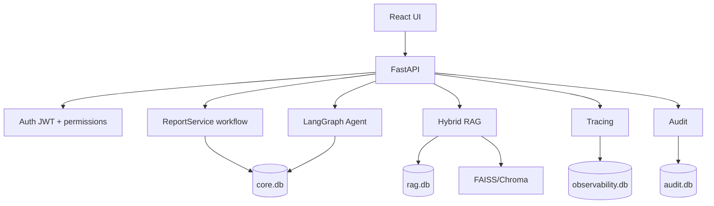

**Say:** “We separate work data, proof, knowledge metadata, and AI camera logs on purpose.”

---

## Slide 16 — Design principles (logics we follow)

**On slide**

1. **Validate early** — bad LOT never saves  
2. **Permissions + business rules** — both layers  
3. **Factory / Strategy** — swap LLM / vector / embedding by config  
4. **HITL for sensitive actions** — especially close  
5. **AI behind fences** — prompts + tools + breaker  
6. **Delete means delete** — file + vectors + metadata  
7. **Measure quality** — tests + eval harness  

---

# PART D — Backend logics (flows)

## Slide 17 — Section divider: Backend logics

**On slide:** “Now the engine room — how each backend capability works.”

---

## Slide 18 — Authentication & roles

**On slide**
- Login → bcrypt verify → JWT Bearer token  
- Every API checks permission strings (`intake:create`, `workflow:approve_close`, …)  
- Role comes from DB user (not only token claim)

**Diagram**

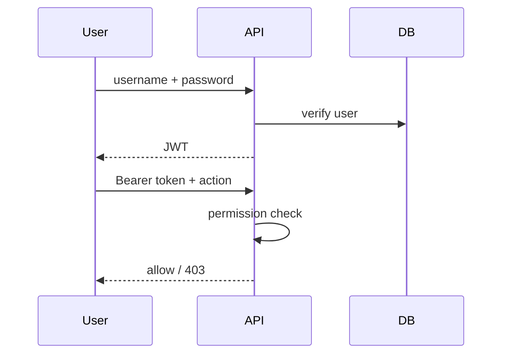

**Say:** “Operator cannot approve close — UI hides it and API rejects it.”

---

## Slide 19 — Intake & workflow logic

**On slide**
- Create report → `REF-2026-####` · status **New**  
- Reviewer: **New → In Review**  
- Request Closed → `pending_close=true` (still In Review)  
- Approver: Approve → **Closed** / Reject → back to In Review  

**Diagram**

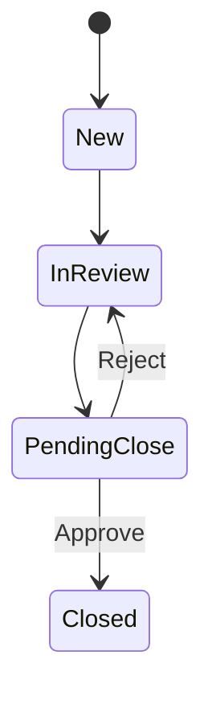

**Say:** “Request close is not close. That single design prevents silent closes.”

---

## Slide 20 — Chunking strategies

**On slide**

| Strategy | When we use it |
|---|---|
| recursive | Default / mixed docs |
| semantic | Topic shifts via embeddings |
| structure_aware | Heading-rich SOPs |
| agentic | LLM proposes topic segments |
| page_based | PDF pages / CSV rows |

**Diagram**

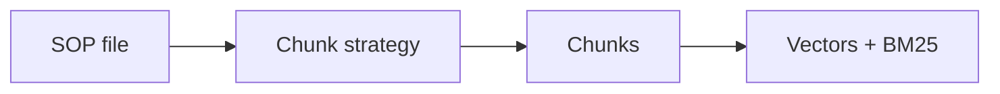

**Say:** “Chunking quality = retrieval quality = answer quality.”

---

## Slide 21 — RAG ingestion (upload → index)

**On slide steps**
1. Admin uploads SOP  
2. Save file locally  
3. Load text (PDF/DOCX/TXT/CSV)  
4. Chunk with chosen strategy  
5. Dedupe by hash  
6. Embed + upsert FAISS/Chroma  
7. Save metadata in `rag.db`  
8. Rebuild BM25  

**Diagram**

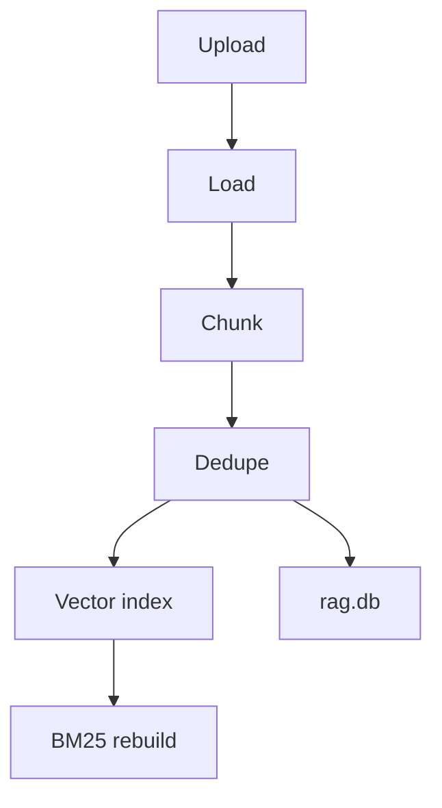

---

## Slide 22 — RAG retrieval (ask → answer)

**On slide**
1. Query expansion  
2. BM25 keyword search  
3. Dense vector search  
4. RRF fusion  
5. Rerank  
6. Guardrailed LLM answer + sources  

**Diagram**

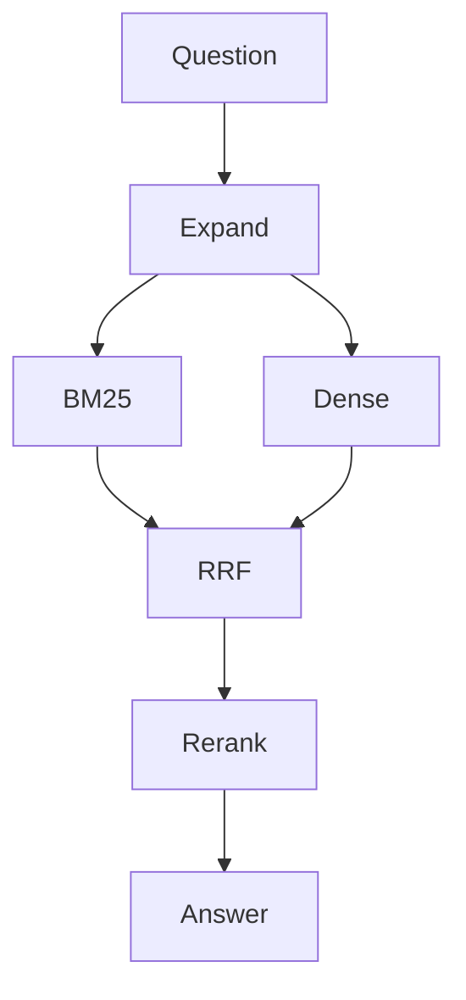

**Say:** “Hybrid search catches exact LOT codes and paraphrased questions.”

---

## Slide 23 — Agent & tools

**On slide**
- LangGraph router picks one lane per turn: direct / rag / intake / lookup / status  
- Tools call the **same** ReportService + RAG rules as the UI  
- Circuit breaker stops repeated bad tool calls  
- Close triggers HITL interrupt (human must approve)

**Diagram**

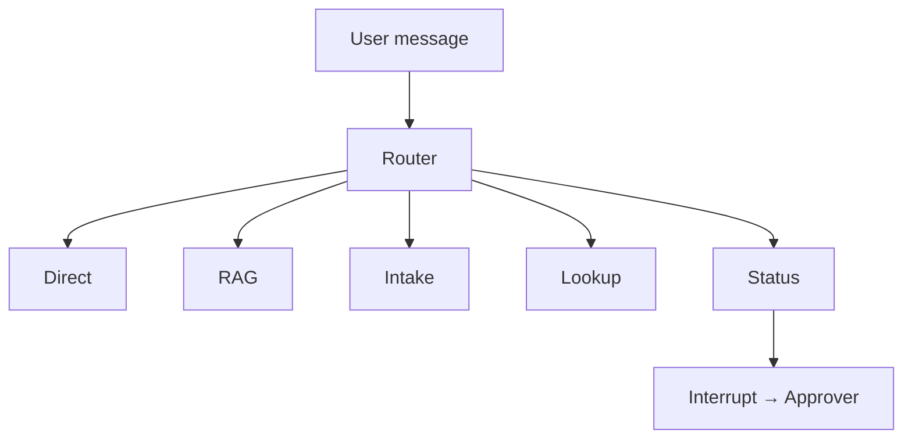

---

## Slide 24 — Agent HITL close (deep)

**On slide**
1. Reviewer asks agent to close REF + notes  
2. Case becomes pending  
3. Graph pauses (checkpoint saved)  
4. Approver resolves on HITL Approvals  
5. Graph resumes → Closed or stays In Review  

**Say:** “AI can request. Humans stamp.”

---

## Slide 25 — Tracing & monitoring

**On slide**
- **Audit** = who did what (proof notebook)  
- **Observability** = how AI steps ran (camera log)  
- Modes: custom SQLite / Langfuse / both  

**Diagram**

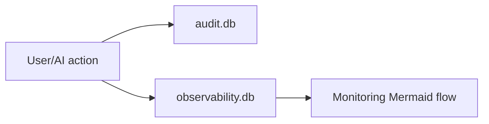

---

## Slide 26 — Evaluation & quality

**On slide**
- `pytest` for workflow/RAG/agent/LLM contracts  
- `python -m evaluation.run_eval` → classic metrics + RAGAS  
- Locust / load probe for smoke under concurrency  

**Say:** “We don’t only demo — we measure.”

---

## Slide 27 — MCP integration

**On slide**
- Same agent tools exposed via FastMCP  
- In-app backend can run `local` or `mcp` tool mode  
- Cursor / MCP Inspector can call the same functions  

**Say:** “One tool brain — multiple doors (web UI and MCP clients).”

---

## Slide 28 — Multi-database design (why 4 DBs)

**On slide**

| DB | Purpose |
|---|---|
| core | users, reports, chat, HITL |
| audit | proof events |
| rag | doc/chunk inventory |
| observability | AI spans/tokens |

**Say:** “If AI logs get noisy, proof and live cases stay clean.”

---

## Slide 29 — LLM roles (cost-aware design)

**On slide**
- Cheap models for router / rewrite  
- Stronger models for RAG answer / response drafting  
- Groq key pool + Google fallback  
- Mock mode for offline demos  

---

## Slide 30 — Guardrails everywhere

**On slide**
- Central prompts in `rag/prompts.py` and `agents/prompts.py`  
- Tool validation (LOT, AE fields, transitions)  
- RBAC permissions  
- HITL on close  
- Circuit breaker  
- Refusal on causality / treatment / reportability  

---

## Slide 31 — Backend section recap

**On slide**
“Validated intake → enforced workflow → searchable knowledge → governed agent → visible proof.”

---

# PART E — Scenarios, time & cost

## Slide 32 — Scenario 1: Without this system (Excel world)

**On slide story**
- 1 packaging complaint + 1 AE call  
- 20–40 min hunting fields / chats / SOP PDF  
- Risk of wrong lot format entering sheet  
- Close without approver possible  
- Manager cannot reconstruct trail  

**Pain score:** High time waste + high audit risk

---

## Slide 33 — Scenario 2: With system (no agent) — forms only

**On slide steps**
1. Operator Intake → REF created in seconds  
2. Reviewer Dashboard → Start Review → Request Close  
3. Approver HITL Approve  
4. Admin/Reviewer asks Knowledge Query for SOP  
5. Audit shows full trail  

**Problems solved:** validation, ownership, HITL, searchable SOPs, proof

---

## Slide 34 — Scenario 3: With agent (assisted desk)

**On slide**
- Operator: “File PQC for NeuroCalm LOT-88392…” → REF via chat  
- Reviewer: “Move REF to In Review” / “Request close + notes”  
- Agent pauses for HITL  
- Approver resolves  
- Same rules as forms — faster interaction  

**Say:** “Agent is a junior assistant with a rulebook — not an autopilot.”

---

## Slide 35 — Time savings (illustrative training estimate)

> Frame clearly: **illustrative estimates for a training/demo desk**, not audited enterprise ROI.

**On slide**

| Task | Without system | With system (forms) | With agent assist |
|---|---|---|---|
| Capture 1 clean case | 10–15 min (rework) | 2–4 min | 1–3 min |
| Find SOP answer | 10–20 min folder hunt | 30–90 sec RAG | 30–90 sec |
| Triage + close handshake | 15–30 min chat ping-pong | 5–8 min | 4–7 min |
| Rebuild audit story | 30–60 min | 2–5 min | 2–5 min |
| **Typical 5-case morning** | **~2–3 hrs friction** | **~40–60 min** | **~30–50 min** |

**Headline:** Roughly **50–70% less coordination time** on the demo workflow path.

**Canva visual:** Big “~60% less busywork” callout + table.

---

## Slide 36 — Cost savings (illustrative)

**On slide (keep honest)**

| Cost type | How this prototype reduces it |
|---|---|
| People time | Less rework, less chat chasing, faster SOP answers |
| Rework cost | Bad LOT/AE blocked before save |
| Audit/inspection scramble | Trail already exists |
| Unsafe AI risk | Guardrails reduce “confident wrong answer” exposure |
| Tooling lock-in | Local + pluggable providers (swap LLM/vector later) |

**Example framing (for demo math only):**  
If a reviewer+operator pair saves **~1.5 hours/day** of coordination at a blended internal cost of **$40/hour**, that’s about **$60/day** or **~$1,200/month** in avoided busywork for that small desk — before counting audit panic cost.

**Say:** “These are directional training estimates to show the shape of value — not a finance-approved ROI model.”

---

# PART F — Screenshot storyboard (real UI)

Leave a large screenshot placeholder on each slide.  
Under it, put the **question you ask the audience** and the **answer you show**.

### Capture checklist (do this once live)

| # | Page | Login as | What to show on screen |
|---|---|---|---|
| S1 | Login | — | Role chips |
| S2 | Intake PQC | operator | NeuroCalm / LOT-88392 success REF |
| S3 | Intake validation | operator | Bad LOT error |
| S4 | Intake AE | operator | Extra AE fields |
| S5 | Dashboard New | reviewer | Filter + Start Review |
| S6 | Request Close | reviewer | pending close badge |
| S7 | HITL Approvals | approver | Approve / Reject |
| S8 | Admin Docs | admin | Upload + chunk strategy |
| S9 | Knowledge Query | reviewer | Answer + sources drawer |
| S10 | Agent create | operator | Chat create REF |
| S11 | Agent close HITL | reviewer→approver | Interrupt toast + resolve |
| S12 | Audit | reviewer | created/status/HITL rows |
| S13 | Observability | admin/reviewer | Mermaid trace flow |

---

## Slide 37 — Screenshot: Login

**Audience question:** “Who is allowed to do what?”  
**You show:** Different menus after logging in as operator vs approver vs admin.  
**Answer:** Role-based navigation + API permissions.

---

## Slide 38 — Screenshot: Intake (operator)

**Audience question:** “How do we stop garbage data?”  
**You show:** Successful PQC REF + failed bad LOT.  
**Answer:** Validation before database write.

**Follow-up question:** “What changes for Suspected AE?”  
**Show:** event description + onset date fields appear/required.

---

## Slide 39 — Screenshot: Reviewer Dashboard

**Audience question:** “How does work move without Excel status chaos?”  
**You show:** Start Review → In Review → Request Close → pending badge.  
**Answer:** Enforced state machine + notes for approver.

---

## Slide 40 — Screenshot: Approver HITL

**Audience question:** “Who is accountable for close?”  
**You show:** Approve one case, Reject another.  
**Answer:** Two-person control; both paths audited.

---

## Slide 41 — Screenshot: RAG for reviewer / operator

**Audience question:** “How does a reviewer get SOP answers fast?”  
**You show:** Ask packaging / LOT quarantine question → sources.  
**Then ask:** “Can it invent FDA reportability?” → show refusal / insufficient evidence.

**Roles angle**
- Operator: quick checklist answers while capturing  
- Reviewer: policy confirmation during triage  
- Approver: optional context before stamp  
- Admin: maintains corpus quality via Admin Docs  

---

## Slide 42 — Screenshot: Agent intake + review

**Audience question:** “What does the agent change?”  
**You show:**
1. Agent creates intake (same LOT rules)  
2. Agent moves to In Review  
3. Agent requests close → HITL pause  
4. Approver resolves  

**Answer:** Same business rules, faster natural-language path.

---

## Slide 43 — Screenshot: Audit + Monitoring

**Audience question:** “Can we prove it — and debug the AI?”  
**You show:** Audit trail for REF + Observability span diagram for RAG/agent.  
**Answer:** Two notebooks — people proof vs AI CCTV.

---

# PART G — Close the story

## Slide 44 — End-to-end value story

**On slide**

```text
Clean capture → Clear ownership → Human-approved close
→ Searchable knowledge → Assisted actions → Visible proof
```

**Say:** “That is the full product loop.”

---

## Slide 45 — What we delivered (implementation snapshot)

**On slide**
- React + FastAPI split stack  
- 4 local databases  
- Hybrid RAG + 5 chunk strategies  
- LangGraph agent + MCP parity  
- HITL workflow  
- Tracing + evaluation harness  
- Full docs pack for backend/frontend/demo  

---

## Slide 46 — Governance & honesty

**On slide**
- Synthetic data only  
- Hard bans on medical/regulatory decisions  
- Local training prototype — not production PV system  
- Designed to teach the right operating model  

---

## Slide 47 — Live demo offer / next steps

**On slide**
1. 10-minute happy path demo  
2. 5-minute AI (RAG + Agent HITL)  
3. Optional deep dive on eval/MCP  

**CTA:** “I can run the walkthrough live from `MANAGER_DEMO_WALKTHROUGH.md`.”

---

## Slide 48 — Q&A prompts you should expect

| Question | Short answer |
|---|---|
| Better than Excel? | Validation + workflow + audit |
| Can AI close alone? | No — HITL required |
| Hallucination control? | Retrieval grounding + refusals + traces |
| Production ready? | Training prototype; architecture is production-shaped |
| Cloud? | Local-first; providers pluggable |

---

## Slide 49 — Thank you

**On slide**
- Thank you  
- Project name  
- Contact / GitHub link if allowed  
- “Questions?”

---

## Appendix — Canva asset kit

### Color suggestion (simple, professional)
- Background: soft cool gray / white  
- Primary: deep teal or navy  
- Accent: amber for warnings / HITL  
- Success: green for Closed / validated  

### Icons to use
- Clipboard (intake)  
- Users (roles)  
- Lock (HITL)  
- Books (RAG)  
- Robot (agent)  
- Chart (monitoring)  
- Shield (guardrails)  

### Mermaid → Canva tip
1. Open any doc Mermaid in preview  
2. Screenshot clean diagram  
3. Place on dark/light card in Canva  
OR redraw with Canva flowchart for sharper fonts  

### Screenshot capture settings
- Browser zoom 100–110%  
- Hide bookmarks bar  
- Use consistent demo data (NeuroCalm / LOT-88392 / CardioSafe)  
- Blur nothing needed (synthetic already)  

---

## Appendix — 15-slide executive cut (AI-first) — FULL Canva script

Use **only these 15 slides** for a short manager / outsider talk (~12–15 minutes).  
Copy each block into Canva as-is.

**SOP reminder for audience:** SOP = Standard Operating Procedure = company official “how we do this work” PDF.

---

### E1 — Title

**On slide**
- Pharma Safety Intake & Triage Tracker  
- **AI + RAG + Agentic AI** for safety intake  
- Local training prototype · synthetic data only  
- Your name · date  

**Say:** “Today I’ll show a real operations problem — and how governed AI fixes it without removing human control.”

---

### E2 — What work is this? (30 seconds)

**On slide**

Pharma teams receive two kinds of reports:

1. **PQC** — Product Quality Complaint (damaged pack, wrong label, broken tablet…)  
2. **Suspected AE** — Adverse Event report (“after medicine, something unexpected happened”) *(fake stories only in this demo)*

Someone must: capture → review → find the rule → close with permission → prove later.

**Say:** “Think of it like a reception desk for product problems. If intake is messy, everything after it is messy.”

---

### E3 — Business problem in 4 boxes

**On slide title:** What is broken today?

| # | Problem | Feels like |
|---|---|---|
| 1 | Cases in **email + Excel + chat** | Same case has 3 versions |
| 2 | Weak process / unclear owner | Work stalls or closes by accident |
| 3 | **SOP** PDFs buried in folders | New joiners waste 20–40 minutes |
| 4 | Open AI chat with no brakes | Answers may be invented |

**Big line:**

> Messy cases + missing knowledge + unsafe AI = **slow work + high risk**

**Say:** “This is not ‘we need a website.’ This is an operations and trust problem.”

---

### E4 — Monday chaos story

**On slide**

| Time | What happens |
|---|---|
| 9:05 | Call: “dizzy… batch maybe 45?” → half-filled Excel |
| 11:30 | New joiner hunts SOP PDF for a simple rule |
| 2:00 | Someone types `Closed` — no Approver |
| 4:30 | Manager asks for proof — team panics |

**Say:** “Nobody is lazy. The tools force hunting, guessing, and copy-paste.”

---

### E5 — Why raw ChatGPT is not enough

**On slide**

| They hope | Reality |
|---|---|
| Find the SOP rule | Public chat does **not** know *your* company docs |
| Create the case | Cannot write into your system of record |
| Close the case | No Approver / permission model |
| Prove what happened | No durable company audit trail |

**Big line:**

> Business needs AI that uses **company knowledge**, takes **controlled actions**, and **stops** when humans must decide.

**Say:** “So our answer is not ‘add a chatbot.’ It is RAG + Agentic AI with guardrails.”

---

### E6 — Solution in one breath

**On slide**

Three layers:

| Layer | Plain meaning |
|---|---|
| **1. Clean workflow** | Validated intake + roles + Approver close |
| **2. RAG** | Answers from **your uploaded SOP docs** + sources |
| **3. Agentic AI** | AI uses approved **tools** to create / triage cases |

**Memorize line (huge):**

> **AI finds the knowledge. Agents do the busywork. Humans keep the final decision.**

---

### E7 — What is RAG?

**On slide title:** RAG = Ask your documents, not the internet

1. Admin uploads company SOP / training PDFs  
2. System indexes them (chunks)  
3. Reviewer asks a question  
4. System retrieves matching passages from **your** docs  
5. AI answers **using those passages** and shows sources  

**Business impact:** stops PDF hunting + stops invented SOP rules.

**Audience question to ask:** “Where did this answer come from?” → point at sources.

---

### E8 — What is Agentic AI?

**On slide title:** Agentic AI = AI that can do steps, not only talk

**Chatbot:** gives advice → you still do the work.  
**Our agent:** calls approved tools inside the product.

Tools examples:
- create / update case  
- move to review  
- ask RAG about SOPs  
- summarize case  
- **request** close (Approver still required)

**Cannot:** skip roles · force close · invent medical causality / treatment / reportability

**Say:** “A controlled junior teammate — not an autopilot.”

---

### E9 — Money slide: pain → AI impact

**On slide**

| Business pain | With our AI |
|---|---|
| Slow / incomplete intake | Agent helps create validated case |
| “Where is the SOP rule?” | RAG answers in seconds + source |
| Reviewer overload | Agent summarizes + next allowed step |
| Risky close | Request close → **human Approver** |
| No proof | Traces + audit exist |

**Caption:** RAG saves search time · Agents save handling time · HITL saves risk cost

---

### E10 — Before vs After Monday

**On slide**

| Moment | Before | After |
|---|---|---|
| Intake call | Half Excel row | Validated case + REF ID (form or agent) |
| SOP question | 20–40 min hunt | RAG answer + citation |
| Triage | Chat ping-pong | Agent / workflow tools |
| Close | Silent Excel close | Approver HITL gate |
| Manager ask | Panic | Audit trail ready |

---

### E11 — Time & cost (illustrative)

> Say clearly: **demo/training estimates**, not audited finance ROI.

**On slide**

| Task | Without system | With RAG + Agent desk |
|---|---|---|
| Capture 1 clean case | 10–15 min | 1–3 min |
| Find SOP answer | 10–20 min | ~30–90 sec |
| Triage + close handshake | 15–30 min | ~4–7 min |
| Rebuild audit story | 30–60 min | ~2–5 min |
| **5-case morning** | **~2–3 hrs friction** | **~30–50 min** |

**Headline:** about **50–70% less coordination busywork** on the demo path.

Optional demo math: ~1.5 hrs/day saved × $40/hr ≈ **~$60/day** / **~$1,200/month** for a small desk (directional only).

---

### E12 — Screenshot: RAG in reviewer hands

**Leave big screenshot placeholder.**

**Audience question:** “How does a reviewer get an SOP answer fast?”  
**You show:** Knowledge Query → answer + sources drawer.  
**Follow-up:** “Can it invent FDA reportability?” → show refusal / insufficient evidence.

**Say:** “This is RAG impacting the business problem live — knowledge without guessing.”

---

### E13 — Screenshot: Agent creating / reviewing case

**Leave big screenshot placeholder.**

**Audience question:** “How does Agentic AI save handling time?”  
**You show:**  
1. Operator/agent: “File PQC for NeuroCalm LOT-88392…” → creates REF  
2. Reviewer/agent: summarize / move to review / request close  
3. Approver still decides close  

**Say:** “Same business rules as forms — faster interaction, still governed.”

---

### E14 — What AI must never decide

**On slide (trust slide)**

AI / Agent will **never** decide:
- medical **causality**  
- **treatment** advice  
- regulatory **reportability**  

Also: synthetic data only · local-first training prototype

**Say:** “These are safety fences — not missing features.”

---

### E15 — Thank you / Q&A

**On slide**
- Thank you  
- Questions welcome  
- Optional live demo next  

**Prompt questions you can offer:**
- “Show me RAG with sources”  
- “Show agent create a case”  
- “Show Approver rejecting a close”  
- “What happens if the LLM is down?” (circuit breaker)

---

## Speak-this-out-loud script (2 minutes — memorize this)

Use this if someone asks: *“Explain the business problem and AI solution simply.”*

> “Pharma teams get quality complaints and suspected adverse-event reports every day.  
> Today that work often sits in email, Excel, and chat. Cases are incomplete, ownership is unclear, SOPs — the official company how-to documents — are hard to find, and if people paste into open ChatGPT the answer may be invented.  
>  
> We built a digital intake desk.  
> **RAG** means the AI answers from *our uploaded SOPs* with sources — so reviewers stop hunting PDFs.  
> **Agentic AI** means the AI can use approved tools to create and triage cases — but closing still needs a human Approver.  
>  
> So: AI finds knowledge, agents do busywork, humans keep the final decision. That is how we cut time without increasing risk.”

---

## Related docs while presenting

| Need | Open |
|---|---|
| Live click script | [`MANAGER_DEMO_WALKTHROUGH.md`](./MANAGER_DEMO_WALKTHROUGH.md) |
| Business depth | [`BUSINESS_PROBLEM_AND_SOLUTION.md`](./BUSINESS_PROBLEM_AND_SOLUTION.md) |
| Backend depth | [`backend/README.md`](./backend/README.md) |
| Frontend depth | [`frontend/README.md`](./frontend/README.md) |

---

*End of Canva Presentation Guide — use slide-by-slide while designing the deck.*
