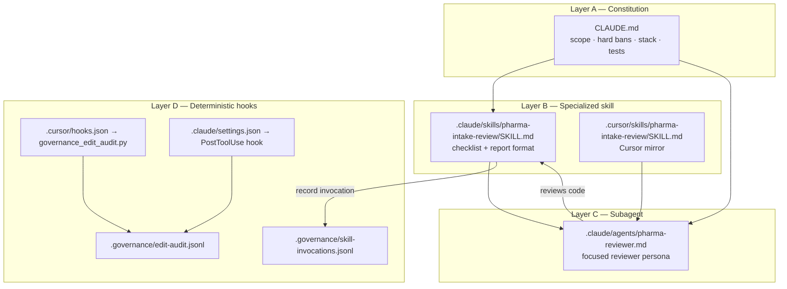

# Claude Governance End-to-End — Skills, Subagent & Hooks

This document is the **presentation map** for capstone deliverables around AI governance:
persistent guidance (`CLAUDE.md`), specialized review skill, subagent, and deterministic hooks.

> Runtime product agent (LangGraph) ≠ Claude/Cursor coding agents.  
> This page is about **how we govern AI-assisted development**, not the in-app intake agent.

---

## 1. One picture



| Layer | Artifact | What a manager should hear |
|---|---|---|
| Constitution | `CLAUDE.md` | Always-on contract: no clinical decisions, synthetic data, local stack |
| Skill | `.claude/skills/.../SKILL.md` | Reusable checklist the coding agent loads for reviews |
| Subagent | `.claude/agents/pharma-reviewer.md` | Narrow reviewer that only audits against the skill |
| Hooks | Cursor + Claude PostToolUse | **Deterministic** JSONL audit of file edits (not model judgment) |

---

## 2. What belongs where? (defense Q1)

| Put in `CLAUDE.md` | Put in a skill | Put in a subagent | Put in a hook |
|---|---|---|---|
| Global bans + stack | Domain review checklist | Persona + when to review | Machine-logged edit events |
| Always-true coding rules | Output report template | Tool allow-list for review | No secrets / no chat text |
| Test commands | “When to invoke” | Points back to skill + CLAUDE.md | Fail-open; never blocks edits |

**Why skills ≠ constitution:** skills are *task-specific* and loaded on demand.  
**Why hooks ≠ skills:** hooks are *deterministic scripts*; they do not “decide” quality — they only record that an edit happened.

---

## 3. File map (repo)

```text
CLAUDE.md
.claude/
  settings.json                 # Claude Code hooks registration
  agents/
    pharma-reviewer.md          # Subagent
  skills/
    pharma-intake-review/
      SKILL.md                  # Review skill
  hooks/
    governance_edit_audit.py    # PostToolUse → edit-audit.jsonl
    record_skill_invocation.py  # Evidence that skill was run
.cursor/
  hooks.json                    # Cursor afterFileEdit + postToolUse
  hooks/
    governance_edit_audit.py
  skills/
    pharma-intake-review/
      SKILL.md                  # Same skill for Cursor
.governance/
  edit-audit.jsonl              # Hook evidence
  skill-invocations.jsonl       # Skill evidence
```

---

## 4. Live demo script (5 minutes)

### Step A — Show the constitution
Open `CLAUDE.md`. Say:

> “This is persistent guidance every coding agent sees: hard bans, stack, testing.”

### Step B — Invoke the skill (review)
In Claude Code / Cursor Agent chat:

```text
Use the pharma-intake-review skill and review backend/app/modules/agents/prompts.py
and backend/app/modules/rag/prompts.py for guardrail completeness.
```

Expect a PASS / FAIL report using the skill template.

Then record evidence:

```bash
python .claude/hooks/record_skill_invocation.py --skill pharma-intake-review --verdict PASS --files backend/app/modules/agents/prompts.py backend/app/modules/rag/prompts.py --note "Guardrail prompts centralized"
```

Show `.governance/skill-invocations.jsonl`.

### Step C — Subagent
Ask:

```text
Launch the pharma-reviewer subagent to review the latest agent/RAG prompt changes.
```

Point at `.claude/agents/pharma-reviewer.md` — it is a **narrow reviewer**, not a feature builder.

### Step D — Hook proof (deterministic)
1. Make a tiny safe edit (e.g. add a blank line in a markdown doc) via the agent, **or** simulate:

```bash
echo {"tool_name":"Write","file_path":"docs/GOVERNANCE_CLAUDE_SKILLS_HOOKS.md"} | python .claude/hooks/governance_edit_audit.py
```

2. Open `.governance/edit-audit.jsonl` → last line shows `timestamp`, `tool_name`, `file_path`, `source`.
3. Emphasize: **no user prompt text, no code diffs, no secrets** in the log.

Cursor side is already registered in `.cursor/hooks.json` (`afterFileEdit` + `postToolUse`).

---

## 5. How this differs from the in-app LangGraph agent

| | Claude/Cursor governance | In-app product agent |
|---|---|---|
| Audience | Developers building the app | Operators / reviewers using the app |
| Tools | Edit files, run pytest | `submit_intake_report`, RAG, status, HITL |
| Memory | Chat + repo | STM traces + SQLite LTM |
| Guardrails | CLAUDE.md + skill + hooks | `agents/prompts.py` + circuit breaker + HITL |

Do **not** conflate them in the presentation.

---

## 6. Capstone checklist mapping

| Deliverable | Proof in this repo |
|---|---|
| CLAUDE.md | Root `CLAUDE.md` |
| Project review skill | `.claude/skills/pharma-intake-review/SKILL.md` (+ Cursor mirror) |
| Subagent | `.claude/agents/pharma-reviewer.md` |
| Governance hook | `.cursor/hooks.json` + `.claude/settings.json` + hook scripts |
| Execution log | `.governance/edit-audit.jsonl` |
| Skill invocation evidence | `.governance/skill-invocations.jsonl` |

---

## 7. Talking points (defense)

1. **Architectural boundary** — Constitution = always; skill = on-demand review; hook = deterministic telemetry.
2. **Planning efficiency** — Plan Mode / `docs/IMPLEMENTATION_PLAN.md` locked data flow before code.
3. **Governance control** — Hooks never “reason”; they append structured JSON. That is why they are auditable.
4. **Production readiness** — Before real PV systems: IdP, validated hosting, secret management, change-control on hooks/skills themselves.
