# How to use NovaCure Safety Intake — full guide

This document is written so **anyone on the team** can run the demo without prior context: what the app is, how pieces connect, who clicks what, and many copy-paste examples (especially for the **Agent**).

> **New here / domain words feel hard?** Start with the toy-shop story first:  
> **[`docs/SIMPLE_STORY_GUIDE.md`](SIMPLE_STORY_GUIDE.md)** — same project explained for a 10-year-old, with pictures (Mermaid flows).

> **Training prototype only.** All data is fictional. The system never assesses causality, never recommends treatment, and never decides regulatory reportability.

---

## Table of contents

1. [What this application is](#1-what-this-application-is)
2. [Visual map of the whole system](#2-visual-map-of-the-whole-system)
3. [Who does what (roles)](#3-who-does-what-roles)
4. [Start the servers](#4-start-the-servers)
5. [Index knowledge into ChromaDB](#5-index-knowledge-into-chromadb)
6. [Operator deep dive — create 5 reports](#6-operator-deep-dive--create-5-reports)
7. [Reviewer deep dive — triage & request close](#7-reviewer-deep-dive--triage--request-close)
8. [Approver deep dive — HITL decisions](#8-approver-deep-dive--hitl-decisions)
9. [Knowledge Query deep dive](#9-knowledge-query-deep-dive)
10. [Agent Chat deep dive (with many examples)](#10-agent-chat-deep-dive-with-many-examples)
11. [End-to-end demo script (20–30 min)](#11-end-to-end-demo-script-2030-min)
12. [Troubleshooting](#12-troubleshooting)
13. [Glossary](#13-glossary)

---

## 1. What this application is

NovaCure Safety Intake is a **local training app** that mimics how a pharma safety / quality team might:

1. **Capture** fictional intake reports (Product Quality Complaint or Suspected Adverse Event)
2. **Triage** them (New → In Review → Closed)
3. Require a **second human** before close (**HITL** = Human-In-The-Loop)
4. **Search SOPs** with hybrid RAG (documents in ChromaDB + BM25)
5. Use an **Agent** that can answer *and* take actions (create report, change status, look up REFs)

Think of three “lanes” you will use:

| Lane | Page | Plain English |
|---|---|---|
| Forms & board | Intake + Dashboard | Humans type reports and click status buttons |
| Library Q&A | Knowledge Query | Ask the indexed SOPs; does **not** change reports |
| Smart assistant | Agent Chat | Ask in natural language; can **search and act** |

---

## 2. Visual map of the whole system

### 2.1 High-level architecture

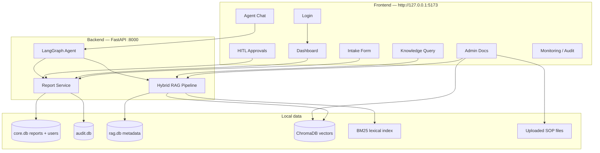

### 2.2 Happy-path business flow (people)

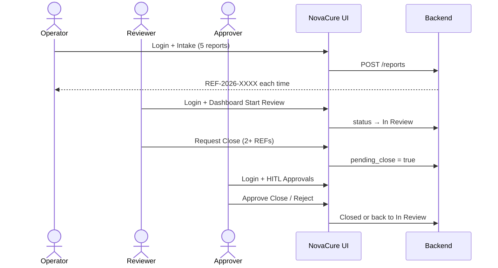

### 2.3 Report status state machine

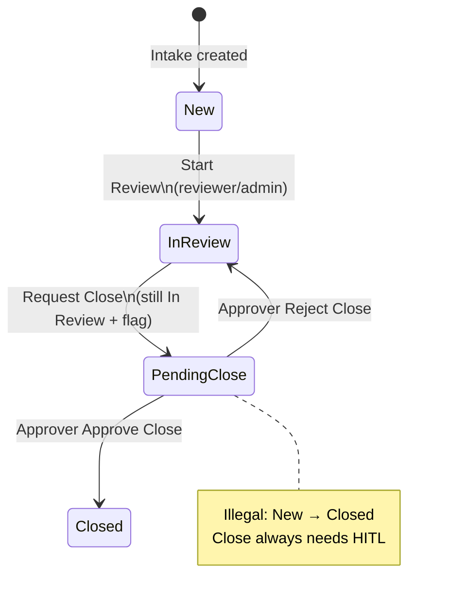

---

## 3. Who does what (roles)

### 3.1 Role map (visual)

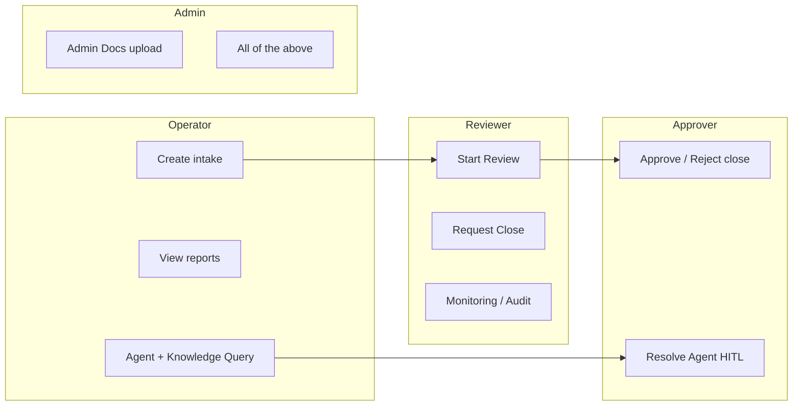

### 3.2 Permissions cheat-sheet

| Page / action | Operator | Reviewer | Approver | Admin |
|---|---|---|---|---|
| View report detail | Yes | Yes | Yes | Yes |
| Create intake (form) | Yes | Yes | No | Yes |
| Start Review | No | Yes | No | Yes |
| Request Close | No | Yes | No | Yes |
| Approve / Reject close | No | No | Yes | Yes |
| Agent Chat | Yes | Yes | Yes | Yes |
| Knowledge Query | Yes | Yes | Yes | Yes |
| Admin Docs | No | No | No | Yes |
| Monitoring | No | Yes | No | Yes |
| Audit Trail | No | Yes | Yes | Yes |

### 3.3 Passwords (sample users)

| Username | Password | Role |
|---|---|---|
| `operator` | `Operator@123` | operator |
| `operator2` | `Operator2@123` | operator |
| `reviewer` | `Reviewer@123` | reviewer |
| `reviewer2` | `Reviewer2@123` | reviewer |
| `approver` | `Approver@123` | approver |
| `approver2` | `Approver2@123` | approver |
| `admin` | `Admin@123` | admin |
| `admin2` | `Admin2@123` | admin |

Login chips on the Login page fill these for you.

---

## 4. Start the servers

### Visual: two processes

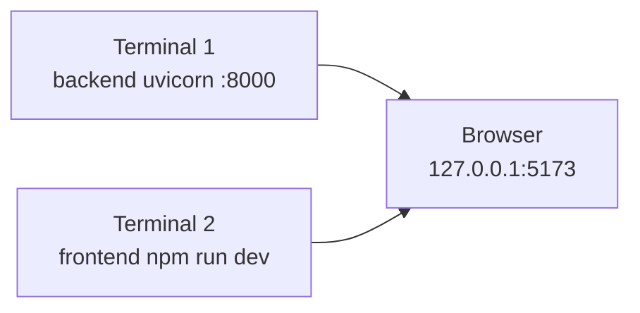

### Commands

**Backend**
```bash
cd backend
.\.venv\Scripts\activate
uvicorn app.main:app --reload --port 8000
```

**Frontend**
```bash
cd frontend
npm run dev
```

Open **http://127.0.0.1:5173**  
API docs (optional): **http://127.0.0.1:8000/docs**

---

## 5. Index knowledge into ChromaDB

### Why this step matters

Without indexed SOPs:

- Knowledge Query often shows **Insufficient evidence**
- Agent RAG answers are weak or empty

With indexing, both can ground answers on packaging / HITL / AE SOPs.

### Visual: ingest pipeline

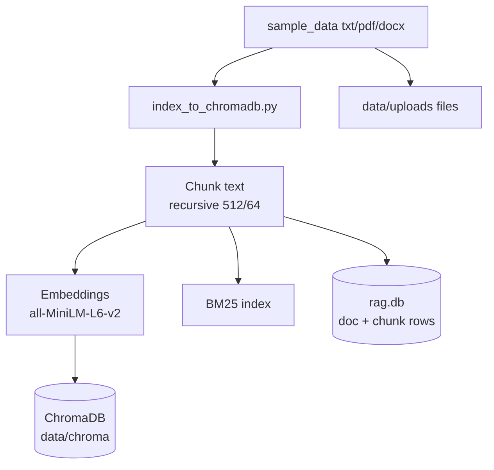

### Which files

| Stem | Ask about… |
|---|---|
| `SOP-LOT-QUARANTINE-PACKAGING-101` | Packaging, LOT-88392, quarantine **4 business hours** |
| `SOP-INTAKE-TRIAGE-HITL-102` | Mandatory fields, status workflow, HITL |
| `SOP-AE-PQC-AGENT-RAG-103` | AE vs PQC, agent rules, retrieval |

Each stem exists as `.txt`, `.pdf`, and `.docx` (9 files total).

### Steps (do once, then restart API)

1. Confirm `backend/.env`:
   ```env
   VECTOR_STORE_PROVIDER=chromadb
   CHROMA_DIR=./data/chroma
   ```
2. Run:
   ```bash
   cd backend
   .\.venv\Scripts\activate
   pip install chromadb
   python ..\sample_data\index_to_chromadb.py
   ```
3. Look for: `Done. indexed=9` (or `SKIP` if already there)
4. Stop and restart `uvicorn`
5. Login as `admin` → **Admin Docs** → confirm documents appear

**Alternate:** upload the same files in **Admin Docs** (admin only) instead of the script.

**Sanity-check question** (Knowledge Query or Agent):

```text
What should we do for a packaging complaint on LOT-88392?
```

You want an answer that mentions quarantine timing and/or `qc-desk@novacure.example` (fictional).

---

## 6. Operator deep dive — create 5 reports

**Login:** `operator` / `Operator@123`

### What the operator is responsible for

- Capture complete fictional intake rows
- Confirm each REF was saved (View modal)
- Optionally ask the Agent / Knowledge Query for SOP guidance
- **Not** responsible for Start Review or Close

### Visual: operator loop

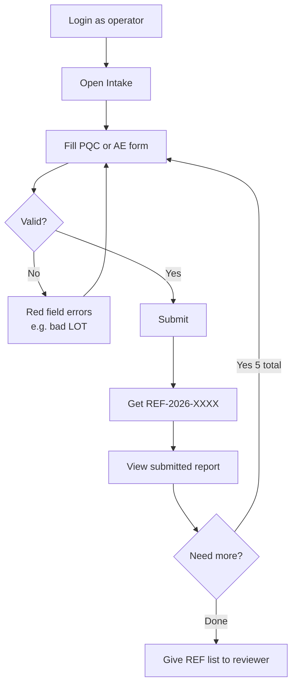

### Exact example set (create all five)

Go to **Intake**. After each submit, write down the REF.

| # | Report type | Product | Lot | Extra fields | Description |
|---|---|---|---|---|---|
| 1 | Product Quality Complaint | NeuroCalm 50mg | `LOT-88392` | — | Bottle seal broken on arrival (fictional) |
| 2 | Product Quality Complaint | CardioSafe 10mg | `LOT-12045` | — | Crushed outer shipper (fictional) |
| 3 | Product Quality Complaint | AllergyClear 5mg | `LOT-33018` | — | Loose desiccant (fictional) |
| 4 | Suspected Adverse Event | CardioSafe 10mg | `LOT-12045` | **Event description** + **Event onset date** required | Dizziness / lightheaded (fictional) |
| 5 | Product Quality Complaint | PainAway Gel | `LOT-44102` | — | Carton count mismatch (fictional) |

### Validation rules (easy to remember)

- Lot must match **`LOT-` + exactly 5 digits** → `LOT-88392` OK, `LOT-8839` / `ABC` fail
- AE without onset date / event description → fails
- After save: **View submitted report** or Dashboard **View** / clickable REF

### Operator Dashboard tips

- Filters: Status = All / New / In Review / Closed; Report type = PQC or AE
- Closed rows still have **View** (full detail modal)
- You will **not** see Start Review / Request Close as operator

---

## 7. Reviewer deep dive — triage & request close

**Logout → Login:** `reviewer` / `Reviewer@123`

### Visual: reviewer path

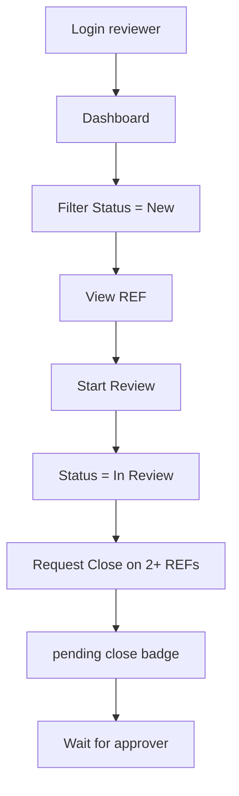

### Step-by-step

1. **Dashboard** → Status **New**
2. For each operator REF: **View** → read narrative → **Start Review**
3. Filter **In Review**
4. On **at least two** reports: **Request Close**
5. Confirm badge shows **pending close** (still In Review until approver acts)

### What “Request Close” really means

It does **not** close the case. It sets a flag so an **approver** must Approve or Reject. That is the HITL gate.

### Optional reviewer extras

- **Knowledge Query** while looking at a packaging lot
- **Monitoring** → open a trace → flow diagram
- **Audit Trail** → `status_changed`, `close_requested`

---

## 8. Approver deep dive — HITL decisions

**Logout → Login:** `approver` / `Approver@123`

### Visual: two HITL queues

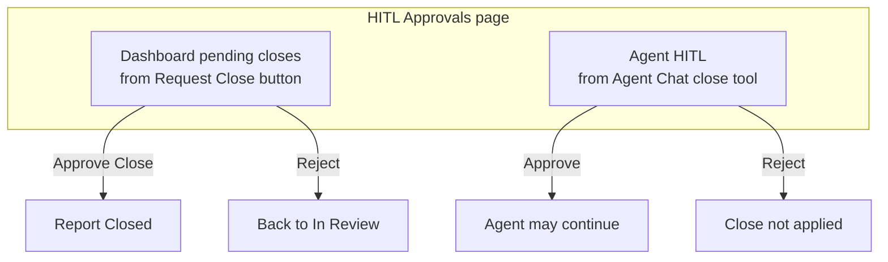

### Dashboard pending closes

1. Open **HITL Approvals**
2. Find REFs the reviewer requested
3. **Approve Close** → Closed  
   **Reject** → In Review again
4. Use Dashboard **View** if you need the full story before deciding

### Agent HITL

Only appears if someone asked the Agent to close a REF and the graph paused.

1. Same page → **Agent HITL** table  
2. Approve / Reject  
3. Return to that Agent session if needed  

Approvers typically **do not** create intake (no Intake nav).

---

## 9. Knowledge Query deep dive

**Who:** any role with query access (operator, reviewer, approver, admin)

### What it is

A **chat over the knowledge base only**. It retrieves SOP chunks and answers. It does **not** create reports or change status.

### Visual: hybrid RAG

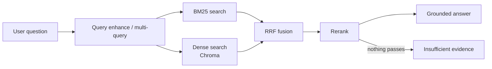

### How to use the UI

1. Open **Knowledge Query**
2. **New** session (left rail) if empty
3. Type question → **Ask**
4. Read answer bubbles in the chat log
5. Click **Show retrieval detail** only when you want JSON (expansion / sources / diagnostics) — it opens a bottom drawer so the chat stays readable

### Example questions (copy-paste)

```text
What should we do for a packaging complaint on LOT-88392?
What fields are mandatory on intake?
When is HITL required to close a report?
What is the quarantine timing for packaging complaints?
How should Suspected Adverse Event fields be filled?
What does the SOP say about lot quarantine?
```

### How to judge success

| Good answer | Weak / empty |
|---|---|
| Mentions 4 business hours / fictional QC mailbox | **Insufficient evidence** banner |
| Retrieval detail lists `DOC-…` sources | Index missing → re-run §5 |

---

## 10. Agent Chat deep dive (with many examples)

This is the most powerful page. The Agent is a **router**: it classifies your message, then may call tools.

### 10.1 Visual: agent decision tree

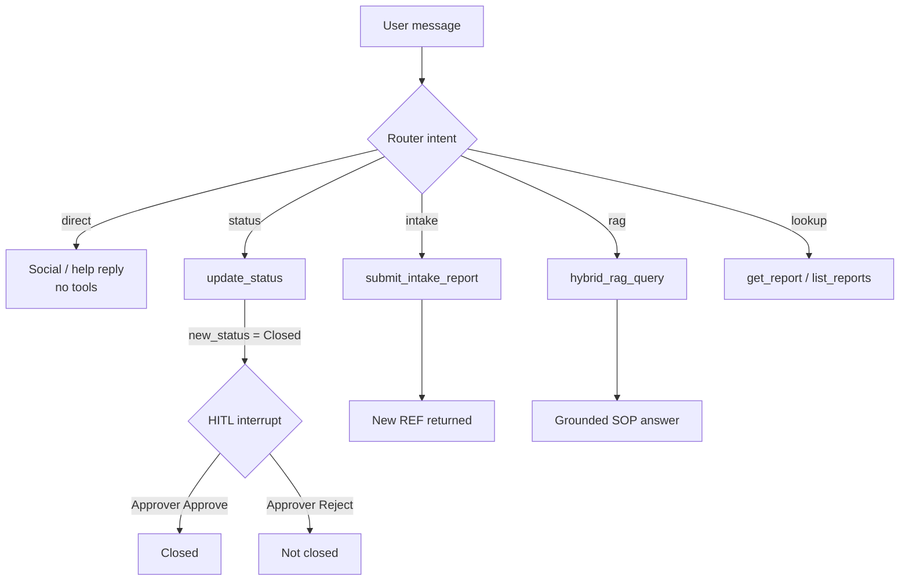

### 10.2 Tools available to the agent

| Tool | What it does | Needs HITL? |
|---|---|---|
| `hybrid_rag_query` | Search SOPs / digests | No |
| `submit_intake_report` | Create PQC/AE report | No |
| `get_report` | Fetch one REF | No |
| `list_reports` | List / filter reports | No |
| `update_status` | New→In Review, or request Closed | **Yes if Closed** |

### 10.3 How to open Agent Chat

1. Login (any chat-capable role)
2. Left nav → **Agent Chat**
3. Click **New** for a clean session (recommended for demos)
4. Type in **Message** → **Send**
5. Optional: **Optional tool args** → paste JSON to force arguments (advanced)

### 10.4 Intent → example phrases

| Intent | Say something like… |
|---|---|
| direct | `hello`, `hi`, `thanks`, `help`, `what can you help me with?` |
| rag | `What does the SOP say about lot quarantine?` |
| intake | `File a PQC for NeuroCalm LOT-88392 seal broken` |
| status | `Move REF-2026-0008 to In Review` / `Close REF-2026-0005` |
| lookup | `Show me REF-2026-0001` / `list all In Review cases` |

---

### 10.5 Worked examples (copy-paste)

Replace `REF-2026-XXXX` with a real ID from your Dashboard.

#### Example A — Greeting (direct)

```text
hello
```

**Expect:** Short friendly reply describing capabilities. No database change.

Also try: `good morning`, `thanks`, `help`

---

#### Example B — SOP packaging (rag)

```text
What should we do for a packaging complaint on LOT-88392?
```

**Expect:** Mentions quarantine within **4 business hours** and/or fictional `qc-desk@novacure.example`. Uses RAG tool.

Also try:

```text
What does the SOP say about lot quarantine?
How should intake handle broken seals?
What are mandatory AE fields?
What is the policy for HITL close approval?
```

---

#### Example C — Get one report (lookup)

```text
Show me REF-2026-0001
```

**Expect:** Product, lot, status, description for that REF.

Also: `get report REF-2026-0004`

---

#### Example D — List reports (lookup)

```text
list all In Review cases
```

Also:

```text
list reports
show recent reports
list Product Quality Complaint reports
```

---

#### Example E — Create intake via agent (intake)

Login as **operator** or **admin**.

```text
File a product quality complaint for NeuroCalm 50mg LOT-88392 — bottle seal broken on arrival (fictional). Reporter type Consumer. Date received 2026-11-03.
```

**Expect:** New `REF-2026-XXXX`. Confirm on Dashboard.

More intake prompts:

```text
create a product quality complaint for AllergyClear 5mg LOT-33018 loose desiccant
I need to log a packaging complaint for PainAway Gel LOT-44102 carton mismatch
Open a suspected adverse event for CardioSafe 10mg LOT-12045: dizziness, onset 2026-10-13, reporter Healthcare Professional
```

---

#### Example F — Start review (status)

Login as **reviewer** or **admin**.

```text
Move REF-2026-0008 to In Review
```

**Expect:** Status becomes In Review.

Also: `start review for REF-2026-0007`

---

#### Example G — Close with HITL (status)

```text
Close REF-2026-0005
```

**Expect:**

1. Agent attempts close  
2. Chat shows HITL / paused  
3. Approver → **HITL Approvals** → **Agent HITL** → Approve or Reject  
4. Optionally continue in the same Agent session  

Also: `change status of REF-2026-0005 to Closed`

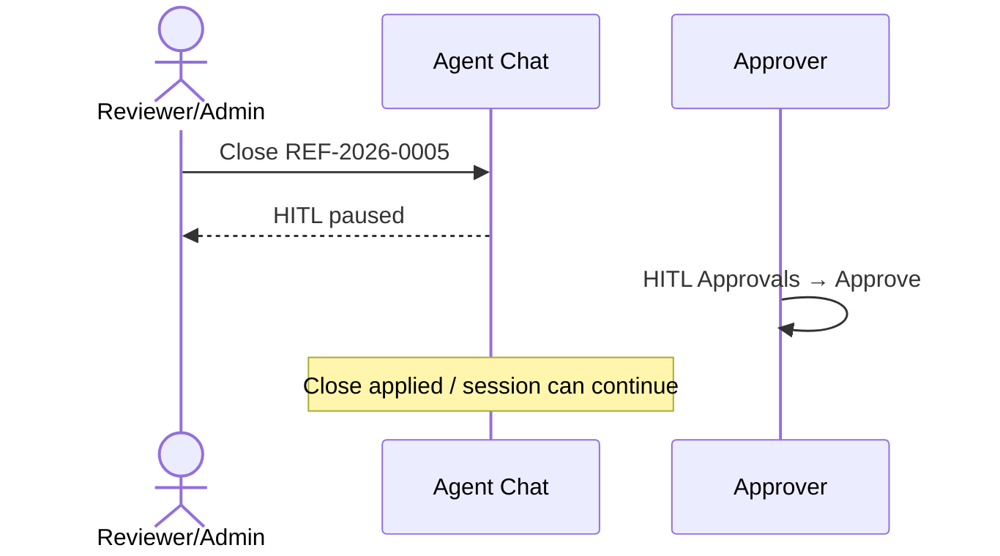

---

#### Example H — Optional tool args (advanced)

Open **Optional tool args**, paste:

```json
{"reference_id":"REF-2026-0008","new_status":"In Review"}
```

Then send a message like: `please apply this status update`

Intake-shaped args example:

```json
{
  "report_type": "Product Quality Complaint",
  "product_name": "NeuroCalm 50mg",
  "batch_lot_number": "LOT-88392",
  "date_received": "2026-11-03",
  "reporter_type": "Consumer",
  "description": "Bottle seal broken on arrival (fictional)."
}
```

---

#### Example I — Validation failure + circuit breaker

```text
Create a PQC with lot ABC
```

**Expect:** Validation error (`LOT-#####`).

If you paste the **same invalid** tool args repeatedly (more than twice), the **circuit breaker** stops the loop — shows guardrails working.

---

#### Example J — One session, multi-turn story

Keep a single Agent session and send in order:

1. `hello`  
2. `list all New reports`  
3. `What should we do for packaging complaint LOT-88392?`  
4. `Move REF-2026-0008 to In Review`  
5. `Close REF-2026-0008` → switch user to approver → resolve Agent HITL  

This one flow shows: social → lookup → RAG → status → HITL.

---

### 10.6 Agent vs Knowledge Query (decision guide)

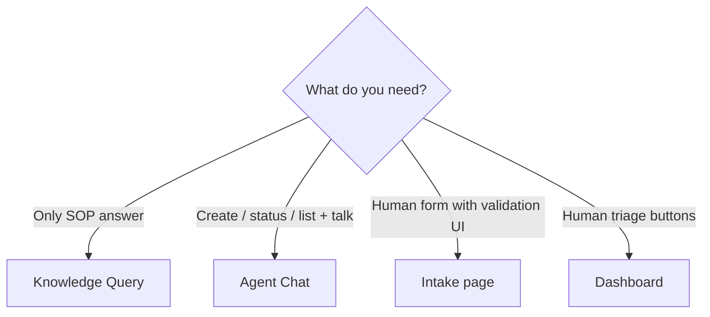

| | Knowledge Query | Agent Chat | Intake / Dashboard |
|---|---|---|---|
| Changes reports? | No | Yes | Yes |
| Best for SOP demos | Excellent | Good | — |
| Best for HITL close story | — | Excellent | Dashboard + Approvals |
| Field-level form errors | — | Weaker | Best on Intake |

### 10.7 Where to inspect agent behaviour

- Chat transcript in the session  
- **Monitoring** (admin/reviewer): agent trace → flow diagram  
- **Audit Trail**: status / HITL / tool-related events  
- **HITL Approvals**: Agent HITL queue  

---

## 11. End-to-end demo script (20–30 min)

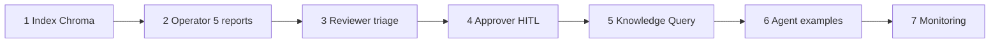

| Step | Who | Do this |
|---|---|---|
| 1 | Anyone | `python sample_data/index_to_chromadb.py` → restart API |
| 2 | operator | Create 5 Intake reports → View each |
| 3 | reviewer | Start Review all → Request Close on 2 |
| 4 | approver | Approve 1 close, Reject 1 |
| 5 | any | Knowledge Query: LOT-88392 packaging question |
| 6 | operator/admin | Agent: A, B, C, E, G (HITL) |
| 7 | admin/reviewer | Monitoring: open RAG + agent traces |

**Pass checklist**

- [ ] Five REFs exist  
- [ ] At least one Closed via HITL  
- [ ] At least one Reject close demonstrated  
- [ ] RAG answer cites quarantine guidance  
- [ ] Agent greeting + RAG + lookup + intake + close/HITL shown  

---

## 12. Troubleshooting

| Symptom | Likely cause | Fix |
|---|---|---|
| Insufficient evidence | Empty / wrong vector store | Re-index; `VECTOR_STORE_PROVIDER=chromadb`; restart API |
| Still on FAISS | Old process / .env | Update `.env`, restart uvicorn |
| Operator can’t Start Review | Role design | Use reviewer/admin |
| Approver has no Intake | Role design | Expected |
| Lot errors | Bad format | Use `LOT-88392` style |
| Close does nothing / HITL | Waiting on approver | HITL Approvals page |
| Invalid or expired token | JWT / SECRET_KEY change | Logout, refresh, login |
| Agent halted | Circuit breaker | Change args; don’t repeat same invalid payload |
| Double scroll / tiny chat on Query | Old UI | Hard refresh; use Show retrieval detail drawer |

---

## 13. Glossary

| Term | Meaning |
|---|---|
| **REF** | Report id like `REF-2026-0001` |
| **PQC** | Product Quality Complaint |
| **AE** | Suspected Adverse Event |
| **HITL** | Human-In-The-Loop — second person must approve sensitive actions (close) |
| **RAG** | Retrieval-Augmented Generation — answer from retrieved SOP chunks |
| **ChromaDB** | Local vector database for dense retrieval |
| **BM25** | Lexical (keyword) retrieval fused with dense via RRF |
| **RRF** | Reciprocal Rank Fusion — merges ranked lists |
| **Circuit breaker** | Stops repeated identical invalid tool calls |
| **Session** | Per-user chat thread (Agent or Knowledge Query) |

---

## Related files

| Path | Purpose |
|---|---|
| `sample_data/index_to_chromadb.py` | Index SOPs into Chroma |
| `sample_data/_generate_knowledge_docs.py` | Regenerate long SOP files |
| `sample_data/README.md` | Corpus inventory |
| `docs/DEMO_WALKTHROUGH.md` | Short defense script |
| `backend/app/modules/agents/graph.py` | Router intents |
| `backend/app/modules/agents/tools.py` | Agent tools |
| `backend/.env` | `VECTOR_STORE_PROVIDER=chromadb` |
