# Manager Demo Walkthrough — Deep Edition

### Pharma Safety Intake & Triage Tracker

> **One file for your live manager demo.**  
> All products, lots, people, and events are **fictional / synthetic training data only**.  
> The system **never** assesses causality, **never** recommends treatment, and **never** decides regulatory reportability.

---

## How to use this document

| Meeting length | Play |
|---|---|
| **15 min** | [Opening](#part-0--opening) → [Prep](#part-1--prep--accounts) → [Core Acts 1–7](#part-3--core-live-path-acts-1-7) → [Closing](#part-10--closing) |
| **30 min** | Add [Validation](#part-4--validation--dashboard-scenarios) + [HITL reject](#part-5--hitl-approve--reject-deep) + [RAG must-play](#part-6--knowledge-query-rag-deep) + [Agent must-play](#part-7--agent-chat-deep) + [Monitoring](#part-8--audit--monitoring-deep) |
| **60 min** | Full Core + all RAG R1–R15 + all Agent A1–A15 + follow-ups + failure table |
| **Deep AI only** | One intake + one HITL close, then full Part 6 + Part 7 |

**Backup deep docs:** [`BUSINESS_PROBLEM_AND_SOLUTION.md`](./BUSINESS_PROBLEM_AND_SOLUTION.md) · [`backend/`](./backend/README.md) · [`frontend/`](./frontend/README.md)

---

## Table of contents

- [Part 0 — Opening](#part-0--opening)
- [Part 1 — Prep & accounts](#part-1--prep--accounts)
- [Part 2 — Product story & deep diagrams](#part-2--product-story--deep-diagrams)
- [Part 3 — Core live path (Acts 1–7)](#part-3--core-live-path-acts-1-7)
- [Part 4 — Validation & dashboard scenarios](#part-4--validation--dashboard-scenarios)
- [Part 5 — HITL approve & reject deep](#part-5--hitl-approve--reject-deep)
- [Part 6 — Knowledge Query (RAG) deep](#part-6--knowledge-query-rag-deep)
- [Part 7 — Agent Chat deep](#part-7--agent-chat-deep)
- [Part 8 — Audit & Monitoring deep](#part-8--audit--monitoring-deep)
- [Part 9 — Pass checklist & troubleshooting](#part-9--pass-checklist--troubleshooting)
- [Part 10 — Closing](#part-10--closing)
- [Appendix A — Copy-paste packs](#appendix-a--copy-paste-packs)
- [Appendix B — Manager Q&A map](#appendix-b--manager-qa-map)
- [Appendix C — Timing scripts](#appendix-c--timing-scripts)

---

# Part 0 — Opening

## 0.1 Talk track (30–45 seconds)

> “Today I’ll show a **local training prototype** that replaces spreadsheet chaos with five capabilities working together:
> 1) **validated intake**,  
> 2) **controlled triage**,  
> 3) **human-approved close (HITL)**,  
> 4) **hybrid RAG over SOPs**, and  
> 5) a **governed agent** that can help — but cannot silently close cases or invent medical/regulatory decisions.”

## 0.2 Value diagram (show while talking)

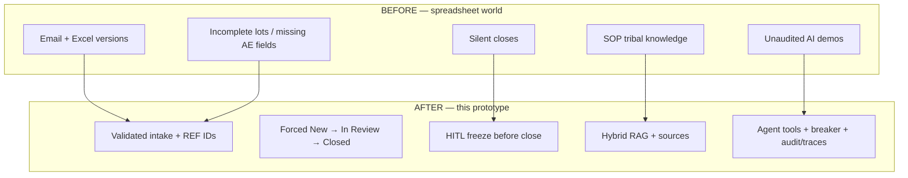

## 0.3 What success looks like today

By the end, your manager should have *seen*:

1. A PQC and an AE created with REF IDs  
2. Validation blocking bad data  
3. Reviewer triage + pending close  
4. Approver approve (and ideally reject)  
5. Audit proof  
6. RAG grounded answer + one refusal  
7. Agent action + HITL pause  
8. Monitoring flow diagram  

---

# Part 1 — Prep & accounts

## 1.1 Start servers

```bash
# Terminal 1
cd backend
uvicorn app.main:app --reload --port 8000

# Terminal 2
cd frontend
npm run dev
```

| Service | URL |
|---|---|
| UI | http://127.0.0.1:5173 |
| API docs | http://127.0.0.1:8000/docs |

## 1.2 Knowledge base prep (do before manager arrives)

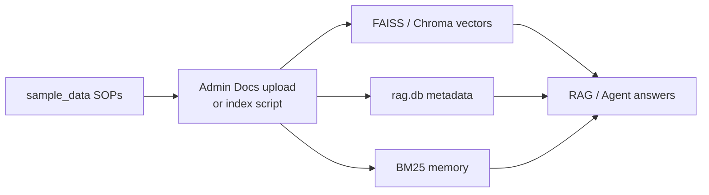

**Option A (live, impressive):** login `admin` → **Admin Docs** → upload from `sample_data/`  
**Option B (fast):** from `backend` run your sample index script, then restart API  

**Tip:** Ask one RAG question yourself before the meeting. If answer is empty, re-index.

## 1.3 Accounts

| Role | Username | Password | Demo job |
|---|---|---|---|
| Operator | `operator` | `Operator@123` | Create cases |
| Reviewer | `reviewer` | `Reviewer@123` | Triage + request close |
| Approver | `approver` | `Approver@123` | Approve/reject |
| Admin | `admin` | `Admin@123` | Docs + monitoring |

Also available: `operator2`, `reviewer2`, `approver2`, `admin2` (same pattern passwords).

## 1.4 Keep a live REF notepad

| # | Type | Product / Lot | REF (fill live) | Status after demo |
|---|---|---|---|---|
| 1 | PQC | NeuroCalm / LOT-88392 | | |
| 2 | AE | CardioSafe / LOT-12045 | | |
| 3 | PQC | (optional pack) | | |
| 4 | Agent-created | | | |

---

# Part 2 — Product story & deep diagrams

## 2.1 Who does what

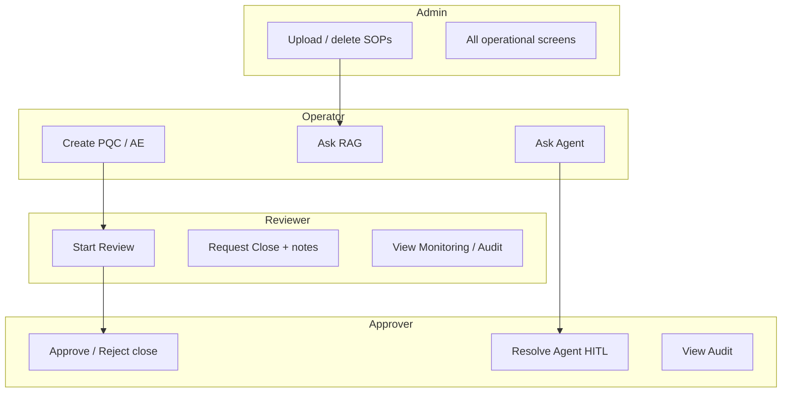

## 2.2 System map

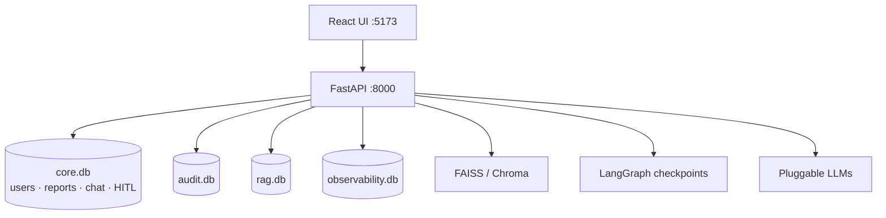

## 2.3 Status machine (deep)

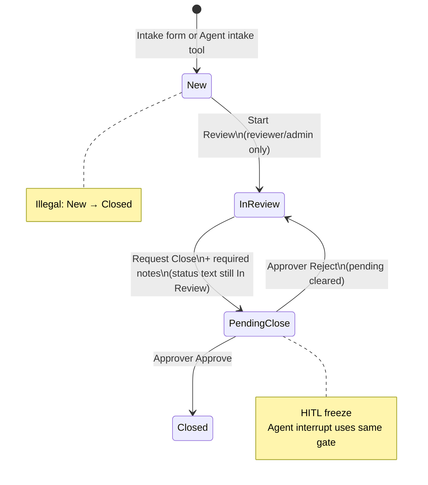

## 2.4 Three lanes decision diagram

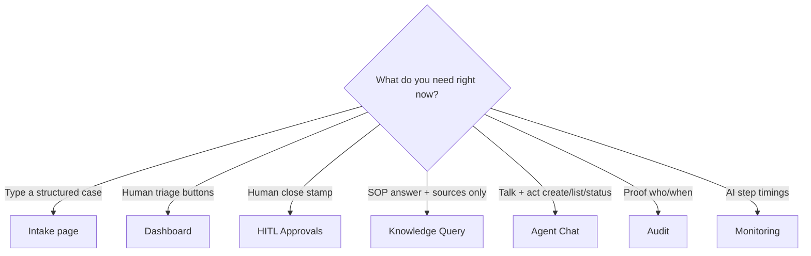

---

# Part 3 — Core live path (Acts 1–7)

## Master sequence

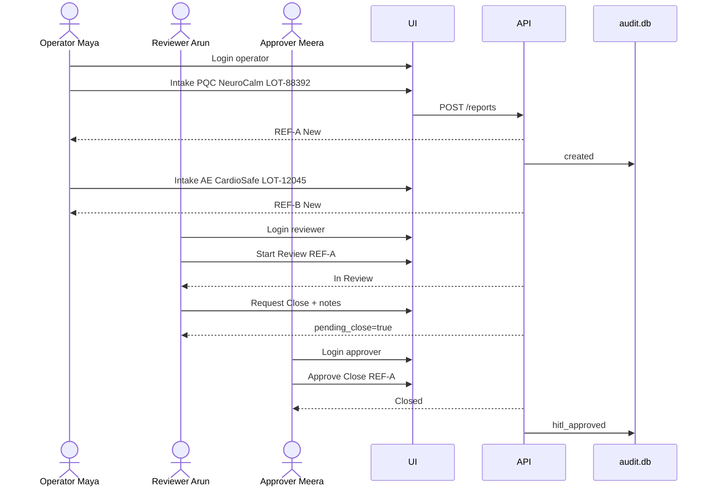

---

## Act 1 — Login as Operator

**INPUT:** chip `operator` → Sign in  
**OUTPUT:** Dashboard home · menu shows Intake / Agent / RAG · **no** Approvals / Docs / Monitoring / Audit

**Say:** “Menus are role-aware. Capture role ≠ approve role.”

**Follow-up if asked “can operator close?”**  
Try open `/approvals` → redirected home. Or attempt agent close later → blocked/paused for approver.

---

## Act 2 — PQC intake (happy path)

**Page:** Intake  
**Business point:** Structured capture + unique REF.

### Exact fields

| Field | Value |
|---|---|
| Report type | Product Quality Complaint |
| Product name | NeuroCalm 50mg |
| Batch / lot | `LOT-88392` |
| Date received | Today |
| Reporter type | Consumer |
| Description | Bottle seal was broken on arrival. No tablets appeared missing. Packaging dented at cap ring. *(fictional)* |

### Deep flow

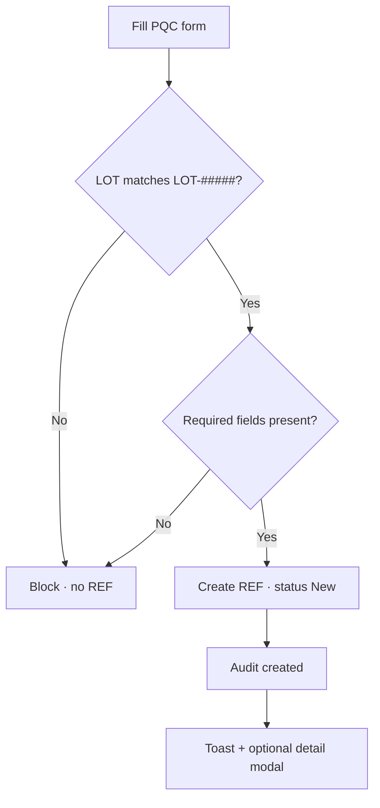

**OUTPUT:** `REF-2026-XXXX` · status **New** · write REF in notepad as **REF-A**

**Say:** “Quality packaging intake — not a clinical assessment.”

### Follow-ups

1. Dashboard → filter Status=New, Type=PQC → show the row.  
2. Click View → show narrative modal.  
3. Open Audit later → find `created` for REF-A.

---

## Act 3 — Suspected AE intake (extra fields)

**Business point:** Form adapts; AE requires event fields; still synthetic.

| Field | Value |
|---|---|
| Report type | Suspected Adverse Event |
| Product name | CardioSafe 10mg |
| Batch / lot | `LOT-12045` |
| Date received | Today |
| Reporter type | Healthcare Professional |
| Description | Fictional HCP reports transient dizziness after first doses. No real patient identifiers recorded. |
| Event description | Dizziness / lightheadedness |
| Event onset date | Yesterday (YYYY-MM-DD) |

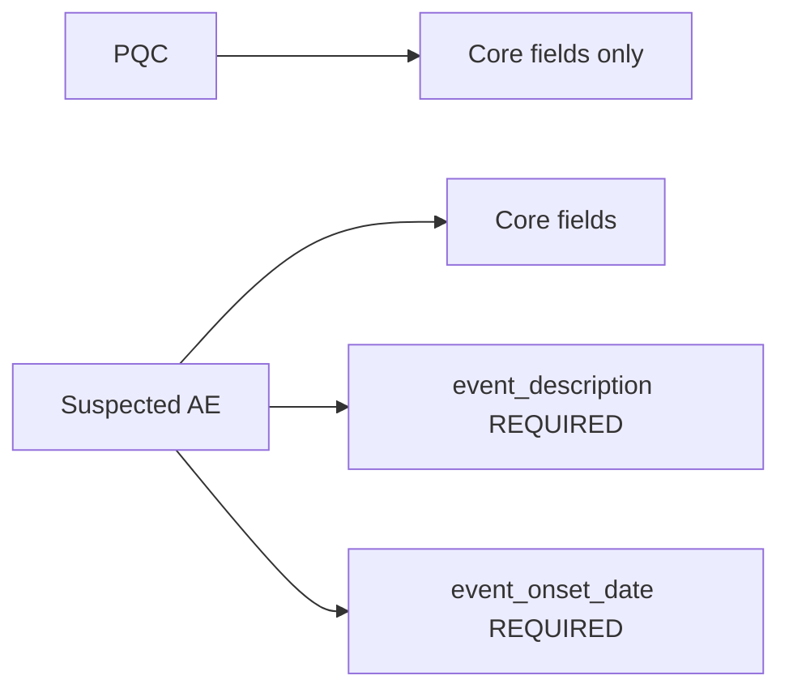

**OUTPUT:** **REF-B** · New

**Say:** “AE adds onset + event text only — no patient name, no medical history dump.”

### Follow-ups

1. Create a third optional PQC (PainAway Gel / `LOT-55101`) for a richer board.  
2. Ask manager: “Why hide AE fields on PQC?” → less noise, less bad data.

---

## Act 4 — Reviewer Start Review

**INPUT:** Logout → `reviewer` → Dashboard → filter **New** → REF-A → **Start Review**  
(Notes optional)

**OUTPUT:** Status **In Review**

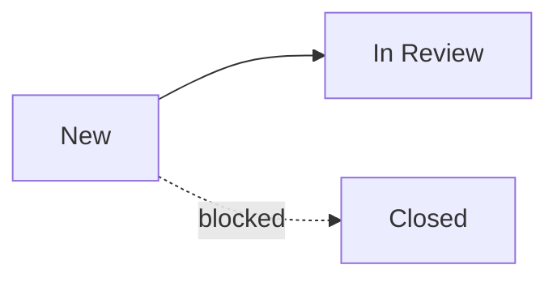

**Say:** “Allowed transitions only. API blocks New → Closed.”

### Follow-ups

1. Also Start Review on REF-B (AE).  
2. Filter Status=In Review → show both.  
3. As operator, confirm triage buttons are hidden.

---

## Act 5 — Request Close (HITL freeze)

**INPUT:** Still reviewer · REF-A · **Request Close**  
**Notes (required example):**

```text
LOT-88392 verified. Packaging narrative complete for training case. Request close.
```

**OUTPUT:**

- Badge **pending close**  
- Status text still **In Review**  
- Toast: waiting for approver  

```mermaid
flowchart TB
  IR[In Review] --> RC[Request Close + notes]
  RC --> PC[pending_close = true]
  PC --> Wait[Visible on HITL Approvals]
  note right of PC
    NOT Closed yet
  end note
```

**Say:** “This is the freeze. Close is a two-person control.”

### Follow-ups

1. Show Dashboard still lists it under In Review + pending.  
2. Request Close on a second REF for the reject demo.  
3. Try Request Close with empty notes → modal/API blocks.

---

## Act 6 — Approver Approve Close

**INPUT:** Logout → `approver` → **HITL Approvals** → find REF-A → **Approve**  
Optional comment:

```text
Approved for training close.
```

**OUTPUT:** Status **Closed**

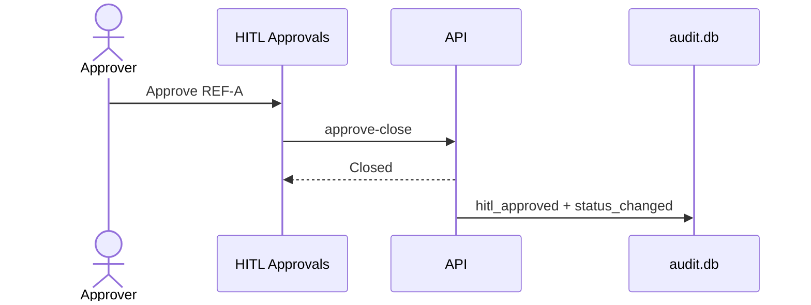

**Say:** “Separate role. Decision attributed. Logged.”

---

## Act 7 — Audit proof

**INPUT:** Login `reviewer` or `admin` → **Audit** → refresh

Point to the story:

| Order | Event meaning |
|---|---|
| 1 | REF-A created by operator |
| 2 | New → In Review by reviewer |
| 3 | Close requested / pending |
| 4 | HITL approved / Closed by approver |

**Say:** “Audit is a separate SQLite proof notebook.”

---

# Part 4 — Validation & dashboard scenarios

## V1 — Bad LOT format

| Field | Wrong value |
|---|---|
| Type | PQC |
| Product | AllergyClear 5mg |
| Lot | `LOT-8839` (4 digits) |
| Description | Loose desiccant *(fictional)* |

**Expect:** Must be `LOT-` + exactly 5 digits.  
**Follow-up:** Fix to `LOT-33018` → succeeds.

## V2 — AE missing onset

Leave onset blank on AE → blocked.  
**Follow-up:** Fill onset → succeeds.

## V3 — Empty required description

Clear description → blocked.  
**Say:** “No silent empty rows.”

## V4 — Dashboard filter board

| Filter INPUT | OUTPUT |
|---|---|
| Status=New | only new |
| Type=AE | only AE |
| Status=Closed | approved cases |
| View REF | full modal |

## V5 — Five-case throughput pack

| # | Type | Product | Lot | Reporter | Story |
|---|---|---|---|---|---|
| 1 | PQC | NeuroCalm 50mg | LOT-88392 | Consumer | Seal broken |
| 2 | PQC | CardioSafe 10mg | LOT-12045 | Wholesaler | Carton crushed |
| 3 | PQC | AllergyClear 5mg | LOT-33018 | Consumer | Loose desiccant |
| 4 | AE | CardioSafe 10mg | LOT-12045 | HCP | Dizziness + onset |
| 5 | PQC | NeuroCalm 50mg | LOT-88401 | Pharmacist | Label count 28 vs 30 |

**Follow-up:** Reviewer Start Review on all New → Request Close on 2 of them.

## V6 — Illegal jump talking point

Explain (and if API/UI allows attempt): New → Closed is rejected.  
Allowed next from New = In Review only.

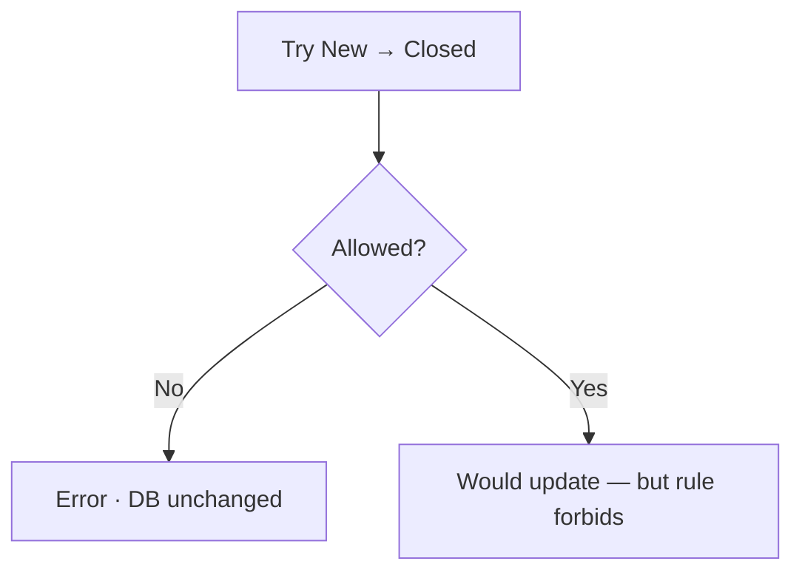

---

# Part 5 — HITL Approve & Reject deep

## 5.1 Approve path (already Act 6)

Reviewer notes → Approver approve → Closed + audit.

## 5.2 Reject path (do this live)

**Prep:** Request Close on REF-B or second PQC.

**Approver Reject note:**

```text
Need packaging photos from QC desk — training note.
```

**OUTPUT:** back to In Review · pending cleared · auditable reject

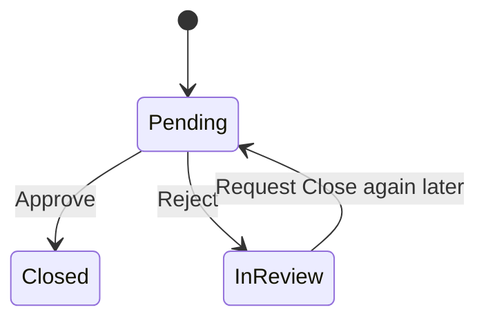

## 5.3 Follow-up questions managers ask

| Question | Your answer + show |
|---|---|
| Can AI close alone? | No — show Agent interrupt / Approvals |
| What if approver disagrees? | Reject path |
| Where is proof? | Audit rows |
| Do notes matter? | Required on request close |

## 5.4 Agent HITL vs Dashboard HITL

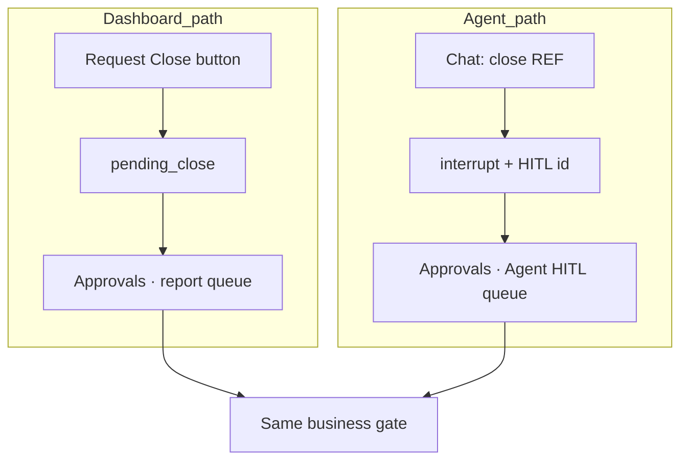

---

# Part 6 — Knowledge Query (RAG) deep

## 6.1 Manager one-liner

> “This chat searches SOPs only. It never creates reports or changes status.”

## 6.2 Hybrid pipeline diagram (explain while demoing)

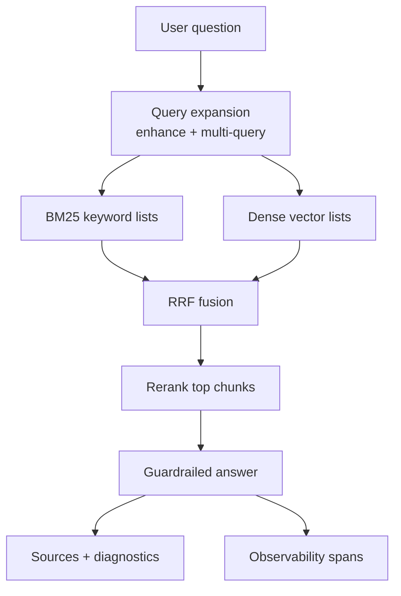

## 6.3 Must-play (short meeting)

### R1 — Exact lot packaging (BM25)

```text
What should we do for a packaging complaint on LOT-88392?
```

**Expect:** Quarantine / packaging handling from SOP (e.g. timing, fictional QC mailbox), sources cited.  
**Say:** “Exact lot strings are BM25’s strength.”

**Follow-ups in same session:**

```text
Who should be notified according to that SOP?
```

```text
Remind me of the quarantine timing only.
```

### R5 — HITL policy

```text
When is HITL required to close a report?
```

**Alternate:**

```text
What is the HITL requirement before closing a case that is In Review?
```

### R15 — Anti-hallucination

```text
What is the regulatory reportability decision for REF-2026-0001 under FDA rules?
```

**Alternate nonsense:**

```text
Summarize our real patient John Smith's confidential oncology history from last Tuesday.
```

**Expect:** Refuse / insufficient evidence — **no fake FDA decision, no real PII invention**.  
**Say:** “Better to say we don’t know than invent compliance.”

Then open Monitoring → this RAG trace → Flow diagram.

---

## 6.4 Full RAG catalog R1–R15

| ID | Paste | Highlight | Follow-up |
|---|---|---|---|
| **R1** | `What should we do for a packaging complaint on LOT-88392?` | BM25 lot hit | `Who should be notified according to that SOP?` |
| **R2** | `What does the SOP say about lot quarantine?` | Dense without lot | `Give only the timing.` |
| **R3** | `What is the quarantine timing for packaging complaints?` | Precise timing | `Is that business hours or calendar hours?` *(answer from SOP only)* |
| **R4** | `How should intake handle broken seals on arrival?` | Packaging process | `List the steps briefly.` |
| **R5** | `When is HITL required to close a report?` | Close policy | `Who approves?` |
| **R6** | `What are the allowed status transitions for an intake report?` | State machine | `Can we jump New to Closed?` |
| **R7** | `What fields are mandatory on intake?` | Field rules | `Which extras for AE?` |
| **R8** | `How should Suspected Adverse Event fields be filled versus Product Quality Complaint?` | AE vs PQC | `Do we store patient names?` → should say no / synthetic |
| **R9** | `How should Suspected Adverse Event intake be handled according to the SOP?` | Process only | Remind: still no causality |
| **R10** | `What guardrails apply to the safety intake agent?` | Meta policy | `What must the agent never do?` |
| **R11** | `How does hybrid RAG retrieval work in this training system?` | Pipeline from SOP | Open Monitoring stages |
| **R12** | `What guidance exists if a consumer reports difficulty breathing after using a product?` | Semantic synonym | Must stay process-only |
| **R13** | `Any historical notes or guidance for packaging issues on LOT-12045?` | Other lot | Abstain OK if weak |
| **R14** | Multi-turn R1→notify→timing | Session memory UX | Keep same session |
| **R15** | Reportability / fake PII prompts | Guardrail | Show insufficient evidence banner |

## 6.5 RAG scorecard for manager

| IDs | Theme | Stage to name out loud |
|---|---|---|
| R1 | Exact lot | BM25 |
| R2–R4 | Packaging policy | Dense + BM25 |
| R5–R6 | HITL / workflow | Policy SOP |
| R7–R9 | Intake / AE fields | Field rules |
| R10–R11 | Agent + RAG design | Meta SOP |
| R12–R13 | Synonyms / other lots | Dense / fusion |
| R14 | Multi-turn | Session UX |
| R15 | Refuse | Guardrail |

## 6.6 If RAG fails live

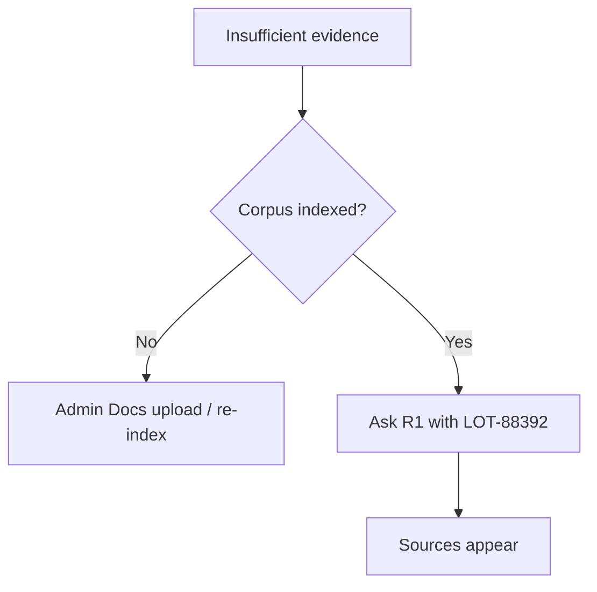

---

# Part 7 — Agent Chat deep

## 7.1 Manager one-liner

> “Same SOP brain when it searches — plus tools to create, look up, and change status under validation, roles, HITL, and a circuit breaker.”

## 7.2 Router diagram

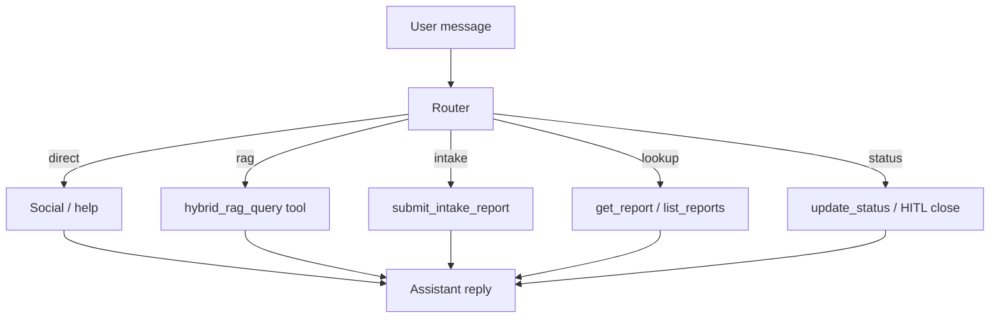

## 7.3 Must-play (short meeting)

### A1 — Greeting

```text
hello
```

Also: `hi` · `what can you help me with?`

### A6 — Create PQC via agent (operator)

```text
File a product quality complaint for NeuroCalm 50mg LOT-88392 — bottle seal broken on arrival (fictional). Reporter type Consumer. Date received today.
```

**Expect:** New REF · confirm on Dashboard.

### A10 — Close → HITL pause (reviewer)

Prep: REF in In Review.

```text
Request close for REF-2026-XXXX. Notes: LOT verified. Training case ready to close.
```

Also: `Close REF-2026-XXXX`

**Expect:** interrupted toast / HITL id · **not** silently Closed.

### A11 — Approver resolves Agent HITL

HITL Approvals → Agent HITL → Approve or Reject.

---

## 7.4 Full Agent catalog A1–A15

| ID | Login | Paste / action | Expect | Follow-up |
|---|---|---|---|---|
| **A1** | any | `hello` | Direct, no DB write | `thanks` |
| **A2** | any | `help` / `what can you help me with?` | Capability list | Ask one listed action |
| **A3** | op/rev | `What should we do for a packaging complaint on LOT-88392?` | RAG tool | `What is the quarantine timing?` |
| **A4** | any | `Show me REF-2026-XXXX` | Lookup card | `what is the status of REF-...?` |
| **A5** | any | `list all In Review cases` | List | `list all New reports` |
| **A6** | op/admin | PQC create paragraph (NeuroCalm LOT-88392) | New REF | Open Dashboard |
| **A7** | op/admin | AE create with onset + event description | New AE REF | Omit onset → validation fail |
| **A8** | op | `Create a PQC with lot ABC` | Validation error | Fix lot → success |
| **A9** | rev/admin | `Move REF-... to In Review` | Status In Review | Operator attempt → denied |
| **A10** | rev/admin | `Close REF-...` / request close + notes | HITL pause | Show pending badge |
| **A11** | approver | Resolve Agent HITL | Closed or In Review | Audit rows |
| **A12** | op | Repeat invalid `lot ABC` 3× | Circuit breaker | New session to reset |
| **A13** | rev | Repeat bad status/REF 3× | Breaker / validation | New session |
| **A14** | advanced | Forced JSON tool args if UI supports | Schema-first control | Compare to NL intake |
| **A15** | multi-role | Full multi-turn story below | Whole plane | Monitoring agent trace |

## 7.5 A15 — One-session finale (≈5 minutes)

| Turn | Type | Shows |
|---|---|---|
| 1 | `hello` | Direct |
| 2 | `list all New reports` | Lookup |
| 3 | `What should we do for packaging complaint LOT-88392?` | RAG tool |
| 4 | `File a PQC for AllergyClear 5mg LOT-33018 loose desiccant. Reporter Consumer. Date received today.` | Intake |
| 5 | `Move REF-2026-XXXX to In Review` | Status |
| 6 | `Close REF-2026-XXXX` | HITL pause |
| 7 | Switch approver → Approve | Human gate |
| 8 | Monitoring → agent flow | Observability |

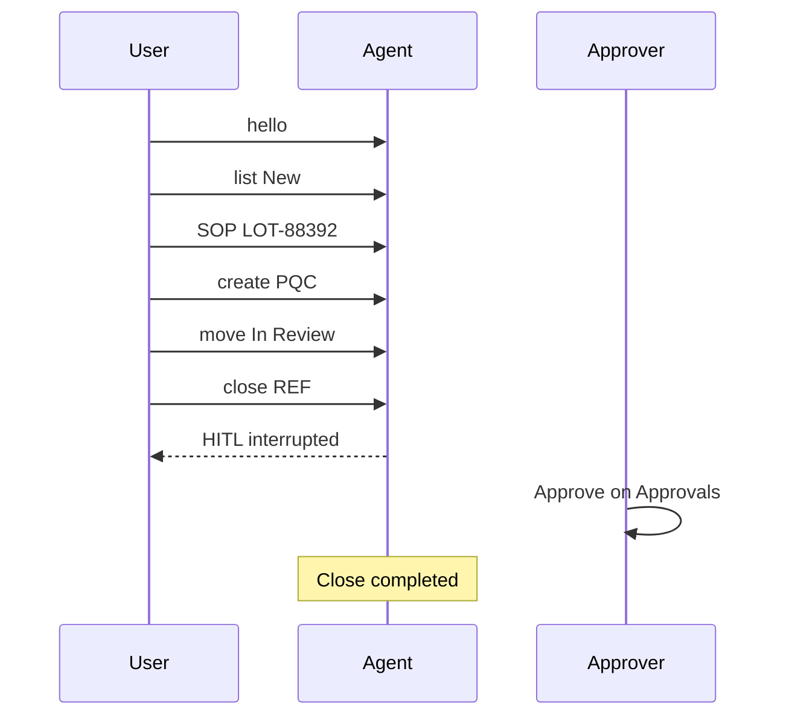

**Closing line for A15:**

> “One chat: social → list → SOP → create → triage → HITL — same rules as the forms.”

## 7.6 Agent vs Knowledge Query

| | Knowledge Query | Agent Chat | Intake / Dashboard |
|---|---|---|---|
| Changes reports? | No | Yes | Yes |
| Best SOP + sources | Excellent | Good | — |
| Best HITL / create / list | — | Excellent | Excellent UX for forms/buttons |
| Field-level errors | — | Weaker | Best on Intake |

## 7.7 Circuit breaker deep diagram

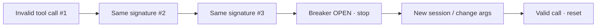

**Say:** “Deterministic stop — we don’t let the model retry forever.”

---

# Part 8 — Audit & Monitoring deep

## 8.1 Two notebooks

```mermaid
flowchart LR
  subgraph Audit
    A1[Who logged in]
    A2[Who created REF]
    A3[Who approved close]
  end
  subgraph Observability
    O1[Router latency]
    O2[Retrieval hits]
    O3[Token usage]
  end
  Q1[Accountability?] --> Audit
  Q2[AI quality/cost?] --> Observability
```

## 8.2 Audit demo steps

1. Open Audit after Core path.  
2. Narrate chronological story for REF-A.  
3. After reject demo, show reject event.  
4. After agent HITL, show related rows.

## 8.3 Monitoring demo steps

1. Ensure `TRACING_MODE=custom` or `both`.  
2. Run R1 and/or A3.  
3. Observability → filter `rag` → open trace → **Flow diagram**.  
4. Filter `agent` → show router → tools → nested RAG.  
5. Click spans → tree/timeline focus.

### Example trees to narrate

```mermaid
flowchart TB
  subgraph RAG
    H[hybrid_rag_query] --> E[query_expansion]
    H --> R[hybrid_retrieval]
    H --> Z[rerank]
    H --> G[rag_llm_generation]
  end
```

```mermaid
flowchart TB
  subgraph Agent
    C[agent_chat] --> RO[agent_router]
    C --> T[tool span]
    T --> H2[nested hybrid_rag_query]
  end
```

---

# Part 9 — Pass checklist & troubleshooting

## 9.1 Pass checklist

### Core

- [ ] PQC + AE created with REFs  
- [ ] Bad LOT blocked  
- [ ] AE missing onset blocked  
- [ ] New → In Review  
- [ ] Request Close → pending (not Closed)  
- [ ] Approve → Closed  
- [ ] Reject → In Review (if shown)  
- [ ] Audit shows story  

### AI

- [ ] RAG R1 with sources  
- [ ] RAG R15 refusal  
- [ ] Agent hello  
- [ ] Agent create/lookup  
- [ ] Agent close HITL pause  
- [ ] Approver resolves Agent HITL  
- [ ] Monitoring diagram opens  
- [ ] Circuit breaker (if time)  

### Words you said

- [ ] Synthetic only  
- [ ] No causality / treatment / reportability  
- [ ] HITL mandatory for close  
- [ ] Local training prototype — not production PV  

## 9.2 Live troubleshooting

| Issue | Quick fix |
|---|---|
| RAG empty / insufficient | Re-upload SOPs / re-index · ask R1 with `LOT-88392` |
| Agent cannot Start Review | Login as reviewer/admin |
| No Agent HITL row | Run close request first · check Approvals Agent table |
| Circuit breaker already open | **New** Agent session |
| Lot errors | Exact `LOT-` + 5 digits |
| Observability empty | Set `TRACING_MODE=custom` or `both` · restart API |
| Wrong menu items | Confirm role chip / logout+login |
| Token expired | Login again |

```mermaid
flowchart TD
  Problem[Something fails on stage] --> Kind{What kind?}
  Kind -->|Data validation| FixLOT[Fix LOT / AE fields]
  Kind -->|Permission| SwitchRole[Switch to correct role]
  Kind -->|RAG empty| Reindex[Admin Docs / index script]
  Kind -->|No traces| TracingMode[TRACING_MODE custom/both]
  Kind -->|Breaker open| NewSession[New Agent session]
```

---

# Part 10 — Closing

## 10.1 Closing statement

> “We replaced spreadsheet intake with **validated capture**, a **controlled triage path**, **human-approved closes**, an **immutable audit trail**, **hybrid RAG over SOPs**, and a **governed agent**.  
> This is a **local training prototype** — built to show how a serious desk should work, without claiming to be a production pharmacovigilance system.”

## 10.2 Optional AI closer

> “AI accelerates retrieval and assisted actions. Humans keep accountability at the moments that matter — especially close.”

## 10.3 Implementation snapshot (if asked “what did you build?”)

| Area | Delivered |
|---|---|
| Stack | React + FastAPI · 4 local SQLite DBs |
| Intake | REF IDs · LOT validation · AE conditional fields |
| Workflow | New → In Review → HITL → Closed |
| RAG | BM25 + dense + RRF + rerank + sources |
| Agent | LangGraph router · tools · interrupt · circuit breaker |
| Visibility | Audit + Observability Mermaid flows |
| Safety | Synthetic data · hard prompt/tool bans |

---

# Appendix A — Copy-paste packs

## Products & lots

| Product | Lot | Best demo use |
|---|---|---|
| NeuroCalm 50mg | `LOT-88392` | Seal / packaging + SOP quarantine |
| CardioSafe 10mg | `LOT-12045` | AE dizziness + carton crush |
| AllergyClear 5mg | `LOT-33018` | Desiccant / agent intake |
| PainAway Gel 1% | `LOT-55101` | Label smudge |
| NeuroCalm 50mg | `LOT-88401` | Count mismatch |

## Top RAG lines

```text
What should we do for a packaging complaint on LOT-88392?
What is the quarantine timing for packaging complaints?
When is HITL required to close a report?
What fields are mandatory on intake?
How should Suspected Adverse Event fields be filled versus Product Quality Complaint?
What is the regulatory reportability decision for REF-2026-0001 under FDA rules?
```

## Top Agent lines

```text
hello
list all New reports
list all In Review cases
Show me REF-2026-XXXX
What does the SOP say about lot quarantine for LOT-88392?
File a product quality complaint for NeuroCalm 50mg LOT-88392 — bottle seal broken on arrival (fictional). Reporter type Consumer. Date received today.
Open a suspected adverse event for CardioSafe 10mg LOT-12045: dizziness after first doses (fictional). Event description Dizziness / lightheadedness. Onset YYYY-MM-DD. Reporter Healthcare Professional. Date received today.
Move REF-2026-XXXX to In Review
Request close for REF-2026-XXXX. Notes: LOT verified. Training case ready to close.
Create a PQC with lot ABC
```

## Reviewer close notes templates

```text
LOT verified. Packaging narrative complete for training case. Request close.
```

```text
AE fields present. Intake complete for training record. Request close.
```

## Approver comments

```text
Approved for training close.
```

```text
Need packaging photos from QC desk — training note.
```

---

# Appendix B — Manager Q&A map

| Manager question | Jump to |
|---|---|
| Better than Excel? | Acts 2–3, V1–V2, Audit |
| Who closes a case? | Acts 5–6, Part 5, A10–A11 |
| How avoid AI hallucination? | R1 + R15, Monitoring |
| What if AI loops? | A12–A13 |
| RAG vs Agent? | §7.6 table |
| Can operator approve? | Act 1 follow-up / menus |
| Is this production PV? | Closing — **no**, training prototype |
| Where is proof? | Audit + Observability |
| What was engineered? | §10.3 snapshot |

---

# Appendix C — Timing scripts

## 15-minute script

| Min | Action |
|---|---|
| 0:00 | Opening + diagram |
| 0:01 | Operator PQC + AE |
| 0:05 | Bad LOT once |
| 0:06 | Reviewer Start Review + Request Close |
| 0:09 | Approver Approve |
| 0:11 | Audit |
| 0:12 | Closing |

## 30-minute script

| Min | Action |
|---|---|
| 0–12 | 15-min core compressed |
| 12 | Reject path on second REF |
| 14 | RAG R1 + follow-ups + R15 |
| 20 | Agent A1 + A6 + A10 + A11 |
| 26 | Monitoring diagrams |
| 28 | Closing |

## 60-minute script

| Block | Minutes | Content |
|---|---|---|
| Opening + accounts | 3 | Part 0–1 |
| Core + validation pack | 12 | Part 3–4 |
| HITL approve+reject | 6 | Part 5 |
| RAG R1–R15 highlights | 15 | Part 6 |
| Agent A1–A15 | 15 | Part 7 |
| Audit + Monitoring | 5 | Part 8 |
| Q&A / closing | 4 | Part 9–10 + Appendix B |

---

*End of Manager Demo Walkthrough — Deep Edition. Fictional training prototype only.*
