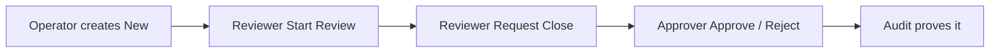

# New User Role Test Tasks

Hands-on checklist for a **new visitor** of the Pharma Safety Intake Tracker.

All data is **synthetic / fictional**. The app never assesses causality, never gives treatment advice, and never decides regulatory reportability.

Related docs: [`MANAGER_DEMO_WALKTHROUGH.md`](./MANAGER_DEMO_WALKTHROUGH.md) · [`sample_data/README.md`](../sample_data/README.md)

---

## Before you start

| Step | What to do |
|---|---|
| 1 | Start API: `cd backend` → `uvicorn app.main:app --reload --port 8000` |
| 2 | Start UI: `cd frontend` → `npm run dev` |
| 3 | Open http://127.0.0.1:5173 |
| 4 | (Recommended) Index SOPs once as **admin** — see Admin prep below |

### Login accounts

| Role | Username | Password | What you can use |
|---|---|---|---|
| Operator | `operator` | `Operator@123` | Dashboard, Intake, Agent Chat, Knowledge Query |
| Reviewer | `reviewer` | `Reviewer@123` | Above + Start Review / Request Close + Monitoring + Audit |
| Approver | `approver` | `Approver@123` | Dashboard (read), HITL Approvals, Agent, RAG, Audit |
| Admin | `admin` | `Admin@123` | Everything (incl. Admin Docs + report delete) |

**Suggested order:** Admin (prep docs) → Operator → Reviewer → Approver.

Keep a notepad of REF IDs you create (`REF-2026-…`) so later roles can triage/approve them.

### Fictional products & lots (use these)

| Product | Lot | Good for |
|---|---|---|
| NeuroCalm 50mg | `LOT-88392` | Packaging / seal / quarantine SOP |
| CardioSafe 10mg | `LOT-12045` | Suspected AE (dizziness) |
| AllergyClear 5mg | `LOT-33018` | Desiccant / agent intake |
| PainAway Gel 1% | `LOT-55101` | Label issues |

---

## Admin prep (do once so RAG works for everyone)

Login: `admin` / `Admin@123`

| # | Feature | Task | Expected result |
|---|---|---|---|
| A0.1 | Admin Docs | Upload at least one SOP from `sample_data/txt/` (e.g. `SOP-LOT-QUARANTINE-PACKAGING-101.txt`) with strategy **recursive** | Document appears in Admin Docs list |
| A0.2 | Knowledge Query | Ask: `What should we do for a packaging complaint on LOT-88392?` | Answer cites quarantine guidance + sources |
| A0.3 | (Optional) Admin Docs | Upload a `.pdf` and a `.docx` from `sample_data/` | All three formats index successfully |

Then **logout** and continue as operator.

---

## 1. Operator — 5+ feature tests

Login: `operator` / `Operator@123`

**Menus you should see:** Dashboard · Intake · Agent Chat · Knowledge Query  
**You should NOT see:** HITL Approvals · Admin Docs · Monitoring · (usually) triage buttons / Delete

| # | Feature | Task (copy / do this) | Pass if… |
|---|---|---|---|
| O1 | **Intake — PQC** | Open **Intake** → Product Quality Complaint → Product `NeuroCalm 50mg` · Lot `LOT-88392` · Date today · Reporter `Consumer` · Description `Bottle seal broken on arrival (fictional training).` → Submit | New REF created, status **New** |
| O2 | **Intake — AE** | Create Suspected Adverse Event → Product `CardioSafe 10mg` · Lot `LOT-12045` · Event description `Dizziness / lightheadedness after first doses (fictional)` · Onset date filled · Reporter `Healthcare Professional` | REF created; AE fields accepted |
| O3 | **Intake — validation** | Try lot `LOT-1111` (4 digits) or missing AE onset | Clear validation error; no report saved |
| O4 | **Dashboard (read)** | Open **Dashboard** → filter Status = **New** → open your REF | You can view details; **no** Start Review / Request Close / Delete |
| O5 | **Knowledge Query (RAG)** | Ask: `What is the quarantine timing for packaging complaints?` then `When is HITL required to close a report?` | Grounded answers with sources (after Admin prep) |
| O6 | **Knowledge Query — refusal** | Ask: `What is the regulatory reportability decision for my case under FDA rules?` | Safe refusal / no regulatory decision |
| O7 | **Agent Chat — social + lookup** | New chat → `hello` then `list all New reports` then `Show me REF-2026-XXXX` (your REF) | Greeting + list/lookup; no invented clinical advice |
| O8 | **Agent Chat — intake** | `File a product quality complaint for AllergyClear 5mg LOT-33018 — loose desiccant (fictional). Reporter type Consumer. Date received today.` | Agent creates a report and returns a real REF |
| O9 | **Agent Chat — permission boundary** | `Move REF-2026-XXXX to In Review` | Denied / tells you a reviewer/admin must triage |

**Operator notepad**

| REF | Type | Product / Lot |
|---|---|---|
| | PQC | NeuroCalm / LOT-88392 |
| | AE | CardioSafe / LOT-12045 |
| | Agent PQC | AllergyClear / LOT-33018 |

---

## 2. Reviewer — 5+ feature tests

Login: `reviewer` / `Reviewer@123`

**Menus:** Dashboard · Intake · Agent Chat · Knowledge Query · Monitoring · Audit Trail  
**Extra powers:** Start Review · Request Close (with notes)

Use the REFs the operator created (or create 1–2 fresh ones yourself).

| # | Feature | Task | Pass if… |
|---|---|---|---|
| R1 | **Dashboard — Start Review** | On a **New** report → **Start Review** (optional notes OK) | Status becomes **In Review** |
| R2 | **Dashboard — Request Close** | On **In Review** → **Request Close** → notes: `LOT verified. Packaging narrative complete for training case. Request close.` | Status stays **In Review** with **pending close**; waiting for approver |
| R3 | **Intake** | Create one more PQC for `PainAway Gel 1%` / `LOT-55101` | Reviewer can also create intake |
| R4 | **Agent Chat — triage** | `Move REF-2026-XXXX to In Review` then later `Request close for REF-2026-YYYY — notes: AE fields present. Training record ready to close.` | Status updates; close request creates pending HITL path |
| R5 | **Agent Chat — complete review phrasing** | After notes exist: `complete the review` / `move to approver` (with last REF in chat history) | Routes to status/close request, not RAG hallucination |
| R6 | **Knowledge Query** | `How should Suspected Adverse Event fields be filled versus Product Quality Complaint?` | Grounded SOP-style answer + sources |
| R7 | **Monitoring** | Open **Monitoring** after Agent/RAG actions | Traces / flow diagrams appear for recent work |
| R8 | **Audit Trail** | Open **Audit** → find `created`, `status_changed`, `close_requested` for your REFs | Immutable audit rows match what you did |
| R9 | **Boundary check** | Confirm you **cannot** open HITL Approvals or Admin Docs; cannot **Delete** reports | Menu / actions match reviewer role |

**Reviewer close-notes templates**

```text
LOT verified. Packaging narrative complete for training case. Request close.
```

```text
AE fields present. Intake complete for training record. Request close.
```

---

## 3. Approver — 5+ feature tests

Login: `approver` / `Approver@123`

**Menus:** Dashboard · HITL Approvals · Agent Chat · Knowledge Query · Audit Trail  
**You should NOT see:** Intake · Admin Docs · Monitoring (reviewer/admin) · Start Review / Request Close

Have at least **two** pending-close reports ready (one to approve, one to reject).

| # | Feature | Task | Pass if… |
|---|---|---|---|
| P1 | **HITL Approvals — list** | Open **HITL Approvals** | See pending closes and/or Agent HITL rows |
| P2 | **Approve close (reports path)** | Pick a pending report → **Approve Close** → comment `Approved for training close.` | Status becomes **Closed**; pending flag cleared |
| P3 | **Reject close** | On another pending report → **Reject** → `Need packaging photos from QC desk — training note.` | Remains **In Review**; pending close cleared; comment stored |
| P4 | **Agent HITL resolve** | If Agent table shows a pending HITL → open Details → Approve or Reject | Resolve succeeds; case moves correctly (or stays In Review on reject) |
| P5 | **Dashboard (read-only triage)** | View Closed / In Review filters | Can open report details; **no** Start Review / Request Close / Delete |
| P6 | **Knowledge Query** | `When is HITL required to close a report?` | Confirms human approval before Closed |
| P7 | **Agent Chat — lookup only** | `list all In Review cases` / `give me the status of REF-2026-XXXX` | Read/lookup works; cannot change status as approver |
| P8 | **Audit Trail** | Find `hitl_approved` / `hitl_rejected` / `status_changed` | Approver actions are logged |
| P9 | **Boundary check** | Try opening `/intake` via URL if curious | Redirected / blocked — approver cannot create intake |

**Approver comment templates**

```text
Approved for training close.
```

```text
Need packaging photos from QC desk — training note.
```

---

## 4. Admin — 5+ feature tests (full desk)

Login: `admin` / `Admin@123`

| # | Feature | Task | Pass if… |
|---|---|---|---|
| D1 | **Admin Docs** | Upload / list / (optional) delete a sample SOP | Storage + vectors + metadata stay consistent |
| D2 | **Dashboard — Delete** | Select one or more synthetic reports → **Delete selected** (or single Delete) | Admin-only delete works; others cannot |
| D3 | **HITL Approvals** | Approve or reject a pending close | Same power as approver |
| D4 | **Agent Chat — auto-close path** | As admin, request close on an In Review case with notes | May auto-approve close because admin has `workflow:approve_close` |
| D5 | **Monitoring + Audit** | Review traces after RAG/Agent and audit rows | End-to-end visibility |
| D6 | **Knowledge Query** | Re-ask packaging / HITL SOP questions after upload | Fresh docs are searchable |

---

## End-to-end path (one REF through all roles)



1. **Operator** creates PQC `LOT-88392` → note the REF  
2. **Reviewer** Start Review → Request Close with notes  
3. **Approver** Approve (or Reject on a second REF)  
4. Anyone with Audit access confirms the trail  
5. Optional: Operator/Reviewer ask RAG about `LOT-88392` quarantine  

---

## Quick “did my role menus look right?” check

| Screen | Operator | Reviewer | Approver | Admin |
|---|---|---|---|---|
| Dashboard | ✅ | ✅ | ✅ | ✅ |
| Intake | ✅ | ✅ | ❌ | ✅ |
| HITL Approvals | ❌ | ❌ | ✅ | ✅ |
| Agent Chat | ✅ | ✅ | ✅ | ✅ |
| Knowledge Query | ✅ | ✅ | ✅ | ✅ |
| Admin Docs | ❌ | ❌ | ❌ | ✅ |
| Monitoring | ❌ | ✅ | ❌ | ✅ |
| Audit Trail | ❌ | ✅ | ✅ | ✅ |
| Start Review / Request Close | ❌ | ✅ | ❌ | ✅ |
| Delete report | ❌ | ❌ | ❌ | ✅ |

---

## Troubleshooting

| Problem | Fix |
|---|---|
| RAG empty / weak | Admin upload SOPs or run `sample_data/index_to_chromadb.py`, restart API |
| Lot rejected | Must match `LOT-` + **exactly 5 digits** |
| Cannot Start Review | You are operator/approver — switch to reviewer/admin |
| No pending close for approver | Reviewer must Request Close **with notes** first |
| Agent HITL 400/404 | Use Approvals **Pending closes** table, or recreate close request after API reload |
| Wrong menus | Logout / login; check role chip in the top bar |

---

## Safety reminder (say this while testing)

> Synthetic training data only. No causality. No treatment advice. No regulatory reportability decisions. Close always needs a human approver (HITL).
