# NovaCure explained like a toy shop (for anyone!)

This guide explains the **same project** using a **toy shop** story.  
No hard words first — we translate them at the end.

> Real app = fictional medicine safety training.  
> Story = **ToyFix Shop** fixing broken toys.  
> Same steps. Same buttons. Easier to picture.

---

## The big idea in one sentence

**Kids bring broken toys → helpers write tickets → a checker looks → a boss says OK to finish → a smart robot helper answers questions and can help write tickets too.**

---

## Meet the toy shop cast (same as app roles)

| Toy shop person | App login | What they do |
|---|---|---|
| **Front desk kid** | `operator` / `Operator@123` | Writes new toy tickets |
| **Checker** | `reviewer` / `Reviewer@123` | Starts looking at tickets, asks boss to finish |
| **Boss** | `approver` / `Approver@123` | Says YES or NO to finishing a ticket |
| **Shop owner** | `admin` / `Admin@123` | Can do everything + put rule books on the shelf |

### Visual: who helps whom

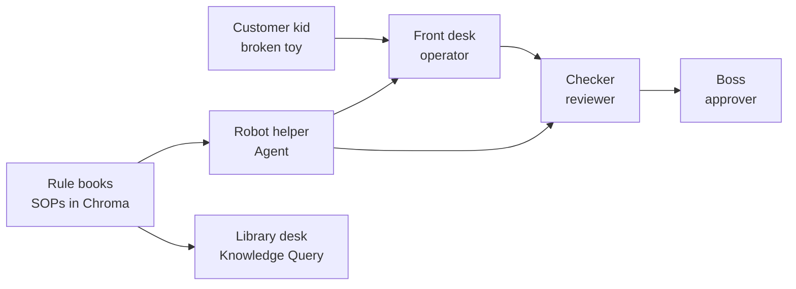

---

## The shop building (same as the website pages)

Imagine the website is a toy shop with rooms:

| Shop room | App page | Plain English |
|---|---|---|
| Reception clipboard | **Intake** | Write a new ticket |
| Big board of tickets | **Dashboard** | See all tickets + View details |
| Boss office stamp | **HITL Approvals** | Boss stamps YES/NO |
| Robot chat corner | **Agent Chat** | Talk to the robot helper |
| Library desk | **Knowledge Query** | Ask the rule books (read only) |
| Book shelf loader | **Admin Docs** | Put new rule books on the shelf |
| Security camera room | **Monitoring / Audit** | See what happened |

### Visual: rooms in the shop

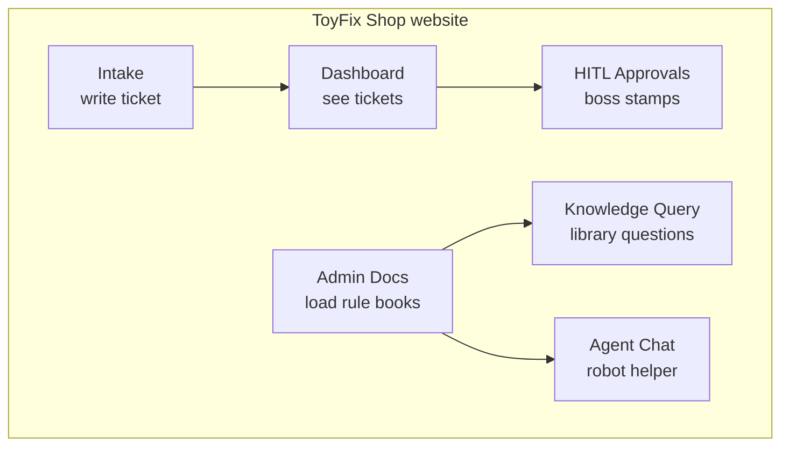

---

## Ticket stickers (same as report status)

Every toy ticket gets a sticker:

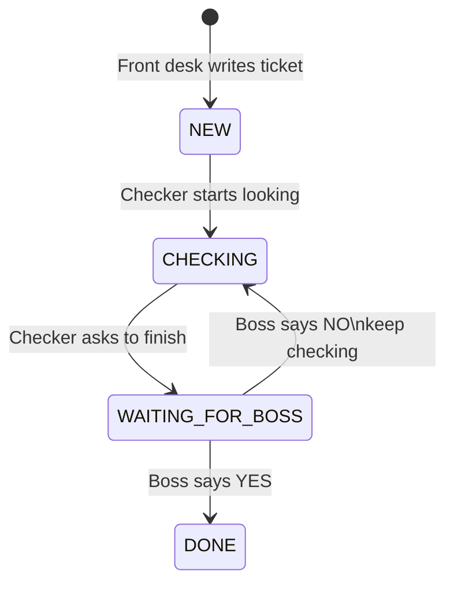

| Sticker in story | Status in app |
|---|---|
| **NEW** | New |
| **CHECKING** | In Review |
| **WAITING FOR BOSS** | In Review + pending close |
| **DONE** | Closed |

**Important kid rule:** Front desk cannot stamp DONE. Checker cannot stamp DONE alone. **Boss must stamp.**

That boss stamp is called **HITL** (Human-In-The-Loop) = “a real person must say OK.”

---

## Rule books on the shelf (same as ChromaDB + SOPs)

The shop has **rule books**:

- How to fix a broken toy box seal  
- What info must be on a ticket  
- When the boss must stamp  

In the real app those books are the sample files under `sample_data/`, put into **ChromaDB** (a smart shelf that finds the right page fast).

### Visual: putting books on the smart shelf

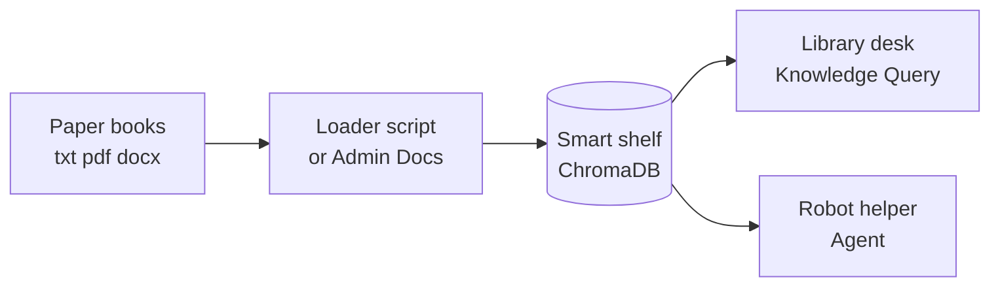

**How to load books (grown-up command):**

```bash
cd backend
.\.venv\Scripts\activate
python ..\sample_data\index_to_chromadb.py
```

Then restart the backend.  
Ask later: *“What should we do for a packaging complaint on LOT-88392?”*  
In toy words: *“What do the rules say when a toy box seal is broken for box code LOT-88392?”*

---

## Scenario 1 — Front desk writes 5 toy tickets (Operator)

**Login:** `operator` / `Operator@123`  
**Room:** Intake

### Story

Five kids bring toys. Front desk writes **5 tickets**.

| # | Toy story | Real form fields |
|---|---|---|
| 1 | NeuroCalm toy box seal broken, box `LOT-88392` | Product Quality Complaint |
| 2 | CardioSafe shipper crushed, `LOT-12045` | Product Quality Complaint |
| 3 | AllergyClear bottle has loose silica pack, `LOT-33018` | Product Quality Complaint |
| 4 | CardioSafe — “felt dizzy” story (pretend), need extra “what happened” + date | Suspected Adverse Event |
| 5 | PainAway — wrong number of toys in carton, `LOT-44102` | Product Quality Complaint |

### Visual: writing tickets

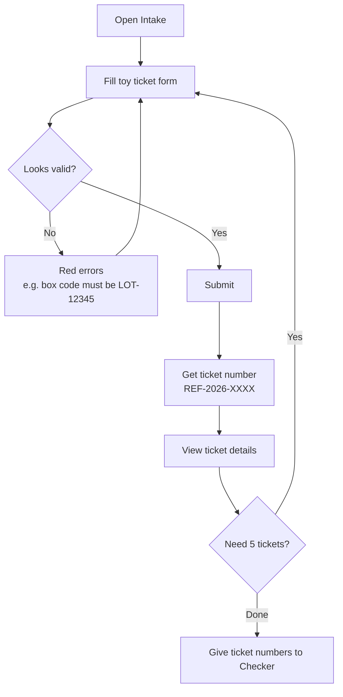

### What you click

1. Login as operator  
2. **Intake** → fill → **Submit report**  
3. Note `REF-2026-…`  
4. **View submitted report** (or Dashboard → **View**)  
5. Repeat until 5 tickets exist  

**Kid tip:** Box code must look like `LOT-88392` (LOT + 5 digits), like a toy barcode.

---

## Scenario 2 — Checker looks at tickets (Reviewer)

**Login:** `reviewer` / `Reviewer@123`  
**Room:** Dashboard

### Story

Checker takes NEW tickets, puts on **CHECKING** sticker, then asks boss to finish some.

### Visual

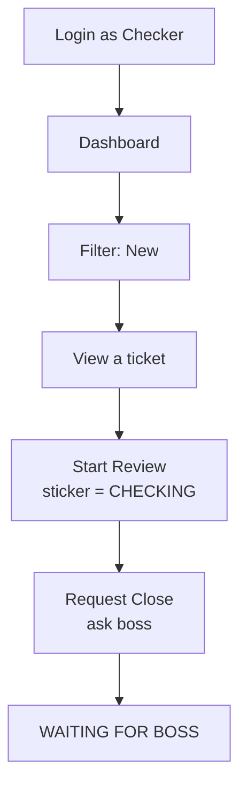

### What you click

1. Dashboard → Status **New**  
2. **View** → read → **Start Review**  
3. Do that for the operator’s tickets  
4. On some tickets click **Request Close**  
5. Now boss work appears under **HITL Approvals**

---

## Scenario 3 — Boss stamps YES or NO (Approver)

**Login:** `approver` / `Approver@123`  
**Room:** HITL Approvals

### Story

Boss sees tickets waiting. Stamps **DONE** (Approve) or sends back to **CHECKING** (Reject).

### Visual

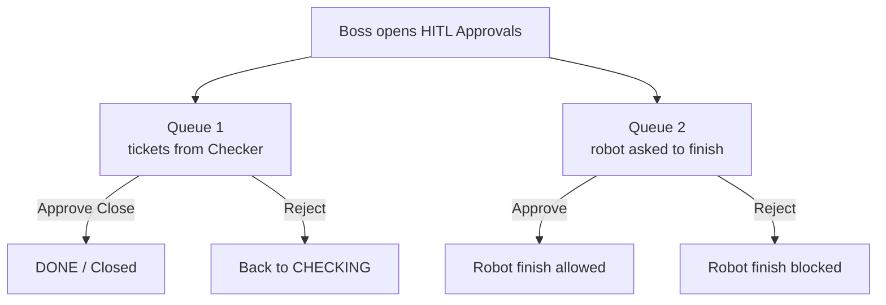

### What you click

1. **HITL Approvals**  
2. **Approve Close** or **Reject**  
3. If robot paused → use **Agent HITL** table too  

---

## Scenario 4 — Library desk questions (Knowledge Query)

**Room:** Knowledge Query  
**Story:** You only ask the rule books. You do **not** change tickets.

### Visual

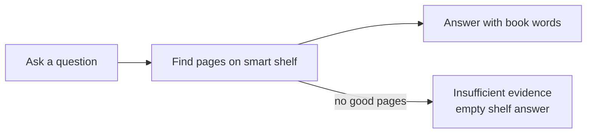

### Examples (toy words → real words)

| You can think… | Type in the app… |
|---|---|
| Broken toy box seal for LOT-88392 — what do rules say? | `What should we do for a packaging complaint on LOT-88392?` |
| What must be written on every ticket? | `What fields are mandatory on intake?` |
| When must boss stamp? | `When is HITL required to close a report?` |

### What you click

1. **Knowledge Query** → **New** chat  
2. Type question → **Ask**  
3. Read answer  
4. Optional: **Show retrieval detail** (see which “book pages” were used)

---

## Scenario 5 — Robot helper (Agent Chat) — most important

**Room:** Agent Chat  
**Story:** A robot that can **talk**, **read books**, **write tickets**, **move stickers**, and **ask the boss** before finishing.

### Visual: robot brain

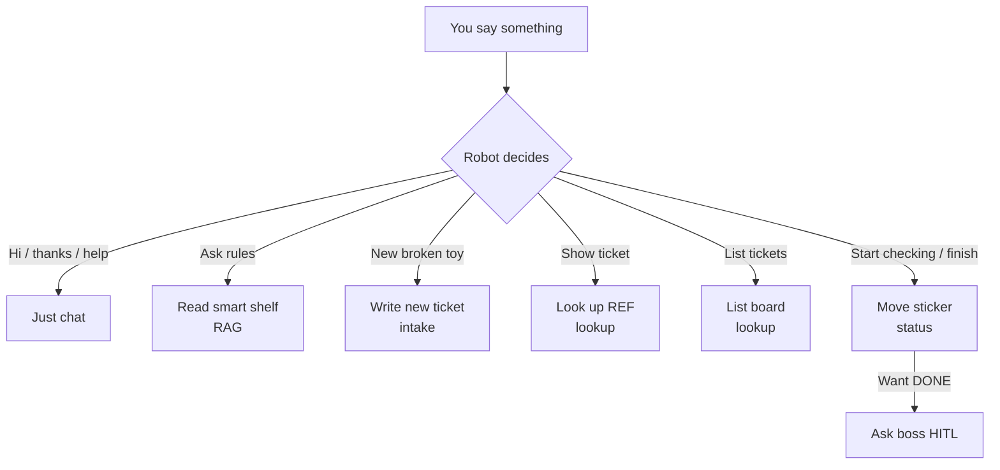

### How to use the robot (easy steps)

1. Login (operator is fine)  
2. **Agent Chat** → **New**  
3. Type a sentence → **Send**  
4. Read the reply  
5. If it says waiting for boss → login as approver → **HITL Approvals** → Agent HITL  

---

### Robot examples (copy-paste)

#### Example A — Say hello

```text
hello
```

**Toy meaning:** Just greet the robot.  
**Expect:** Friendly hello. No ticket changes.

---

#### Example B — Ask the rule books

```text
What should we do for a packaging complaint on LOT-88392?
```

**Toy meaning:** “Broken box seal for barcode LOT-88392 — what do the rules say?”  
**Expect:** Talk about fixing/quarantine timing (4 business hours) from the books.

---

#### Example C — Show one ticket

```text
Show me REF-2026-0001
```

**Toy meaning:** “Open ticket #1 please.”  
**Expect:** Ticket details.

---

#### Example D — Show many tickets

```text
list all In Review cases
```

**Toy meaning:** “Show all tickets with CHECKING sticker.”

---

#### Example E — Robot writes a new ticket

```text
File a product quality complaint for NeuroCalm 50mg LOT-88392 — bottle seal broken on arrival (fictional). Reporter type Consumer. Date received 2026-11-03.
```

**Toy meaning:** “Please write a new broken-box ticket for me.”  
**Expect:** New `REF-2026-…` appears. Check Dashboard.

---

#### Example F — Robot starts checking

*(Login as reviewer or admin)*

```text
Move REF-2026-0008 to In Review
```

**Toy meaning:** “Put CHECKING sticker on this ticket.”

---

#### Example G — Robot asks boss to finish

```text
Close REF-2026-0005
```

**Toy meaning:** “Please finish this ticket.”  
**Expect:** Robot pauses → boss must stamp.

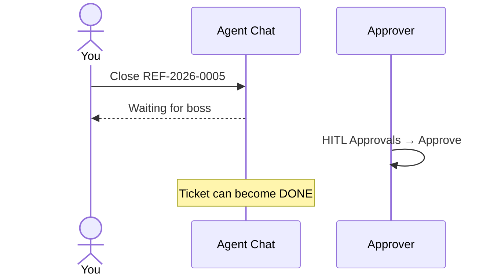

---

#### Example H — Wrong barcode (robot says no)

```text
Create a PQC with lot ABC
```

**Toy meaning:** Bad barcode.  
**Expect:** Error. Must look like `LOT-12345`.

---

#### Example I — One robot chat adventure (full story)

In **one** Agent session, send:

1. `hello`  
2. `list all New reports`  
3. `What should we do for packaging complaint LOT-88392?`  
4. `Move REF-2026-0008 to In Review`  
5. `Close REF-2026-0008`  
6. Switch to **approver** → approve Agent HITL  

That one adventure uses almost the whole shop!

---

## Scenario 6 — Full play day (everyone together)

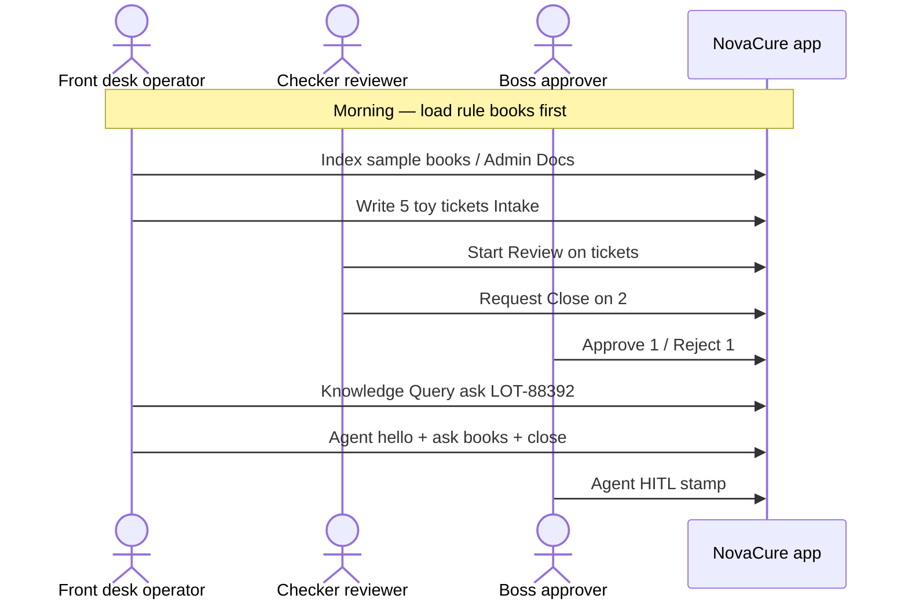

### Play-day checklist

- [ ] Rule books loaded (Chroma)  
- [ ] 5 tickets created  
- [ ] Checker moved them to CHECKING  
- [ ] Boss stamped at least one DONE and one NO  
- [ ] Library question answered from books  
- [ ] Robot did hello + book question + ticket action + boss stamp  

---

## Library desk vs robot (simple choice)

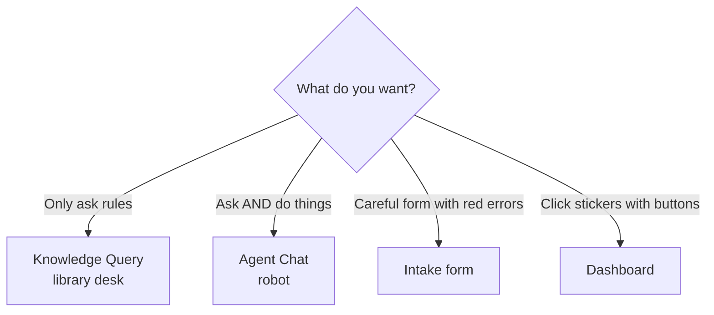

| Want… | Go here |
|---|---|
| Only read rules | Knowledge Query |
| Talk + create/change tickets | Agent Chat |
| Nicest form for new tickets | Intake |
| See board + View + triage buttons | Dashboard |
| Boss stamps | HITL Approvals |

---

## Word translator (toy → real)

| Toy word | Real project word |
|---|---|
| ToyFix Shop | NovaCure Safety Intake app |
| Toy ticket | Intake **report** |
| Ticket number | **REF-2026-XXXX** |
| Broken box / wrong carton | **Product Quality Complaint (PQC)** |
| “Felt sick” pretend story | **Suspected Adverse Event (AE)** |
| Box barcode `LOT-88392` | **Batch / lot number** |
| NEW / CHECKING / DONE stickers | **New / In Review / Closed** |
| Waiting for boss | **Pending close** + **HITL** |
| Rule books | **SOPs** / sample docs |
| Smart shelf | **ChromaDB** vector store |
| Library desk | **Knowledge Query** |
| Robot helper | **Agent Chat** (LangGraph) |
| Boss stamp | **HITL approval** |
| Security camera | **Monitoring / Audit** |

---

## Start the shop (servers)

**Terminal 1 — kitchen machines (backend)**
```bash
cd backend
.\.venv\Scripts\activate
uvicorn app.main:app --reload --port 8000
```

**Terminal 2 — shop doors (frontend)**
```bash
cd frontend
npm run dev
```

Open: **http://127.0.0.1:5173**

---

## If something feels broken

| What you see | Toy explanation | Fix |
|---|---|---|
| Insufficient evidence | Shelf has no books | Run indexer / upload Admin Docs |
| Can’t Start Review as operator | Front desk can’t wear checker badge | Login as reviewer |
| Close doesn’t finish | Boss didn’t stamp yet | Approver → HITL Approvals |
| Lot ABC error | Bad barcode | Use `LOT-88392` style |
| Invalid token | Old keycard | Logout and login again |

---

## Where to read more (grown-up detail)

| File | Level |
|---|---|
| **This file** `docs/SIMPLE_STORY_GUIDE.md` | Toy story (easiest) |
| `docs/HOW_TO_USE.md` | Full real-terms guide + more diagrams |
| `docs/DEMO_WALKTHROUGH.md` | Short demo script |
| `sample_data/README.md` | What sample files are |

---

**Remember:** It’s still the same app. The toy story is only a map so the path feels easy: **write tickets → check → boss stamps → ask books → talk to robot.**
