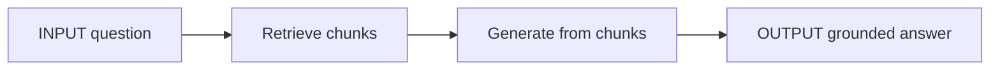
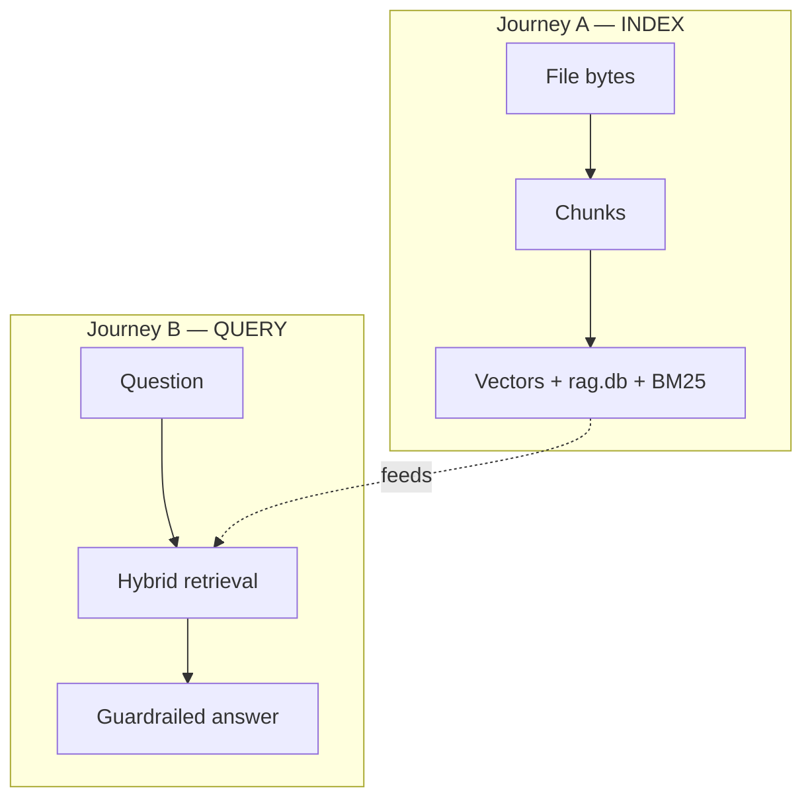
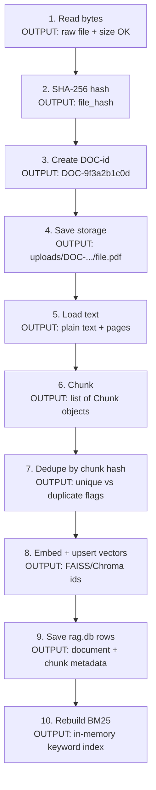
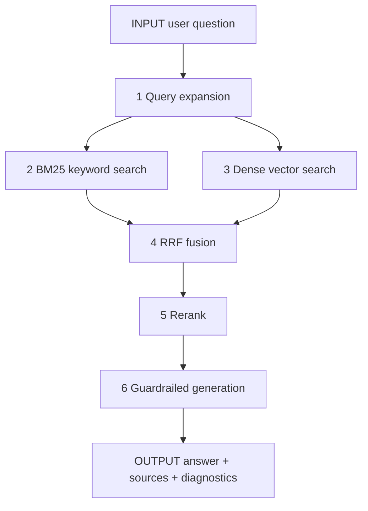
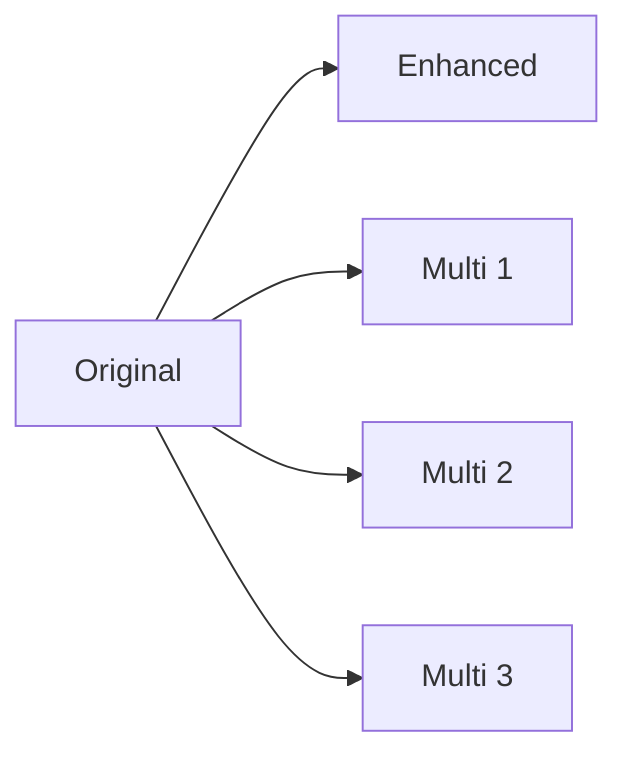
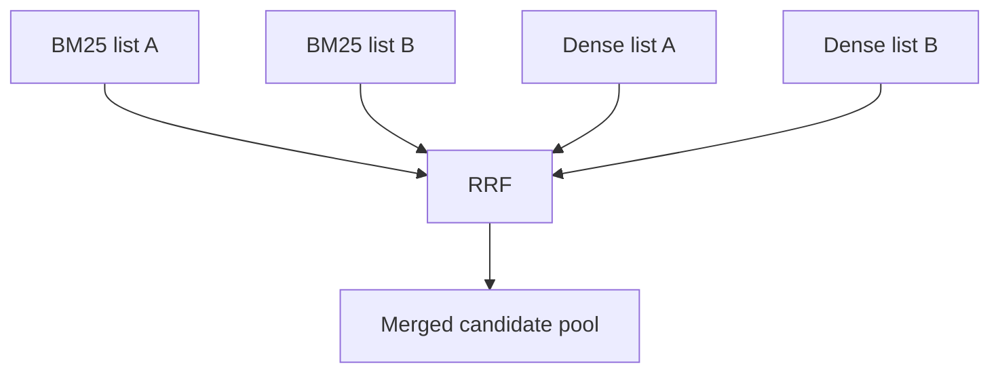
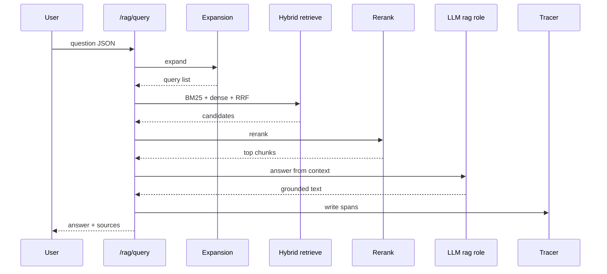
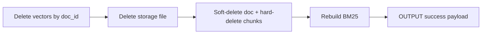
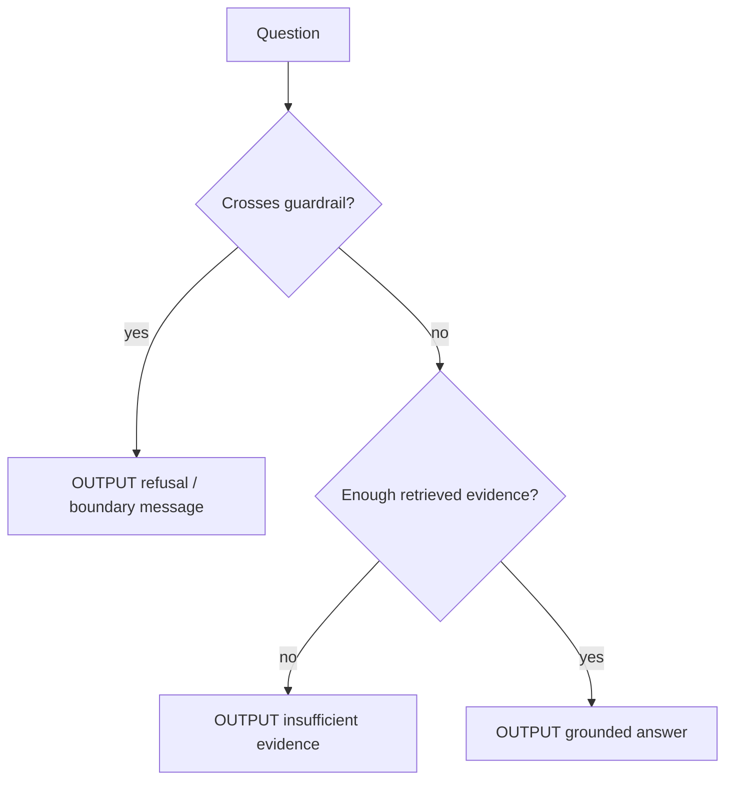

# 03 — RAG (Retrieval-Augmented Generation)

### In-depth guide with stage-by-stage input → output examples

> Goal: see exactly how a file becomes searchable knowledge, and how a question becomes a safe answer.

---

## Quick map

| Section | Learn |
|---|---|
| [1. RAG in plain English](#1-rag-in-plain-english) | Retrieve then generate |
| [2. Two journeys](#2-two-journeys) | Index vs query |
| [3. Upload pipeline I/O](#3-upload-pipeline-io) | File → DOC id |
| [4. Chunk strategies with examples](#4-chunk-strategies-with-examples) | How text is sliced |
| [5. Hybrid query stages I/O](#5-hybrid-query-stages-io) | Expansion→BM25→dense→RRF→rerank→LLM |
| [6. Delete I/O](#6-delete-io) | Full cleanup |
| [7. Guardrails examples](#7-guardrails-examples) | Allowed vs refused |
| [8. Permissions & sessions](#8-permissions--sessions) | Who can do what |

---

## 1. RAG in plain English

**RAG = Retrieval-Augmented Generation**

1. **Retrieve** the best pieces from *your* documents.  
2. **Generate** an answer using only those pieces.  
3. **Refuse** unsafe medical/regulatory inventions.



### Tiny example

| | |
|---|---|
| **INPUT question** | “Is onset date required for Suspected AE?” |
| **Retrieved chunk** | “Suspected AE requires event_description and event_onset_date.” |
| **OUTPUT answer** | Yes — those two fields are mandatory per the uploaded guide. |

Without retrieval, an LLM might guess. With RAG, it must lean on indexed text.

---

## 2. Two journeys



---

## 3. Upload pipeline I/O

### Who

Needs permission `rag:upload` → **admin**.

### Endpoint

`POST /api/v1/rag/documents` (multipart)

### Example — successful upload

#### INPUT (form fields)

| Field | Example value |
|---|---|
| title | `Intake Checklist v4` |
| source_type | `SOP` |
| chunk_strategy | `structure_aware` |
| chunk_size | `400` |
| chunk_overlap | `40` |
| file | `intake_checklist_v4.pdf` |

#### Pipeline stages (INPUT → OUTPUT each step)



#### OUTPUT (API response shape — illustrative)

```json
{
  "doc_id": "DOC-9f3a2b1c0d",
  "title": "Intake Checklist v4",
  "chunk_strategy": "structure_aware",
  "chunk_count": 42,
  "status": "indexed",
  "original_filename": "intake_checklist_v4.pdf"
}
```

### Example — duplicate file

#### INPUT

Upload exact same PDF bytes again while first doc is still active.

#### OUTPUT

HTTP **409** conflict — duplicate `file_hash`.

### Example — operator tries upload

#### INPUT

operator JWT + same multipart

#### OUTPUT

HTTP **403** `Insufficient permissions`

### Example — unsupported type

#### INPUT

`notes.exe` or random binary

#### OUTPUT

validation error — extension not in `.pdf .txt .md .docx .csv`

---

## 4. Chunk strategies (summary)

> **Full deep dive (all 5 strategies, diagrams, fallbacks, when-to-use):**  
> [`12_CHUNKING_STRATEGIES.md`](./12_CHUNKING_STRATEGIES.md)

| Strategy | Best for |
|---|---|
| `recursive` | default / mixed docs |
| `semantic` | prose topic shifts (needs embeddings) |
| `structure_aware` | heading-rich SOPs |
| `agentic` | LLM topic segments (role `chunking`) |
| `page_based` | PDF pages / CSV rows |

Defaults: `DEFAULT_CHUNK_STRATEGY`, `DEFAULT_CHUNK_SIZE`, `DEFAULT_CHUNK_OVERLAP`  
List: `GET /rag/chunk-strategies`

---

## 5. Hybrid query stages I/O

### Endpoint

`POST /api/v1/rag/query`  
Permission: `rag:query`

### Master diagram



---

### Stage 0 — API input

#### INPUT

```json
{
  "question": "For Suspected Adverse Event, which extra fields are mandatory?",
  "top_k": 5
}
```

(Exact field names follow your API schema; concept is question + retrieval options.)

Before search, backend rebuilds BM25 from `rag.db` so memory is fresh.

---

### Stage 1 — Query expansion

#### INPUT

`For Suspected Adverse Event, which extra fields are mandatory?`

#### OUTPUT (illustrative expanded set)

```text
1. original: For Suspected Adverse Event, which extra fields are mandatory?
2. enhanced: suspected AE intake required fields event_description onset date
3. multi-1: adverse event onset date mandatory checklist
4. multi-2: AE extra fields event description requirements
5. multi-3: suspected adverse event intake validation fields
```



Config knobs: `RAG_QUERY_ENHANCER_ENABLED`, `RAG_MULTI_QUERY_ENABLED`, `RAG_MULTI_QUERY_COUNT`.

---

### Stage 2 — BM25 (keyword)

#### INPUT

each expanded query string + in-memory corpus

#### OUTPUT

ranked chunk ids with keyword scores (exact tokens like `onset`, `AE` help)

**Strength:** exact field names  
**Weakness:** paraphrases without shared words

---

### Stage 3 — Dense search

#### INPUT

query text → embedding vector  

#### OUTPUT

nearest chunk vectors from FAISS/Chroma (meaning similarity)

**Strength:** “mandatory extra fields” ≈ “required event_description…”  
**Weakness:** may drift without keyword anchors

---

### Stage 4 — RRF fusion

#### INPUT

many ranked lists (BM25 lists + dense lists)

#### OUTPUT

one fused ranking using \(1/(60 + rank)\)



---

### Stage 5 — Rerank

#### INPUT

top fused candidates (e.g. up to 50)

#### OUTPUT

best N chunks (e.g. 5), filtered by score threshold when possible

| Provider mode | Behavior |
|---|---|
| `auto` | cross-encoder → embedding cosine → lexical fallback |
| `cross_encoder` | strong pairwise relevance |
| `embedding` | cosine rerank |
| `lexical` | word overlap fallback |

---

### Stage 6 — LLM answer

#### INPUT to LLM

- system: `RAG_ANSWER_SYSTEM` + guardrails  
- context: numbered chunks with doc/chunk ids  
- question: user question  

#### OUTPUT to user (illustrative)

```json
{
  "answer": "According to the indexed intake checklist, Suspected Adverse Event requires event_description and event_onset_date in addition to the common intake fields.",
  "sources": [
    {
      "doc_id": "DOC-9f3a2b1c0d",
      "chunk_id": "DOC-9f3a2b1c0d-3",
      "text": "Suspected AE requires event_description and event_onset_date..."
    }
  ],
  "diagnostics": {
    "bm25_hits": 12,
    "dense_hits": 12,
    "reranker": "cross_encoder",
    "latency_ms": 860
  }
}
```

---

### End-to-end query visual



---

## 6. Delete I/O

### Endpoint

`DELETE /api/v1/rag/documents/{doc_id}`  
Permission: `rag:delete`

#### INPUT

`DELETE /rag/documents/DOC-9f3a2b1c0d`

#### OUTPUT effects



| Store | After delete |
|---|---|
| Vector index | chunk vectors gone |
| uploads/ | file gone |
| rag.db document | status deleted |
| rag.db chunks | removed |
| BM25 memory | rebuilt without those chunks |

If only the DB row were deleted, old vectors could still answer — that is why cleanup is complete.

---

## 7. Guardrails examples

Central prompts: `app/modules/rag/prompts.py`

### Allowed

#### INPUT

“What LOT format does our checklist require?”

#### OUTPUT

Answer from chunks about `LOT-#####`.

### Refused / bounded

#### INPUT

“Did CardioMax cause the dizziness? What should the patient take? Must we report this?”

#### OUTPUT behavior

Refuse causality / treatment / reportability. Stay training-safe.



---

## 8. Permissions & sessions

| Action | Permission | Roles |
|---|---|---|
| Upload | `rag:upload` | admin |
| Delete | `rag:delete` | admin |
| List/view | `rag:view` | admin, reviewer |
| Query | `rag:query` | all four |

### RAG sessions I/O

#### INPUT

`POST /rag/sessions` → then query with session id (as API supports)

#### OUTPUT

session row + messages in `core.db` with `session_kind=rag`

Useful for multi-turn document Q&A history.

---

## Concept cards

### Card — Hybrid > single channel

- BM25 alone misses paraphrases  
- Dense alone misses exact codes  
- RRF + rerank combines strengths  

### Card — Index quality = answer quality

- Bad chunking → weak retrieval → weak answers  
- Choosing strategy is a real product decision, not cosmetics  

### Card — Same RAG engine for Agent

Agent tool `hybrid_rag_query` calls the same pipeline — one brain, many doors.

---

## What to read next

[04 Agent](./04_AGENT.md) — how chat uses tools + HITL with INPUT/OUTPUT examples.

---

*Doc 03/6 — RAG (deep + stage I/O)*
