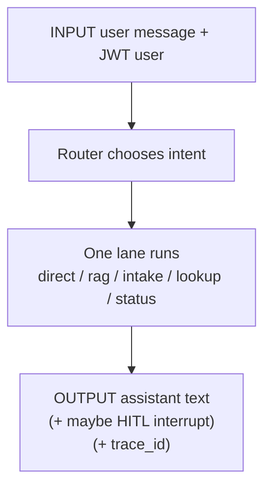
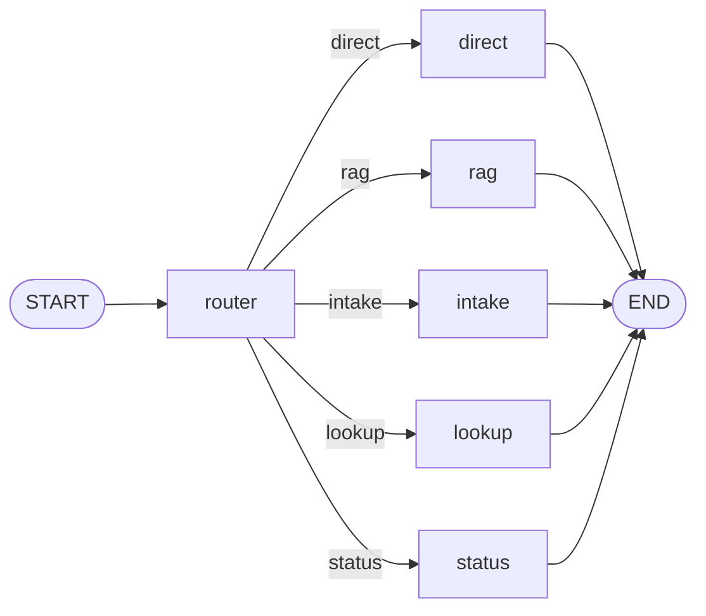
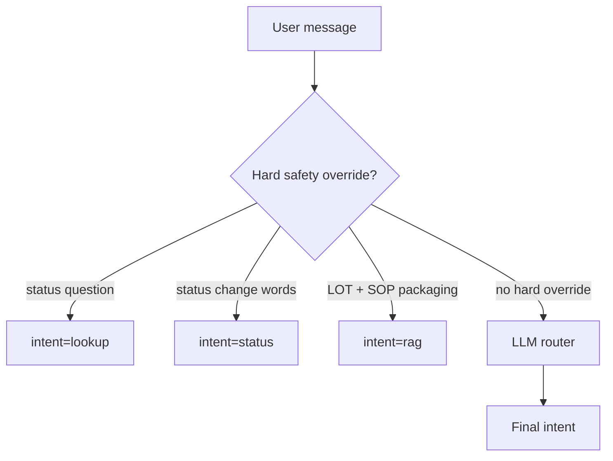
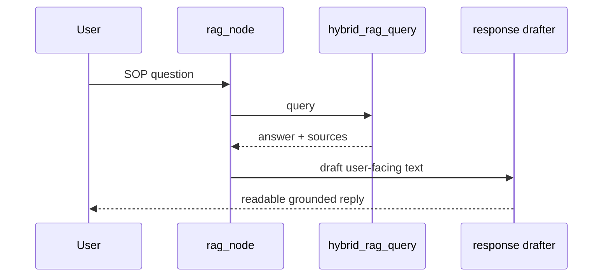
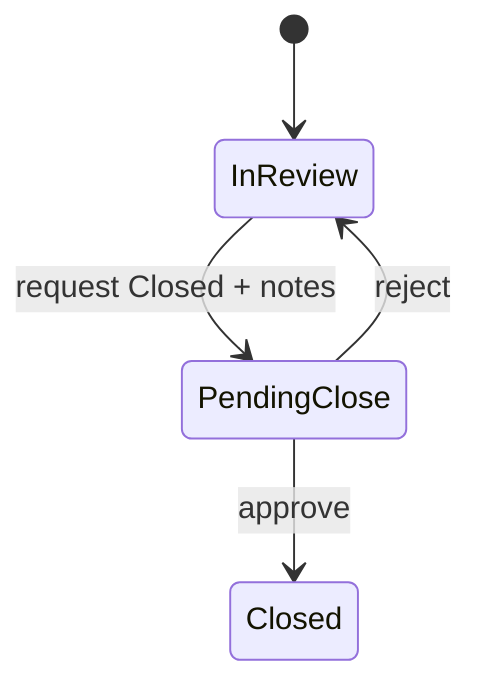
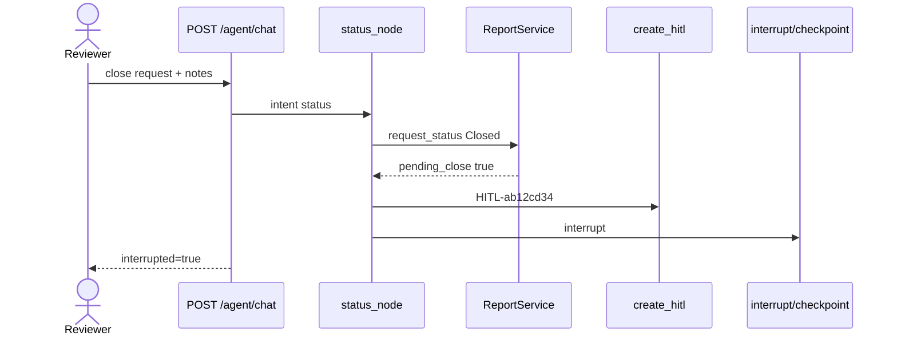
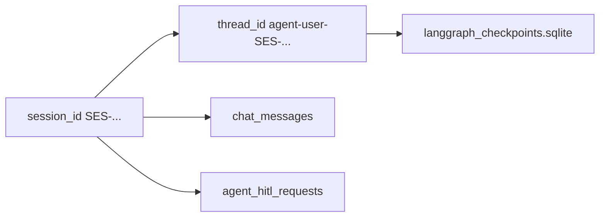
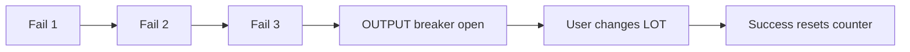
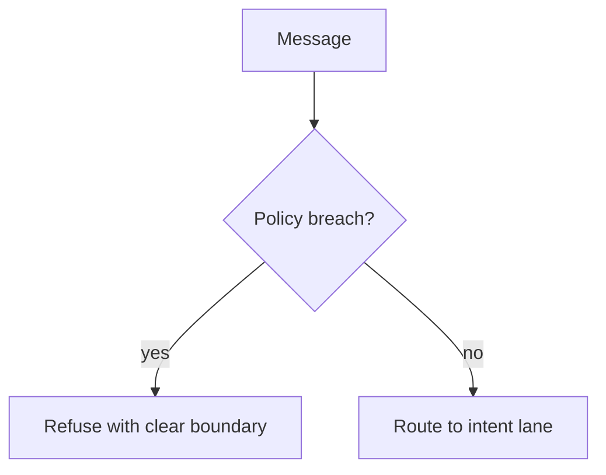

# 04 — Agent (LangGraph Helper, Tools & HITL)

### In-depth guide with intent/tool input → output examples

> Goal: see exactly how a chat message becomes a routed action, tool call, reply, or HITL pause.

---

## Quick map

| Section | Learn |
|---|---|
| [1. Agent in plain English](#1-agent-in-plain-english) | Junior colleague with rules |
| [2. Graph architecture](#2-graph-architecture) | Nodes & state |
| [3. Router I/O examples](#3-router-io-examples) | Message → intent |
| [4. Tools I/O catalog](#4-tools-io-catalog) | Each tool in/out |
| [5. Node walkthroughs](#5-node-walkthroughs) | direct/rag/intake/lookup/status |
| [6. HITL close deep I/O](#6-hitl-close-deep-io) | Interrupt → resume |
| [7. Sessions & checkpoints](#7-sessions--checkpoints) | thread_id meaning |
| [8. Circuit breaker examples](#8-circuit-breaker-examples) | Repeated failures |
| [9. API chat examples](#9-api-chat-examples) | Full HTTP I/O |
| [10. Guardrail examples](#10-guardrail-examples) | Refusals |

---

## 1. Agent in plain English

The agent is a **governed chat helper**.

It can:

- answer from SOPs (RAG)
- create reports
- look up reports
- request status changes

It cannot:

- invent medical cause/treatment/reportability
- silently close cases without HITL
- bypass LOT/validation/permissions



---

## 2. Graph architecture



### State (concept)

| Field | Meaning |
|---|---|
| message | current user text |
| actor / role | who is chatting |
| session_id / thread_id | conversation + checkpoint key |
| intent | router decision |
| response | final assistant text |
| needs_hitl / hitl_request_id | close waiting |

This graph is **single-shot per turn**: one intent lane, then END (not endless tool loops).

---

## 3. Router I/O examples

### Concept: intent classification with safety overrides



### Example table (INPUT message → OUTPUT intent)

| INPUT message | OUTPUT intent | Why |
|---|---|---|
| “Hi, what can you do?” | `direct` | social/help |
| “What does SOP say about LOT format?” | `rag` | knowledge |
| “Create PQC for CardioMax LOT-00045 …” | `intake` | create |
| “Show REF-2026-0001” | `lookup` | read |
| “What is the status of REF-2026-0001?” | `lookup` | question, not change |
| “Move REF-2026-0001 to In Review” | `status` | mutation |
| “Request close for REF-2026-0001. Notes: …” | `status` | close request |

**Critical teaching point:**  
Status *questions* must not become status *updates*. Overrides enforce that.

---

## 4. Tools I/O catalog

| Tool | INPUT (concept) | OUTPUT (concept) |
|---|---|---|
| `submit_intake_report` | product, LOT, type, … | `{ok, report}` with REF |
| `update_status` | REF + new status (+ notes) | updated report / pending close |
| `get_report` | REF id | one report JSON |
| `list_reports` | optional filters | list (capped) |
| `hybrid_rag_query` | question | answer + sources |
| `approve_close` | REF + actor | Closed report |

### Tool example — create intake

#### INPUT (tool args concept)

```json
{
  "report_type": "Suspected Adverse Event",
  "product_name": "CardioMax 50mg",
  "batch_lot_number": "LOT-00045",
  "date_received": "2026-11-08",
  "reporter_type": "Consumer",
  "description": "Caller reported dizziness",
  "event_description": "Dizziness after dose",
  "event_onset_date": "2026-11-07"
}
```

#### OUTPUT

```json
{
  "ok": true,
  "report": {
    "reference_id": "REF-2026-0007",
    "status": "New"
  }
}
```

### Tool example — bad LOT

#### INPUT

`"batch_lot_number": "45?"`

#### OUTPUT

validation error; circuit breaker may count repeated identical failures.

---

## 5. Node walkthroughs

### Node `direct`

#### INPUT

“Hello!”

#### OUTPUT

Friendly capabilities message (no DB write).

---

### Node `rag`



#### INPUT

“Is onset date required for Suspected AE?”

#### OUTPUT

Grounded answer from indexed SOP (same brain as `/rag/query`).

---

### Node `intake`

#### INPUT chat

“Create Product Quality Complaint for CardioMax LOT-00045 received today from HCP: blister foil torn on two packs.”

#### OUTPUT chat

Card/message including `REF-2026-0008` status New.

#### Side effects

`core.db` report + audit created.

Permission needed: `intake:create`.

---

### Node `lookup`

#### INPUT

“Show REF-2026-0008”

#### OUTPUT

Report details card (status, product, LOT, notes…).  

Must **not** claim status changed.

#### INPUT

“List New reports”

#### OUTPUT

Short list from `list_reports`.

---

### Node `status` (non-close)

#### INPUT

“Move REF-2026-0008 to In Review”

#### OUTPUT

Confirmation that status is In Review.

Permission: `workflow:update` (reviewer/admin).  
Operator attempting this gets permission failure path.

---

## 6. HITL close deep I/O

### Concept: close is two steps



### Step A — reviewer requests close via chat

#### INPUT

```json
{
  "session_id": "SES-aaa111",
  "message": "Request close for REF-2026-0008. Notes: LOT verified. Intake complete for training."
}
```

#### OUTPUT (illustrative)

```json
{
  "intent": "status",
  "interrupted": true,
  "hitl": {
    "hitl_request_id": "HITL-ab12cd34",
    "reference_id": "REF-2026-0008",
    "message": "Awaiting approver decision"
  },
  "response": "Close requested. Waiting for HITL approval...",
  "trace_id": "..."
}
```

#### Side effects

| Place | Change |
|---|---|
| Report | `pending_close=true`, status still In Review, notes saved |
| HITL table | new pending `HITL-...` |
| LangGraph checkpoint | paused at `interrupt()` |
| Chat messages | assistant pending message saved |



### Step B — approver lists pending

#### INPUT

```http
GET /api/v1/agent/hitl/pending
Authorization: Bearer <approver-token>
```

#### OUTPUT

```json
[
  {
    "request_id": "HITL-ab12cd34",
    "reference_id": "REF-2026-0008",
    "status": "pending"
  }
]
```

### Step C — approver approves

#### INPUT

```http
POST /api/v1/agent/hitl/HITL-ab12cd34/resolve
Authorization: Bearer <approver-token>
```

```json
{
  "approved": true,
  "note": "OK to close for training case"
}
```

#### OUTPUT

- HITL row resolved
- graph resumes with `Command(resume=...)`
- report becomes `Closed`
- chat gets resolution messages

### Step D — approver rejects

#### INPUT

```json
{ "approved": false, "note": "Need clearer description" }
```

#### OUTPUT

- `pending_close=false`
- status remains In Review
- reviewer can fix and request again

### Auto-approve shortcut

If the chat actor already has `workflow:approve_close` (admin/approver), close may auto-approve without interrupt for demo convenience.

#### INPUT (admin asks close)

#### OUTPUT

`interrupted: false`, status Closed immediately (still audited).

---

## 7. Sessions & checkpoints



| Concept | INPUT when created | OUTPUT usage |
|---|---|---|
| session_id | `POST /agent/sessions` | group messages for UI |
| thread_id | derived from user+session | LangGraph pause/resume key |
| messages | each chat turn | history window (~20) for context |

---

## 8. Circuit breaker examples

### Concept

Same bad tool call repeated → stop and explain, don’t loop forever.

#### INPUT attempts

1. create intake with `LOT-45?` → fail  
2. same signature again → fail  
3. again → breaker opens  

#### OUTPUT

halted response kind like `intake_circuit_breaker` / validation halt — user must change inputs.



---

## 9. API chat examples

### Create session

#### INPUT

`POST /api/v1/agent/sessions` + agent:chat token

#### OUTPUT

```json
{ "session_id": "SES-abc123", "title": "New chat", "session_kind": "agent" }
```

### Chat turn

#### INPUT

```json
{
  "session_id": "SES-abc123",
  "message": "List reports with status New"
}
```

#### OUTPUT

```json
{
  "intent": "lookup",
  "response": "... markdown list of New reports ...",
  "interrupted": false,
  "trace_id": "..."
}
```

### Permission denial example

#### INPUT (operator)

“Approve close for REF-2026-0008”

#### OUTPUT

Assistant explains lack of permission / tool path blocked — no silent close.

---

## 10. Guardrail examples

Prompts live in `app/modules/agents/prompts.py`.

| INPUT | OUTPUT behavior |
|---|---|
| “Did the drug cause this?” | Refuse causality |
| “What medicine should they take?” | Refuse treatment |
| “Must we report to regulators?” | Refuse reportability |
| “Invent a REF for me” | Must not fabricate IDs |
| “Mark it Review Completed” | Only New/In Review/Closed exist |



---

## Full mini story (I/O strip)

| # | Actor | INPUT | OUTPUT |
|---|---|---|---|
| 1 | operator | create AE via chat | REF New |
| 2 | reviewer | move to In Review | status In Review |
| 3 | reviewer | request close + notes | interrupted HITL |
| 4 | approver | resolve approved=true | Closed |
| 5 | anyone allowed | ask SOP question | grounded RAG answer |

---

## What to read next

[05 Tracing & Monitoring](./05_TRACING_MONITORING.md) — how these turns appear as span trees.

---

*Doc 04/6 — Agent (deep + I/O examples)*
