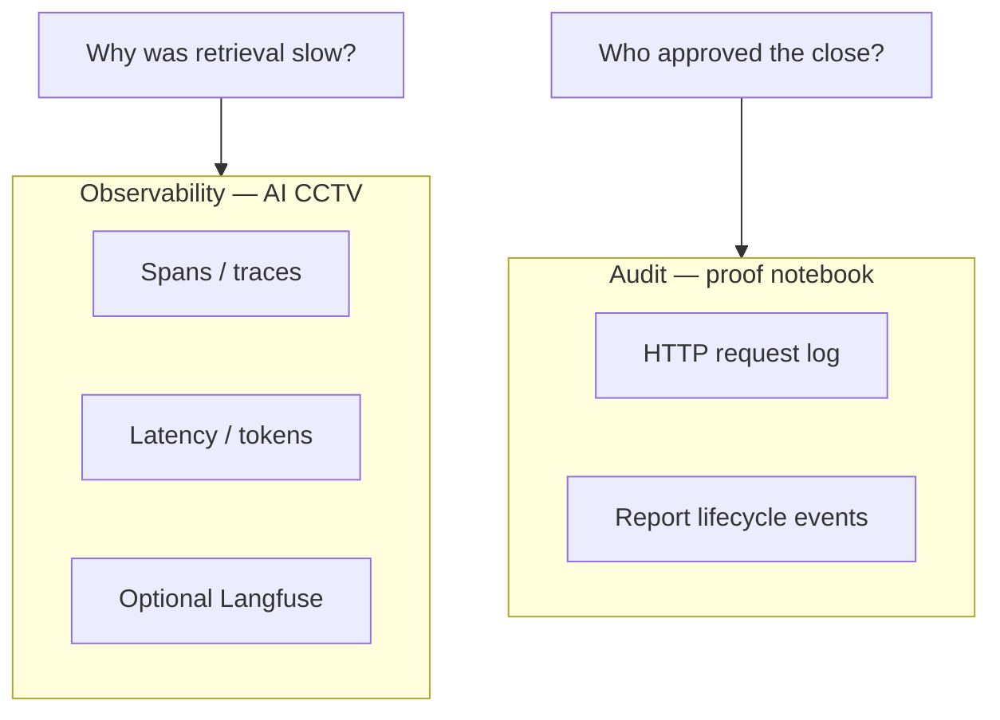
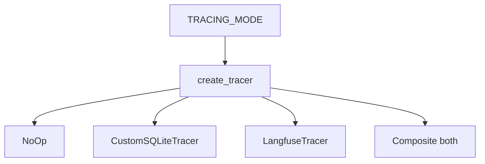
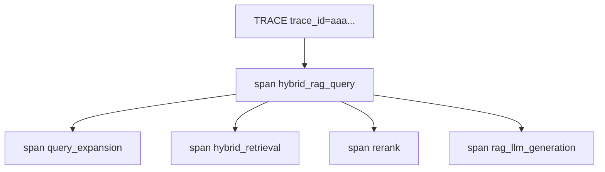
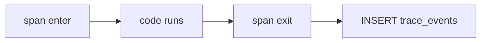
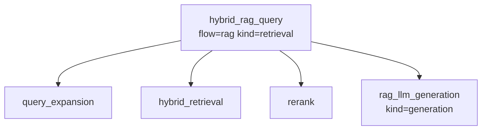
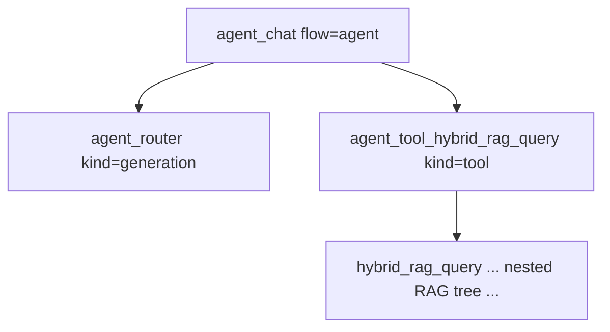
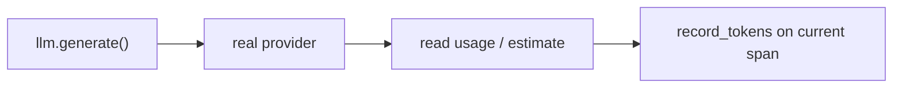
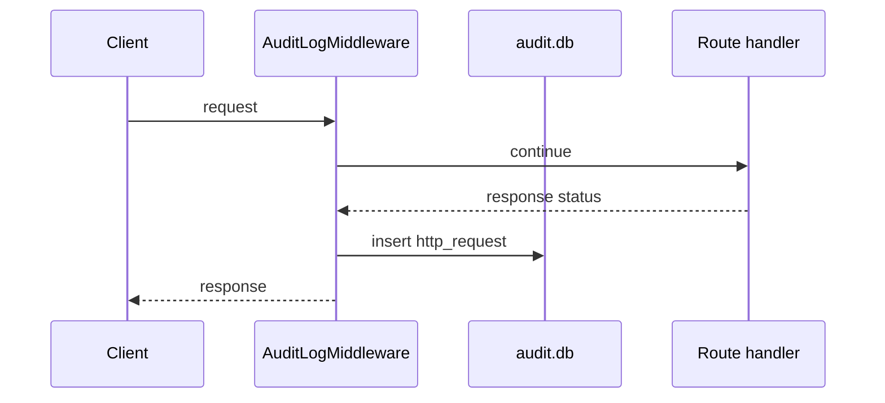
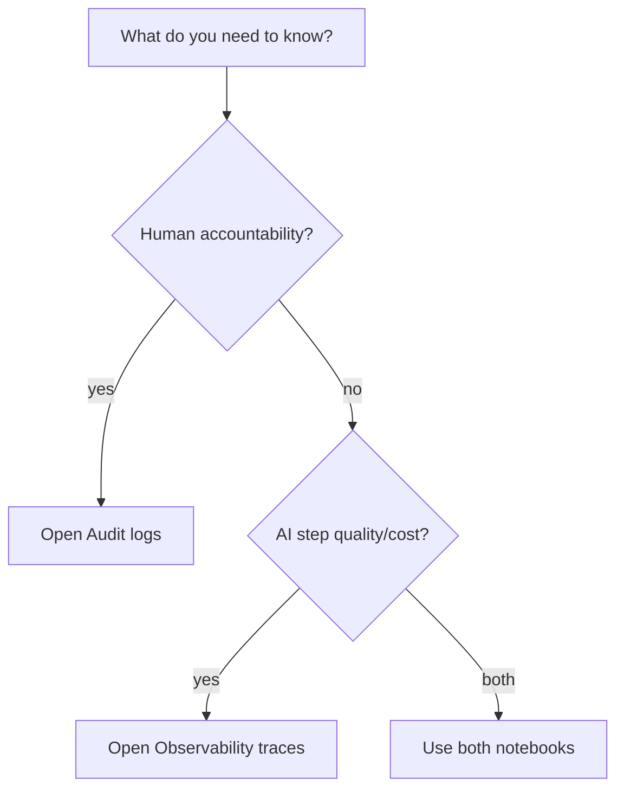

# 05 — Tracing & Monitoring

### In-depth guide with span-tree input → output examples

> Goal: clearly separate **observability (AI CCTV)** from **audit (proof notebook)**, and show exact INPUT → OUTPUT at each monitoring step.

---

## Quick map

| Section | Learn |
|---|---|
| [1. Two monitoring worlds](#1-two-monitoring-worlds) | Audit vs traces |
| [2. Tracing modes I/O](#2-tracing-modes-io) | off/custom/langfuse/both |
| [3. Trace vs span](#3-trace-vs-span) | Story vs chapters |
| [4. Custom SQLite tracer I/O](#4-custom-sqlite-tracer-io) | What gets stored |
| [5. RAG span tree example](#5-rag-span-tree-example) | Full query visibility |
| [6. Agent span tree example](#6-agent-span-tree-example) | Chat + nested RAG |
| [7. LLM token attachment](#7-llm-token-attachment) | Where tokens land |
| [8. Observability API I/O](#8-observability-api-io) | Endpoints |
| [9. Audit middleware & domain audit](#9-audit-middleware--domain-audit) | Proof examples |
| [10. Side-by-side decision guide](#10-side-by-side-decision-guide) | Which log to open |

---

## 1. Two monitoring worlds



| Question | System | DB |
|---|---|---|
| Who called approve-close? | Audit | `audit.db` |
| Who created REF-…? | Domain audit | `audit.db` |
| How long did rerank take? | Tracing | `observability.db` |
| How many tokens did RAG use? | Tracing | `observability.db` |

---

## 2. Tracing modes I/O

### Config INPUT

```text
TRACING_MODE=custom   # off | custom | langfuse | both
```

### OUTPUT behavior matrix

| Mode INPUT | SQLite traces OUTPUT | Langfuse OUTPUT | `/observability/*` useful? |
|---|---|---|---|
| `off` | none | none | empty |
| `custom` | yes | no | yes |
| `langfuse` | no | yes if keys set | empty |
| `both` | yes | yes if keys set | yes |



### Langfuse keys INPUT

```text
LANGFUSE_PUBLIC_KEY=pk_...
LANGFUSE_SECRET_KEY=sk_...
LANGFUSE_BASE_URL=https://cloud.langfuse.com
```

### OUTPUT

- keys present → export observations  
- keys missing → warning, no crash, local custom still works in `both`

**Demo recommendation:** `TRACING_MODE=both`

---

## 3. Trace vs span

### Concept

| Term | Analogy | Example |
|---|---|---|
| Trace | whole movie | one `/rag/query` call |
| Span | one scene | `rerank` step |



### ID OUTPUT format

- `trace_id`: 32 hex chars  
- `span_id`: 16 hex chars  
- `parent_span_id`: links child → parent  

Compatible with Langfuse/OTEL style correlation.

---

## 4. Custom SQLite tracer I/O

### INPUT to `tracer.span(...)` (concept)

```text
name="hybrid_rag_query"
kind="retrieval"
actor="operator"
role="operator"
metadata={ flow: "rag", question preview... }
```

### OUTPUT row in `trace_events`

| Column | Example value |
|---|---|
| trace_id | `a1b2...` |
| span_id | `c3d4...` |
| name | `hybrid_rag_query` |
| kind | `retrieval` |
| status | `ok` |
| latency_ms | `842` |
| prompt_tokens | `1200` |
| completion_tokens | `180` |
| input_preview | question text truncated |
| output_preview | answer preview truncated |
| metadata_json | diagnostics, models, flow |



On exception: `status=error` + `error_message` saved, then error re-raised.

---

## 5. RAG span tree example

### INPUT

`POST /rag/query`  
question: “Is onset date required for Suspected AE?”

### OUTPUT span tree (conceptual)



| Span | What INPUT it represents | What OUTPUT it records |
|---|---|---|
| hybrid_rag_query | full question | final answer preview + total latency |
| query_expansion | original question | expanded query list metadata |
| hybrid_retrieval | queries | hit counts |
| rerank | candidates | chosen top chunks |
| rag_llm_generation | context+question | answer text + tokens |

### Example diagnostics people look for

- expansion slow?  
- zero BM25 hits?  
- reranker dropped everything?  
- generation tokens high?

---

## 6. Agent span tree example

### INPUT

`POST /agent/chat`  
message: “What does SOP say about LOT format?”

### OUTPUT tree



### Close HITL spans (concept names)

| Moment | Span idea |
|---|---|
| close requested | hitl close request span |
| resume approve/reject | hitl resume span |

### Useful OUTPUT field for UI

Agent response often includes:

```json
{ "trace_id": "a1b2c3..." }
```

#### INPUT to monitoring API

`GET /observability/traces/a1b2c3...`

#### OUTPUT

full tree JSON for that chat turn.

---

## 7. LLM token attachment

### Concept

Every container LLM is wrapped by `InstrumentedLLMProvider`.



### Example

#### INPUT

RAG generation prompt with 5 chunks

#### OUTPUT on `rag_llm_generation` span

```text
prompt_tokens: 1400
completion_tokens: 220
token_usage: 1620
metadata.llm_model: ...
metadata.llm_provider: groq
```

Tokens usually attach with `bubble=False` so parent totals are not double-counted incorrectly when APIs sum children.

---

## 8. Observability API I/O

Permission: **`obs:view`** (admin, reviewer)

### Config

#### INPUT

`GET /api/v1/observability/config`

#### OUTPUT (illustrative)

```json
{
  "tracing_mode": "both",
  "langfuse_configured": true,
  "custom_sqlite": true,
  "llm_roles": { "rag": "groq:...", "router": "groq:..." }
}
```

### List traces

#### INPUT

`GET /observability/traces?limit=20&flow=agent`

#### OUTPUT

array of trace summaries: trace_id, status, latency, token totals, intent/flow.

### Trace detail

#### INPUT

`GET /observability/traces/{trace_id}`

#### OUTPUT

```json
{
  "trace_id": "...",
  "root": { "name": "agent_chat", "latency_ms": 1100 },
  "spans": [ ... flat list ... ],
  "tree": { ... nested ... },
  "token_totals": { "prompt": 900, "completion": 200 }
}
```

### Permission denial example

#### INPUT

operator token → `/observability/spans`

#### OUTPUT

**403 Insufficient permissions**

---

## 9. Audit middleware & domain audit

### A) HTTP middleware I/O

#### INPUT

any API request (except health), with/without JWT

#### OUTPUT row

| Field | Example |
|---|---|
| action | `http_request` |
| actor | `reviewer` or `anonymous` |
| resource_type | `http` |
| details | method/path/status/latency/ip |



### B) Domain audit I/O (reports)

#### INPUT event

report created / status changed / HITL approved / rejected

#### OUTPUT row examples

| action | details idea |
|---|---|
| `created` | Intake report created |
| `status_changed` | New → In Review |
| `close_requested` | pending close |
| `hitl_approved` | approver closed |
| `hitl_rejected` | returned to review |

### Audit API

#### INPUT

`GET /api/v1/audit/logs?limit=50`  
permission `audit:view`

#### OUTPUT

newest audit rows for UI/compliance storytelling.

---

## 10. Side-by-side decision guide



| Scenario INPUT | Where to look OUTPUT |
|---|---|
| “Who closed REF-1?” | audit domain events |
| “Did someone spam login?” | audit HTTP rows |
| “Why RAG answer weak?” | obs retrieval/rerank spans |
| “Agent routed wrong?” | obs `agent_router` span |
| “Token bill spike?” | obs token columns |

---

## Mini end-to-end monitoring story

1. **INPUT:** reviewer asks agent SOP question.  
2. **OUTPUT:** chat answer + `trace_id`.  
3. **INPUT:** `GET /observability/traces/{id}`.  
4. **OUTPUT:** router → tool → nested RAG timings.  
5. **INPUT:** later approve close via REST.  
6. **OUTPUT:** audit shows `hitl_approved` — separate from AI spans.

---

## Concept cards

### Card — empty observability UI

If `TRACING_MODE=langfuse` only, local UI is empty even if Langfuse has data.

### Card — traces are not legal proof alone

Use audit for accountability; traces for engineering insight.

### Card — nested context

Child spans inherit parent via ContextVar — LLM wrappers can attach tokens without manual span plumbing everywhere.

---

## What to read next

[06 End-to-End Backend Solution](./06_END_TO_END_BACKEND.md) — full day script with INPUT/OUTPUT at every business step.

---

*Doc 05/6 — Tracing & monitoring (deep + I/O)*
