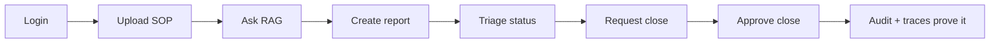
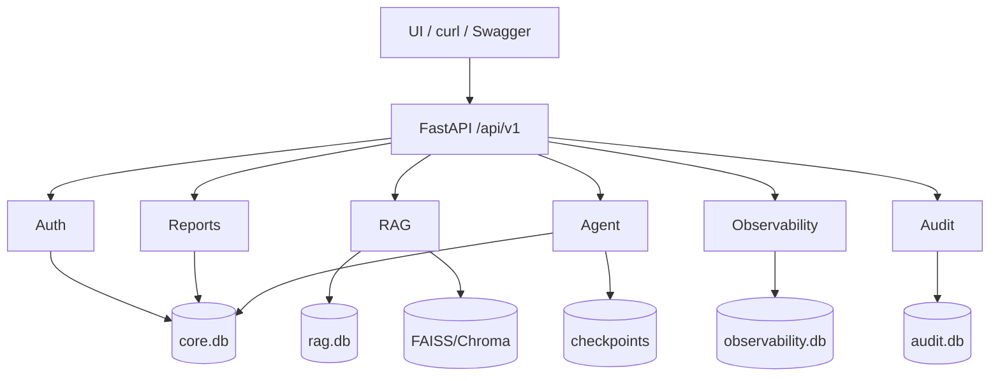
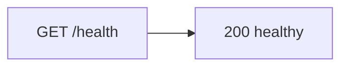
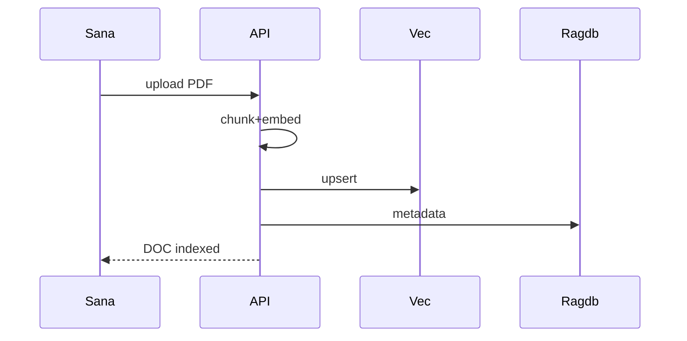
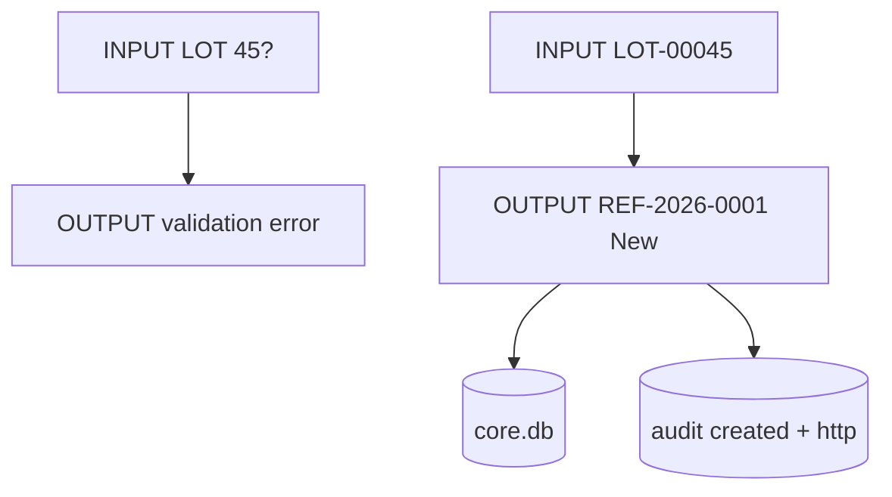
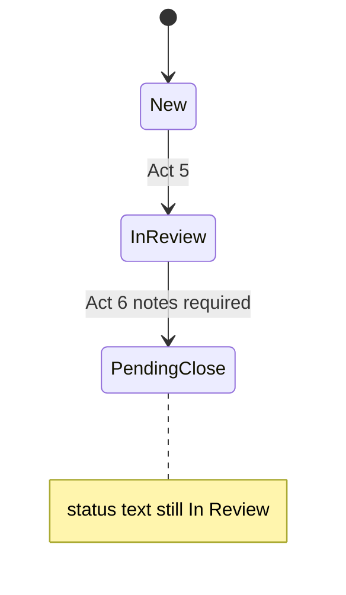
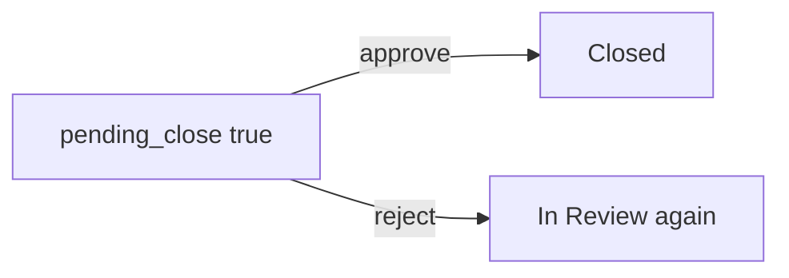
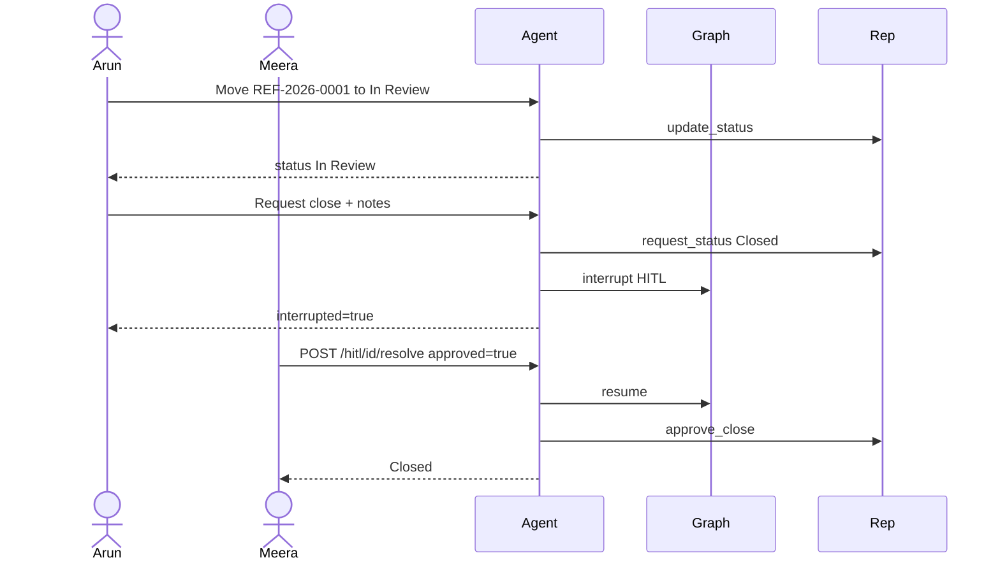
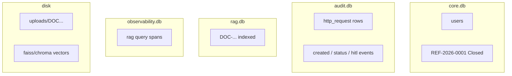
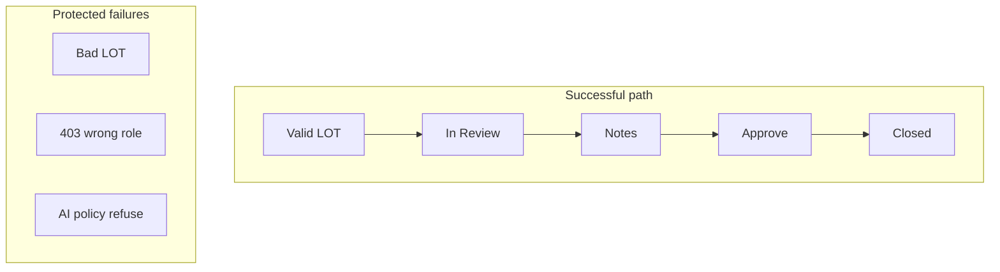

# 06 — End-to-End Backend Solution

### Full backend story with deep visuals + input → output at every step

> This is the “movie” version.  
> Docs 01–05 are the scenes. This file plays them in order with concrete INPUT/OUTPUT.

---

## Quick map

| Section | Learn |
|---|---|
| [1. What end-to-end means](#1-what-end-to-end-means) | One desk, many engines |
| [2. Architecture reminder](#2-architecture-reminder) | Big diagram |
| [3. Cast & tokens](#3-cast--tokens) | Who acts |
| [4. Full day script I/O](#4-full-day-script-io) | Acts 1–10 |
| [5. Parallel agent path](#5-parallel-agent-path) | Same outcome via chat |
| [6. Data landing map](#6-data-landing-map) | Which DB got what |
| [7. Failure demos](#7-failure-demos) | Useful errors |
| [8. Explain to any audience](#8-explain-to-any-audience) | Business/dev/AI |
| [9. Final checklist](#9-final-checklist) | Done means done |

---

## 1. What end-to-end means

End-to-end backend solution = one continuous path:



Each arrow has a real **INPUT** and **OUTPUT**.

---

## 2. Architecture reminder



Deep dive: [01_ARCHITECTURE.md](./01_ARCHITECTURE.md)

---

## 3. Cast & tokens

| Person | Username | Role | Gets token via |
|---|---|---|---|
| Maya | operator | operator | `/auth/login` |
| Arun | reviewer | reviewer | `/auth/login` |
| Meera | approver | approver | `/auth/login` |
| Sana | admin | admin | `/auth/login` |

### Shared login I/O pattern

#### INPUT

```json
{ "username": "operator", "password": "Operator@123" }
```

#### OUTPUT

```json
{
  "access_token": "<JWT>",
  "role": "operator",
  "username": "operator",
  "full_name": "Maya Operator"
}
```

All later calls use:

```http
Authorization: Bearer <JWT>
```

Deep dive: [02_AUTHENTICATION_ROLES.md](./02_AUTHENTICATION_ROLES.md)

---

## 4. Full day script I/O

### Act 1 — Health check

#### INPUT

`GET /api/v1/system/health` (public)

#### OUTPUT

healthy JSON (service is up)



---

### Act 2 — Admin uploads SOP

#### INPUT

`POST /api/v1/rag/documents` as **admin**

multipart:

- title: `Intake Checklist v4`
- strategy: `structure_aware`
- file: `intake_checklist_v4.pdf`

#### OUTPUT

```json
{
  "doc_id": "DOC-9f3a2b1c0d",
  "status": "indexed",
  "chunk_count": 42
}
```

#### Side effects OUTPUT

| Target | Effect |
|---|---|
| uploads/ | file saved |
| FAISS/Chroma | vectors upserted |
| rag.db | doc + chunks |
| BM25 memory | rebuilt |



Deep dive: [03_RAG.md](./03_RAG.md)

---

### Act 3 — Operator asks knowledge question

#### INPUT

`POST /api/v1/rag/query` as **operator**

```json
{
  "question": "For Suspected Adverse Event, which extra fields are mandatory?"
}
```

#### OUTPUT (illustrative)

```json
{
  "answer": "event_description and event_onset_date are required...",
  "sources": [{ "doc_id": "DOC-9f3a2b1c0d", "text": "..." }],
  "diagnostics": { "reranker": "cross_encoder", "latency_ms": 900 }
}
```

#### Observability OUTPUT

Trace tree under `flow=rag` in `observability.db` (if tracing custom/both).

---

### Act 4 — Operator creates Suspected AE (fail then succeed)

#### INPUT #1 (bad LOT)

```json
{
  "report_type": "Suspected Adverse Event",
  "product_name": "CardioMax 50mg",
  "batch_lot_number": "45?",
  "date_received": "2026-11-08",
  "reporter_type": "Consumer",
  "description": "Caller reported dizziness",
  "event_description": "Dizziness after dose",
  "event_onset_date": "2026-11-07"
}
```

#### OUTPUT #1

error: `batch_lot_number must match LOT-#####`  
DB unchanged.

#### INPUT #2 (fixed)

same body with `"batch_lot_number": "LOT-00045"`

#### OUTPUT #2

```json
{
  "reference_id": "REF-2026-0001",
  "status": "New",
  "pending_close": false,
  "created_by": "operator"
}
```



---

### Act 5 — Reviewer lists New and takes case

#### INPUT

`GET /api/v1/reports?status=New` as **reviewer**

#### OUTPUT

array including `REF-2026-0001`

#### INPUT

```http
POST /api/v1/reports/REF-2026-0001/status
```

```json
{ "new_status": "In Review" }
```

#### OUTPUT

```json
{
  "reference_id": "REF-2026-0001",
  "status": "In Review",
  "pending_close": false
}
```

#### Denied contrast INPUT

same status call as **operator** → OUTPUT **403**

---

### Act 6 — Reviewer requests close

#### INPUT

```json
{
  "new_status": "Closed",
  "reviewer_notes": "LOT verified. AE fields complete. Training case ready to close."
}
```

#### OUTPUT

```json
{
  "reference_id": "REF-2026-0001",
  "status": "In Review",
  "pending_close": true,
  "reviewer_notes": "LOT verified. AE fields complete. Training case ready to close."
}
```



**Teaching OUTPUT:** close is requested, not finished.

---

### Act 7 — Approver approves close

#### INPUT

```http
POST /api/v1/reports/REF-2026-0001/approve-close
Authorization: Bearer <approver>
```

```json
{ "confirm": true, "comment": "Approved for training close." }
```

#### OUTPUT

```json
{
  "reference_id": "REF-2026-0001",
  "status": "Closed",
  "pending_close": false,
  "approver_comment": "Approved for training close."
}
```

#### Audit OUTPUT

domain events include close/HITL approval evidence.

---

### Act 8 — Reject path (alternate demo)

If Act 7 uses reject instead:

#### INPUT

```json
{ "confirm": true, "note": "Please clarify product strength in description." }
```

#### OUTPUT

- status stays **In Review**
- `pending_close=false`
- reviewer must fix and request again



---

### Act 9 — Manager reads audit

#### INPUT

`GET /api/v1/audit/logs?limit=50` as reviewer/admin/approver

#### OUTPUT (story you can narrate)

1. http login / create calls  
2. `created` for REF-2026-0001  
3. `status_changed` to In Review  
4. close requested  
5. `hitl_approved` / closed  

Deep dive: [05_TRACING_MONITORING.md](./05_TRACING_MONITORING.md)

---

### Act 10 — Reviewer inspects AI traces (optional but impressive)

#### INPUT

`GET /api/v1/observability/traces?flow=rag`

#### OUTPUT

trace summaries for Act 3 question.

#### INPUT

`GET /observability/traces/{trace_id}`

#### OUTPUT

expansion → retrieval → rerank → generation tree with latencies/tokens.

---

## 5. Parallel agent path

Same business day, but triage/close via chat.



### Agent chat I/O strip

| Turn | INPUT message | OUTPUT intent | OUTPUT effect |
|---|---|---|---|
| 1 | create AE … LOT-00045 | intake | new REF |
| 2 | what is status of REF-…? | lookup | read-only card |
| 3 | move REF to In Review | status | In Review |
| 4 | request close + notes | status | HITL interrupt |
| 5 | (approver resolve) | — | Closed |

Deep dive: [04_AGENT.md](./04_AGENT.md)

---

## 6. Data landing map

After a full successful REST day (upload + AE + triage + approve):



| Action | core | audit | rag | obs | vectors/uploads |
|---|---|---|---|---|---|
| login | read users | http | | | |
| upload SOP | | http | write | maybe | write |
| rag query | maybe session | http | read | write spans | read |
| create report | write report | http+domain | | | |
| status/close | update report | http+domain | | | |
| agent HITL | hitl+messages+checkpoint | http+domain | | agent spans | |

---

## 7. Failure demos (show these!)

| # | INPUT | OUTPUT | Proves |
|---|---|---|---|
| 1 | LOT `45?` | validation error | clean intake |
| 2 | AE without onset date | validation error | typed rules |
| 3 | operator approve-close | 403 | RBAC |
| 4 | approver create report | 403 | separation of duties |
| 5 | New → Closed illegal jump | business error | state machine |
| 6 | close without notes | rejected | HITL quality |
| 7 | “Did drug cause this?” | AI refusal | guardrails |
| 8 | delete DOC | vectors+file+meta gone | safe knowledge ops |



---

## 8. Explain to any audience

### Business audience

**INPUT question:** “What problem did you solve?”  
**OUTPUT answer:**  
Messy email/Excel intake → validated cases, enforced handoffs, human-approved closes, searchable SOPs, AI that helps but cannot silently decide.

### Engineering audience

**INPUT question:** “How is it built?”  
**OUTPUT answer:**  
FastAPI + permission RBAC + ReportService state machine + hybrid RAG factory stack + LangGraph HITL interrupts + split SQLite telemetry.

### AI/governance audience

**INPUT question:** “Is the AI safe enough to demo?”  
**OUTPUT answer:**  
Grounded retrieval, centralized prompts, tool-level validation, HITL on close, inspectable traces, synthetic data only, explicit bans on causality/treatment/reportability.

---

## 9. Final checklist

### Functional

- [ ] Login returns JWT for all 4 roles  
- [ ] Upload indexes document  
- [ ] Query returns grounded answer + sources  
- [ ] Create report issues REF  
- [ ] Reviewer can move to In Review  
- [ ] Close requires notes + pending flag  
- [ ] Approver can approve/reject  
- [ ] Agent can do the same path with interrupt  
- [ ] Audit shows lifecycle  
- [ ] Observability shows RAG/agent spans when enabled  

### Safety

- [ ] Bad LOT blocked  
- [ ] Wrong-role actions 403  
- [ ] AI refuses banned advice  
- [ ] Delete removes storage + vectors + metadata  

If all boxes pass, the **backend end-to-end solution is complete**.

---

## One-page memory card

| Stage | Best INPUT example | Best OUTPUT example |
|---|---|---|
| Auth | login operator | JWT + role |
| RAG index | admin uploads SOP | DOC indexed |
| RAG ask | onset date question | grounded answer |
| Intake | AE + LOT-00045 | REF New |
| Triage | status In Review | status changed |
| HITL ask | Closed + notes | pending_close true |
| HITL done | approve-close | Closed |
| Proof | audit + traces | who/what/when + AI steps |

---

## Links to deep docs

1. [Architecture](./01_ARCHITECTURE.md)  
2. [Auth & roles](./02_AUTHENTICATION_ROLES.md)  
3. [RAG](./03_RAG.md)  
4. [Agent](./04_AGENT.md)  
5. [Tracing](./05_TRACING_MONITORING.md)  
6. Business story: [`../BUSINESS_PROBLEM_AND_SOLUTION.md`](../BUSINESS_PROBLEM_AND_SOLUTION.md)

---

## Closing line

The backend end-to-end solution is a governed pipeline:

**identity → knowledge → validated intake → enforced workflow → human close → visible proof.**

Every step has a clear INPUT and a clear OUTPUT. That is how the system stays understandable, demoable, and trustworthy.

---

*Doc 06/6 — End-to-end backend (deep + full I/O script)*
