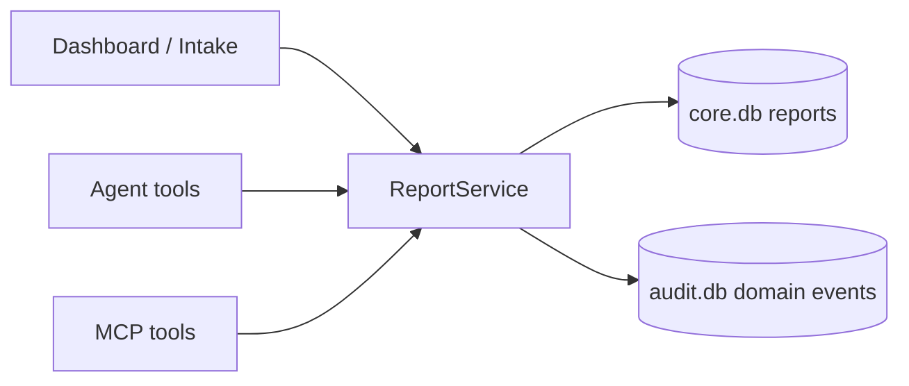
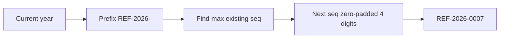
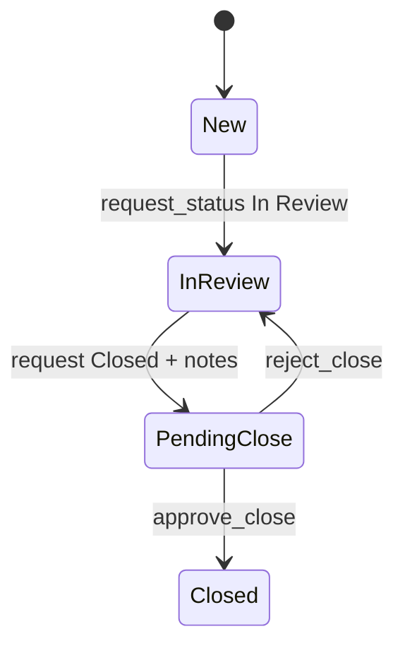
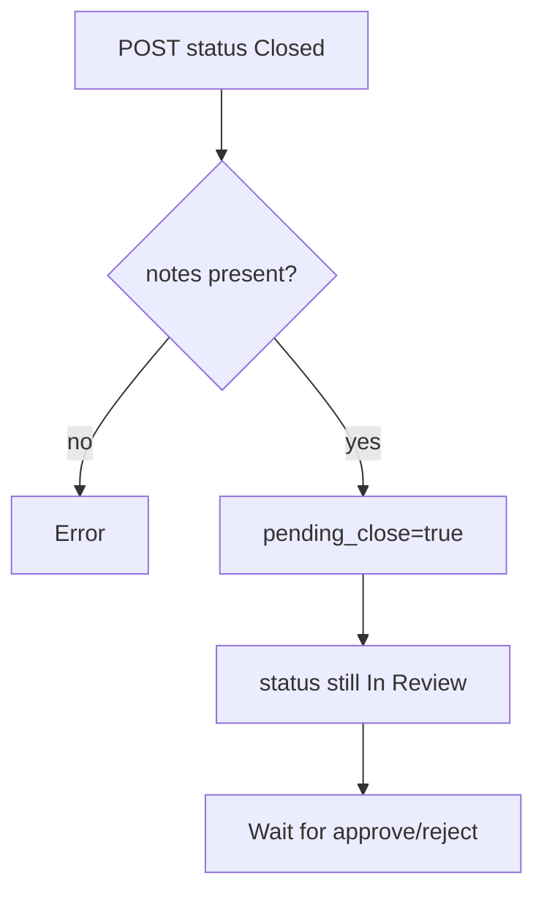
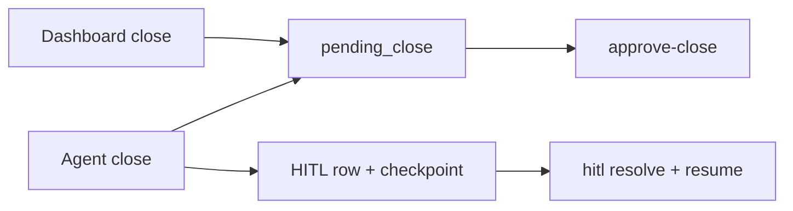

# 07 — Reports & Workflow (ReportService)

### Deep reference for intake validation, status machine, and HITL close

> This fills a major backend gap: the **report engine** that both Dashboard and Agent share.

---

## 1. Why this doc exists

`ReportService` is the source of truth for:

- creating PQC / Suspected AE reports  
- generating `REF-YYYY-####`  
- enforcing `New → In Review → Closed`  
- pending close (HITL)  
- domain audit events  



**Key files**

| File | Role |
|---|---|
| `app/services/report_service.py` | Business rules |
| `app/api/routes/reports.py` | HTTP endpoints |
| `app/schemas/reports.py` | Request shapes |
| `app/db/models/core.py` | `Report` table |
| `tests/test_report_workflow.py` | Contract tests |

---

## 2. Create report — INPUT → OUTPUT

### Endpoint

`POST /api/v1/reports` · permission `intake:create`

### Validation rules

| Rule | INPUT example | OUTPUT |
|---|---|---|
| Required core fields | missing product | error, nothing saved |
| LOT format `^LOT-\d{5}$` | `LOT-45?` / `LOT-8839` | error |
| Valid LOT | `LOT-88392` | OK |
| AE extras required | AE without onset | error |
| PQC | no AE fields needed | OK |

### REF ID generation



### Success OUTPUT (shape)

```json
{
  "reference_id": "REF-2026-0001",
  "status": "New",
  "pending_close": false,
  "batch_lot_number": "LOT-88392",
  "created_by": "operator"
}
```

**Side effect:** audit action `created`.

---

## 3. Status machine (deep)



### ALLOWED map (code)

| Current | Allowed next |
|---|---|
| New | In Review |
| In Review | Closed *(via pending HITL, not instant)* |
| Closed | *(none)* |

### Illegal transition INPUT → OUTPUT

#### INPUT

`New` → `Closed`

#### OUTPUT

```text
Invalid transition: New → Closed.
Allowed workflow is New → In Review → Closed.
```

DB unchanged.

---

## 4. request_status behaviors

| Situation | Behavior |
|---|---|
| New → In Review | status updates · audit `status_changed` |
| Already In Review again | no-op success (idempotent) |
| In Review → Closed + notes | sets `pending_close=true`, status stays In Review · audit `close_requested` |
| Close already pending | no-op return current row |
| Close without notes | `ValueError` — notes required |
| Notes provided while already In Review | may update `reviewer_notes` |

### Critical teaching point

**Requesting Closed ≠ Closed.**



---

## 5. approve_close / reject_close

### Approve

**Preconditions**

- status is In Review  
- `pending_close` true  
- reviewer_notes present  

**OUTPUT**

- status `Closed`  
- `pending_close=false`  
- optional `approver_comment`  
- audit `hitl_approved` + `status_changed`

### Reject

**OUTPUT**

- status remains In Review  
- `pending_close=false`  
- optional `approver_comment`  
- audit `hitl_rejected`

### Endpoint permissions

| Endpoint | Permission |
|---|---|
| `POST /reports/{id}/status` | `workflow:update` |
| `POST /reports/{id}/approve-close` | `workflow:approve_close` |
| `POST /reports/{id}/reject-close` | `workflow:approve_close` |

Approve/reject bodies typically include `confirm: true`.

---

## 6. HTTP vs Agent HITL (do not confuse)

| Path | What is created | How it finishes |
|---|---|---|
| Dashboard Request Close | report `pending_close` only | `POST .../approve-close` |
| Agent “close REF” | report pending **+** `agent_hitl_requests` + LangGraph interrupt | `POST /agent/hitl/{id}/resolve` (resumes graph) |



Both respect the same business gate: humans approve closes.

---

## 7. Domain audit actions

| Action | When |
|---|---|
| `created` | intake saved |
| `status_changed` | New→In Review or final Closed |
| `close_requested` | pending HITL set |
| `hitl_approved` | approver approved |
| `hitl_rejected` | approver rejected |

These live in **audit.db** (with HTTP middleware logs). See also [05_TRACING_MONITORING.md](./05_TRACING_MONITORING.md).

---

## 8. Quick API matrix

| Method | Path | Permission |
|---|---|---|
| POST | `/reports` | `intake:create` |
| GET | `/reports` | `intake:read` |
| GET | `/reports/{id}` | `intake:read` |
| POST | `/reports/{id}/status` | `workflow:update` |
| POST | `/reports/{id}/approve-close` | `workflow:approve_close` |
| POST | `/reports/{id}/reject-close` | `workflow:approve_close` |

---

## 9. Example end-to-end I/O strip

| Step | INPUT | OUTPUT |
|---|---|---|
| 1 | create PQC LOT-88392 | REF New |
| 2 | status In Review | In Review |
| 3 | status Closed + notes | pending_close true |
| 4 | approve-close | Closed |
| 5 | (alternate) reject-close | In Review again |

---

*Doc 07/11 — Reports & workflow*
