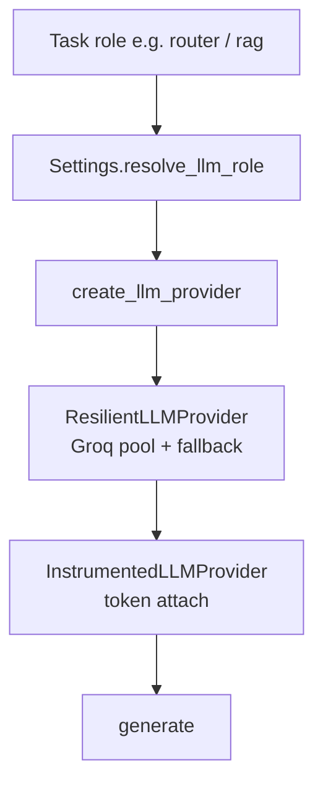
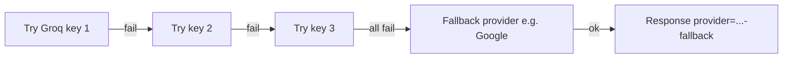

# 08 — LLM Providers, Roles & Resilience

### How the backend chooses models per task, rotates keys, and records tokens

> Major gap filled: LLM wiring was only skimmed in architecture before.

---

## 1. Big idea

Not every call needs the same model.

| Need | Prefer |
|---|---|
| Classify intent | Cheap / fast model |
| Draft user answer / RAG answer | Stronger model |
| Offline class demo | `mock` provider |



**Key files:** `config.py`, `modules/llms/providers.py`, `resilient.py`, `instrumented.py`, `usage.py`, `core/container.py`

---

## 2. LLM roles catalog

| Role | Used for | Typical tier |
|---|---|---|
| `default` | fallback | quality |
| `router` | agent intent classification | cheap |
| `response` | draft user-facing replies | quality |
| `social` | greetings / help | cheap |
| `rag` | answer from retrieved chunks | quality |
| `query_enhancer` | rewrite one search query | cheap |
| `query_rewrite` | multi-query variants | cheap |
| `chunking` | agentic chunk boundaries | cheap |

Container builds one instrumented provider per role:

```text
container.llm_for("rag")
container.llm_for("router")
```

---

## 3. Resolution order (INPUT config → OUTPUT provider)

For each role:

1. Role override `LLM_{ROLE}_PROVIDER` / `_MODEL` / `_API_KEY` if set  
2. Else global `LLM_PROVIDER`  
3. Model: role model, else for Groq use cheap/quality tier, else `LLM_MODEL_NAME`  
4. API key: role key, else Groq pool sticky slot, else shared provider key  

### Tier helper

| Roles | Default Groq tier field |
|---|---|
| `default`, `response`, `rag` | `LLM_QUALITY_MODEL` |
| others | `LLM_CHEAP_MODEL` |

### Example INPUT

```text
LLM_PROVIDER=groq
LLM_CHEAP_MODEL=llama-3.1-8b-instant
LLM_QUALITY_MODEL=openai/gpt-oss-120b
GROQ_API_KEYS=keyA,keyB,keyC
```

### Example OUTPUT (concept)

| Role | Model tier | Groq key slot (sticky) |
|---|---|---|
| router | cheap | 0 |
| social | cheap | 1 |
| rag | quality | 1 |
| response | quality | 2 |

---

## 4. Supported providers

| Name | Notes |
|---|---|
| `openai` | needs `OPENAI_API_KEY` |
| `groq` | pool + rotation |
| `google` | often used as fallback |
| `openrouter` | needs key |
| `mistral` | needs key |
| `mock` | offline / tests |

If keys missing and mock allowed → silent mock responses for demos.

---

## 5. Resilience (Groq rotation + fallback)



Config:

```text
LLM_FALLBACK_ENABLED=true
LLM_FALLBACK_PROVIDER=google
LLM_FALLBACK_MODEL=gemini-1.5-flash
```

**Say to manager:** “We fail over instead of crashing the desk when one key rate-limits.”

---

## 6. Instrumentation (tokens → traces)

Every role LLM is wrapped by `InstrumentedLLMProvider`.

#### INPUT

`generate(system, user)` under an open tracer span

#### OUTPUT side effect

Span gets:

- `prompt_tokens`  
- `completion_tokens`  
- provider/model metadata  

If API omits usage → estimate ≈ `len(text)/4`.

See [05_TRACING_MONITORING.md](./05_TRACING_MONITORING.md).

---

## 7. Safe discovery (no secrets)

`GET /api/v1/system/providers` (needs `rag:view`) returns `llm_roles` summary:

- provider  
- model  
- api_key_configured yes/no  
- groq pool size / slot  
- fallback on/off  

Never returns raw API keys.

---

## 8. Practical recipes

### Offline classroom

```text
LLM_PROVIDER=mock
```

### Groq-only demo

```text
LLM_PROVIDER=groq
GROQ_API_KEY=...
```

### Groq + Google fallback

```text
LLM_PROVIDER=groq
GROQ_API_KEYS=k1,k2
LLM_FALLBACK_ENABLED=true
LLM_FALLBACK_PROVIDER=google
GOOGLE_API_KEY=...
```

### Stronger RAG only

```text
LLM_RAG_PROVIDER=openai
LLM_RAG_MODEL=gpt-4o-mini
OPENAI_API_KEY=...
```

---

## 9. Restart note

Container is `@lru_cache`. Most LLM env changes need **API process restart**.

Exception: agent tool backend can be switched at runtime via `/agent/config`.

---

*Doc 08/11 — LLM providers*
