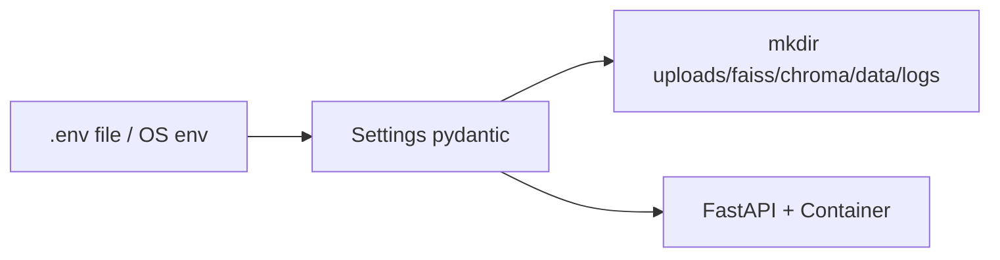

# 09 — Config & `.env` Reference

### Complete settings catalog — what each variable does

> Major gap filled: long `.env.example` without a human explanation map.

**Source of truth:** `app/core/config.py` + `backend/.env.example`

---

## 1. How settings load



`get_settings()` is cached. Change env → **restart uvicorn**.

---

## 2. App / security

| Env | Meaning | Default idea |
|---|---|---|
| `APP_NAME` | API title | Pharma Safety Intake Tracker |
| `APP_ENV` | development / production | development |
| `API_PREFIX` | route prefix | `/api/v1` |
| `SECRET_KEY` | JWT signing | must be strong outside dev |
| `ACCESS_TOKEN_EXPIRE_MINUTES` | token lifetime | 480 |
| `CORS_ORIGINS` | allowed frontends | `http://localhost:5173,...` |
| `SEED_DEMO_USERS` | seed in prod if true | false |
| `MAX_UPLOAD_BYTES` | upload cap | 15MB |

Non-dev refuses weak `SECRET_KEY`.

---

## 3. Databases

| Env | DB |
|---|---|
| `CORE_DB_URL` | users, reports, chat, HITL |
| `AUDIT_DB_URL` | HTTP + domain audit |
| `RAG_DB_URL` | document/chunk metadata |
| `OBS_DB_URL` | trace spans |

Also on disk (not env URLs): `data/langgraph_checkpoints.sqlite`.

---

## 4. Embeddings & vectors

| Env | Options / notes |
|---|---|
| `EMBEDDING_PROVIDER` | sentence_transformers / huggingface / openai / google |
| `EMBEDDING_MODEL_NAME` | e.g. `all-MiniLM-L6-v2` |
| `VECTOR_STORE_PROVIDER` | `faiss` / `chromadb` |
| `FAISS_DIR` | FAISS files |
| `CHROMA_DIR` | Chroma persist dir |

Changing embedding model usually requires **re-index**.

---

## 5. LLM globals + keys

| Env | Meaning |
|---|---|
| `LLM_PROVIDER` | openai/groq/google/openrouter/mistral/mock |
| `LLM_MODEL_NAME` | default model |
| `LLM_CHEAP_MODEL` | cheap tier (Groq roles) |
| `LLM_QUALITY_MODEL` | quality tier |
| `OPENAI_API_KEY` | OpenAI |
| `GROQ_API_KEY` | primary Groq |
| `GROQ_API_KEYS` | comma pool for rotation |
| `GOOGLE_API_KEY` | Google |
| `OPENROUTER_API_KEY` | OpenRouter |
| `MISTRAL_API_KEY` | Mistral |
| `LLM_FALLBACK_ENABLED` | enable fallback |
| `LLM_FALLBACK_PROVIDER` | e.g. google |
| `LLM_FALLBACK_MODEL` | fallback model |

### Per-role overrides (blank = inherit)

For each of `ROUTER`, `RESPONSE`, `SOCIAL`, `RAG`, `QUERY_ENHANCER`, `QUERY_REWRITE`, `CHUNKING`:

```text
LLM_<ROLE>_PROVIDER=
LLM_<ROLE>_MODEL=
LLM_<ROLE>_API_KEY=
```

Details: [08_LLM_PROVIDERS.md](./08_LLM_PROVIDERS.md)

---

## 6. Tracing

| Env | Meaning |
|---|---|
| `TRACING_MODE` | off / custom / langfuse / both |
| `LANGFUSE_PUBLIC_KEY` | Langfuse |
| `LANGFUSE_SECRET_KEY` | Langfuse |
| `LANGFUSE_BASE_URL` | preferred endpoint |
| `LANGFUSE_HOST` | legacy alias |

UI Observability needs `custom` or `both`.

---

## 7. Storage & chunk defaults

| Env | Meaning |
|---|---|
| `STORAGE_PROVIDER` | local (cloud stubs not implemented) |
| `UPLOAD_DIR` | uploaded files |
| `DEFAULT_CHUNK_STRATEGY` | recursive / semantic / … |
| `DEFAULT_CHUNK_SIZE` | default size |
| `DEFAULT_CHUNK_OVERLAP` | overlap |

---

## 8. RAG query tuning

| Env | Meaning |
|---|---|
| `RAG_QUERY_ENHANCER_ENABLED` | rewrite one query |
| `RAG_MULTI_QUERY_ENABLED` | multi variants |
| `RAG_MULTI_QUERY_COUNT` | how many variants |
| `RERANKER_PROVIDER` | auto/cross_encoder/embedding/lexical |
| `RERANKER_MODEL_NAME` | cross-encoder model |
| `RERANK_SCORE_THRESHOLD` | keep threshold |
| `RERANK_CANDIDATE_LIMIT` | candidates into rerank |

---

## 9. Agent / MCP

| Env | Meaning |
|---|---|
| `AGENT_TOOL_BACKEND` | `local` or `mcp` |
| `AGENT_MCP_TRANSPORT` | `inprocess` or `http` |
| `AGENT_MCP_URL` | e.g. `http://127.0.0.1:8765/mcp` |

Runtime override possible via `PUT /agent/config` (process memory only).

---

## 10. What `/system/providers` shows vs hides

**Shows (safe):** embedding, vector, tracing mode, llm role summary (no secrets)  
**Does not fully mirror:** every RAG knobs, MCP URL, upload limits — check `.env` / this doc

Related:

- `GET /system/health` — public  
- `GET /rag/chunk-strategies` — strategies + defaults (`rag:view`)

---

## 11. Startup side effects

On settings load / lifespan:

1. Create upload/faiss/chroma/data/logs dirs  
2. Init 4 SQLite DBs + schema migrate helpers  
3. Seed demo users (unless prod gate)  
4. Warm container (embeddings/LLM/tracer)  
5. Rebuild BM25 from rag.db  

---

*Doc 09/11 — Config reference*
