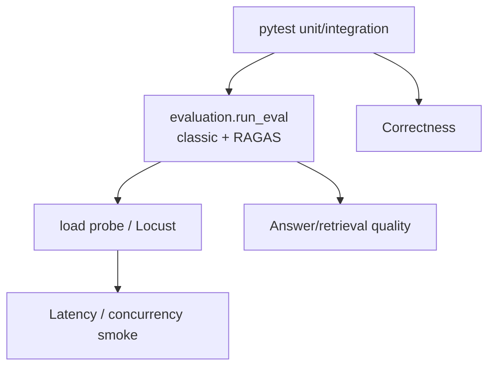
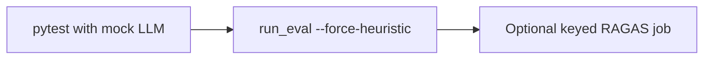

# 10 — Evaluation, Load & Pytest Map

### How we measure quality and keep regressions caught

> Major gap filled: eval/load/tests were almost undocumented.

---

## 1. Three quality layers



---

## 2. Offline evaluation harness

### Run

```bash
cd backend
python -m evaluation.run_eval --mode both
python -m evaluation.run_eval --mode ragas --force-heuristic
python -m evaluation.run_eval --mode classic --k 5
```

### Modes

| Mode | What it measures |
|---|---|
| `classic` | precision / recall / MRR / NDCG + refusal accuracy |
| `ragas` | faithfulness / answer relevancy style metrics |
| `both` | combined JSON report |

### RAGAS fallback chain


`--force-heuristic` → always C (good for CI without keys).

### OUTPUT

Writes `backend/evaluation/last_eval_report.json` and prints JSON.

### Gold data

| File | Purpose |
|---|---|
| `evaluation/gold/rag_gold.json` | RAG-oriented gold cases |
| `evaluation/gold/agent_gold.json` | Agent routing/guardrail expectations |
| `evaluation/dataset.py` | classic embedded gold loader |

**Note:** Admin role has permission string `eval:run`, but **there is no HTTP eval endpoint** today — eval is **CLI-only**.

---

## 3. Load testing

### Lightweight probe

```bash
cd backend
python -m evaluation.run_load
```

Produces `last_load_report.json` (threaded httpx style smoke).

### Locust

```bash
cd backend
locust -f evaluation/locustfile.py --host http://127.0.0.1:8000
```

Tags commonly include read / write / rag style scenarios.  
**Caution:** concurrent creates can collide on REF sequencing under heavy write load — treat as smoke, not formal capacity cert.

---

## 4. Pytest map (what each file guards)

Run:

```bash
cd backend
pytest
```

`pytest.ini` sets `pythonpath = .`

### Intake / workflow

| Test file | Guards |
|---|---|
| `test_report_workflow.py` | transitions, HITL approve/reject, notes |

### Agent

| Test file | Guards |
|---|---|
| `test_langgraph_agent.py` | graph behaviors |
| `test_agent_status_routing.py` | lookup vs status change routing |
| `test_agent_breaker.py` | circuit breaker (orchestrator path teaching) |
| `test_agent_tool_backend.py` | local vs mcp backend switch |
| `test_prompts_modules.py` | guardrail prompt presence |

### RAG / docs

| Test file | Guards |
|---|---|
| `test_chunking.py` | chunk strategies |
| `test_semantic_agentic_chunking.py` | semantic/agentic paths |
| `test_langchain_loaders.py` | file loaders |
| `test_document_dedupe.py` | file/chunk dedupe |
| `test_rag_metrics.py` | retrieval metric helpers |
| `test_storage_safety.py` | local path confinement |

### LLM / tracing

| Test file | Guards |
|---|---|
| `test_llm_roles.py` | role resolution |
| `test_llm_rotation.py` | groq pool / fallback helpers |
| `test_token_usage_tracing.py` | token attach |
| `test_observability_tracing.py` | span persistence |

### Eval / MCP

| Test file | Guards |
|---|---|
| `test_ragas_eval.py` | eval helpers |
| `test_gold_sets.py` | gold JSON shape/size |
| `test_load_summary.py` | load report helpers |
| `test_mcp_server_parity.py` | MCP tool parity with agent tools |

### Important nuance

Production chat uses **LangGraph** (`graph.py`).  
`AgentOrchestrator` is legacy/teaching and mainly touched by breaker tests — don’t confuse it with the live API path.

---

## 5. Suggested CI recipe



1. Always: `pytest`  
2. Always-safe: `python -m evaluation.run_eval --mode both --force-heuristic`  
3. Optional nightly: live keys + real RAGAS  

---

## 6. How this ties to the demo

| Manager question | Show |
|---|---|
| Do you test workflow? | `pytest` + `test_report_workflow` |
| Do you measure RAG quality? | `run_eval` report |
| Can it take load smoke? | Locust / `run_load` |
| Are tools consistent with MCP? | `test_mcp_server_parity` |

---

*Doc 10/11 — Evaluation & testing*
