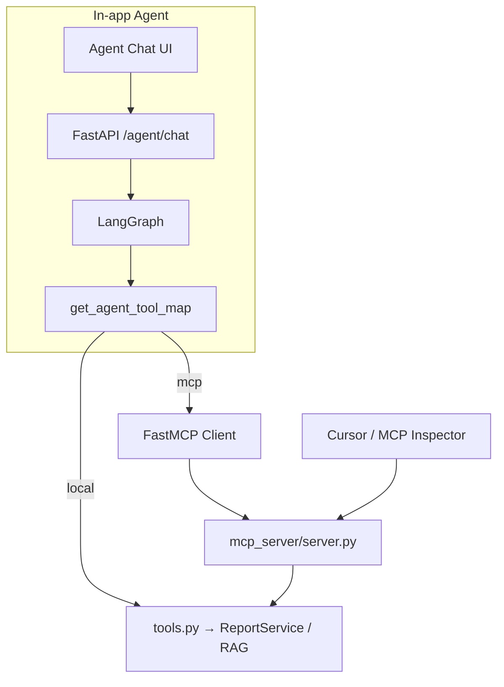
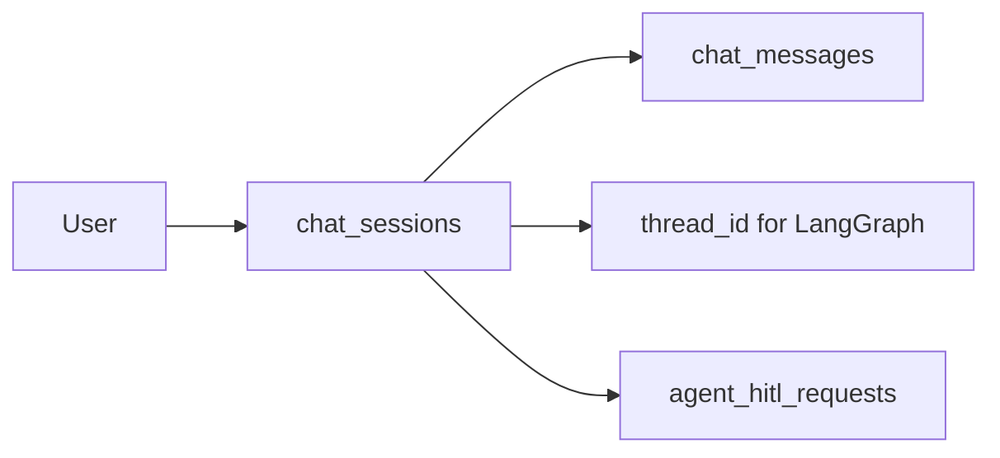
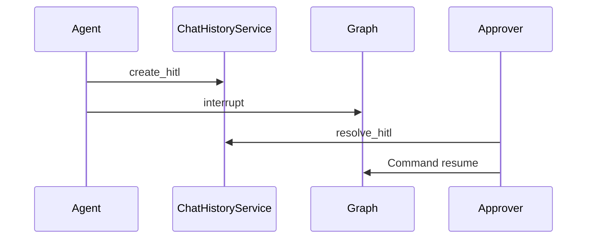

# 11 — MCP Tool Backend & Chat Sessions

### External MCP tools + in-app chat/HITL session storage

> Major gaps filled: MCP wiring inside the app, and how chat sessions/HITL rows are stored.

---

## Part A — MCP & tool backend

## A1. Two ways to run the same tools



| Mode | Env | Meaning |
|---|---|---|
| `local` | `AGENT_TOOL_BACKEND=local` | call Python tools in-process |
| `mcp` | `AGENT_TOOL_BACKEND=mcp` | same schemas via FastMCP |

Transport:

| `AGENT_MCP_TRANSPORT` | Behavior |
|---|---|
| `inprocess` | load `mcp_server/server.py` in-process |
| `http` | connect to `AGENT_MCP_URL` |

### Runtime switch

`GET/PUT /api/v1/agent/config` (permission `agent:chat`) can override backend for the running process.  
Restart clears override.

### Tool parity list

| Tool | Purpose |
|---|---|
| `submit_intake_report` | create PQC/AE |
| `update_status` | workflow transitions |
| `get_report` | lookup REF |
| `list_reports` | filter list |
| `hybrid_rag_query` | RAG ask |
| `approve_close` | HITL helper |

External demo README: `mcp_server/README.md`

### Demo caution

Both MCP and web UI share the same SQLite data. Prefer **one writer at a time** during demos.

---

## Part B — Chat sessions & HITL rows

## B1. Why sessions exist



**Service:** `ChatHistoryService` (`app/services/chat_service.py`)  
**DB:** `core.db`

## B2. Session kinds

| Kind | ID style | Used by | Permission |
|---|---|---|---|
| `agent` | `SES-...` | Agent Chat | `agent:chat` |
| `rag` | `RAG-...` | Knowledge Query | `rag:query` |

### thread_id formula

```text
{kind}-{username}-{session_id}
```

Example: `agent-reviewer-SES-ab12cd34ef56`  
This is the LangGraph checkpointer key for HITL pause/resume.

## B3. Session lifecycle I/O

| Action | INPUT | OUTPUT |
|---|---|---|
| Create | `POST /agent/sessions` or `/rag/sessions` | new session row |
| List | `GET .../sessions` | active sessions for user |
| Messages | `GET .../sessions/{id}/messages` | bubbles |
| Rename | `PATCH` (agent) | updated title |
| Delete | `DELETE` | soft delete `is_active=false` |

Ownership is per `username` — wrong user → not found.

### Titles

- Agent default: `New chat` → becomes first user message snippet  
- RAG default: `Knowledge chat`

## B4. Message roles & metadata

| role | Meaning |
|---|---|
| `user` | human text |
| `assistant` | model/tool result text |
| `system` | HITL resolution notes, etc. |
| `tool` | optional tool traces |

RAG assistant messages may store `metadata_json` with:

- sources  
- query_expansion  
- diagnostics  

Agent interrupted turns may store HITL metadata (`interrupted`, hitl id).

## B5. HITL request rows

When agent requests close:

1. Report `pending_close=true`  
2. `create_hitl(...)` → `HITL-...` row linked to session/thread  
3. Graph `interrupt()`  
4. Approver `POST /agent/hitl/{id}/resolve`  
5. `resolve_hitl` + LangGraph resume  



`GET /agent/hitl/pending` lists open requests (approver/admin).

## B6. Agent history window

On each chat turn, graph typically loads recent user/assistant messages (about last 20) into state for context — not the entire lifetime dump.

---

## Concept cards

### Card — MCP is a protocol adapter

Same business rules. Different transport (IDE vs web).

### Card — Sessions are not optional glue

Without sessions/thread_ids, HITL interrupt cannot resume cleanly.

### Card — Soft delete keeps history

Deleted sessions disappear from lists but message rows remain in DB for forensic/training inspection.

---

## Related docs

- Agent story: [04_AGENT.md](./04_AGENT.md)  
- Reports HITL: [07_REPORTS_WORKFLOW.md](./07_REPORTS_WORKFLOW.md)  
- Config: [09_CONFIG_ENV_REFERENCE.md](./09_CONFIG_ENV_REFERENCE.md)  
- External MCP README: `../../mcp_server/README.md`

---

*Doc 11/11 — MCP & chat sessions*
