# 12 — Chunking Strategies (Deep Guide)

### How documents are split before RAG — with diagrams, examples, and INPUT → OUTPUT

> You were right: chunking was only skimmed in the RAG doc.  
> This is the full deep dive for all **5 strategies** in the backend.

---

## Quick map

| Section | Learn |
|---|---|
| [1. Why chunking matters](#1-why-chunking-matters) | Bad chunks = bad answers |
| [2. Where chunking sits](#2-where-chunking-sits) | Upload pipeline position |
| [3. Shared concepts](#3-shared-concepts) | size, overlap, Chunk object |
| [4. Strategy catalog](#4-strategy-catalog) | All 5 at a glance |
| [5. recursive](#5-recursive) | Default splitter |
| [6. semantic](#6-semantic) | Embedding topic breaks |
| [7. structure_aware](#7-structure_aware) | Headings / sections |
| [8. agentic](#8-agentic) | LLM proposes segments |
| [9. page_based](#9-page_based) | PDF pages / CSV rows |
| [10. How to choose](#10-how-to-choose) | Decision guide |
| [11. UI / API I/O](#11-ui--api-io) | Admin Docs + endpoints |
| [12. After chunking](#12-after-chunking) | Dedupe → vectors → BM25 |
| [13. Failures & fallbacks](#13-failures--fallbacks) | What happens when AI fails |

---

## 1. Why chunking matters

RAG does **not** search whole PDFs as one blob.  
It searches **chunks** (smaller pieces).

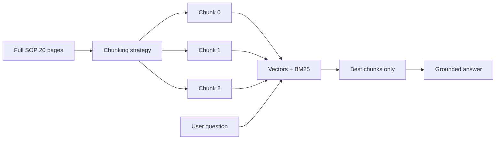

### Bad vs good (simple example)

**INPUT document**

```text
## Suspected AE
Capture event_description and event_onset_date.

## LOT rules
batch_lot_number must match LOT-#####.
```

| Chunking quality | What retrieval might return for “onset date?” |
|---|---|
| One giant chunk | Whole file — noisy |
| Good section chunks | Just the AE section — precise |

**Takeaway:** Chunk strategy is a product decision, not a cosmetic setting.

---

## 2. Where chunking sits

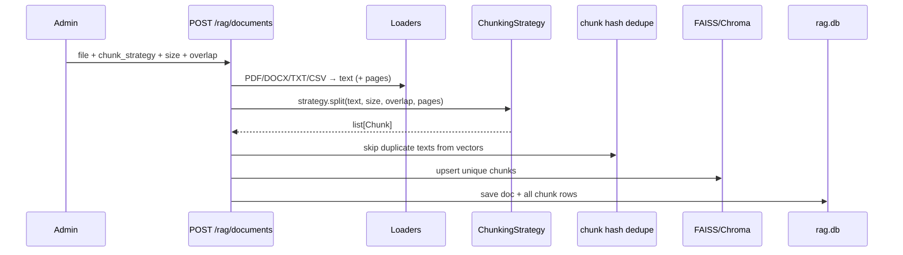

**Code path**

1. `Admin Docs` / `POST /rag/documents`  
2. `DocumentService.ingest(...)`  
3. `get_chunking_strategy(name, embedding=..., llm=chunking)`  
4. `strategy.split(...)`  

**Files**

| Path | Role |
|---|---|
| `app/modules/chunking/base.py` | `Chunk`, abstract strategy |
| `app/modules/chunking/strategies.py` | 5 strategies + factory |
| `app/services/document_service.py` | calls strategy during ingest |
| `app/api/routes/rag.py` | form field `chunk_strategy` |

---

## 3. Shared concepts

### Chunk object

| Field | Meaning |
|---|---|
| `text` | chunk content |
| `index` | 0-based order |
| `page_number` | set by page_based (optional) |
| `metadata` | strategy name, section, mode, titles… |
| `token_estimate` | ≈ word count |

### `chunk_size` and `chunk_overlap`

| Setting | Plain meaning |
|---|---|
| `chunk_size` | target size (word-oriented for most strategies) |
| `chunk_overlap` | repeated tail words between neighbors so meaning doesn’t snap at edges |


### Defaults (from `.env`)

```text
DEFAULT_CHUNK_STRATEGY=recursive
DEFAULT_CHUNK_SIZE=512
DEFAULT_CHUNK_OVERLAP=64
```

### Important note for `recursive`

LangChain character splitter scales size/overlap by **×4** internally (`chunk_size * 4`) because it works on characters, while UI defaults feel token/word-ish.

---

## 4. Strategy catalog

| Strategy | Needs | Best for | Fallback if something fails |
|---|---|---|---|
| `recursive` | nothing special | general SOPs (default) | word windows |
| `semantic` | embedding provider | prose with topic shifts | word windows |
| `structure_aware` | headings/sections in text | manuals with `#` / numbered headings | section windows |
| `agentic` | LLM role `chunking` | complex docs, topic segments | heuristic cue split |
| `page_based` | loader `pages` list | PDFs / CSV-like page/row units | whole text as one page |

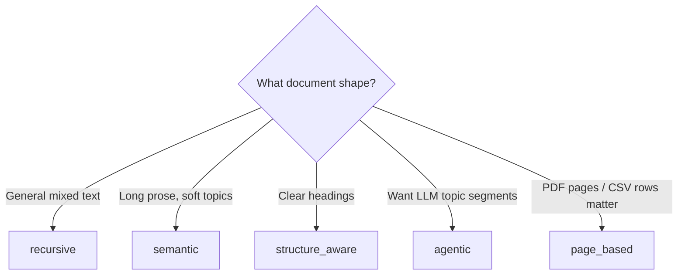

---

## 5. `recursive`

### Idea

Split text using LangChain `RecursiveCharacterTextSplitter` with separators:

`\n\n` → `\n` → `. ` → ` ` → `""`

### Deep flow

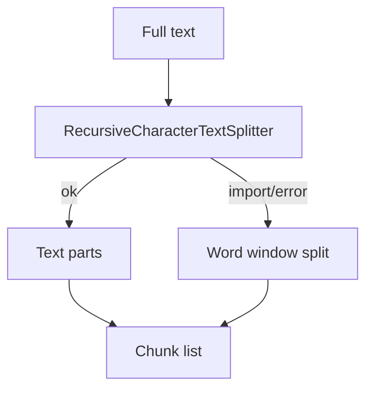

### INPUT → OUTPUT example

#### INPUT

- strategy: `recursive`  
- size: `512`  
- overlap: `64`  
- text: long SOP without clean headings  

#### OUTPUT

Many overlapping chunks with metadata:

```json
{ "strategy": "recursive" }
```

### When to use

Default safe choice for mixed training docs.

### Manager line

> “Recursive splitting is the reliable baseline — it works even when documents are messy.”

---

## 6. `semantic`

### Idea

1. Split into sentences  
2. Embed consecutive sentences  
3. Where cosine similarity drops → topic boundary  
4. Pack groups to `chunk_size` with overlap  

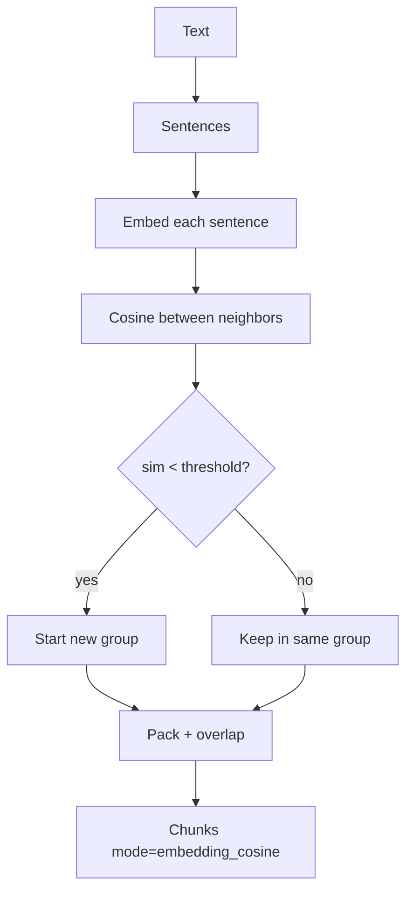

### Threshold

By default uses **25th percentile** of neighbor similarities as breakpoint (or absolute threshold if configured in code).

### INPUT → OUTPUT example

#### INPUT text (tiny)

```text
LOT format must be LOT-#####. Always validate on intake.
The cafeteria menu changes every Friday in the office.
Quarantine packaging complaints within 4 business hours.
```

#### OUTPUT idea

- Chunk about LOT validation  
- Chunk about cafeteria (if similarity drop)  
- Chunk about quarantine  

So a question about LOT won’t drag cafeteria noise as easily.

### Dependencies

Needs working `EmbeddingProvider` from container.  
On failure → metadata `mode=fallback` word windows.

### Manager line

> “Semantic chunking cuts where meaning shifts — not just where the character counter fills up.”

---

## 7. `structure_aware`

### Idea

Split on structural cues:

- Markdown headings `#{1,3}`  
- Numbered starts `1.`  
- ALL-CAPS heading-like lines  

Then window-split each section.

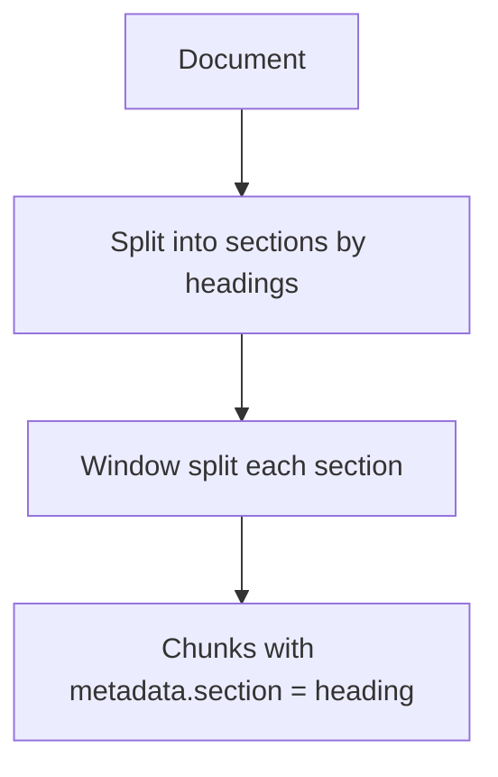

### INPUT → OUTPUT example

#### INPUT

```text
## Suspected AE
Capture event_description and event_onset_date.

## LOT rules
batch_lot_number must match LOT-#####.
```

#### OUTPUT chunks (concept)

| index | metadata.section | text about |
|---|---|---|
| 0 | `## Suspected AE` | AE fields |
| 1 | `## LOT rules` | LOT format |

### When to use

SOPs that already have clear headings — common in pharma training docs.

### Manager line

> “If the SOP is already structured, we keep those section boundaries instead of cutting mid-heading.”

---

## 8. `agentic`

### Idea

1. Split into sentences (max **80** in LLM prompt window)  
2. Ask LLM role **`chunking`** for JSON segments `{start, end, title}`  
3. Build topic groups + pack with overlap  
4. Append remainder sentences beyond window  

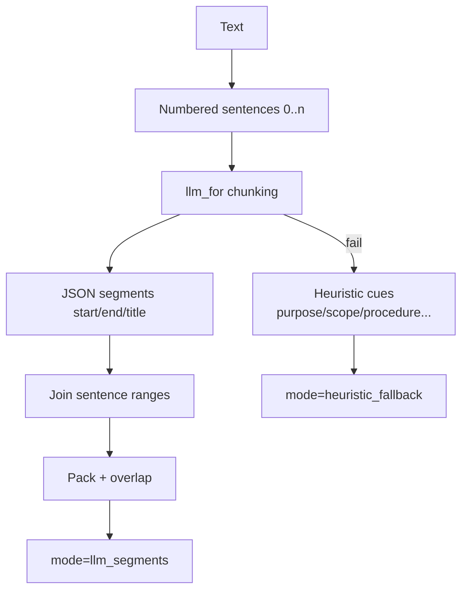

### Example LLM segment OUTPUT (illustrative)

```json
[
  {"start": 0, "end": 4, "title": "Purpose and scope"},
  {"start": 5, "end": 12, "title": "LOT quarantine procedure"},
  {"start": 13, "end": 18, "title": "HITL close rules"}
]
```

### INPUT requirements

- Working LLM for role `chunking` (or mock)  
- Config: `LLM_CHUNKING_PROVIDER` / model optional overrides  

### When to use

Long, messy docs where headings are weak but topics are clear to an LLM.

### Caveats

- More latency/cost than recursive  
- Prompt window caps at 80 sentences (remainder appended)  
- Must still obey “no medical advice” system text  

### Manager line

> “Agentic chunking asks an LLM to propose topic boundaries — with a deterministic fallback if the model fails.”

---

## 9. `page_based`

### Idea

Use loader-provided `pages` (PDF pages, CSV rows, etc.).  
Each page is window-split; chunks keep `page_number`.

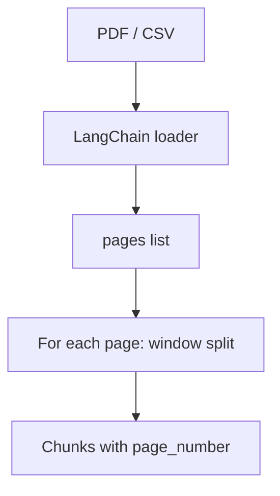

### INPUT → OUTPUT example

#### INPUT

PDF with 3 pages, strategy `page_based`

#### OUTPUT

Chunks tagged:

```json
{ "strategy": "page_based", "page": 2 }
```

and `Chunk.page_number = 2`

### When to use

When “page 3 of the SOP” matters for operators, or CSV row boundaries should stay intact.

### If `pages` missing

Treats whole text as a single page.

### Manager line

> “Page-based keeps physical document boundaries — useful for PDF evidence talk-tracks.”

---

## 10. How to choose (decision guide)

| Document type | Prefer | Why |
|---|---|---|
| Mixed / unknown | `recursive` | Reliable default |
| Heading-rich SOP | `structure_aware` | Keeps section identity |
| Narrative prose | `semantic` | Cuts on topic shift |
| Complex unheaded policy | `agentic` | LLM topic segments |
| Scanned/paged PDF focus | `page_based` | Page metadata |

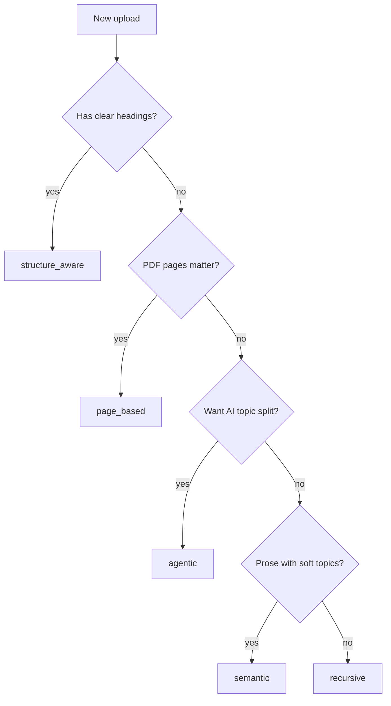

### Demo tip for managers

Show **same file** uploaded twice with different strategies (second upload needs different bytes or prior delete because of file-hash dedupe). Compare chunk counts and a sample RAG answer.

---

## 11. UI / API I/O

### List strategies

#### INPUT

`GET /api/v1/rag/chunk-strategies` (permission `rag:view`)

#### OUTPUT (concept)

```json
{
  "strategies": ["agentic", "page_based", "recursive", "semantic", "structure_aware"],
  "defaults": {
    "strategy": "recursive",
    "chunk_size": 512,
    "chunk_overlap": 64
  }
}
```

Admin Docs UI loads this to fill the strategy dropdown.

### Upload with strategy

#### INPUT (multipart)

| Field | Example |
|---|---|
| title | Intake Checklist v4 |
| chunk_strategy | `structure_aware` |
| chunk_size | 400 |
| chunk_overlap | 40 |
| file | `sop.pdf` |

#### OUTPUT

Document row stores `chunk_strategy`, `chunk_size`, `chunk_overlap`, `chunk_count`.

---

## 12. After chunking (what happens next)

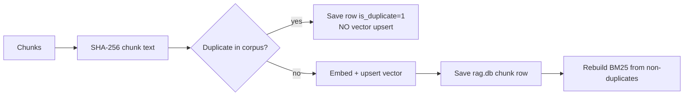

So chunking quality affects:

1. vector search quality  
2. BM25 keyword quality  
3. final RAG answers  

Related: [03_RAG.md](./03_RAG.md)

---

## 13. Failures & fallbacks

| Strategy | Failure mode | Fallback OUTPUT |
|---|---|---|
| recursive | LangChain splitter error | word windows |
| semantic | embedding error | word windows (`mode=fallback`) |
| agentic | bad/missing LLM JSON | heuristic cue split (`purpose`, `scope`, …) |
| structure_aware | no headings matched | effectively fewer/larger sections |
| page_based | no pages | whole text as page 1 |

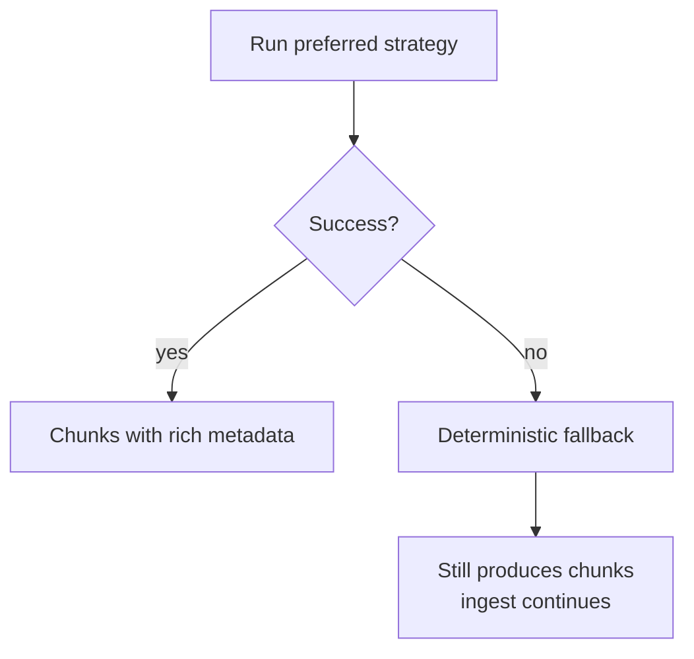

**Product meaning:** Upload should not hard-crash the desk because one AI chunker failed.

---

## Side-by-side mini lab (same tiny SOP)

**INPUT text**

```text
# Purpose
This fictional SOP explains intake LOT checks.

# Procedure
Validate LOT-##### before save.
For Suspected AE require onset date.
```

| Strategy | Likely behavior |
|---|---|
| recursive | size-based cuts (may split mid-section if long) |
| structure_aware | Purpose section chunk(s) + Procedure section chunk(s) |
| semantic | may break between Purpose and Procedure by similarity |
| agentic | LLM titles like “Purpose”, “Procedure” |
| page_based | depends on loader pages, not headings |

---

## Factory API (for developers)

```text
get_chunking_strategy("semantic", embedding=container.embedding)
get_chunking_strategy("agentic", llm=container.llm_for("chunking"))
get_chunking_strategy("recursive")
list_chunking_strategies()  → sorted names
```

Unknown name → `ValueError` listing available strategies.

---

## Concept cards

### Card — Chunking is retrieval design

Changing strategy without re-upload won’t rewrite old vectors.  
New strategy applies on **new ingest**.

### Card — Overlap fights boundary loss

Questions near section edges still find context.

### Card — Agentic ≠ agent chat

`agentic` chunking uses LLM role `chunking` during **upload**, not the LangGraph chat agent.

---

## Related docs

- RAG pipeline: [03_RAG.md](./03_RAG.md)  
- LLM role `chunking`: [08_LLM_PROVIDERS.md](./08_LLM_PROVIDERS.md)  
- Config defaults: [09_CONFIG_ENV_REFERENCE.md](./09_CONFIG_ENV_REFERENCE.md)  
- Tests: `tests/test_chunking.py`, `tests/test_semantic_agentic_chunking.py`

---

*Doc 12 — Chunking strategies (deep)*
