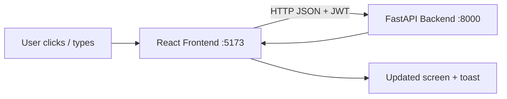
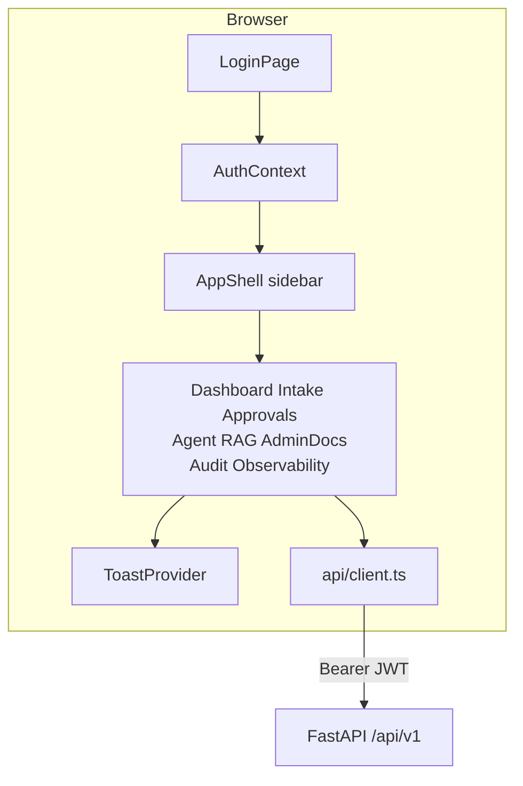
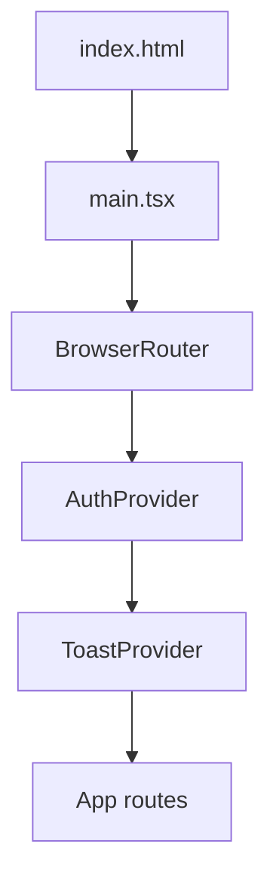
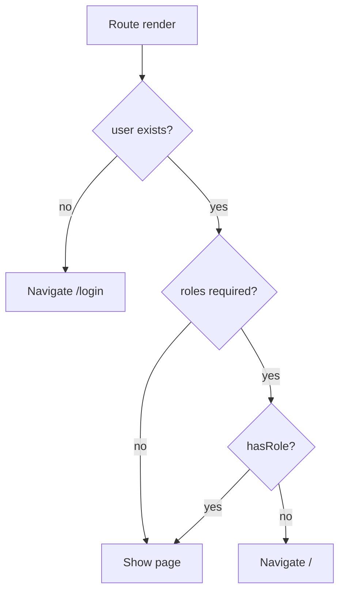
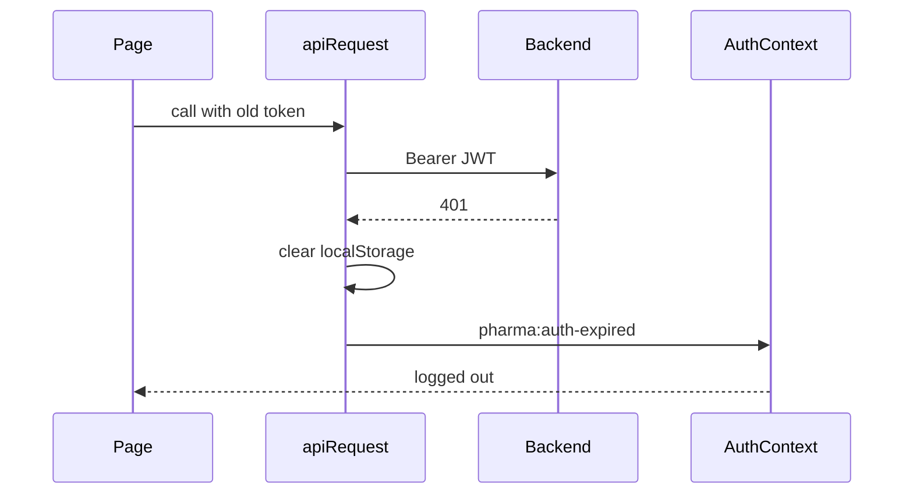
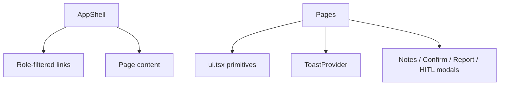

# 01 — Frontend Architecture & Technologies

### In-depth guide with visuals + input → output examples

> Goal: understand how the React app is built, how screens talk to the backend, and what happens from a click to a JSON response.

---

## Quick map

| Section | Learn |
|---|---|
| [1. What the frontend is](#1-what-the-frontend-is) | Screens vs brain |
| [2. Tech stack](#2-tech-stack) | React, Vite, Router |
| [3. Big picture](#3-big-picture) | Browser → API |
| [4. Folder structure](#4-folder-structure) | Where code lives |
| [5. App bootstrap & providers](#5-app-bootstrap--providers) | Startup tree |
| [6. Routing architecture](#6-routing-architecture) | Protected routes |
| [7. Auth client architecture](#7-auth-client-architecture) | Token in localStorage |
| [8. API client](#8-api-client) | `apiRequest` I/O |
| [9. Shared UI system](#9-shared-ui-system) | Shell, modals, toast |
| [10. Config](#10-config) | `VITE_API_BASE_URL` |

---

## 1. What the frontend is

The frontend is the **desk the humans touch**.

| Frontend does | Backend does |
|---|---|
| Show forms, tables, chats | Validate, save, enforce rules |
| Hide/show menus by role | Final permission checks |
| Collect notes for close | HITL state machine |
| Display traces nicely | Store spans in SQLite |



**Simple rule:**  
UI can guide and block early.  
**Backend is still the source of truth.**

---

## 2. Tech stack

| Technology | Why | Example |
|---|---|---|
| **React 19** | Component UI | pages + modals |
| **Vite 8** | Fast local dev/build | `npm run dev` on port 5173 |
| **TypeScript** | Safer props/types | `Role`, `Report` |
| **react-router-dom 7** | Client routes | `/intake`, `/approvals` |
| **react-markdown** | Chat bubbles | Agent / RAG answers |
| **mermaid** | Trace diagrams | Observability flow view |

### INPUT → OUTPUT (run locally)

#### INPUT

```bash
cd frontend
npm install
npm run dev
```

#### OUTPUT

- Dev server at `http://127.0.0.1:5173`
- Hot reload on file save
- Calls backend at `API_BASE_URL` (default `http://127.0.0.1:8000/api/v1`)

---

## 3. Big picture



### Concept: page → API → redraw

#### INPUT (user)

Clicks **Submit** on Intake form.

#### OUTPUT chain

1. `IntakePage` validates LOT locally.  
2. `apiRequest('/reports', { method:'POST', body }, token)`  
3. Backend returns `REF-…`  
4. Toast success + optional detail modal  
5. Dashboard will show the new row after refresh/navigation  

---

## 4. Folder structure

```text
frontend/src/
├── main.tsx                 # providers + Router
├── App.tsx                  # routes + Protected
├── config.ts                # API_BASE_URL
├── types.ts                 # Role, AuthUser, Report, RagDocument
├── index.css                # global NovaCure styles
├── api/
│   └── client.ts            # fetch wrapper + 401 handling
├── auth/
│   └── AuthContext.tsx      # login/logout/hasRole
├── hooks/
│   └── usePagination.ts     # table pagination
├── pages/                   # one screen per route
└── components/              # shell, modals, badges, chat, traces
```

### Where to change what

| You want to… | Edit… |
|---|---|
| Add a menu item | `AppShell.tsx` + `App.tsx` route |
| Change who can open a page | `Protected roles={[...]}` |
| Change API URL | `.env` → `VITE_API_BASE_URL` |
| Change report form fields | `IntakePage.tsx` (+ backend schema) |
| Change toast look | `Toast.tsx` / CSS |

---

## 5. App bootstrap & providers



### INPUT

Browser loads `/`

### OUTPUT

1. If no saved user → redirect logic sends you to login when protected.  
2. If `localStorage` has `pharma_auth_user` → session restored.  
3. AppShell + Dashboard render for authenticated users.

---

## 6. Routing architecture

### Concept: `Protected`



### Example I/O

| INPUT URL + role | OUTPUT screen |
|---|---|
| `/intake` as operator | IntakePage |
| `/intake` as approver | redirect to `/` |
| `/approvals` as approver | ApprovalsPage |
| `/approvals` as reviewer | redirect to `/` |
| `/admin/docs` as admin | AdminDocsPage |
| `/admin/docs` as operator | redirect to `/` |
| `/login` while logged in | redirect to `/` |

Deep matrix: [02_PAGES_AND_ROLES.md](./02_PAGES_AND_ROLES.md)

---

## 7. Auth client architecture

**File:** `src/auth/AuthContext.tsx`

### Storage

| Key | Value |
|---|---|
| `pharma_auth_user` | JSON `AuthUser` including `access_token` |

### Login I/O

#### INPUT

```json
{ "username": "operator", "password": "Operator@123" }
```

UI: Login form or sample-user chip.

#### OUTPUT (success)

- React `user` state set  
- localStorage saved  
- Navigate to Dashboard  

#### OUTPUT (failure)

- toast error  
- stay on login  

### Logout I/O

#### INPUT

Click **Logout** in AppShell.

#### OUTPUT

- storage cleared  
- user null  
- next protected route → login  

### Session expired I/O

#### INPUT

API returns 401 invalid/expired token.

#### OUTPUT

- `api/client` clears storage  
- dispatches `pharma:auth-expired`  
- AuthProvider logs out  
- user must login again  



---

## 8. API client

**File:** `src/api/client.ts`  
**Config:** `src/config.ts`

### Base URL

#### INPUT (.env)

```text
VITE_API_BASE_URL=http://127.0.0.1:8000/api/v1
```

#### OUTPUT

All calls go to that prefix, e.g. `/reports` → `http://127.0.0.1:8000/api/v1/reports`

### `apiRequest` behavior

| INPUT option | OUTPUT behavior |
|---|---|
| JSON body object | stringified + `Content-Type: application/json` |
| `FormData` body | no forced JSON content-type (file upload) |
| `token` provided | `Authorization: Bearer …` |
| 204 response | `undefined` |
| JSON response | parsed object |
| binary content | blob (doc download/view) |
| error JSON | throws `ApiError` with `detail` |

### Example create report call

#### INPUT (from IntakePage)

```ts
apiRequest('/reports', { method: 'POST', body: payload }, user.access_token)
```

#### OUTPUT

Resolved `Report` object **or** thrown `ApiError`.

---

## 9. Shared UI system



| Component | Job | Used by |
|---|---|---|
| `AppShell` | Sidebar + top bar + logout | all authenticated pages |
| `PageHeader` / `Card` / `Table` | Layout primitives | most pages |
| `StatusBadge` | New / In Review / Closed (+ pending) | Dashboard, Approvals |
| `NotesPromptModal` | Collect triage/approval notes | Dashboard, Approvals |
| `ConfirmDialog` | Dangerous deletes | Admin docs, chats |
| `ReportDetailModal` | Fetch + show one REF | Intake, Dashboard, Approvals |
| `HitlDetailModal` | Agent HITL payload detail | Approvals |
| `ChatMarkdown` | Render assistant text | Agent, RAG |
| `TraceFlowDiagram` | Mermaid span tree | Observability |
| `Toast` | Success/info/error feedback | everywhere |

### Toast I/O example

#### INPUT

Intake succeeds.

#### OUTPUT

Green toast: report created with `REF-…`  
(and optionally open detail modal)

---

## 10. Config

| Setting | Meaning | Default |
|---|---|---|
| `VITE_API_BASE_URL` | Backend API root | `http://127.0.0.1:8000/api/v1` |

### LocalStorage UI prefs (examples)

| Key | Meaning |
|---|---|
| `pharma_auth_user` | auth session |
| `novacure.navCollapsed` | sidebar collapsed |
| `novacure.rag.sessionsOpen` | RAG sidebar open |
| `novacure.agent.sessionsOpen` | Agent sidebar open |

---

## Concept cards

### Card — UI gate ≠ only security

Frontend hides Approvals from reviewers.  
Backend still returns **403** if called anyway. Defense in depth.

### Card — thin pages, shared client

Pages should not reinvent fetch/401 logic.  
Always go through `apiRequest`.

### Card — types mirror backend contracts

`Report.pending_close`, `reviewer_notes`, etc. must stay aligned with API JSON.

---

## What to read next

[02 Pages, Roles & Navigation](./02_PAGES_AND_ROLES.md)

---

*Doc 01/6 — Frontend architecture*
