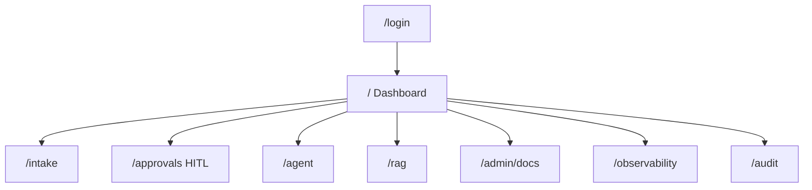
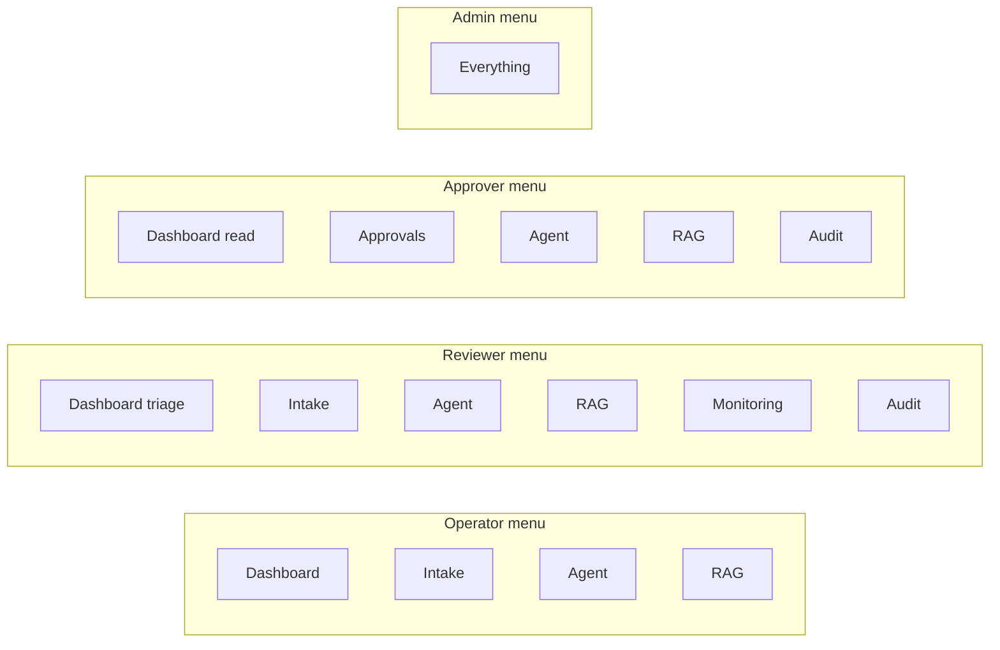
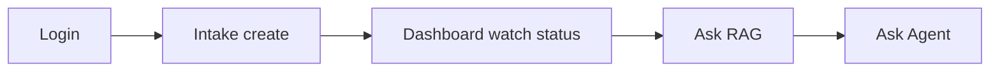
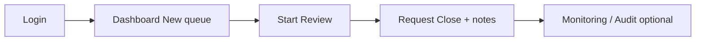
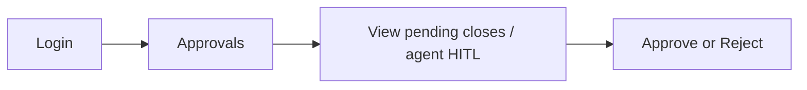
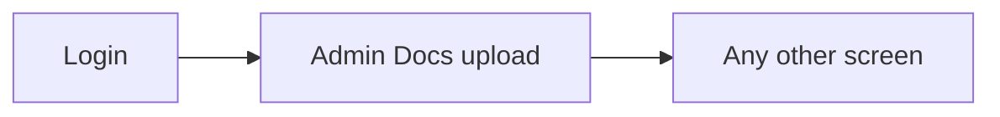

# 02 — Pages, Roles & Navigation

### Who sees what — with visuals and INPUT → OUTPUT examples

---

## Quick map

| Section | Learn |
|---|---|
| [1. Screens at a glance](#1-screens-at-a-glance) | Every route |
| [2. Role × page matrix](#2-role--page-matrix) | Allow / deny |
| [3. Navigation shell](#3-navigation-shell) | Sidebar filtering |
| [4. Login experience](#4-login-experience) | Sample users |
| [5. Per-role journeys](#5-per-role-journeys) | What each person does |
| [6. Wrong-URL behavior](#6-wrong-url-behavior) | Redirects |

---

## 1. Screens at a glance



| Route | Page file | Purpose in one line |
|---|---|---|
| `/login` | `LoginPage.tsx` | Sign in |
| `/` | `DashboardPage.tsx` | Case list + triage |
| `/intake` | `IntakePage.tsx` | Create report |
| `/approvals` | `ApprovalsPage.tsx` | HITL approvals |
| `/agent` | `AgentChatPage.tsx` | LangGraph assistant |
| `/rag` | `RagPage.tsx` | Knowledge Q&A |
| `/admin/docs` | `AdminDocsPage.tsx` | Upload/delete SOPs |
| `/observability` | `ObservabilityPage.tsx` | AI traces |
| `/audit` | `AuditPage.tsx` | Proof logs |

---

## 2. Role × page matrix

| Page | admin | reviewer | operator | approver |
|---|:---:|:---:|:---:|:---:|
| Dashboard `/` | ✓ | ✓ | ✓ | ✓ |
| Intake | ✓ | ✓ | ✓ | ✗ |
| HITL Approvals | ✓ | ✗ | ✗ | ✓ |
| Agent | ✓ | ✓ | ✓ | ✓ |
| RAG Knowledge | ✓ | ✓ | ✓ | ✓ |
| Admin Docs | ✓ | ✗ | ✗ | ✗ |
| Observability | ✓ | ✓ | ✗ | ✗ |
| Audit | ✓ | ✓ | ✗ | ✓ |



### INPUT → OUTPUT access examples

| INPUT | OUTPUT |
|---|---|
| Login as `operator`, open sidebar | No Approvals / Docs / Monitoring / Audit links |
| Login as `approver`, type `/intake` | Redirect to `/` |
| Login as `reviewer`, open Approvals URL | Redirect to `/` |
| Login as `admin`, open any page | Allowed |

---

## 3. Navigation shell

**File:** `AppShell.tsx`

### Concept: hide what you cannot use

Nav links are filtered with `hasRole(...)` so users mainly see useful items.

#### INPUT

`user.role = "approver"`

#### OUTPUT sidebar (typical)

- Dashboard  
- HITL Approvals  
- Agent  
- Knowledge (RAG)  
- Audit  
- (no Intake, no Admin Docs, no Observability)

### Extra shell behaviors

| Control | INPUT | OUTPUT |
|---|---|---|
| Collapse nav | click collapse | narrower sidebar (`novacure.navCollapsed`) |
| Mobile | small screen | mobile-friendly nav behavior |
| Logout | click logout | clear session → login |

---

## 4. Login experience

### UI pieces

- Brand / hero area  
- Username + password fields  
- Sample credential chips (8 demo users)  
- Submit  

### Example I/O

#### INPUT

Click chip **operator** then Sign in  
(or type `operator` / `Operator@123`)

#### OUTPUT

- token stored  
- land on Dashboard  
- operator menu only  

#### INPUT

Wrong password

#### OUTPUT

toast error; remain on login

### Demo users shown in UI

| Chip | Role |
|---|---|
| operator / operator2 | operator |
| reviewer / reviewer2 | reviewer |
| approver / approver2 | approver |
| admin / admin2 | admin |

---

## 5. Per-role journeys

### Operator (Maya)



**Primary job in UI:** create clean reports, ask knowledge, optionally use agent for assisted intake/lookup.

**Cannot in UI:** triage buttons, approvals, docs admin, observability, audit.

---

### Reviewer (Arun)



**Primary job:** move cases and request close with notes.

**Cannot:** final approve on Approvals page (no access).

---

### Approver (Meera)



**Primary job:** human stamp for close / agent interrupts.

**Cannot:** Intake page (no create path in UI).

---

### Admin (Sana / Sam)



**Primary job:** manage knowledge corpus + full operational access for demos.

---

## 6. Wrong-URL behavior

```mermaid
flowchart TB
  URL[User enters restricted URL] --> P[Protected check]
  P -->|not logged in| Login[/login]
  P -->|logged in wrong role| Dash[/ Dashboard]
  P -->|allowed| Page[Requested page]
```

| INPUT | OUTPUT |
|---|---|
| anonymous `/dashboard` equivalent `/` | `/login` |
| operator `/approvals` | `/` |
| approver `/admin/docs` | `/` |
| unknown path `/foo` | `/` |

---

## Concept cards

### Card — nav hide + route guard

Two layers:

1. Don’t show the link  
2. Still block direct URL  

### Card — all roles can open Agent + RAG

Even approvers may ask knowledge questions.  
Mutating tools still depend on backend permissions.

### Card — Dashboard is universal home

Everyone lands on `/`.  
What you can *do* on that page still depends on role (triage buttons only for admin/reviewer).

---

## What to read next

[03 Intake & Workflow UI](./03_INTAKE_AND_WORKFLOW.md)

---

*Doc 02/6 — Pages & roles*
