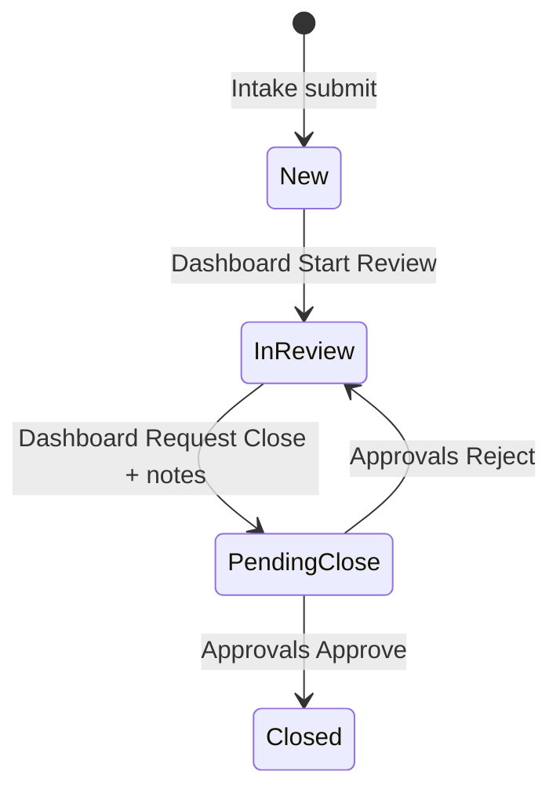
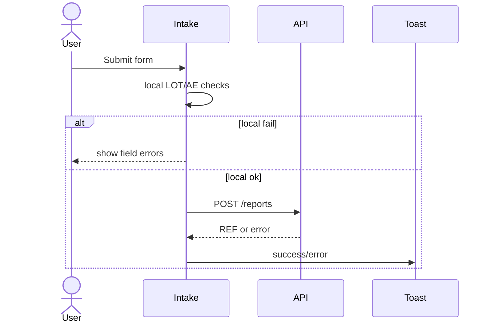
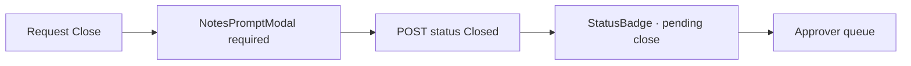
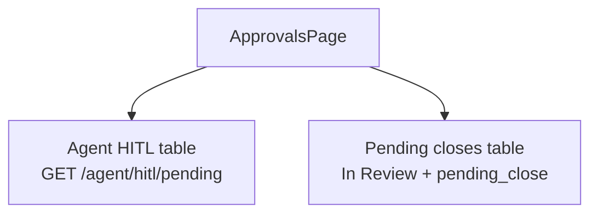
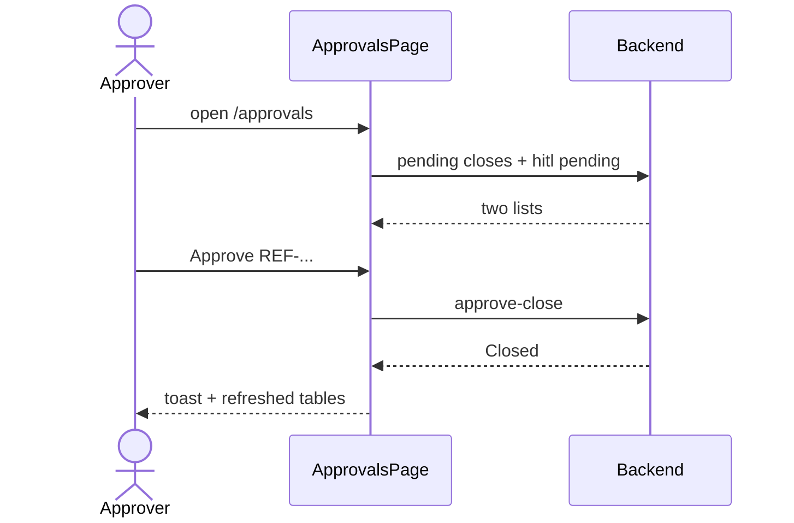

# 03 — Intake & Workflow UI

### Intake form, Dashboard triage, and HITL Approvals — with INPUT → OUTPUT

---

## Quick map

| Section | Learn |
|---|---|
| [1. Workflow in the UI](#1-workflow-in-the-ui) | Visual state machine |
| [2. Intake page deep dive](#2-intake-page-deep-dive) | Create report I/O |
| [3. Dashboard deep dive](#3-dashboard-deep-dive) | Filters + triage |
| [4. Approvals deep dive](#4-approvals-deep-dive) | Report HITL + Agent HITL |
| [5. Shared modals](#5-shared-modals) | Notes, details, confirm |

---

## 1. Workflow in the UI



| UI place | Who | Action |
|---|---|---|
| `/intake` | admin/reviewer/operator | Create New |
| `/` Dashboard | admin/reviewer | Start Review / Request Close |
| `/approvals` | admin/approver | Approve / Reject |

---

## 2. Intake page deep dive

**Route:** `/intake`  
**File:** `IntakePage.tsx`

### What you see

- Report type presets (PQC, Suspected AE, custom)
- Product, LOT, date received, reporter type, description
- Extra AE fields when type looks like adverse event
- Submit button

### Client-side checks (before API)

| Rule | INPUT example | OUTPUT |
|---|---|---|
| LOT format | `45?` | inline/field error, no API call |
| LOT format | `LOT-00045` | OK |
| AE extras | missing onset date | blocked locally |
| Required fields | empty product | blocked locally |

### Happy path I/O

#### INPUT (user fills)

```text
Type: Suspected Adverse Event
Product: CardioMax 50mg
LOT: LOT-00045
Date: 2026-11-08
Reporter: Consumer
Description: Caller reported dizziness
Event description: Dizziness after dose
Event onset: 2026-11-07
```

#### OUTPUT (UI)

1. `POST /reports` with token  
2. Toast success with `REF-2026-0001`  
3. Optional **View submitted report** → `ReportDetailModal`  

#### OUTPUT (data)

New row status **New** visible later on Dashboard.

### Failure path I/O

#### INPUT

Server returns validation detail string with field hints.

#### OUTPUT

Toast/error + parsed field messages (semicolon-separated details mapped where possible).



---

## 3. Dashboard deep dive

**Route:** `/`  
**File:** `DashboardPage.tsx`

### What you see

- Stat-style summary area  
- Filters: status / report type  
- Table of reports + pagination  
- View details  
- Triage actions if `hasRole('admin','reviewer')`

### Filter I/O

#### INPUT

Choose status = `New`, type = `Suspected Adverse Event`

#### OUTPUT

`GET /reports?status=New&report_type=...`  
table shows matching rows only.

### Start Review I/O

#### INPUT

Click **Start Review** on a `New` row → Notes modal (notes optional) → confirm

#### OUTPUT

- `POST /reports/{ref}/status` `{ new_status: "In Review", reviewer_notes? }`  
- row becomes In Review  
- toast success  

### Request Close I/O (HITL starts in UI)

#### INPUT

Click **Request Close** on In Review (not already pending) → Notes modal (**notes required**)

#### OUTPUT

- API `{ new_status: "Closed", reviewer_notes: "..." }`  
- UI shows status still In Review with **pending close** badge  
- toast info: waiting for approver  



### Who sees triage buttons?

| Role | Start Review / Request Close buttons |
|---|---|
| admin | Yes |
| reviewer | Yes |
| operator | No (read/watch) |
| approver | No (uses Approvals page) |

### View details I/O

#### INPUT

Click reference id / View

#### OUTPUT

`ReportDetailModal` loads `GET /reports/{ref}` and shows fields + pending close flag.

---

## 4. Approvals deep dive

**Route:** `/approvals`  
**File:** `ApprovalsPage.tsx`  
**Roles:** admin, approver

### Two queues in one page



### Queue A — Pending report closes

#### INPUT (page load)

`GET /reports?status=In%20Review` then keep `pending_close === true`

#### OUTPUT UI

Table of cases waiting for human close decision, often with reviewer notes preview.

#### Approve INPUT

Click Approve → NotesPromptModal (optional comment) → confirm

#### Approve OUTPUT

`POST /reports/{ref}/approve-close`  
`{ confirm: true, comment }`  
→ status **Closed**

#### Reject INPUT

Click Reject → note optional/required per UX → confirm

#### Reject OUTPUT

`POST /reports/{ref}/reject-close`  
→ back to active In Review (not pending)

---

### Queue B — Agent HITL

#### INPUT (page load)

`GET /agent/hitl/pending`  
(if fails, UI shows empty list)

#### OUTPUT UI

Rows with request id, user, tool, linked REF.

#### Resolve INPUT

Approve/Reject with note

#### Resolve OUTPUT

`POST /agent/hitl/{id}/resolve`  
`{ approved: true/false, note }`  
→ agent graph resumes on backend; lists refresh

### Details

- **HitlDetailModal** for agent payload + linked report  
- **ReportDetailModal** for classic pending closes  



---

## 5. Shared modals

### NotesPromptModal

| INPUT | OUTPUT |
|---|---|
| optional notes mode (Start Review) | may send empty notes |
| required notes mode (Request Close) | blocks confirm until notes entered |
| approve/reject prompts | comment/note sent to API |

### ReportDetailModal

| INPUT | OUTPUT |
|---|---|
| open with `reference_id` | fetch report, show fields |
| pending close true | copy says awaiting HITL |
| slow network | abort window (~15s) / error state |

### ConfirmDialog

Used more on deletes (docs/sessions) than triage, but same pattern: confirm destructive action.

---

## End-to-end UI strip (classic path)

| Step | Screen | INPUT | OUTPUT |
|---|---|---|---|
| 1 | Intake | submit AE | REF New |
| 2 | Dashboard | Start Review | In Review |
| 3 | Dashboard | Request Close + notes | pending close badge |
| 4 | Approvals | Approve | Closed |
| 5 | Dashboard filter Closed | view REF | Closed details |

---

## Concept cards

### Card — pending close is a UI teaching moment

Users must understand: requesting Closed ≠ Closed.  
Badge + Approvals page make HITL visible.

### Card — notes are first-class UX

Close without notes is blocked in UI and backend.  
NotesPromptModal is the product’s trust gate.

### Card — operators create, reviewers move, approvers stamp

UI enforces the human story from the business problem doc.

---

## What to read next

[04 RAG & Agent UI](./04_RAG_AND_AGENT_UI.md)

---

*Doc 03/6 — Intake & workflow UI*
