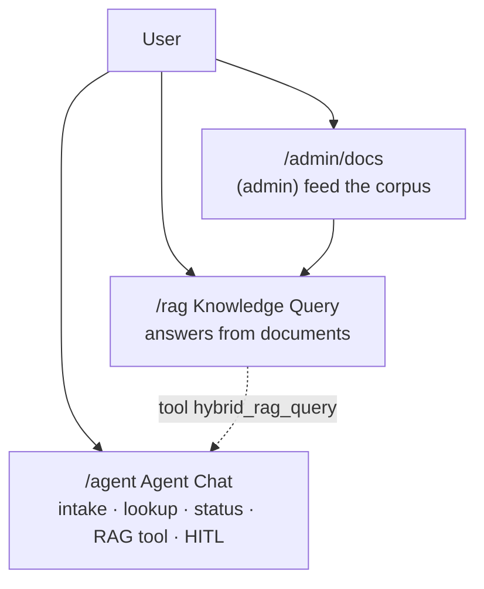
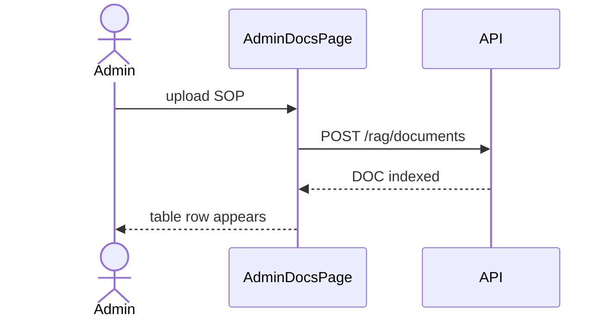
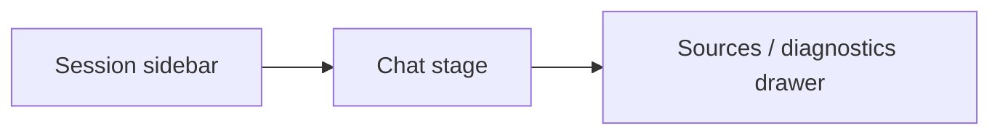
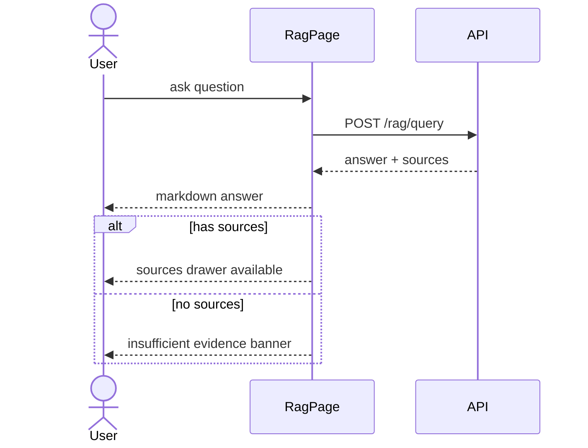
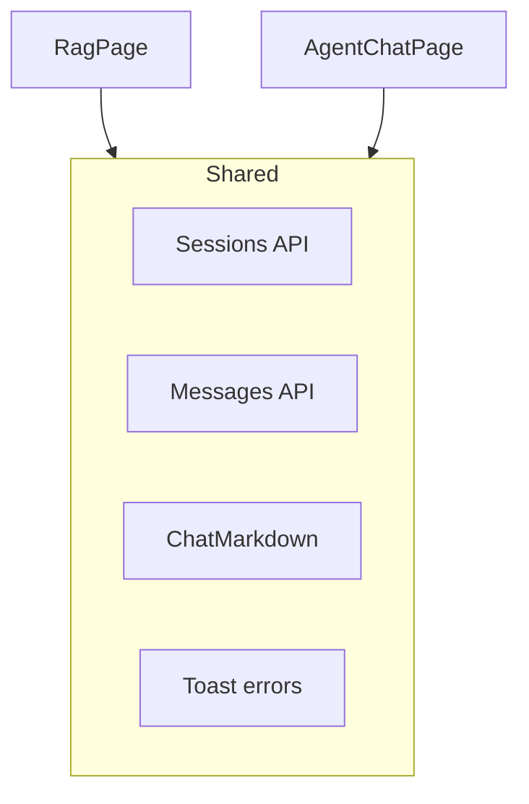

# 04 — RAG & Agent UI

### Knowledge chat vs LangGraph agent chat — with INPUT → OUTPUT

---

## Quick map

| Section | Learn |
|---|---|
| [1. Two chat products](#1-two-chat-products) | RAG ≠ Agent |
| [2. Admin Docs UI](#2-admin-docs-ui) | Upload knowledge |
| [3. RAG page deep dive](#3-rag-page-deep-dive) | Ask SOPs |
| [4. Agent page deep dive](#4-agent-page-deep-dive) | Tools + HITL pause |
| [5. Shared chat UX](#5-shared-chat-ux) | Sessions sidebar |
| [6. Side-by-side examples](#6-side-by-side-examples) | Same question, different systems |

---

## 1. Two chat products



| | RAG page | Agent page |
|---|---|---|
| Goal | Grounded Q&A | Do work with tools |
| Main API | `/rag/query` | `/agent/chat` |
| Can create reports? | No | Yes (if permitted) |
| Can request close? | No | Yes → may interrupt |
| Sources drawer | Yes | No (chat-focused) |
| HITL toast | No | Yes when interrupted |

---

## 2. Admin Docs UI

**Route:** `/admin/docs`  
**Roles:** admin only  
**File:** `AdminDocsPage.tsx`

### What you see

- Upload form: title, source type, chunk strategy/size/overlap, file  
- Documents table  
- View content / Delete  

### Upload I/O

#### INPUT

Admin selects PDF + strategy `structure_aware` → Upload

#### OUTPUT

- `POST /rag/documents` multipart  
- new row in table (`DOC-…`, chunk_count, status indexed)  
- toast success  

### View I/O

#### INPUT

Click View on a doc

#### OUTPUT

`GET /rag/documents/{id}/content` → opens blob in new browser tab

### Delete I/O

#### INPUT

Delete → ConfirmDialog yes

#### OUTPUT

`DELETE /rag/documents/{id}`  
row removed/refresh; backend also clears vectors/storage



Without Admin Docs, RAG/Agent knowledge answers stay empty or stale.

---

## 3. RAG page deep dive

**Route:** `/rag`  
**File:** `RagPage.tsx`  
**Roles:** any logged-in user

### Layout



### Session I/O

| User action INPUT | API | UI OUTPUT |
|---|---|---|
| Open page | `GET /rag/sessions` | session list |
| New chat | `POST /rag/sessions` | empty thread |
| Select session | `GET .../messages` | bubbles reload |
| Delete session | confirm + `DELETE` | session gone |

### Ask question I/O

#### INPUT

Type: “Is onset date required for Suspected AE?” → Send  
(or click suggestion chip / press Enter)

#### OUTPUT chain

1. Ensure session exists (auto-create if needed)  
2. `POST /rag/query` with `{ question, top_n: 5, session_id }`  
3. Messages refresh  
4. If sources exist → enable **Show sources** drawer  
5. If no sources → **Insufficient evidence** banner  

### Sources drawer OUTPUT (typical)

- query expansion details  
- ranked source chunks  
- diagnostics (latency / reranker info when provided)



### Guardrail UX

RAG UI emphasizes evidence.  
If retrieval is empty, it does not pretend confidence.

---

## 4. Agent page deep dive

**Route:** `/agent`  
**File:** `AgentChatPage.tsx`  
**Roles:** any logged-in user

### Layout

Similar session sidebar + chat stage (no retrieval drawer).

### Chat I/O

#### INPUT

```text
Create Product Quality Complaint for CardioMax LOT-00045 ...
```

#### OUTPUT

- `POST /agent/chat` `{ session_id, message }`  
- assistant bubble with REF / confirmation  
- intent pill may show (intake/lookup/status/rag/direct)

### Lookup I/O

#### INPUT

“What is the status of REF-2026-0001?”

#### OUTPUT

lookup-style card (should not claim a status change)

### Status + HITL I/O

#### INPUT (reviewer)

“Request close for REF-2026-0001. Notes: LOT verified…”

#### OUTPUT

```json
{
  "interrupted": true,
  "hitl": { "hitl_request_id": "HITL-..." }
}
```

UI toast: **Approval needed** (shows HITL id)  
Approver finishes on **HITL Approvals** page.

```mermaid
flowchart TB
  Msg[Agent message close request] --> Chat[POST /agent/chat]
  Chat --> Int{interrupted?}
  Int -->|yes| Toast[Toast Approval needed]
  Toast --> Appr[/approvals Agent HITL queue]
  Appr --> Res[Approve/Reject resolve]
  Res --> Cont[Conversation can continue]
```

### Suggestion chips

Agent page offers tool-oriented examples (create, list, status, SOP ask).  
RAG page offers knowledge-oriented examples.

---

## 5. Shared chat UX

Both RAG and Agent share patterns:

| Feature | Behavior |
|---|---|
| Session list | create / select / delete |
| Collapsible sidebar | remembered in localStorage |
| ChatMarkdown | light markdown rendering |
| Typing state | disabled input while request in flight |
| Intent pill | shows classified intent when returned |
| Pagination | long session lists |



---

## 6. Side-by-side examples

### Example A — SOP question

| | RAG UI | Agent UI |
|---|---|---|
| INPUT | “LOT format required?” | same text |
| OUTPUT | grounded answer + sources drawer | grounded answer via RAG tool |
| Best for | evidence inspection | quick assistant style |

### Example B — create report

| | RAG UI | Agent UI |
|---|---|---|
| INPUT | “Create PQC …” | “Create PQC …” |
| OUTPUT | usually refuses / not a tool path | may create REF if role allowed |

### Example C — close case

| | RAG UI | Agent UI |
|---|---|---|
| INPUT | “Close REF-…” | “Close REF-… + notes” |
| OUTPUT | not a workflow tool | may HITL-interrupt |

---

## Concept cards

### Card — feed then ask

Admin Docs → RAG/Agent quality.  
Empty corpus = weak answers.

### Card — interrupt is a feature

Agent toast “Approval needed” is success of governance, not a crash.

### Card — same login, different powers

Operator can open Agent page but cannot approve HITL; Approvals page is hidden.

---

## What to read next

[05 Monitoring UI](./05_MONITORING_UI.md)

---

*Doc 04/6 — RAG & Agent UI*
