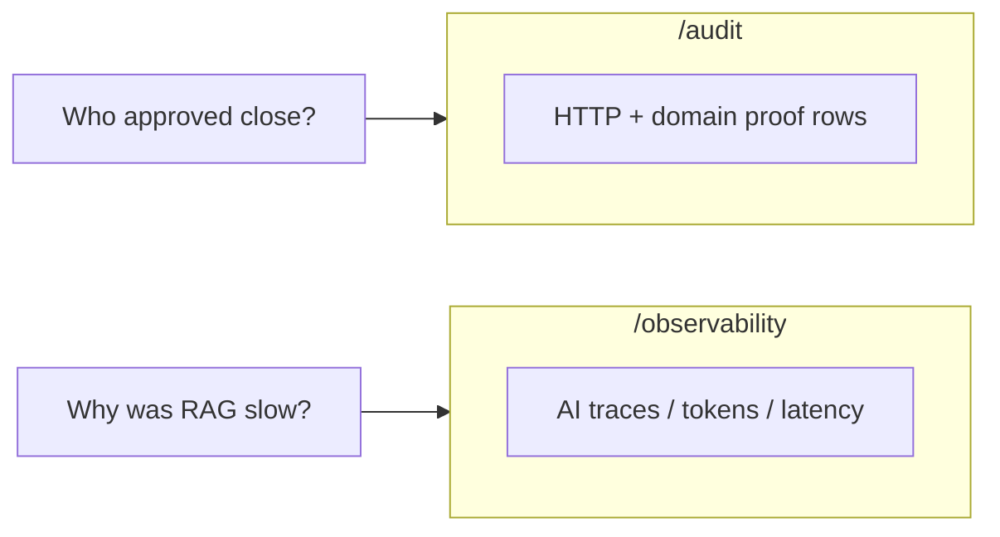
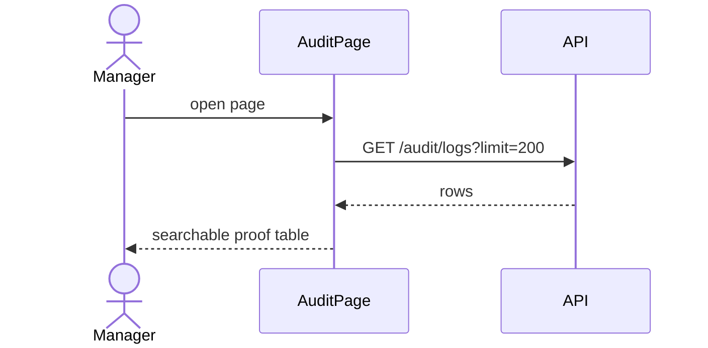
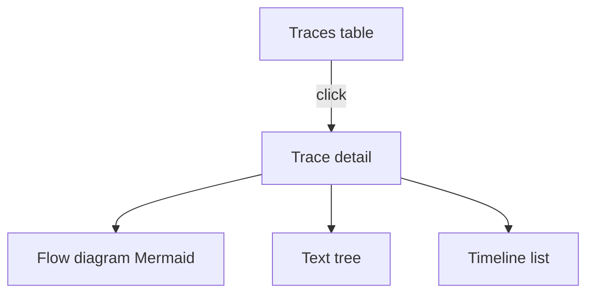
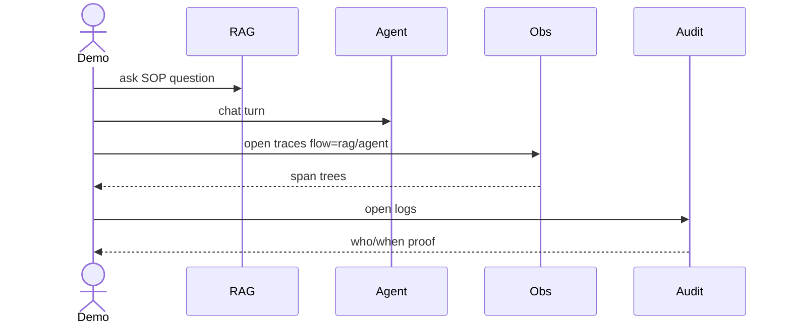

# 05 — Monitoring UI (Audit + Observability)

### Proof screens and AI CCTV screens — with INPUT → OUTPUT

---

## Quick map

| Section | Learn |
|---|---|
| [1. Two monitoring pages](#1-two-monitoring-pages) | Audit vs Observability |
| [2. Audit page](#2-audit-page) | Who did what |
| [3. Observability page](#3-observability-page) | Traces / spans |
| [4. Trace detail UX](#4-trace-detail-ux) | Diagram, tree, timeline |
| [5. Demo script](#5-demo-script) | Generate then inspect |

---

## 1. Two monitoring pages



| Page | Roles | Backend permission spirit |
|---|---|---|
| `/audit` | admin, reviewer, approver | `audit:view` |
| `/observability` | admin, reviewer | `obs:view` |

Operator sees **neither** in the nav.

---

## 2. Audit page

**File:** `AuditPage.tsx`

### What you see

- Refresh button  
- Table: time, actor+role, method, path, status, details  
- Pagination  

### Load I/O

#### INPUT

Open `/audit` or click Refresh

#### OUTPUT

`GET /audit/logs?limit=200`  
rows rendered newest-first style via table/pagination

### Example rows you can narrate

| What happened earlier | What audit shows |
|---|---|
| Operator created REF | domain/http evidence around `/reports` |
| Reviewer requested close | status-related audit details |
| Approver approved | approve-close path / hitl_approved style details |



### Access denial I/O

#### INPUT

operator types `/audit`

#### OUTPUT

redirect to Dashboard (Protected roles)

---

## 3. Observability page

**File:** `ObservabilityPage.tsx`

### What you see

- Config summary (tracing mode, providers snippet)  
- Token/stat style summary  
- Flow filter: all / rag / agent  
- Traces table  
- Detail panel when a trace is selected  

### Load I/O

#### INPUT

Open `/observability`

#### OUTPUT

1. `GET /observability/config`  
2. `GET /observability/traces?limit=200`  
3. tables/stats populate  

### Filter I/O

#### INPUT

Choose flow = `agent`

#### OUTPUT

`GET /observability/traces?limit=200&flow=agent`  
only agent traces listed

### Select trace I/O

#### INPUT

Click a trace row

#### OUTPUT

`GET /observability/traces/{trace_id}`  
detail card opens with spans tree data



---

## 4. Trace detail UX

### Tab: Flow diagram

Uses `TraceFlowDiagram` (Mermaid).

#### INPUT

span tree JSON from API

#### OUTPUT

visual flowchart of parent/child spans  
HITL-like spans can be styled when name includes hitl/interrupt

### Tab: Text tree

Recursive span tree for reading nested steps.

### Tab: Timeline

Flat list ordered for scanning latency.

### Span focus I/O

#### INPUT

Click a node in diagram/timeline

#### OUTPUT

Corresponding node emphasized/focused in text tree

### What a RAG trace looks like in UI

```text
hybrid_rag_query
├─ query_expansion
├─ hybrid_retrieval
├─ rerank
└─ rag_llm_generation
```

### What an Agent + RAG trace looks like

```text
agent_chat
├─ agent_router
└─ agent_tool_hybrid_rag_query
   └─ hybrid_rag_query
      └─ ...
```

---

## 5. Demo script

### Generate evidence first

1. Ask a RAG question on `/rag`  
2. Send an agent message on `/agent`  
3. Create/update a report on Intake/Dashboard  

### Then inspect

| Step | INPUT | OUTPUT |
|---|---|---|
| 1 | Open Observability | see new rag/agent traces |
| 2 | Open a rag trace | see retrieval/generation spans |
| 3 | Open Audit | see HTTP + domain actions |
| 4 | Approve a close | new audit proof rows |



---

## Concept cards

### Card — empty Observability

If backend `TRACING_MODE=off` or `langfuse`-only, local traces page may look empty.  
Use `custom` or `both` for UI demos.

### Card — Audit is for people accountability

Approvers can see Audit even though they cannot see Observability.

### Card — Monitoring supports the business story

Stakeholders trust the system when they can *see* both proof and AI behavior.

---

## What to read next

[06 End-to-End Frontend Solution](./06_END_TO_END_FRONTEND.md)

---

*Doc 05/6 — Monitoring UI*
