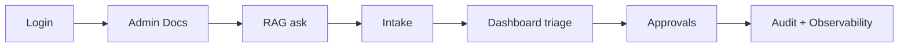
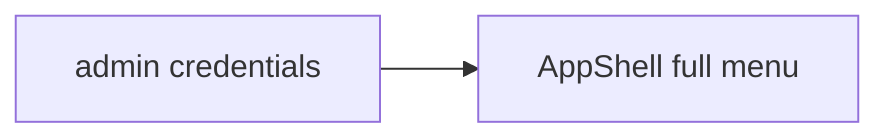
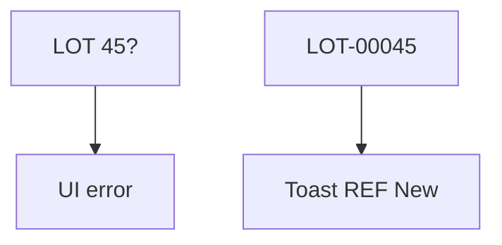
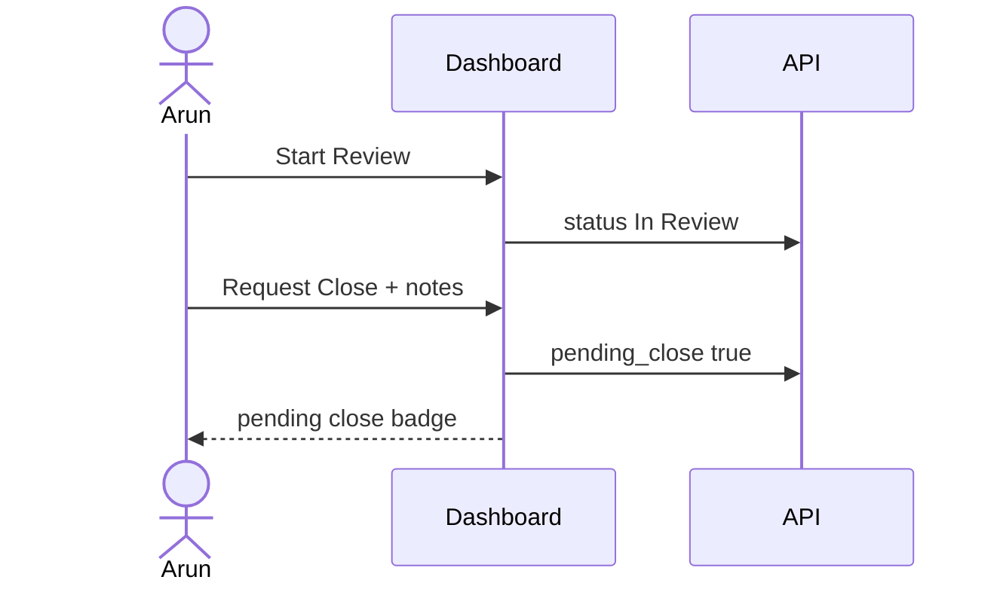
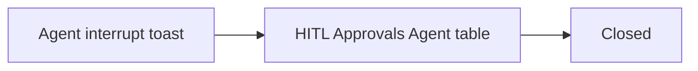
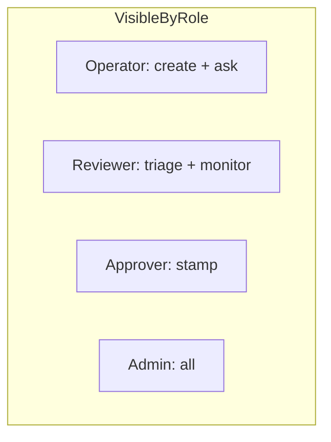

# 06 — End-to-End Frontend Solution

### Full UI day script with visuals + INPUT → OUTPUT at every step

> Backend E2E explains the engines.  
> This file explains the **screens people click** to run the same story.

---

## Quick map

| Section | Learn |
|---|---|
| [1. Frontend E2E meaning](#1-frontend-e2e-meaning) | Desk walkthrough |
| [2. Prep](#2-prep) | Servers + logins |
| [3. Full day Acts 1–10](#3-full-day-acts-1-10) | Click-by-click I/O |
| [4. Agent alternate path](#4-agent-alternate-path) | Chat HITL |
| [5. Role camera angles](#5-role-camera-angles) | What each person sees |
| [6. Failure demos in UI](#6-failure-demos-in-ui) | Teach with errors |
| [7. Final checklist](#7-final-checklist) | Demo done |

---

## 1. Frontend E2E meaning



Same business outcome as backend E2E, told through UI states, toasts, badges, and redirects.

---

## 2. Prep

### INPUT

```bash
# terminal 1
cd backend && uvicorn app.main:app --reload --port 8000

# terminal 2
cd frontend && npm run dev
```

### OUTPUT

- API: `http://127.0.0.1:8000/docs`  
- UI: `http://127.0.0.1:5173`

### Cast

| Person | Login chip | Home after login |
|---|---|---|
| Sana | admin | Dashboard + all menus |
| Maya | operator | Dashboard + Intake/Agent/RAG |
| Arun | reviewer | Dashboard triage + Monitoring/Audit |
| Meera | approver | Dashboard + HITL Approvals + Audit |

---

## 3. Full day Acts 1–10

### Act 1 — Login as Admin

#### INPUT

Open UI → choose **admin** chip → Sign in

#### OUTPUT

- JWT stored in `localStorage`  
- land on Dashboard  
- sidebar shows Docs / Approvals / Monitoring / Audit  



---

### Act 2 — Upload knowledge

#### INPUT

Sidebar **Admin Docs** → choose PDF + strategy → Upload

#### OUTPUT

- toast success  
- table shows `DOC-…` indexed  
- corpus ready for RAG/Agent  

---

### Act 3 — Ask knowledge (still admin, or switch to operator)

#### INPUT

Open **Knowledge / RAG** → ask  
“For Suspected AE, which extra fields are mandatory?”

#### OUTPUT

- assistant answer bubble  
- sources drawer available  
- Observability will later show `flow=rag` trace  

---

### Act 4 — Logout → Login as Operator

#### INPUT

Logout → operator chip → Sign in

#### OUTPUT

- Approvals/Docs/Monitoring/Audit **hidden**  
- Intake visible  

---

### Act 5 — Create Suspected AE (fail then succeed)

#### INPUT #1

Intake form LOT = `45?` → Submit

#### OUTPUT #1

UI validation error (no REF created)

#### INPUT #2

LOT = `LOT-00045` + AE fields filled → Submit

#### OUTPUT #2

- toast with `REF-2026-0001`  
- optional detail modal  
- Dashboard will list status **New**  



---

### Act 6 — Switch to Reviewer Dashboard triage

#### INPUT

Logout → reviewer login → Dashboard filter **New**

#### OUTPUT

See `REF-2026-0001`

#### INPUT

**Start Review** → (optional notes) confirm

#### OUTPUT

Status badge **In Review**

#### INPUT

**Request Close** → enter required notes → confirm

#### OUTPUT

- badge shows **pending close**  
- toast: waiting for approver  
- Approvals queue now has work (for approver)  



---

### Act 7 — Approver HITL

#### INPUT

Logout → approver login → **HITL Approvals**

#### OUTPUT

Pending closes table shows REF with reviewer notes

#### INPUT

Approve (+ optional comment)

#### OUTPUT

- status becomes **Closed**  
- row leaves pending queue  
- Audit can prove the decision  

---

### Act 8 — Verify on Dashboard

#### INPUT

Filter status **Closed** (as any role that can open Dashboard)

#### OUTPUT

REF visible as Closed; detail modal shows approver comment if present

---

### Act 9 — Audit proof

#### INPUT

Login as reviewer/admin/approver → **Audit**

#### OUTPUT

Timeline of HTTP/domain events for create/status/approve

---

### Act 10 — Observability (admin/reviewer)

#### INPUT

Open **Monitoring / Observability** → filter `rag` or `agent`

#### OUTPUT

Trace list + detail tabs (diagram/tree/timeline)

If you asked RAG/Agent earlier, those traces are the demo climax for AI visibility.

---

## 4. Agent alternate path

Replace Acts 6–7 with chat:

### INPUT (reviewer on `/agent`)

1. “Move REF-2026-0001 to In Review”  
2. “Request close for REF-2026-0001. Notes: …”  

### OUTPUT

1. confirmation bubble  
2. `interrupted` toast **Approval needed** + HITL id  

### INPUT (approver on `/approvals`)

Resolve Agent HITL Approve

### OUTPUT

case Closed; agent side resolved



---

## 5. Role camera angles

### Operator camera

Sees: Intake success, Dashboard read-only status, RAG/Agent answers.  
Does not see: triage buttons, approvals, audit/obs.

### Reviewer camera

Sees: triage controls, pending close after request, monitoring/audit.  
Does not see: Approvals final stamp page.

### Approver camera

Sees: Approvals queues, audit.  
Does not see: Intake form, observability.

### Admin camera

Sees everything — best role for a single-person full demo if needed.



---

## 6. Failure demos in UI

| Demo INPUT | UI OUTPUT | Lesson |
|---|---|---|
| Bad LOT on Intake | blocked with message | clean data |
| Approver opens `/intake` | redirect home | separation of duties |
| Operator opens `/approvals` | redirect home | RBAC |
| Request Close with empty notes | modal blocks | notes required |
| Agent close as reviewer | approval needed toast | HITL |
| RAG with no docs uploaded | insufficient evidence | corpus matters |
| Delete doc in Admin Docs | confirm then gone | controlled knowledge |

---

## 7. Final checklist

- [ ] Both servers running  
- [ ] Admin can upload docs  
- [ ] RAG returns grounded answer + sources  
- [ ] Operator can create REF  
- [ ] Reviewer can Start Review + Request Close  
- [ ] Pending close badge appears  
- [ ] Approver can Approve/Reject  
- [ ] Agent interrupt appears in Approvals when used  
- [ ] Audit shows proof  
- [ ] Observability shows traces (tracing enabled)  
- [ ] Wrong-role URLs redirect safely  

If all pass, the **frontend end-to-end solution** is demo-ready.

---

## One-page memory card

| Screen | Best INPUT | Best OUTPUT |
|---|---|---|
| Login | role chip | role menu |
| Admin Docs | upload SOP | DOC indexed |
| RAG | onset question | answer + sources |
| Intake | AE + LOT-00045 | REF New toast |
| Dashboard | Start Review / Request Close | In Review / pending close |
| Approvals | Approve | Closed |
| Agent | close request | HITL toast |
| Audit | refresh | proof rows |
| Observability | open trace | span diagram |

---

## Links

1. [Architecture](./01_ARCHITECTURE.md)  
2. [Pages & roles](./02_PAGES_AND_ROLES.md)  
3. [Intake & workflow](./03_INTAKE_AND_WORKFLOW.md)  
4. [RAG & Agent UI](./04_RAG_AND_AGENT_UI.md)  
5. [Monitoring UI](./05_MONITORING_UI.md)  
6. Backend E2E: [`../backend/06_END_TO_END_BACKEND.md`](../backend/06_END_TO_END_BACKEND.md)  
7. Business story: [`../BUSINESS_PROBLEM_AND_SOLUTION.md`](../BUSINESS_PROBLEM_AND_SOLUTION.md)

---

## Closing line

The frontend turns the backend rulebook into a human desk:

**clear menus by role → guided intake → visible triage → HITL approvals → evidence drawers for knowledge and monitoring.**

That is the end-to-end frontend solution.

---

*Doc 06/6 — End-to-end frontend*
