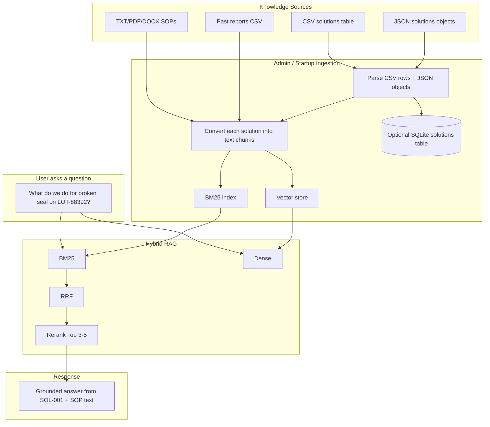
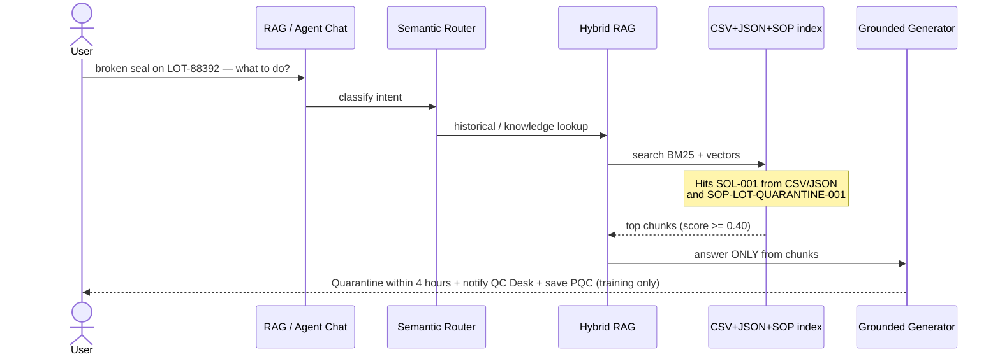
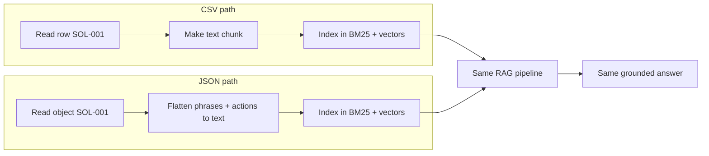
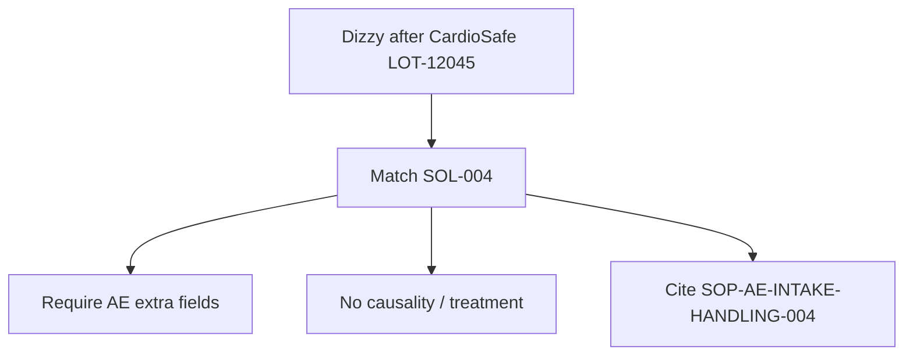
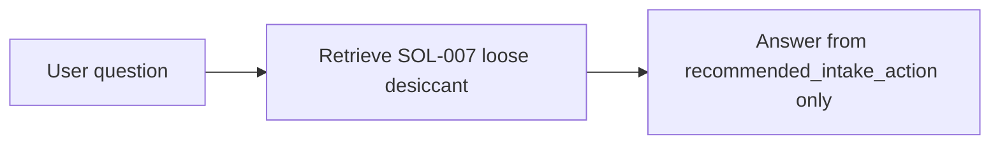
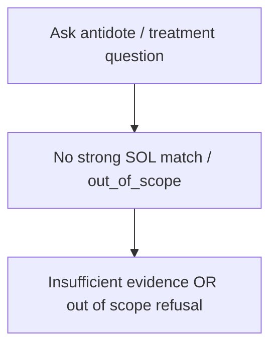

# When Product Issue Solutions Are in CSV / JSON — How It Looks

> Plain answer: those files become part of the **knowledge base**.  
> When a user asks about a product issue, the app **retrieves the matching solution row/object**, then answers from that evidence (plus related SOPs if needed).

---

## 1. What these files are

You already have reports in CSV.  
Now you also have **solution knowledge**:

| File | Role |
|---|---|
| `csv/fictional_product_issue_solutions.csv` | Flat table: issue → recommended intake action |
| `json/fictional_product_issue_solutions.json` | Same knowledge, richer nested structure (phrases, related docs, out-of-scope) |

They are **not medical treatment plans**.  
They are **training “what intake staff should do next”** steps (quarantine, validate fields, HITL, etc.).

---

## 2. Example: one issue in both formats

### In CSV (one row)

| Field | Example value |
|---|---|
| solution_id | `SOL-001` |
| product_name | NeuroCalm 50mg |
| batch_lot_number | LOT-88392 |
| issue_keyword | broken seal |
| issue_summary | Bottle seal broken or cap-ring dented on arrival |
| recommended_intake_action | Save PQC; quarantine within 4 hours; notify Quality Desk... |
| related_sop_id | SOP-LOT-QUARANTINE-001 |

### In JSON (same idea, nested)

```json
{
  "solution_id": "SOL-001",
  "product_name": "NeuroCalm 50mg",
  "batch_lot_number": "LOT-88392",
  "issue": {
    "keyword": "broken seal",
    "summary": "Bottle seal broken or cap-ring dented on arrival",
    "example_user_phrases": ["seal was broken", "cap ring dented"]
  },
  "recommended_intake_action": [
    "Save Product Quality Complaint with REF-YYYY-XXXX",
    "Quarantine lot within 4 business hours",
    "Notify qc-desk@novacure.example"
  ],
  "related_documents": ["SOP-LOT-QUARANTINE-001"],
  "out_of_scope": ["causality assessment", "treatment recommendation"]
}
```

**Same meaning.** CSV is easy for tables/import. JSON is better for nested lists and phrases.

---

## 3. How the architecture looks when CSV/JSON solutions exist



---

## 4. End-to-end scenario (with real example values)

### User question
> “NeuroCalm LOT-88392 seal is broken. What should intake do?”

### Step-by-step what happens



### Example retrieved evidence (what RAG “sees”)

**From CSV/JSON solution SOL-001**
```text
Issue: broken seal for NeuroCalm 50mg LOT-88392
Action: Save PQC, quarantine lot within 4 business hours,
notify qc-desk@novacure.example, no medical advice
Related SOP: SOP-LOT-QUARANTINE-001
```

**From SOP text**
```text
Quarantine the implicated fictional lot within 4 business hours.
```

### Example final answer shown to user

```text
For this training knowledge base match (SOL-001 / LOT-88392 broken seal):
1. Create a Product Quality Complaint and keep the REF ID.
2. Quarantine the implicated lot within 4 business hours.
3. Notify qc-desk@novacure.example.
4. Do not add medical advice or causality conclusions.

Sources: SOL-001 (solutions CSV/JSON), SOP-LOT-QUARANTINE-001
```

---

## 5. Side-by-side: CSV vs JSON in the app



| | CSV | JSON |
|---|---|---|
| Easy to open in Excel | Yes | No |
| Nested lists / phrases | Awkward | Natural |
| Good for SQL import | Excellent | Good (after flatten) |
| Good for RAG phrases | Medium | Excellent (`example_user_phrases`) |
| Used by Hybrid RAG? | Yes, after converted to text chunks | Yes, after flattened to text chunks |

---

## 6. Another example: AE issue from JSON

### User asks
> “Someone felt dizzy after CardioSafe LOT-12045. What fields do I need?”

### Matched solution
`SOL-004` in JSON/CSV

### Answer style

```text
Training match SOL-004:
- Use report type: Suspected Adverse Event
- Fill core fields + event description + event onset date
- Status starts as New
- This app must NOT assess causality or recommend treatment

Sources: SOL-004, SOP-AE-INTAKE-HANDLING-004
```



---

## 7. What if solution is only in CSV/JSON (no SOP uploaded)?

Still works — RAG can answer from the solution chunk alone.



If both solution + SOP exist, answer is stronger (solution steps + official training SOP wording).

---

## 8. What if no CSV/JSON solution matches?



Example:
```text
No grounded intake-solution record found for treatment/antidote guidance.
This training app does not provide medical treatment advice.
```

---

## 9. How this looks inside your project folders

```text
sample_data/
  csv/
    fictional_intake_reports.csv          ← past cases
    fictional_product_issue_solutions.csv ← issue → action table
  json/
    fictional_product_issue_solutions.json ← richer same knowledge
  txt/ pdf/ docx/                           ← SOP documents
```

**In the running app:**
1. Startup or Admin page loads CSV + JSON solutions  
2. Each solution becomes searchable text  
3. User question → Hybrid RAG → returns SOL-xxx (+ SOP if related)  
4. UI shows answer + source IDs  

---

## 10. Tiny mental model

| Question type | Where answer comes from |
|---|---|
| “What do I do for broken seal LOT-88392?” | **Solutions CSV/JSON** (+ quarantine SOP) |
| “What fields are mandatory for AE?” | **Solutions CSV/JSON** (+ mandatory-fields SOP) |
| “Show past cases for LOT-88392” | **Reports CSV** / SQLite reports |
| “Close this case” | **Workflow + HITL**, not solutions file |

---

**Bottom line:**  
If product-issue solutions live in `.csv` / `.json`, they look like structured “issue → next intake action” records. The app ingests them like documents, retrieves the matching `SOL-xxx`, and returns a grounded response — it does **not** invent a clinical fix.
